## 1.概述

海光HCT密码技术除了提供基于CCP密码协处理器和指令集的密码运算加速外，还提供了符合国密认证要求的TKM密钥管理功能。TKM实现了完整的密钥生命周期管理，包括密钥生成、存储、使用、导入导出、备份恢复、销毁等操作。通过TKM用户可以安全的管理并使用密钥，实现对密钥的“可用不可见”。

本文档对TKM常用的应用场景进行说明，通过该文档用户可以对TKM常用的使用场景有个基本的了解，使用场景全部通过管理工具hag来完成，使用该文档对hag以及其他环境要求如下表：

**表1** **TKM功能测试配置要求**

| 配置          | 要求                  | 备注 |
|--------------|-----------------------|-----|
| CPU          | Hygon C86-3G及以上             |      |
| BIOS         | 	基础PI为2.1.0.4，部分新特性需要更高版本的PI | [安全固件动态升级方法](<../../07. 工具/01. 海光安全工具/03. 安全固件动态升级.md>)) |
| hag          | 基础版本为1837，部分新特性需要更高版本的PI             | [安全固件动态升级方法](<../../07. 工具/01. 海光安全工具/03. 安全固件动态升级.md>))，文档中提供安装下载安装方法，默认安装路径`/opt/hygon/bin/hag`|
| glibc | 2.17或以上 |  |

注：此文档后续验证过程依赖**HCT-3.x**，若使用**HCT-2.x**，请参考[密钥管理功能测试](https://openanolis.cn/sig/Hygon-Arch/doc/865622271175038798)进行验证。

## 2.版本基本说明

### 2.1  安全固件不同版本的功能支持情况

| **版本号** | **支持的功能**                 |
|------------|--------------------------------|
| 1881       | 基本功能                       |
| 2070       | 支持虚拟化密钥隔离             |
| 2131       | 支持海光CSV虚拟机中使用TKM |
| 2210       | 性能优化     |
| 2309       | 支持GM/T 0018-2023             |
| 2366       | HCT热迁移支持                  |
| 2726       | 支持同厂商CPU间（含跨代）备份恢复密钥镜像 |

### 2.2 安全固件版本的检查方式

安全固件版本的检查方式，可以通过hag命令进行检查：

```
$ sudo hag general check
```

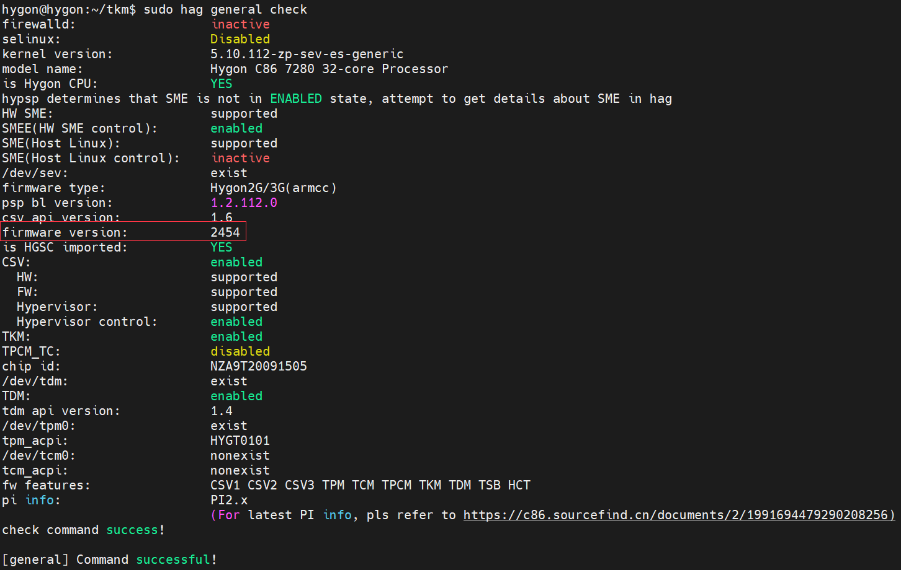

图中输出的firmware\_version字段表示安全固件的版本。而hag工具的版本检查方式为：

```
$ sudo hag general version
```

输出的Version字段表示hag工具的版本

### 2.3 通用安全证书导入说明

- 检查机器是否已导入支持使用TKM的通用证书，可以通过hag命令进行检查：

```
$ sudo hag general check
```

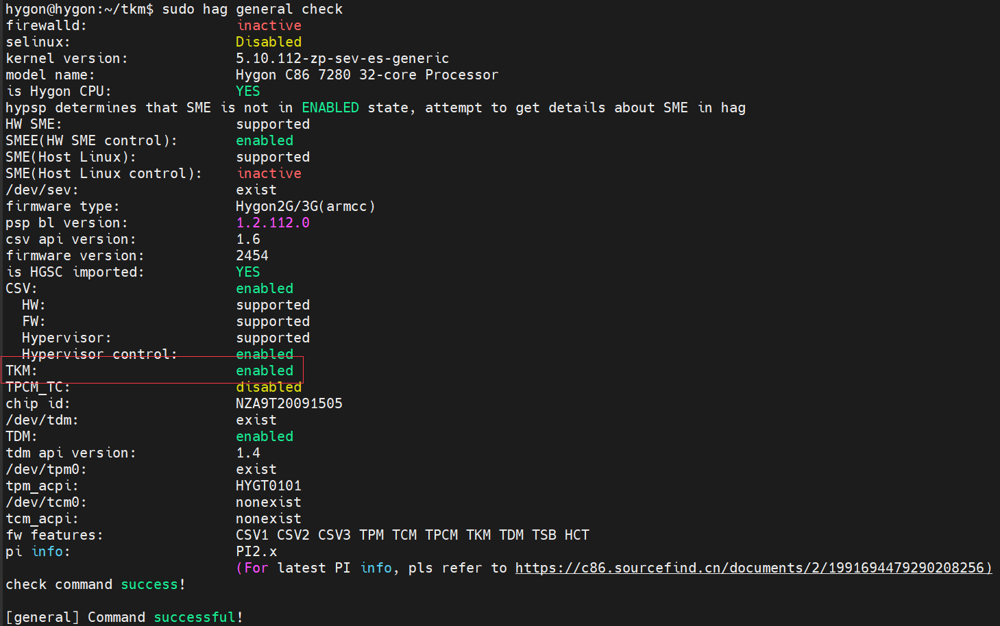

图中输出的TKM字段为enabled时表示已通过通用证书使能TKM。

- 若TKM已使能，跳过这步，否则请参考文档[通用安全功能使能方法](<../../07. 工具/01. 海光安全工具/02. 导入通用安全证书.md>))使能TKM，TKM功能在通用安全证书导入成功后才能使用。

- 通用证书导入成功后，除重刷BIOS操作外，无需再次导入证书。

### 2.4 Hag TKM命令查看

执行如下命令获取TKM支持的命令：

```
$ sudo hag tkm help
```

命令正确执行的结果如下图，TKM支持的命令分类显示。主要分为以下几项：设备管理命令、密钥管理命令、非对称操作命令、对称操作命令、哈希算法命令、其他命令。

图 1 获取Hag tkm支持的命令信息

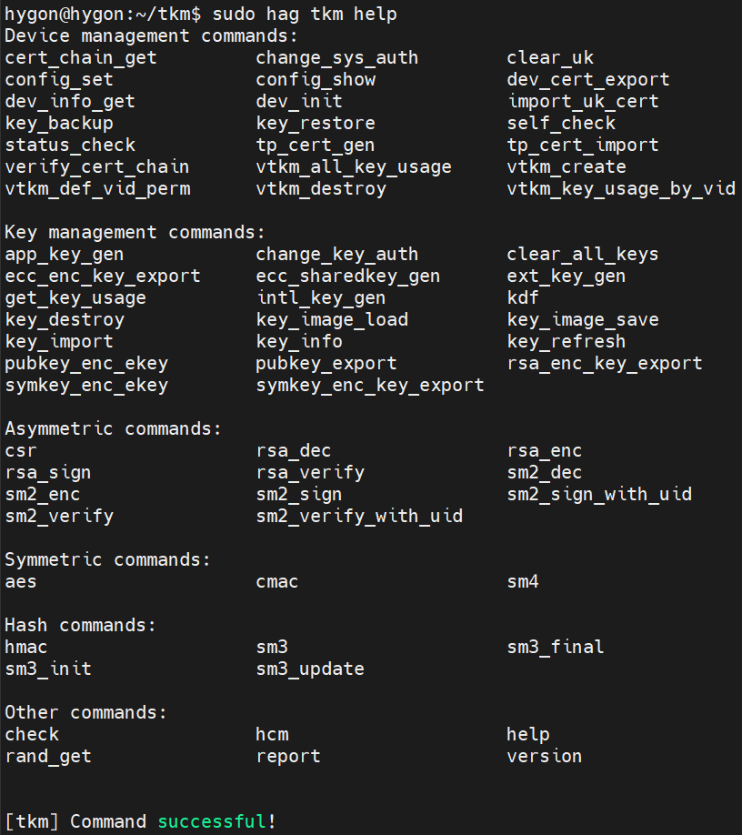

如需使用其中的单个命令，可以通过--help参数查看命令使用方法，如查看sm2\_sign命令使用方法：

```
$ sudo hag tkm sm2_sign --help
```

## 3.TKM典型应用场景说明与验证

**各场景说明均使用hag工具来进行演示，应用密钥应用场景说明中，由于应用密钥由固件内部分配，因此每次操作分配的句柄可能不同，实际操作时请以实际返回句柄为准。**

### 3.1.初始化

公共使用部分数据初始配置：

```
$ echo 0123456789abcdeffedcba9876543210 | xxd -r -ps > iv.data
$ sudo hag tkm rand_get -len 32 -out data32.plain
$ sudo hag tkm rand_get -len 64 -out data64.plain
```

命令正确执行的结果如下图：

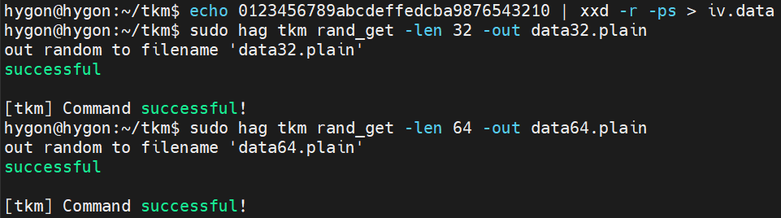

### 3.2.外部密钥派发到TKM设备场景

**场景说明：**

用户在使用中有将自己密钥明文派发到TKM设备内部密钥槽位的需求，派发后密钥掉电不丢失，这里对该应用场景进行示例说明，基本过程如下图所示，首先通过TKM接口在TKM内部生成一对非对称密钥对作为父密钥对，接着用户准备好将要派发的密钥明文，调用TKM接口导出父密钥对公钥，用户使用该公钥对将要派发的密钥明文进行加密得到密钥密文，调用TKM导入接口导入密钥密文并指定使用父密钥对的私钥解密装载，装载成功后该密钥被装入TKM设备密钥槽位并返回对应密钥索引信息，用户可以通过该索引来完成需要的基于TKM设备的密码运算

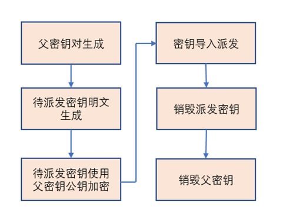

**操作过程说明：**

（1）在TKM设备产生sm2加密内部密钥作为父密钥，用户生成需要派发的密钥明文文件，这里派发一个sm4密钥，使用父密钥对应公钥在用户侧进行加密，之后调用TKM导入接口将sm4密钥密文派发到TKM设备，指定使用对应的父密钥私钥进行解密，装载槽位根据idx参数指定，这里为11号槽位。

```
$ sudo hag tkm intl_key_gen -type sm2enc -idx 10 -password 87654321
$ sudo hag tkm rand_get -len 16 -out intlkey16.plain
$ sudo hag tkm pubkey_enc_ekey -type sm4 -ptype sm2enc -pidx 10 -in intlkey16.plain -out kek_enc_key.bin
$ sudo hag tkm key_import -ptype sm2enc -pidx 10 -password1 87654321 -key kek_enc_key.bin -idx 11 -password2 12345678
```

命令正确执行的结果如下图：

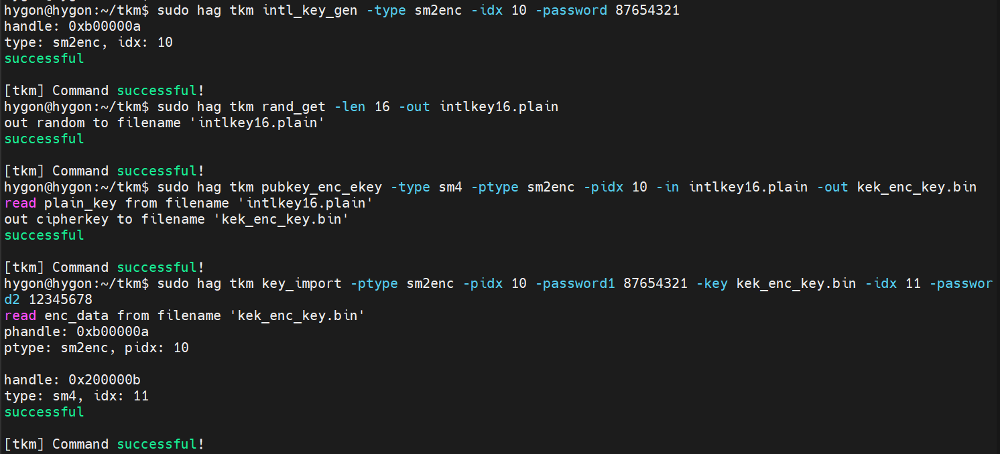

（2）派发完成，清理操作环境，销毁派发的密钥以及父密钥

```
$ sudo rm -rf kek_enc_key.bin intlkey16.plain
$ sudo hag tkm key_destroy -type sm4 -idx 11 -password 12345678
$ sudo hag tkm key_destroy -type sm2enc -idx 10 -password 87654321
```

命令正确执行的结果如下图：

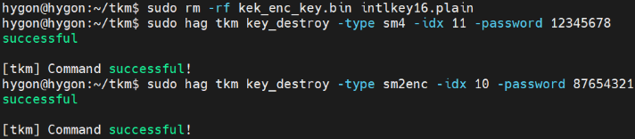

### 3.3.TKM密钥迁移到另一台TKM设备场景

用户在使用TKM设备中，有将一台设备密钥迁移到另一台设备的需求，这里共提供三种迁移场景供用户参考。（只有具有导出属性的密钥才支持导出迁移，未配置该属性则密钥不允许导出）

#### 3.3.1 迁移场景一：sm2公钥加密导出，私钥解密导入迁移

**场景说明：**

该场景使用了非对称密钥的公私钥特性来实现，需要导出密钥的机器这里称为S，需要导入装载密钥的机器这里称为D，用户通过在机器D产生一对sm2密钥对，导出其公钥在机器S调用TKM的ecc公钥加密密钥导出接口，即可将机器S的目标句柄对应的密钥加密导出，之后用户在机器D调用TKM导入装载接口导入密钥密文并指定sm2私钥解密，即可将机器S的密钥迁移到机器D，如下图所示为一个基本的过程。这里在密钥迁移成功后做了一个简单的测试来验证密钥被成功迁移，即指定机器S原密钥加密一段数据，使用机器D迁移后的密钥解密，通过对比明文与解密后的明文是否一致即可进一步验证密钥迁移的正确性。

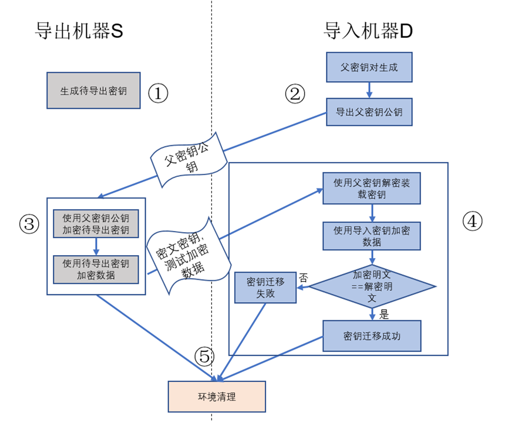

**操作过程说明：**

（1）在机器S端生成待导出密钥，该密钥需要配置exportable属性，否则无法被加密导出接口导出；

```
$ sudo hag tkm intl_key_gen -type sm4 -idx 10 -password 87654321 -attr exportable
```

命令正确执行的结果如下图：

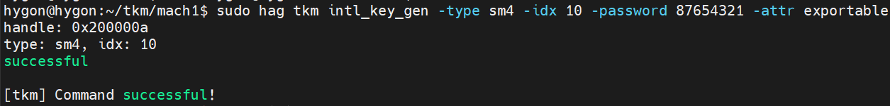

（2）在机器D端生成一对sm2父密钥，记录密钥返回索引，并导出其公钥，将公钥传递到机器S；

```
$ sudo hag tkm intl_key_gen -type sm2enc -idx 10 -password 87654321
$ sudo hag tkm pubkey_export -type sm2enc -idx 10 -out sm2_pubkey.bin
```

命令正确执行的结果如下图：

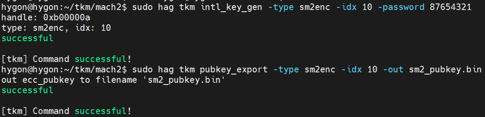

（3）机器S使用从机器D收到的公钥以及待导出密钥对应索引值调用ecc加密导出接口获取密文密钥，并使用待导出密钥对一段数据明文进行加密，将数据明文以及加密后的数据密文传递到机器D；

```
$ ls -l
$ sudo hag tkm ecc_enc_key_export -pub sm2_pubkey.bin -type sm4 -idx 10 -password 87654321 -out ex_enckey.bin
$ sudo hag tkm sm4 -type sm4 -idx 10 -password 87654321 -iv iv.data -in data64.plain -out enc_data.bin -e -m ecb -p pkcs7
```

命令正确执行的结果如下图：

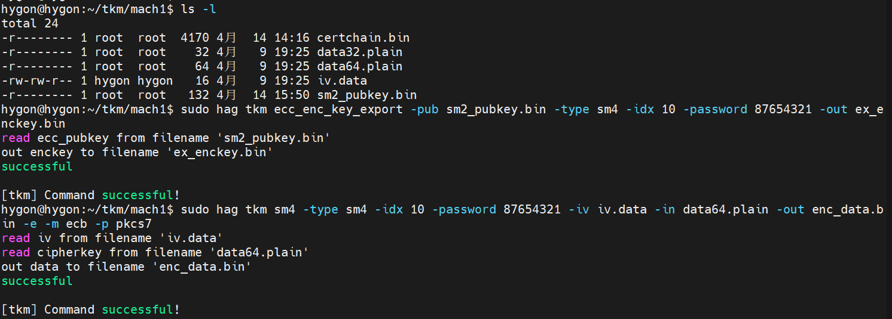

（4）机器D调用密钥导入接口导入从机器S收到的密钥密文并指定其使用sm2父密钥私钥解密装载，记录装载成功后返回的装载密钥索引，密钥迁移成功。使用装载密钥索引解密从机器S收到的数据密文，得到解密明文；将解密明文与数据明文对比，若一致表示迁移正常，否则迁移密钥异常；

```
$ ls -l
$ sudo hag tkm key_import -ptype sm2enc -pidx 10 -password1 87654321 -key ex_enckey.bin -idx 11 -password2 87654321
$ sudo hag tkm sm4 -type sm4 -idx 11 -password 87654321 -iv iv.data -in enc_data.bin -out dec_data.bin -d -m ecb -p pkcs7
$ sudo cmp -b data64.plain dec_data.bin && echo $?
```

命令正确执行的结果如下图：

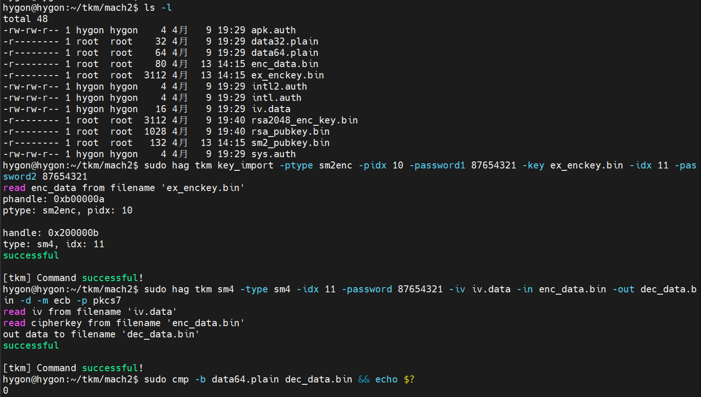

（5）机器S与机器D清理测试环境

机器S清理：

```
$ sudo rm -rf enc_data.bin ex_enckey.bin sm2_pubkey.bin
$ sudo hag tkm key_destroy -type sm4 -idx 10 -password 87654321
```

命令正确执行的结果如下图：

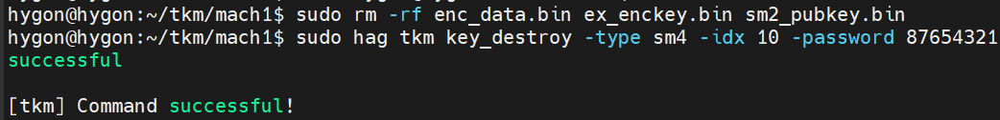

机器D清理：

```
$ sudo rm -rf dec_data.bin enc_data.bin ex_enckey.bin sm2_pubkey.bin
$ sudo hag tkm key_destroy -type sm4 -idx 11 -password 87654321
$ sudo hag tkm key_destroy -type sm2enc -idx 10 -password 87654321
```

命令正确执行的结果如下图：

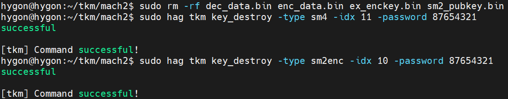

#### 3.3.2 迁移场景二：rsa公钥加密导出，私钥解密导入迁移

**场景说明：**

该场景与迁移场景一基本类似，不同之处为非对称密钥使用应用密钥RSA来实现，需要先在TKM设备产生一个RSA应用密钥，之后过程与场景一基本相同（SM2也可以使用应用密钥来完成密钥迁移，过程与通过RSA过程基本一致，不再赘述）。

**操作过程说明：**

（1）在机器S端生成待导出密钥，该密钥需要配置exportable属性，否则无法被加密导出接口导出；

```
$ sudo hag tkm intl_key_gen -type sm4 -idx 10 -password 87654321 -attr exportable
```

命令正确执行的结果如下图：

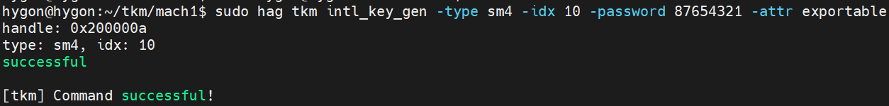

（2）在机器D端生成一对RSA父密钥，记录密钥返回句柄，并导出其公钥，将公钥传递到机器S；

```
$ sudo hag tkm intl_key_gen -type sm4 -idx 11 -password 87654321
$ sudo hag tkm app_key_gen -type rsa2048 -ptype sm4 -pidx 11 -password 87654321 -out rsa2048_enc_key.bin -pad
$ sudo hag tkm key_import -ptype sm4 -pidx 11 -password1 87654321 -key rsa2048_enc_key.bin -password2 12345678 -pad
$ sudo hag tkm pubkey_export -handle 0x90000001 -out rsa_pubkey.bin
```

命令正确执行的结果如下图：

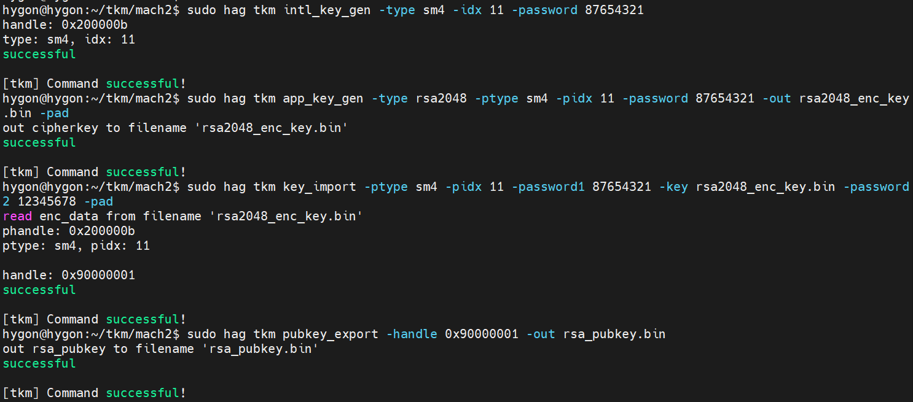

（3）机器S使用从机器D收到的公钥以及待导出密钥对应索引值调用RSA加密导出接口获取密文密钥，并使用待导出密钥对一段数据明文进行加密，将数据明文以及加密后的数据密文传递到机器D；

```
$ ls -l
$ sudo hag tkm rsa_enc_key_export -pub rsa_pubkey.bin -type sm4 -idx 10 -password 87654321 -out ex_enckey.bin
$ sudo hag tkm sm4 -type sm4 -idx 10 -password 87654321 -iv iv.data -in data64.plain -out enc_data.bin -e -m ecb -p pkcs7
```

命令正确执行的结果如下图：

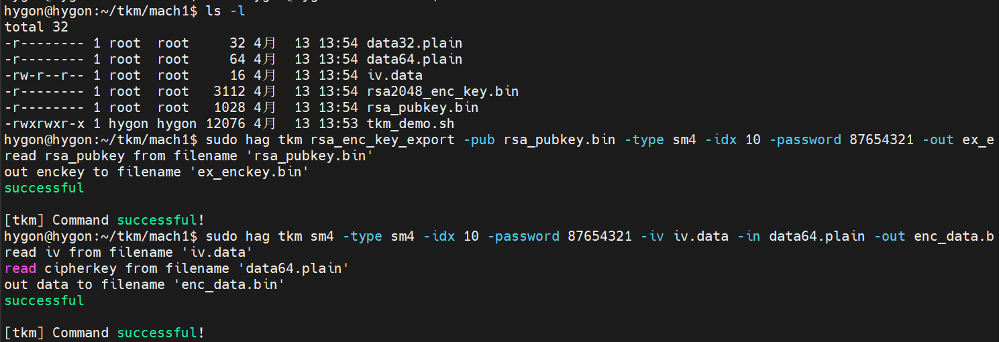

（4）机器D调用密钥导入接口导入从机器S收到的密钥密文并指定其使用RSA父密钥私钥解密装载，记录装载成功后返回的装载密钥索引，密钥迁移成功。使用装载密钥索引解密从机器S收到的数据密文，得到解密明文；将解密明文与数据明文对比，若一致表示迁移正常，否则迁移密钥异常；

```
$ ls -l
$ sudo hag tkm key_import -phandle 0x90000001 -password1 12345678 -key ex_enckey.bin -idx 12 -password2 87654321
$ sudo hag tkm sm4 -type sm4 -idx 12 -password 87654321 -iv iv.data -in enc_data.bin -out dec_data.bin -d -m ecb -p pkcs7
$ sudo cmp -b data64.plain dec_data.bin && echo $?
```

命令正确执行的结果如下图：

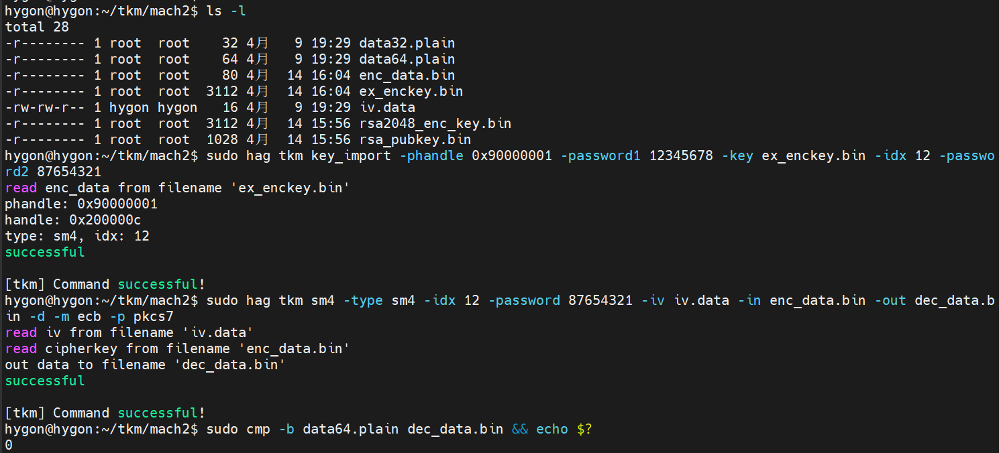

（5）机器S与机器D清理测试环境

机器S清理：

```
$ sudo rm -rf enc_data.bin ex_enckey.bin rsa_pubkey.bin
$ sudo hag tkm key_destroy -type sm4 -idx 10 -password 87654321
```

命令正确执行的结果如下图：

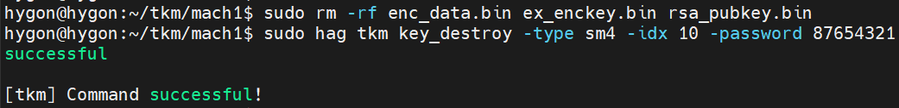

机器D清理：

```
$ sudo rm -rf dec_data.bin enc_data.bin ex_enckey.bin rsa2048_enc_key.bin rsa_pubkey.bin
$ sudo hag tkm key_destroy -handle 0x90000001 -password 12345678
$ sudo hag tkm key_destroy -type sm4 -idx 11 -password 87654321
$ sudo hag tkm key_destroy -type sm4 -idx 12 -password 87654321
```

命令正确执行的结果如下图：

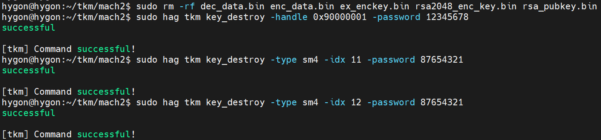

#### 3.3.3 迁移场景三：派发对称密钥加密导出、解密导入迁移

**场景说明：**

该场景根据对称密钥算法特性，首先通过派发过程，保证两台机器中有相同的密钥，之后分别使用相同密钥对应的句柄分别对需要迁移的密钥进行加密导出与解密导入装载，最后通过对装载后的密钥进行基本的加解密测试来验证迁移密钥的正确性，基本过程如下图所示。

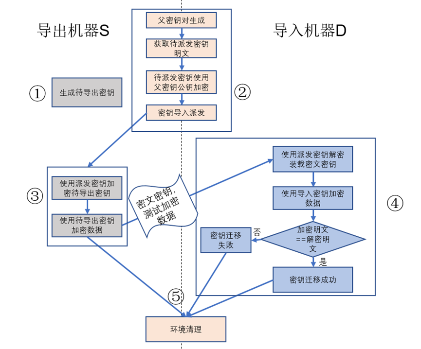

**操作过程说明：**

（1）在机器S端生成待导出密钥，该密钥需要配置exportable属性，否则无法被加密导出接口导出；

```
$ sudo hag tkm intl_key_gen -type sm4 -idx 10 -password 87654321 -attr exportable
```

命令正确执行的结果如下图：

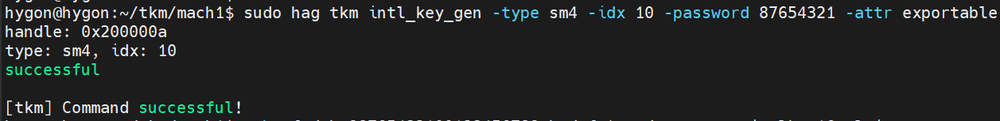

（2）分别在机器S与机器D端派发相同的密钥到设备内部；

机器S派发密钥：

```
$ echo fedcba98765432100123456789abcdef | xxd -r -ps > intlkey16.plain
$ sudo hag tkm intl_key_gen -type sm2enc -idx 10 -password 87654321
$ sudo hag tkm pubkey_enc_ekey -type sm4 -ptype sm2enc -pidx 10 -in intlkey16.plain -out kek_enc_key.bin
$ sudo hag tkm key_import -ptype sm2enc -pidx 10 -password1 87654321 -key kek_enc_key.bin -idx 11 -password2 87654321
```

命令正确执行的结果如下图：

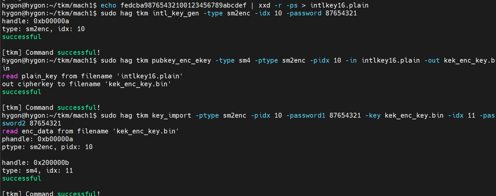

机器D派发密钥：

```
$ echo fedcba98765432100123456789abcdef | xxd -r -ps > intlkey16.plain
$ sudo hag tkm intl_key_gen -type sm2enc -idx 20 -password 87654321
$ sudo hag tkm pubkey_enc_ekey -type sm4 -ptype sm2enc -pidx 20 -in intlkey16.plain -out kek_enc_key.bin
$ sudo hag tkm key_import -ptype sm2enc -pidx 20 -password1 87654321 -key kek_enc_key.bin -idx 20 -password2 87654321
```

命令正确执行的结果如下图：

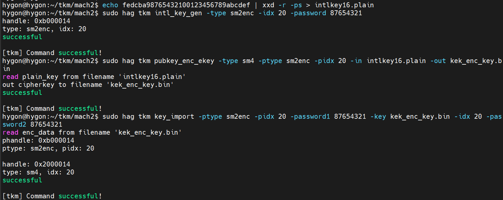

（3）机器S指定使用派发密钥调用对称加密导出接口获得密文密钥，并使用待导出密钥对一段数据明文进行加密，将密文密钥、数据明文以及加密后的数据密文传递到机器D；

```
$ sudo hag tkm symkey_enc_key_export -ptype sm4 -pidx 11 -password1 87654321 -type sm4 -idx 10 -password2 87654321 -out ex_enckey.bin
$ sudo hag tkm sm4 -type sm4 -idx 10 -password 87654321 -iv iv.data -in data64.plain -out enc_data.bin -e -m ecb -p pkcs7
```

命令正确执行的结果如下图：

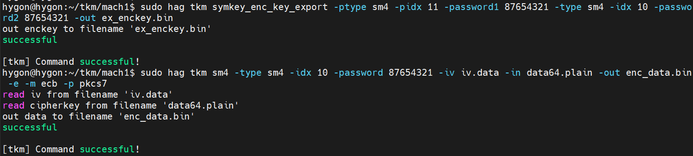

（4）机器D调用密钥导入接口导入从机器S收到的密钥密文并指定其使用派发密钥解密装载，记录装载成功后返回的装载密钥索引，密钥迁移成功。使用装载密钥索引解密从机器S收到的数据密文，得到解密明文；将解密明文与数据明文对比，若一致表示迁移正常，否则迁移密钥异常；

```
$ ls -l
$ sudo hag tkm key_import -pad -ptype sm4 -pidx 20 -password1 87654321 -key ex_enckey.bin -idx 21 -password2 87654321
$ sudo hag tkm sm4 -type sm4 -idx 21 -password 87654321 -iv iv.data -in enc_data.bin -out dec_data.bin -d -m ecb -p pkcs7
$ sudo cmp -b data64.plain dec_data.bin && echo $?
```

命令正确执行的结果如下图：

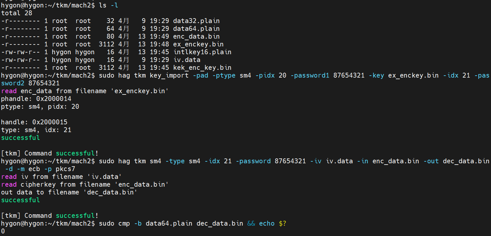

（5）机器S与机器D清理测试环境。

机器S清理：

```
$ sudo rm -rf enc_data.bin ex_enckey.bin intlkey16.plain kek_enc_key.bin
$ sudo hag tkm key_destroy -type sm4 -idx 10 -password 87654321
$ sudo hag tkm key_destroy -type sm4 -idx 11 -password 87654321
$ sudo hag tkm key_destroy -type sm2enc -idx 10 -password 87654321
```

命令正确执行的结果如下图：

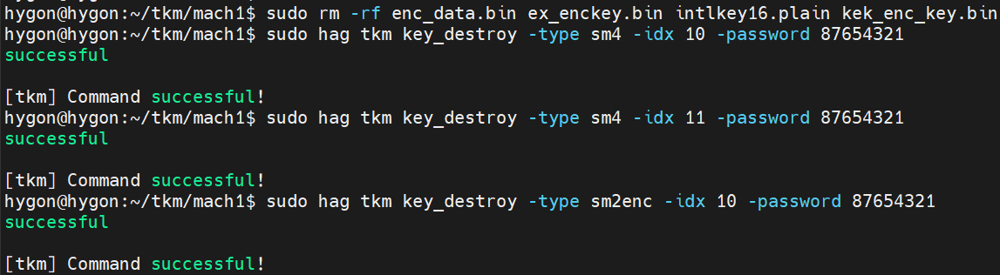

机器D清理：

```
$ sudo rm -rf dec_data.bin enc_data.bin ex_enckey.bin intlkey16.plain kek_enc_key.bin
$ sudo hag tkm key_destroy -type sm4 -idx 20 -password 87654321
$ sudo hag tkm key_destroy -type sm4 -idx 21 -password 87654321
$ sudo hag tkm key_destroy -type sm2enc -idx 20 -password 87654321
```

命令正确执行的结果如下图：

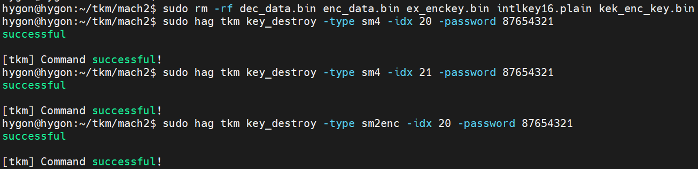

### 3.4.sm4应用密钥加解密场景

**场景说明：**

sm4应用密钥加解密逻辑如下图所示，首先调用TKM接口生成一个内部对称密钥作为父密钥，然后调用TKM密钥生成加密导出接口生成并导出应用密钥，应用密钥指定使用父密钥加密，密钥类型根据需要设置，导出的密文应用密钥用户可以自行存储，在需要使用时，调用TKM导入接口导入装载密文应用密钥到TKM设备，导入成功后TKM设备返回应用密钥句柄，用户通过该句柄即可调用TKM加解密接口完成加解密数据操作。

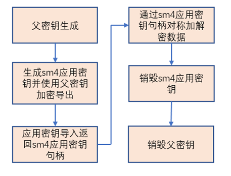

**操作过程说明：**

（1）基于内部密钥产生并装载应用密钥获得sm4应用密钥句柄

```
$ sudo hag tkm intl_key_gen -type sm4 -idx 10 -password 87654321
$ sudo hag tkm app_key_gen -type sm4 -ptype sm4 -pidx 10 -password 87654321 -out sm4_enc_key.bin
$ sudo hag tkm key_import -ptype sm4 -pidx 10 -password1 87654321 -key sm4_enc_key.bin -password2 12345678
```

命令正确执行的结果如下图：

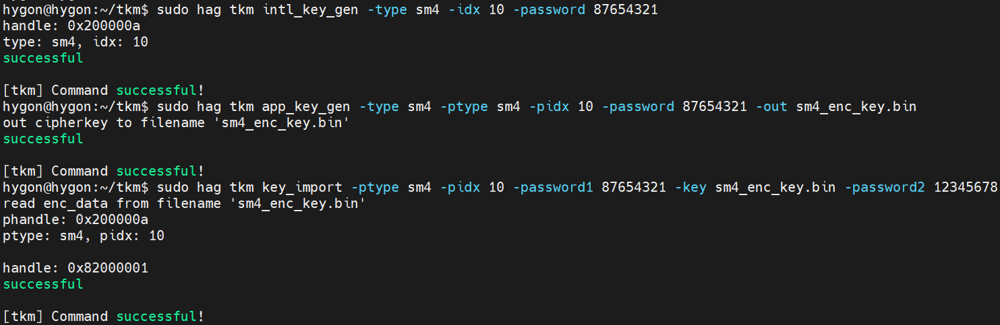

（2）传入sm4应用密钥句柄使用其对应密钥进行对称加解密

```
$ sudo hag tkm sm4 -handle 0x82000001 -password 12345678 -iv iv.data -in data64.plain -out enc_data.bin -e -m cfb
$ sudo hag tkm sm4 -handle 0x82000001 -password 12345678 -iv iv.data -in enc_data.bin -out dec_plain.bin -d -m cfb
$ sudo cmp -b data64.plain dec_plain.bin && echo $?
```

命令正确执行的结果如下图：

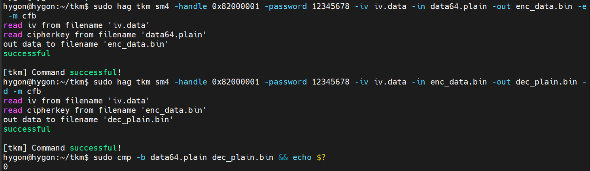

（3）清理测试环境，销毁密钥

```
$ sudo hag tkm key_destroy -handle 0x82000001 -password 12345678
$ sudo rm -rf sm4_enc_key.bin enc_data.bin dec_plain.bin
$ sudo hag tkm key_destroy -type sm4 -idx 10 -password 87654321
```

命令正确执行的结果如下图：

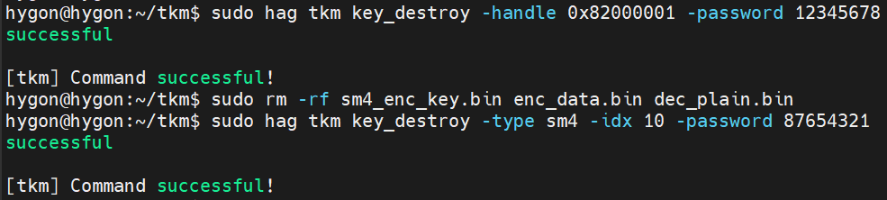

### 3.5.sm2应用密钥签名验签场景

**场景说明：**

sm2应用密钥签名验签逻辑如下图所示，首先调用TKM接口生成一个内部对称密钥作为父密钥，然后调用TKM密钥生成加密导出接口生成并导出应用密钥，应用密钥指定使用父密钥加密，密钥类型根据需要设置，导出的密文应用密钥用户可以自行存储，在需要使用时，调用TKM导入接口导入装载密文应用密钥到TKM设备，导入成功后TKM设备返回应用密钥句柄，用户通过该句柄即可调用TKM接口完成签名验签操作。

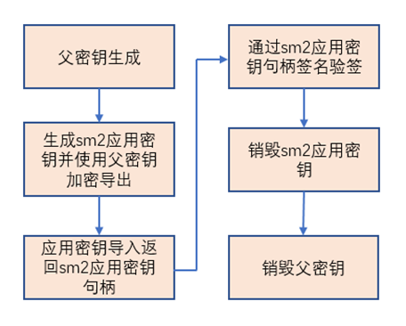

**操作过程说明：**

（1）基于内部密钥产生并装载应用密钥获得sm2应用密钥句柄

```
$ sudo hag tkm intl_key_gen -type sm4 -idx 10 -password 87654321
$ sudo hag tkm app_key_gen -type sm2 -ptype sm4 -pidx 10 -password 87654321 -out sm2_enc_key.bin
$ sudo hag tkm key_import -ptype sm4 -pidx 10 -password1 87654321 -key sm2_enc_key.bin -password2 12345678
```

命令正确执行的结果如下图：

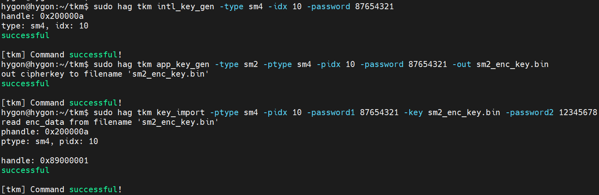

（2）传入sm2应用密钥句柄使用其对应密钥进行签名验签

```
$ sudo hag tkm sm2_sign -handle 0x89000001 -password 12345678 -in data32.plain -out sm2_sign.bin
$ sudo hag tkm pubkey_export -handle 0x89000001 -out sm2_pubkey.bin
$ sudo hag tkm sm2_verify -dgst data32.plain -pub sm2_pubkey.bin -sig sm2_sign.bin
```

命令正确执行的结果如下图：

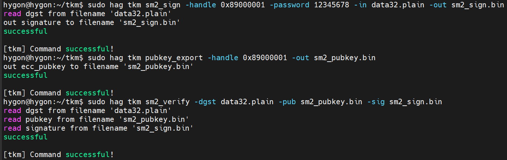

（3）清理测试环境，销毁密钥

```
$ sudo rm -rf sm2_enc_key.bin sm2_sign.bin sm2_pubkey.bin
$ sudo hag tkm key_destroy -handle 0x89000001 -password 12345678
$ sudo hag tkm key_destroy -type sm4 -idx 10 -password 87654321
```

命令正确执行的结果如下图：

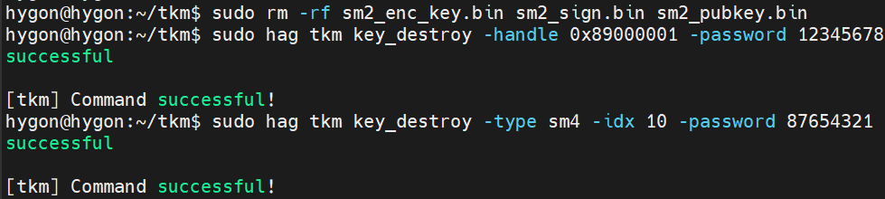

### 3.6.sm2应用密钥加密解密场景

**场景说明：**

sm2应用密钥加解密逻辑如下图所示，首先调用TKM接口生成一个内部对称密钥作为父密钥，然后调用TKM密钥生成加密导出接口生成并导出应用密钥，应用密钥指定使用父密钥加密，密钥类型根据需要设置，导出的密文应用密钥用户可以自行存储，在需要使用时，调用TKM导入接口导入装载密文应用密钥到TKM设备，导入成功后TKM设备返回应用密钥句柄，用户通过该句柄即可调用TKM接口完成加解密操作。

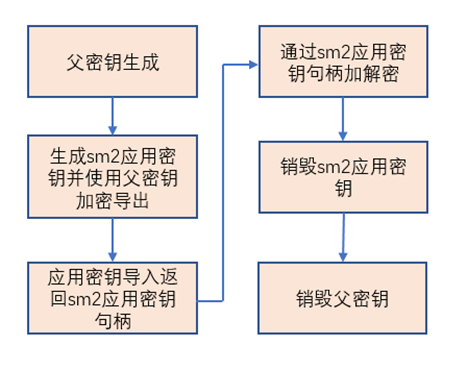

**操作过程说明：**

（1）基于内部密钥产生并装载应用密钥获得sm2应用密钥句柄

```
$ sudo hag tkm intl_key_gen -type sm4 -idx 10 -password 87654321
$ sudo hag tkm app_key_gen -type sm2 -ptype sm4 -pidx 10 -password 87654321 -out sm2_enc_key.bin
$ sudo hag tkm key_import -ptype sm4 -pidx 10 -password1 87654321 -key sm2_enc_key.bin -password2 12345678
```

命令正确执行的结果如下图：

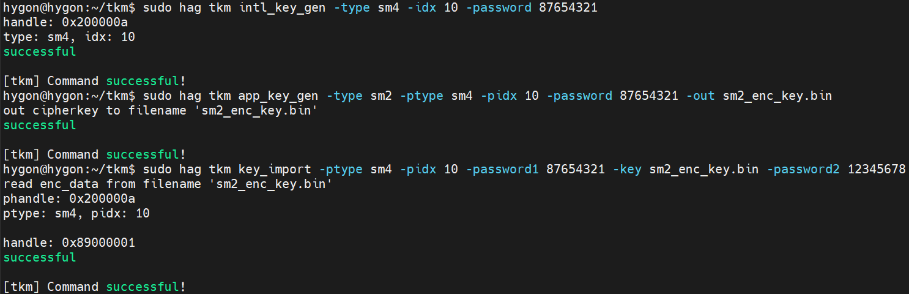

（2）传入sm2应用密钥句柄使用其对应密钥进行加密解密

```
$ sudo hag tkm pubkey_export -handle 0x89000001 -out sm2_pubkey.bin
$ sudo hag tkm sm2_enc -in data32.plain -pub sm2_pubkey.bin -out sm2_enc_data.bin
$ sudo hag tkm sm2_dec -handle 0x89000001 -password 12345678 -in sm2_enc_data.bin -out sm2_dec_data.bin
$ sudo cmp -b data32.plain sm2_dec_data.bin && echo $?
```

命令正确执行的结果如下图：

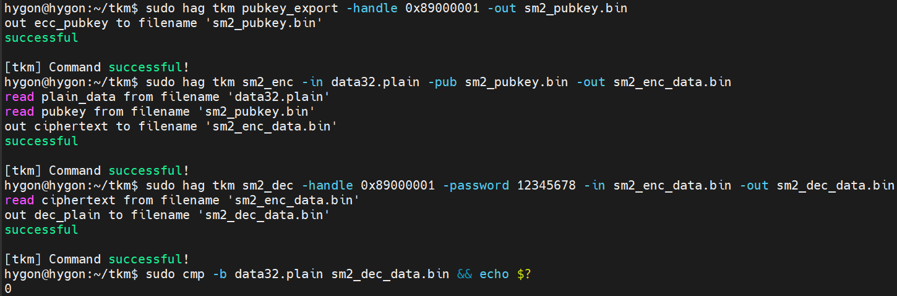

（3）清理测试环境，销毁密钥

```
$ sudo rm -rf sm2_enc_key.bin sm2_sign.bin sm2_pubkey.bin
$ sudo hag tkm key_destroy -handle 0x89000001 -password 12345678
$ sudo hag tkm key_destroy -type sm4 -idx 10 -password 87654321
```

命令正确执行的结果如下图：

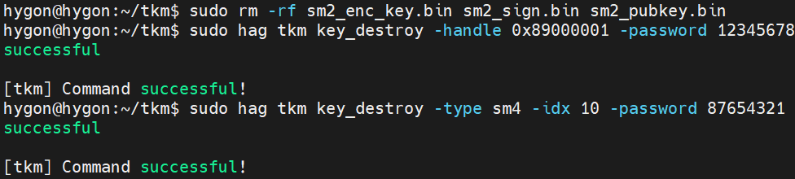

### 3.7.rsa应用密钥签名验签场景

**场景说明：**

rsa应用密钥签名验签逻辑如下图所示，首先调用TKM接口生成一个内部对称密钥作为父密钥，然后调用TKM密钥生成加密导出接口生成并导出应用密钥，应用密钥指定使用父密钥加密，密钥类型根据需要设置，导出的密文应用密钥用户可以自行存储，在需要使用时，调用TKM导入接口导入装载密文应用密钥到TKM设备，导入成功后TKM设备返回应用密钥句柄，用户通过该句柄即可调用TKM接口完成签名验签操作。

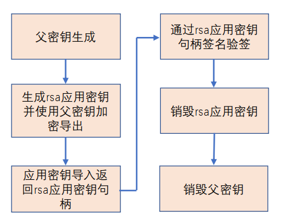

**操作过程说明：**

（1）基于内部密钥产生并装载应用密钥获得rsa应用密钥句柄

```
$ sudo hag tkm intl_key_gen -type sm4 -idx 10 -password 87654321
$ sudo hag tkm app_key_gen -type rsa2048 -ptype sm4 -pidx 10 -password 87654321 -out rsa2048_enc_key.bin -pad
$ sudo hag tkm key_import -ptype sm4 -pidx 10 -password1 87654321 -key rsa2048_enc_key.bin -password2 12345678 -pad
```

命令正确执行的结果如下图：

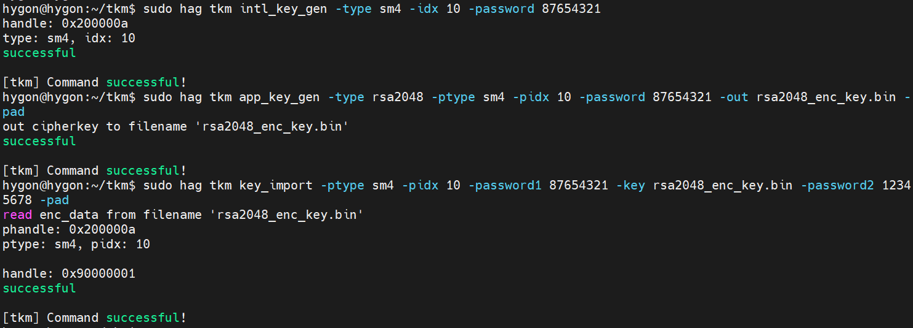

（2）传入rsa应用密钥句柄使用其对应密钥进行签名验签

```
$ sudo hag tkm rsa_sign -handle 0x90000001 -password 12345678 -in data32.plain -out rsa_sign_out.bin -hash sha256
$ sudo hag tkm pubkey_export -handle 0x90000001 -out rsa_pubkey.bin
$ sudo hag tkm rsa_verify -in data32.plain -pub rsa_pubkey.bin -sig rsa_sign_out.bin -hash sha256
```

命令正确执行的结果如下图：

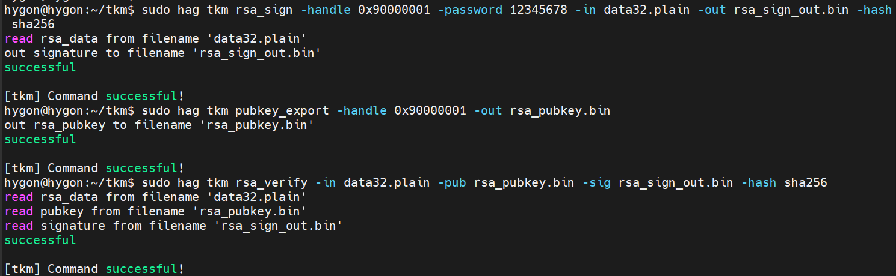

（3）清理测试环境，销毁密钥

```
$ sudo rm -rf rsa2048_enc_key.bin rsa_sign_out.bin rsa_pubkey.bin
$ sudo hag tkm key_destroy -handle 0x90000001 -password 12345678
$ sudo hag tkm key_destroy -type sm4 -idx 10 -password 87654321
```

命令正确执行的结果如下图：

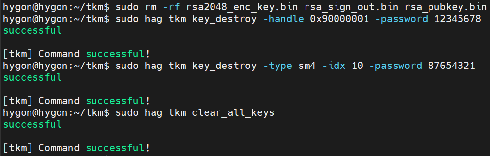

### 3.8.rsa应用密钥加密解密场景

**场景说明：**

rsa应用密钥签名验签逻辑如下图所示，首先调用TKM接口生成一个内部对称密钥作为父密钥，然后调用TKM密钥生成加密导出接口生成并导出应用密钥，应用密钥指定使用父密钥加密，密钥类型根据需要设置，导出的密文应用密钥用户可以自行存储，在需要使用时，调用TKM导入接口导入装载密文应用密钥到TKM设备，导入成功后TKM设备返回应用密钥句柄，用户通过该句柄即可调用TKM接口完成加解密操作。

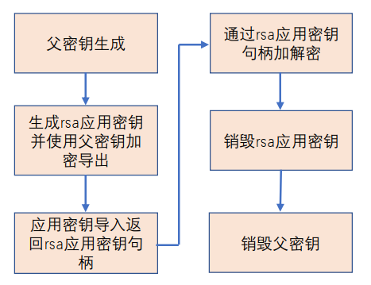

**操作过程说明：**

（1）基于内部密钥产生并装载应用密钥获得rsa应用密钥句柄

```
$ sudo hag tkm intl_key_gen -type sm4 -idx 10 -password 87654321
$ sudo hag tkm app_key_gen -type rsa2048 -ptype sm4 -pidx 10 -password 87654321 -out rsa2048_enc_key.bin -pad
$ sudo hag tkm key_import -ptype sm4 -pidx 10 -password1 87654321 -key rsa2048_enc_key.bin -password2 12345678 -pad
```

命令正确执行的结果如下图：


（2）传入rsa应用密钥句柄使用其对应密钥进行加密解密

```
$ sudo hag tkm pubkey_export -handle 0x90000001 -out rsa_pubkey.bin
$ sudo hag tkm rsa_enc -in data32.plain -pub rsa_pubkey.bin -out rsa_enc_data.bin
$ sudo hag tkm rsa_dec -handle 0x90000001 -password 12345678 -in rsa_enc_data.bin -out rsa_dec_data.bin
$ sudo cmp -b data32.plain rsa_dec_data.bin && echo $?
```

命令正确执行的结果如下图：

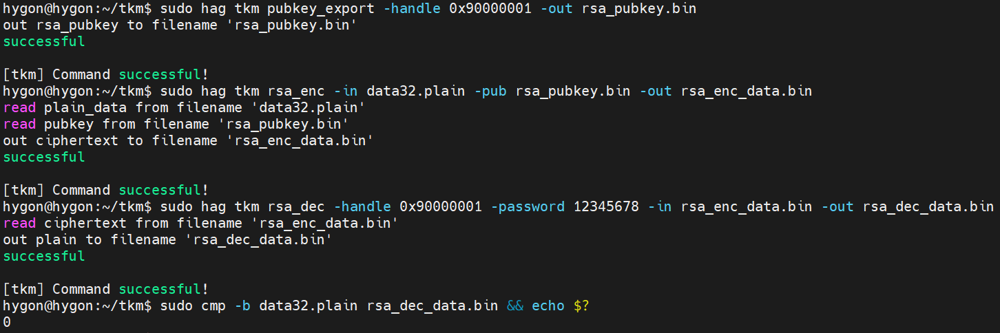

（3）清理测试环境，销毁密钥

```
$ sudo rm -rf rsa2048_enc_key.bin rsa_pubkey.bin rsa_dec_data.bin rsa_enc_data.bin
$ sudo hag tkm key_destroy -handle 0x90000001 -password 12345678
$ sudo hag tkm key_destroy -type sm4 -idx 10 -password 87654321
```

命令正确执行的结果如下图：

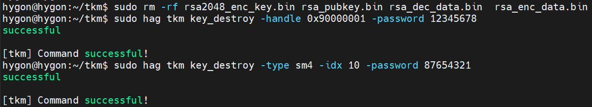

### 3.9.密钥协商应用场景验证（hag与固件build\_id为1828及以上版本支持）

**场景说明：**

用户在使用TKM设备中，有基于两台机器的密钥协商需求。该场景使用了sm2的密钥协商算法来实现密钥协商，角色为requestor的机器这里称为S，角色为responser的机器这里称为D，根据密钥协商算法该场景设计流程如下图所示，首先调用TKM相关分别在机器S与机器D生成密钥协商需要的主密钥与临时密钥，并导出公钥；同时分别确定自己的uid信息，将uid、主密钥公钥、临时密钥公钥在两台机器中进行交换；各机器分别使用自己机器主密钥与临时密钥对应的索引或句柄以及对方的公钥信息、自己uid、对方uid进行密钥协商并生成协商密钥，同时通过检查s1与sa初步确定协商的正确性。

这里在密钥协商成功后做了一个简单的测试来验证被协商的密钥时相同的，即指定机器S协商密钥加密一段数据，使用机器D协商的密钥解密，通过对比明文与解密后的明文是否一致即可进一步验证密钥协商的正确性。

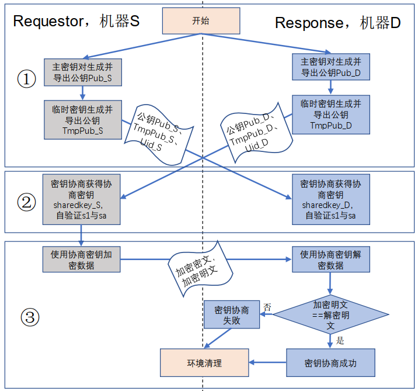

**操作过程说明：**

（1）在机器S端生成主密钥与临时密钥，并导出其公钥；

```
$ sudo hag tkm intl_key_gen -type sm2enc -idx 10 -password 87654321
$ sudo hag tkm intl_key_gen -type sm2enc -idx 11 -password 87654321
$ sudo hag tkm pubkey_export -type sm2enc -idx 10 -out Pkey_S.bin
$ sudo hag tkm pubkey_export -type sm2enc -idx 11 -out TmpPkey_S.bin
```

命令正确执行的结果如下图：

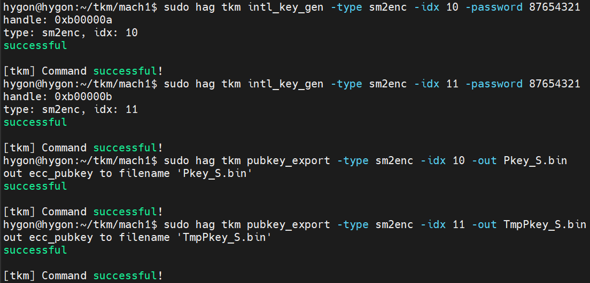

（2）在机器D端生成主密钥与临时密钥，并导出其公钥；

```
$ sudo hag tkm intl_key_gen -type sm2enc -idx 12 -password 87654321
$ sudo hag tkm intl_key_gen -type sm2enc -idx 13 -password 87654321
$ sudo hag tkm pubkey_export -type sm2enc -idx 12 -out Pkey_D.bin
$ sudo hag tkm pubkey_export -type sm2enc -idx 13 -out TmpPkey_D.bin
```

命令正确执行的结果如下图：

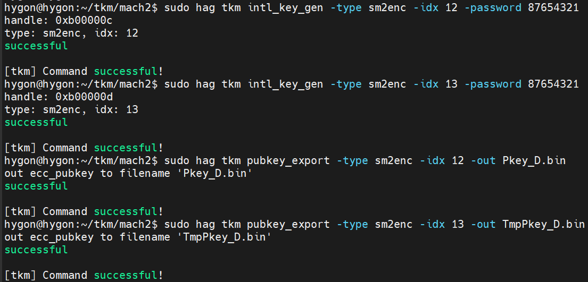

（3）机器S与D交换公钥以及uid后，调用密钥协商命令协商密钥；协商完成后检查s1与sa初步验证协商正确性；并通过协商密钥句柄对一个测试数据进行加密，并将加密明文与密文发送到机器D；

```
$ sudo hag tkm ecc_sharedkey_gen -role requestor -ktype1 sm2enc -kidx1 10 -password1 87654321 -ktype2 sm2enc -kidx2 11 -password2 87654321 -pub1_other Pkey_D.bin -pub2_other TmpPkey_D.bin -type sm4 -password_setting 12345678 -uid_self 1234 -uid_other abcd -attr none -dgst_s1 dgst_s1.bin -dgst_sa dgst_sa.bin
$ sudo cmp -b dgst_s1.bin dgst_sa.bin && echo $?
$ sudo hag tkm sm4 -handle 0x82000001 -password 12345678 -iv iv.data -in data64.plain -out enc_data.bin -e -m cfb
```

命令正确执行的结果如下图：


（4）机器D与S交换公钥以及uid后，调用密钥协商命令协商密钥；协商完成后检查s1与sa初步验证协商正确性；并通过协商密钥句柄对机器D提供的数据密文进行解密，解密后通过验证解密明文与加密明文是否相同从而进一步验证密钥协商的正确性；

```
$ sudo hag tkm ecc_sharedkey_gen -role responser -ktype1 sm2enc -kidx1 12 -password1 87654321 -ktype2 sm2enc -kidx2 13 -password2 87654321 -pub1_other Pkey_S.bin -pub2_other TmpPkey_S.bin -type sm4 -password_setting 12345678 -uid_self abcd -uid_other 1234 -attr none -dgst_s1 dgst_s1.bin -dgst_sa dgst_sa.bin
$ sudo cmp -b dgst_s1.bin dgst_sa.bin && echo $?
$ sudo hag tkm sm4 -handle 0x82000002 -password 12345678 -iv iv.data -in enc_data.bin -out dec_plain.bin -d -m cfb
$ sudo cmp -b data64.plain dec_plain.bin && echo $?
```

命令正确执行的结果如下图：


（5）机器S与机器D清理测试环境；

机器S清理：

```
$ sudo rm -rf dgst_s1.bin dgst_sa.bin Pkey_D.bin Pkey_S.bin TmpPkey_D.bin TmpPkey_S.bin enc_data.bin
$ sudo hag tkm key_destroy -handle 0x82000001 -password 12345678
$ sudo hag tkm key_destroy -type sm2enc -idx 10 -password 87654321
$ sudo hag tkm key_destroy -type sm2enc -idx 11 -password 87654321
```

命令正确执行的结果如下图：


机器D清理：

```
$ sudo rm -rf dgst_s1.bin dgst_sa.bin Pkey_D.bin Pkey_S.bin TmpPkey_D.bin TmpPkey_S.bin enc_data.bin
$ sudo hag tkm key_destroy -handle 0x82000002 -password 12345678
$ sudo hag tkm key_destroy -type sm2enc -idx 12 -password 87654321
$ sudo hag tkm key_destroy -type sm2enc -idx 13 -password 87654321
```

命令正确执行的结果如下图：


### 3.10.内部密钥备份与恢复场景（hag与固件build\_id为1877及以上版本支持）

用户在使用TKM设备中，有将一台设备所有内部密钥备份恢复到另一台设备的需求，这里共提供四种场景供用户参考。

#### 3.10.1 备份恢复场景一：同一CPU备份与恢复

**场景说明：**

该场景通过使用CPU内唯一机密信息派生密钥，由该密钥对内部密钥进行加密及完整性保护，从而支持将设备内所有内部密钥备份，且仅支持在该设备内恢复，其他设备由于CPU内唯一机密信息不同，派生出来的密钥也将不同，因此将无法通过该密钥镜像进行恢复，如下图所示为一个基本的过程。这里在密钥恢复成功后做了一个简单的测试来验证密钥被成功恢复，即指定机器原密钥加密一段数据，使用机器恢复后的密钥解密，通过对比明文与解密后的明文是否一致即可进一步验证密钥备份恢复的正确性。

  

**操作过程说明：**

（1）在机器中生成待备份密钥，这里以类型为sm4索引为10号密钥为例，然后使用该密钥对一段数据明文进行加密；

```
$ sudo hag tkm intl_key_gen -type sm4 -idx 10 -password 87654321
$ sudo hag tkm sm4 -type sm4 -idx 10 -password 87654321 -iv iv.data -in data64.plain -out enc_data.bin -e -m ecb -p pkcs7
```

命令正确执行的结果如下图：


（2）调用密钥备份接口对上一步生成的sm4密钥进行备份，备份成功后，将上一步生成的sm4密钥销毁；（备份时，支持用户通过user\_password参数自定义口令参与密钥的备份过程，此参数为可选项）

a. 不使用自定义口令备份

```
$ sudo hag tkm key_backup -password 12345678 -scheme same_cpu -outfile key_same_cpu.bin
```

命令正确执行的结果如下图：


b. 使用自定义口令备份

```
$ sudo hag tkm key_backup -password 12345678 -scheme same_cpu -user_password 11223344 -outfile key_same_cpu.bin
```

命令正确执行的结果如下图：


以上操作a与操作b视情况选择其一。

c. 销毁密钥

```
$ sudo hag tkm key_destroy -type sm4 -idx 10 -password 87654321
```

命令正确执行的结果如下图：


（3）调用密钥恢复接口对密钥进行恢复，密钥恢复成功后，使用被恢复的sm4密钥解密备份前的数据密文，得到解密明文；将解密明文与数据明文对比，若一致表示恢复正常，否则恢复密钥异常；（恢复时，支持用户通过user\_password参数自定义口令参与密钥的恢复过程，此参数为可选项，且仅在密钥备份过程指定了自定义口令时可用）

a. 不使用自定义口令恢复

```
$ sudo hag tkm key_restore -password 12345678 -scheme same_cpu -infile key_same_cpu.bin
```

命令正确执行的结果如下图：


b. 使用自定义口令恢复

```
$ sudo hag tkm key_restore -password 12345678 -scheme same_cpu -user_password 11223344 -infile key_same_cpu.bin
```

命令正确执行的结果如下图：


以上操作a与操作b视情况选择其一。

c. 验证密钥恢复结果

```
$ sudo hag tkm sm4 -type sm4 -idx 10 -password 87654321 -iv iv.data -in enc_data.bin -out dec_data.bin -d -m ecb -p pkcs7
$ sudo cmp -b data64.plain dec_data.bin && echo $?
```

命令正确执行的结果如下图：


（4）清理测试环境。

```
$ sudo rm -rf enc_data.bin dec_data.bin key_same_cpu.bin
$ sudo hag tkm key_destroy -type sm4 -idx 10 -password 87654321
```

命令正确执行的结果如下图：


#### 3.10.2 备份恢复场景二：同一代CPU备份与恢复

**场景说明：**

该场景通过使用同一代CPU相同的密钥，由该密钥对内部密钥进行加密及完整性保护，从而支持将设备S内所有内部密钥备份，且在同一代的CPU的D设备内恢复，如下图所示为一个基本的过程。这里在密钥备份恢复成功后做了一个简单的测试来验证密钥被成功在另一台设备恢复，即指定机器S原密钥加密一段数据，使用机器D恢复后的密钥解密，通过对比明文与解密后的明文是否一致即可进一步验证密钥恢复的正确性。

 

**操作过程说明：**

（1）在机器S中生成待备份密钥，这里以类型为sm4索引为10号密钥为例，然后使用该密钥对一段数据明文进行加密，加密成功后，调用备份接口对机器S密钥进行备份，并将加密数据密文、备份密钥文件传递给机器D用于恢复验证；（备份时，支持用户通过user\_password参数自定义口令参与密钥的备份过程）

a. 生成待备份密钥与密文

```
$ sudo hag tkm intl_key_gen -type sm4 -idx 10 -password 87654321
$ sudo hag tkm sm4 -type sm4 -idx 10 -password 87654321 -iv iv.data -in data64.plain -out enc_data.bin -e -m ecb -p pkcs7
```

命令正确执行的结果如下图：


b. 不使用自定义口令备份

```
$ sudo hag tkm key_backup -password 12345678 -scheme same_gen -outfile key_same_gen.bin
```

命令正确执行的结果如下图：


c. 使用自定义口令备份

```
$ sudo hag tkm key_backup -password 12345678 -scheme same_gen -user_password 11223344 -outfile key_same_gen.bin
```

命令正确执行的结果如下图：


以上操作b与操作c视情况选择其一。

（2）机器D使用从机器S获取的备份密钥文件调用恢复接口进行恢复，并使用恢复后的密钥解密从机器S收到的数据密文，得到解密明文；将解密明文与数据明文对比，若一致表示恢复正常，否则恢复密钥异常；（恢复时，支持用户通过user\_password参数自定义口令参与密钥的恢复过程，此参数为可选项，且仅在密钥备份过程指定了自定义口令时可用）

a. 不使用自定义口令恢复

```
$ sudo hag tkm key_restore -password 12345678 -scheme same_gen -infile key_same_gen.bin
```

命令正确执行的结果如下图：


b. 使用自定义口令恢复

```
$ sudo hag tkm key_restore -password 12345678 -scheme same_gen -user_password 11223344 -infile key_same_gen.bin
```

命令正确执行的结果如下图：


以上操作a与操作b视情况选择其一。

c. 验证恢复结果

```
$ sudo hag tkm sm4 -type sm4 -idx 10 -password 87654321 -iv iv.data -in enc_data.bin -out dec_data.bin -d -m ecb -p pkcs7
$ sudo cmp -b data64.plain dec_data.bin && echo $?
```

命令正确执行的结果如下图：


（3）机器S与机器D清理测试环境。

机器S清理：

```
$ sudo rm -rf enc_data.bin key_same_gen.bin
$ sudo hag tkm key_destroy -type sm4 -idx 10 -password 87654321
```

命令正确执行的结果如下图：


机器D清理：

```
$ sudo rm -rf dec_data.bin enc_data.bin key_same_gen.bin
$ sudo hag tkm key_destroy -type sm4 -idx 10 -password 87654321
```

命令正确执行的结果如下图：


#### 3.10.3 备份恢复场景三：设备证书方式备份与恢复

**场景说明：**

该场景通过使用TKM设备证书，由恢复机器D将自己证书链提供给机器S，机器S首先对其进行证书链验证，验证通过后使用其TKM设备证书中的公钥在设备内通过密钥协商方式生成密钥，并将协商共享数据导出供后续机器D使用，之后使用该生成密钥对内部密钥进行加密及完整性保护，从而支持将设备S内所有内部密钥备份；在机器D恢复时，设备将会首先使用自己的设备私钥以及S传递的共享数据计算出协商密钥，之后该协商密钥对备份的密钥文件进行解密恢复，如下图所示为一个基本的过程。这里在密钥备份恢复成功后做了一个简单的测试来验证密钥被成功在另一台设备恢复，即指定机器S原密钥加密一段数据，使用机器D恢复后的密钥解密，通过对比明文与解密后的明文是否一致即可进一步验证密钥恢复的正确性。


**操作过程说明：**

（1）机器D首先获取自己的证书链文件，并将自身证书链文件提供给机器S；生成证书链的方式包含在线与离线两种，在能够联网的主机下操作时，两种模式均可，而主机无法联网或使用虚拟机时，仅支持离线模式；

在线模式生成证书链：

```
$ sudo hag tkm cert_chain_get -cert_type sign -outfile certchain.bin
```

命令正确执行的结果如下图：


离线模式生成证书链：

a. 获取芯片序列号

```
$ sudo hag general get_id
```

命令正确执行的结果如下图：


b. 获取证书链部分文件

在可以访问互联网的机器上访问[https://cert.hygon.cn/](https://cert.hygon.cn/)，如下图所示，输入服务器的芯片序列号，以及公司信息后，点击下载，获得hsk\_cek证书文件。


随后，请点击此链接[https://cert.hygon.cn/hrk](https://cert.hygon.cn/hrk)，或将其复制到可以访问互联网的机器上的浏览器访问，获得hrk证书文件。


b. 将上一步获得的hsk\_cek证书文件与hrk证书文件拷贝至需要生成证书链的主机或虚拟机，通过以下命令生成证书链。

```
$ sudo hag tkm cert_chain_get -cert_type sign -outfile certchain.bin -offline -hsk_cek hygon-hsk-cek-cert-ID332A012458154D49.bin -hrk hygon-hrk-cert.bin
```

命令正确执行的结果如下图：


（2）在机器S中生成待备份密钥，这里以类型为sm4索引为10号密钥为例，然后使用该密钥对一段数据明文进行加密，加密成功后，调用备份接口对机器S密钥进行备份，并将加密数据密文、备份密钥文件、共享数据文件传递给机器D用于恢复验证；

```
$ sudo hag tkm intl_key_gen -type sm4 -idx 10 -password 87654321
$ sudo hag tkm sm4 -type sm4 -idx 10 -password 87654321 -iv iv.data -in data64.plain -out enc_data.bin -e -m ecb -p pkcs7
$ sudo hag tkm key_backup -password 12345678 -scheme dev_cert -outfile key_dev_cert.bin -cert certchain.bin -sharedfile shared_data.bin
```

命令正确执行的结果如下图：


（3）机器D使用从机器S获取的备份密钥文件、共享数据文件调用恢复接口进行密钥恢复，并使用恢复后的密钥解密从机器S收到的数据密文，得到解密明文；将解密明文与数据明文对比，若一致表示恢复正常，否则恢复密钥异常；

```
$ sudo hag tkm key_restore -password 12345678 -scheme dev_cert -infile key_dev_cert.bin -sharedfile shared_data.bin
$ sudo hag tkm sm4 -type sm4 -idx 10 -password 87654321 -iv iv.data -in enc_data.bin -out dec_data.bin -d -m ecb -p pkcs7
$ sudo cmp -b data64.plain dec_data.bin && echo $?
```

命令正确执行的结果如下图：


（4）机器S与机器D清理测试环境

机器S清理：

```
$ sudo rm -rf enc_data.bin shared_data.bin key_dev_cert.bin
$ sudo hag tkm key_destroy -type sm4 -idx 10 -password 87654321
```

命令正确执行的结果如下图：


机器D清理：

```
$ sudo rm -rf key_dev_cert.bin shared_data.bin dec_data.bin enc_data.bin
$ sudo hag tkm key_destroy -type sm4 -idx 10 -password 87654321
```

命令正确执行的结果如下图：


#### 3.10.4 备份恢复场景四：同厂商CPU备份与恢复（支持跨代，hag与固件build\_id为2726及以上版本支持）

**场景说明：**

该场景通过使用同一厂商CPU共享的应用根密钥机制，实现对内部密钥进行加密及完整性保护，从而支持将设备S内所有内部密钥备份，并在同一厂商的其他CPU设备（包括不同代CPU）上恢复；由于根密钥由厂商级应用根密钥提供，其他厂商CPU无法恢复该镜像。与场景二（同一代CPU）相比，本场景不再受CPU代际限制。同时也提供了user\_password机制支持用户输入自定义的信息参与到密钥的备份恢复过程中，从而保证密钥镜像仅可以由知道相同user\_password的用户恢复。这里在密钥备份恢复成功后做了一个简单的测试来验证密钥被成功在另一台设备恢复，即指定机器S原密钥加密一段数据，使用机器D恢复后的密钥解密，通过对比明文与解密后的明文是否一致即可进一步验证密钥恢复的正确性。

**操作过程说明：**

（1）在机器S中生成待备份密钥，这里以类型为sm4索引为10号密钥为例，然后使用该密钥对一段数据明文进行加密，加密成功后，调用备份接口对机器S密钥进行备份，并将加密数据密文、备份密钥文件传递给机器D用于恢复验证；（备份时，支持用户通过user\_password参数自定义口令参与密钥的备份过程）

a. 生成待备份密钥与密文

```
$ sudo hag tkm intl_key_gen -type sm4 -idx 10 -password 87654321
$ sudo hag tkm sm4 -type sm4 -idx 10 -password 87654321 -iv iv.data -in data64.plain -out enc_data.bin -e -m ecb -p pkcs7
```

命令正确执行的结果如下图：


b. 不使用自定义口令备份

```
$ sudo hag tkm key_backup -password 12345678 -scheme same_vendor -outfile key_same_vendor.bin
```

命令正确执行的结果如下图：


c. 使用自定义口令备份

```
$ sudo hag tkm key_backup -password 12345678 -scheme same_vendor -user_password 11223344 -outfile key_same_vendor.bin
```

命令正确执行的结果如下图：


以上操作b与操作c视情况选择其一。

（2）机器D使用从机器S获取的备份密钥文件调用恢复接口进行恢复，并使用恢复后的密钥解密从机器S收到的数据密文，得到解密明文；将解密明文与数据明文对比，若一致表示恢复正常，否则恢复密钥异常；（恢复时，支持用户通过user\_password参数自定义口令参与密钥的恢复过程，此参数为可选项，且仅在密钥备份过程指定了自定义口令时可用）

a. 不使用自定义口令恢复

```
$ sudo hag tkm key_restore -password 12345678 -scheme same_vendor -infile key_same_vendor.bin
```

命令正确执行的结果如下图：


b. 使用自定义口令恢复

```
$ sudo hag tkm key_restore -password 12345678 -scheme same_vendor -user_password 11223344 -infile key_same_vendor.bin
```

命令正确执行的结果如下图：


以上操作a与操作b视情况选择其一。

c. 验证恢复结果

```
$ sudo hag tkm sm4 -type sm4 -idx 10 -password 87654321 -iv iv.data -in enc_data.bin -out dec_data.bin -d -m ecb -p pkcs7
$ sudo cmp -b data64.plain dec_data.bin && echo $?
```

命令正确执行的结果如下图：


（3）机器S与机器D清理测试环境。

机器S清理：

```
$ sudo rm -rf enc_data.bin key_same_vendor.bin
$ sudo hag tkm key_destroy -type sm4 -idx 10 -password 87654321
```

命令正确执行的结果如下图：


机器D清理：

```
$ sudo rm -rf dec_data.bin enc_data.bin key_same_vendor.bin
$ sudo hag tkm key_destroy -type sm4 -idx 10 -password 87654321
```

命令正确执行的结果如下图：


### 3.11.环境清理

清理公共部分初始化的数据

```
$ sudo rm -rf iv.data data32.plain data64.plain
```
