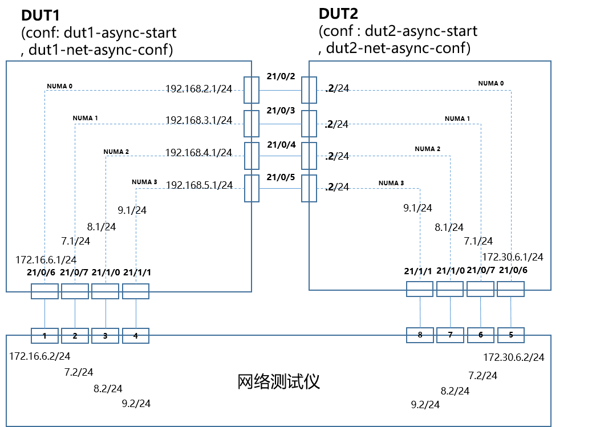
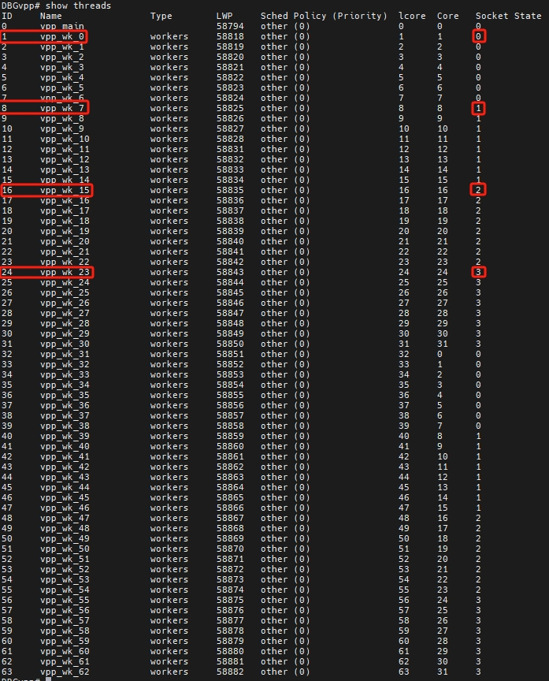

# 1. 概要

## 1.1. VPP的IPSec功能介绍

VPP是思科（CISCO）公司主导的[FD.io](https://fd.io/)（快速数据输入/输出）开源项目中的一个子项目，提供网络层L2-L4快速处理网络数据的功能，整个项目由c语言编写，运行在linux用户态，详见官方wiki（[https://wiki.fd.io/view/VPP](https://wiki.fd.io/view/VPP)）。IPSec是为IP网络提供安全性的协议和服务的集合，它是VPN（Virtual Private Network，虚拟专用网）中常用的一种技术。通信双方通过IPsec建立加密隧道，IP数据包通过加密隧道进行传输，有效保证了数据在不安全的网络环境如Internet中传输的安全性，详见rfc文档：

- [https://tools.ietf.org/html/rfc4301](https://tools.ietf.org/html/rfc4301)
- [https://tools.ietf.org/html/rfc4302](https://tools.ietf.org/html/rfc4302)
- [https://tools.ietf.org/html/rfc4303](https://tools.ietf.org/html/rfc4303)

VPP内置了IPSec功能，其实现方式具有高度的可扩展性和灵活性，支持多种软硬件优化技术，除了可选择自带的处理引擎外，还为开发者提供了模块化框架，允许以插件形式开发自己的加速引擎，从而为更广泛的高性能处理方案提供了适配能力，可以在不同的硬件平台上实现最优性能。
本文描述的HCT crypto插件集基于该框架开发。

## 1.2. 用于VPP IPSec的HCT crypto插件集

海光密码技术(HCT, Hygon Cryptographic Technology)是基于海光密码协处理器和密码指令集自主设计研发的一套密码算法加速软件开发套件。HCT充分利用海光平台密码加速特性，整合底层海光密码计算资源，为用户上层应用提供高性能密码计算能力。关于HCT的使用介绍详见[HCT密码运算加速引擎](<./02. 测试密码运算加速引擎CAE.md>)。
HCT crypto插件集依赖HCT提供的密码运算能力，利用VPP框架提供的插件机制，实现了两个加密插件，分别是HCT异步插件和HCT同步插件，可在VPP IPSec应用中充分发挥海光处理器的国密算法加速能力。

## 1.3. 参考部署环境

| 组件         | 版本信息                   |
| ------------ | -------------------------- |
| CPU          | 单路7385 C86 CPU           |
| 内存         | 128GB DDR4                 |
| 系统发行版  | Ubuntu 18.04 LTS           |
| 内核 | Linux kernel 5.4.19        |
| gcc          | 7.5.0                      |
| OpenSSL      | 1.1.1c                     |
| numa         | 2.0.12                     |
| HCT套件      | hct\_2.0.0.20241030\_release |
| 网卡         |mellanox MCX556A-EDAT       |

以上环境为本文撰写时使用的环境，仅供参考。其他具备海光密码加速特性的平台都能使用本文描述的技术。

# 2. 源码和编译

## 2.1. 源码介绍

HCT crypto插件集基于VPP的**stable/2101**分支开发，如果用户需要使用其他分支，可基于本案提交的补丁进行移植。
源码下载包含了VPP全部源码以及本项目新增的两个插件：[项目源码](https://gitee.com/anolis/vpp)

### 2.1.1. VPP框架修改

插件使用国密算法，需要引用VPP IPSec框架中与算法相关的定义，原生VPP中没有定义国密算法，所以增加了国密算法相关内容，改动的文件在VPP框架代码“src/vnet/ipsec”目录和“src/vnet/crypto”目录。

### 2.1.2. 新增插件

HCT crypto插件集提供的两个插件分别为：

- 同步功能插件 crypto\_hct\_sync
- 异步功能插件 crypto\_hct\_async

同名源码目录放置在路径“src/plugins”下。

## 2.2. 准备编译环境

### 2.2.1. 删除冲突组件

系统中已安装的VPP或DPDK会对编译和运行产生干扰，造成不确定的错误。编译前确认当前系统环境中是否曾经安装过VPP或者DPDK，通过如下命令：
debian类系统：

```bash
dpkg -l | grep vpp
dpkg -l | grep DPDK
```

centos类系统：

```bash
yum list installed | grep vpp
yum list installed | grep DPDK
```

如果已安装过，先卸载对应的VPP或者DPDK组件，否则源码编译过程和运行过程可能会出错。

### 2.2.2. 联网环境

在联网条件下，clone或下载本项目源码后，进入源码根目录：

```bash
cd vpp-21.01
git checkout stable/2101
```

这里一定注意checkout到stable/2101分支，因为本插件集是基于这个分支开发并提交的。
VPP编译过程所需的各类工具、依赖软件，均由VPP的make系统解决，无需手动安装，仅需执行以下命令即可自动探测当前系统环境并安装缺失的依赖：

```bash
make install-dep      # 安装编译过程所需依赖包
make install-ext-deps # 安装运行过程所需依赖包
```

根据网络环境，以上两个命令的执行时间可能较长，需要耐心等待。

### 2.2.3. 离线环境

离线环境下VPP源码和所有依赖都需要手动拷贝、安装。源码从本案链接下载后拷贝到离线环境即可；编译工具依赖包的离线安装需要根据编译过程提示的错误信息，逐一下载离线包进行安装，根据包管理系统按需操作，不再赘述。
下面描述运行时依赖包的下载，有两种方法获取“make install-ext-deps”命令下载安装的软件包：

- **方法一：** 从曾经联网编译过相同版本的VPP的机器上，VPP目录的“**build/external**”下，拷贝“**downloads**”文件夹到离线编译的机器上VPP源码目录相同路径“**build/external**”下即可。
- **方法二：** 查看VPP根目录“**build/external/packages**”下的各个“**\*.mk**”文件，这些文件分别对应了不同软件包的makefile脚本，用文本编辑器打开这些文件，从中找到下载链接，使用可联网机器输入链接即可下载，下载的压缩包放入目录“**build/external/downloads**”（没有downloads目录则创建一个）下即可。以DPDK为例说明下载方法：
  查看“build/external/packages/dpdk.mk”的内容：

```makefile
...
dpdk_version                 ?= 20.11
dpdk_base_url                ?= http://fast.dpdk.org/rel
dpdk_tarball                 := dpdk-$(dpdk_version).tar.xz
...
dpdk_url                     := $(dpdk_base_url)/$(dpdk_tarball)
...
```

可以组合出下载DPDK的路径为：[http://fast.dpdk.org/rel/dpdk-20.11.tar.xz](http://fast.dpdk.org/rel/dpdk-20.11.tar.xz) 。
获取其他依赖包，如rdma、quicly等的下载路径，过程类似，不再赘述。
所有软件包都下载完毕并放入指定目录后，在源码根目录执行：

```bash
touch build-root/.deps.ok
```

创建“.deps.ok”的目的是为编译系统建立锚点，使其越过下载步骤执行后续编译。

## 2.3. 编译

1. 编译命令
   在源码根目录执行：

```bash
make build            #编译debug版
make build-release    #编译release版
```

VPP编译完成后，可执行程序和相关的库都在源码目录下生成，根据编译的类型是debug还是release，生成的可执行文件和库的位置在源码目录下：

- debug版： 可执行文件路径 **build-root/install-vpp\_debug-native/vpp/bin/**，库路径 **build-root/install-vpp\_debug-native/vpp/lib/**
- release版： 可执行文件路径 **build-root/install-vpp-native/vpp/bin/**， 库路径 **build-root/install-vpp-native/vpp/lib/**

# 3. 运行

## 3.1. 运行环境

### 3.1.1. 安装hct

本案所述插件运行依赖于HCT提供的接口，运行前需要安装HCT，详细安装步骤见[HCT环境部署](<./01. 环境部署.md>)。

### 3.1.2. 配置大页内存

不配置大页内存也可以运行，但是配置大页内存可以大幅提高程序性能，建议进行配置。
在/etc/default/grub文件中，修改“GRUB\_CMDLINE\_LINUX”参数内容：default\_hugepagesz(默认大页大小，设为1G)、hugepagesz(大页大小，设为1G)、hugepages(大页个数，根据具体平台而定)，修改后如下所示：

```bash
GRUB_CMDLINE_LINUX="... default_hugepagesz=1G hugepagesz=1G hugepages=32 ..."
```

其中“hugepages”的数量，在海光3系cpu上不低于4，在海光5系cpu上不低于8，在海光7系cpu上不低于16。
修改并保存/etc/default/grub文件后，**更新grub并重启后生效**：
debian类系统：

```bash
sudo update-grub
sudo reboot
```

centos类系统：

```bash
sudo grub2-mkconfig -o /boot/grub2/grub.cfg  # bios引导
```

或

```bash
sudo grub2-mkconfig -o /boot/efi/EFI/centos/grub.cfg  # UEFI引导
```

## 3.2. 运行命令

进入DUT1的VPP可执行文件路径，**使用root权限运行命令**：

```bash
sudo ./vpp -c </path/to/config-file>
```

其中/path/to/config-file是VPP启动配置文件（文本格式），VPP自带一个基础的示例模板，位于build-root/install-vpp-native/VPP/etc/VPP/startup.conf，在该文件的基础上，文件名和内容均可以按需修改，文件内容的含义参见[https://wiki.fd.io/view/VPP/Command-line\_Arguments](https://wiki.fd.io/view/VPP/Command-line_Arguments) 文档相关章节。

## 3.3. 测试方案

可使用单机测试或者双机测试本案插件，它们的特点如下：

- **单机测试**
  只用一台机器，即可完成IPSec业务闭环，即打流、加密、解密均在一台机器上完成，不需要额外的机器和测试仪，但受限于单机性能同时运行两个VPP以及打流，不能测出目标机型在真实业务环境下的加解密能力；
- **多机测试**
  用三台机器（两台作为IPSec网关，一台作为打流机）或两台机器（作为IPSec网关） + 专业网络测试仪。这种方式下测试流量由专门的机器发出，模拟真实业务流量。目标机只执行IPSec网关的角色，只要网卡总带宽足够，就可以测出实际加解密能力。

下面采用**单机测试演示同步插件**的使用，采用**多机测试演示异步插件**的使用。 但需要明确的是，单机演示异步插件，多机演示同步插件都是可以的，这里只是为了不占用过多篇幅，可以举一反三。

### 3.3.1. 单机测试

用单机测试演示同步插件的使用。

#### 3.3.1.1. 测试拓扑

单机测试仅需一台机器，没有对外网络连接的需求，通过对linux网络命名空间和VPP的设置，在同一台机器上模拟两个VPP实体通信过程：


#### 3.3.1.2. 配置文件

以下是设置主机网络的脚本set\_host\_net.sh内容：

```bash
sudo ip netns add ns0                                     # 新建网络命名空间ns0
sudo ip link add name vpp0 type veth peer name host_vpp0  # 创建虚拟以太网口对（vpp0和host_vpp0）
sudo ip link set vpp0 up                                  # 设置虚拟网口vpp0状态为up
sudo ip link set host_vpp0 netns ns0                      # 将上面创建好的以太网口对中host_vpp0放入ns0命名空间，它的对端留在默认命名空间
sudo ip netns exec ns0 ip link set lo up                  # 使能ns0命名空间中的回环接口
sudo ip netns exec ns0 ip link set host_vpp0 up           # 设置虚拟网口host_vpp0状态为up
sudo ip netns exec ns0 ip addr add 192.168.1.1/24 dev host_vpp0 # 为ns0中的虚拟网口host_vpp0设置ip地址
sudo ip netns exec ns0 ip route add default via 192.168.1.2 dev host_vpp0 # 为ns0创建默认路由，其网关地址“192.168.1.2”属于虚拟网口host_vpp0的对端网口，即“vpp0”，“vpp0”将在VPP的配置文件中启用

# 与上面类似，创建了另一个网络命名空间ns1，余下类似
sudo ip netns add ns1
sudo ip link add name vpp1 type veth peer name host_vpp1
sudo ip link set vpp1 up
sudo ip link set host_vpp1 netns ns1
sudo ip netns exec ns1 ip link set lo up
sudo ip netns exec ns1 ip link set host_vpp1 up
sudo ip netns exec ns1 ip addr add 192.168.2.1/24 dev host_vpp1
sudo ip netns exec ns1 ip route add default via 192.168.2.2 dev host_vpp1
```

VPP配置文件dut1-sync-start内容如下：

```text
unix {
  nodaemon
  log /var/log/VPP/VPP.log
  full-coredump
  interactive
  startup-config /path/to/dut1-net-sync-conf
}
cpu {
  main-core 1
  corelist-workers 6,7
}
plugins {
  plugin crypto_hct_sync_plugin.so {enable}   # 使能本项目定义的同步插件
}
buffers { buffers-per-numa 133320 }
memory { main-heap-size 2G }
statseg { size 1G }
```

“dut1-sync-start”文件中，“startup-config /path/to/dut1-net-sync-conf”一行是指定网络参数配置的，配置的内容写在dut1-net-sync-conf文件中，该文件内容如下：

```text
create host-interface name vpp0 hw-addr fa:16:29:29:29:29   # 接管外部创建的虚拟网口vpp0，并为其设置mac地址（在这里被重命名为“host-vpp0”）
set interface state host-vpp0 up                            # 使能host-vpp0网口
set interface ip address host-vpp0 192.168.1.2/24           # 设置host-vpp0网口ip地址
create interface memif id 0 slave                           # VPP创建mem内存接口memif0/0，用于和另一个VPP里的内存接口连接，模拟以太网直连通信
set interface state memif0/0 up
set interface ip address memif0/0 192.168.3.1/24
create ipip tunnel src 192.168.3.1 dst 192.168.3.2          # 创建IP-in-IP隧道
ipsec sa add 11 spi 1001 esp crypto-key 4339314b55523947594d6d3547666b45 crypto-alg sm4-cbc integ-key 4339314b55523947594d6d3547666b45 integ-alg sm3 salt 0x11223344  # 创建SA参数，指定加密算法和完整性校验算法，以及相关密钥
ipsec tunnel protect ipip0 sa-in 11 sa-out 11               # 为IP-in-IP隧道绑定SA，形成IPSec隧道
ip route add 192.168.2.1/32 via 192.168.3.2 ipip0           # 添加转发路由，将目标地址路由到指定隧道上
set interface unnumbered ipip0 use memif0/0                 # 将IPSec隧道接口设置为无编号接口并借用memif接口IP地址
set interface state ipip0 up                                # 使能隧道接口
set crypto handler all hct_sync                             # 设置密码引擎为同步引擎“hct_sync”
```

另一个VPP配置文件dut2-sync-start内容如下：

```text
unix {
  nodaemon
  log /var/log/vpp/vpp.log
  full-coredump
  interactive
  startup-config /{path}/dut2-net-sync-conf
}
cpu {
  main-core 1
  corelist-workers 6,7
}
plugins {
  plugin crypto_hct_sync_plugin.so {enable}   # 使能本项目定义的同步插件
}
buffers { buffers-per-numa 133320 }
memory { main-heap-size 2G }
statseg { size 1G }
```

其中dut2-net-sync-conf内容如下:

```text
create host-interface name vpp1 hw-addr fa:16:19:19:19:19
set interface state host-vpp1 up
set interface ip address host-vpp1 192.168.2.2/24
create interface memif id 0 master
set interface state memif0/0 up
set interface ip address memif0/0 192.168.3.2/24
create ipip tunnel src 192.168.3.2 dst 192.168.3.1
ipsec sa add 11 spi 1001 esp crypto-key 4339314b55523947594d6d3547666b45 crypto-alg sm4-cbc integ-key 4339314b55523947594d6d3547666b45 integ-alg sm3 salt 0x11223344
ipsec tunnel protect ipip0 sa-in 11 sa-out 11
ip route add 192.168.1.0/24 via 192.168.3.1 ipip0
set interface unnumbered ipip0 use memif0/0
set interface state ipip0 up
set crypto handler all hct_sync
```

可以通过以下命令验证：
启动VPP发送实例以及接收实例：

```bash
sudo ./vpp -c </path/to/dut1-sync-start>
sudo ./vpp -c </path/to/dut2-sync-start>
```

在其中一个网络空间中用ping测试到达对端网络空间的连通性：

```bash
sudo ip netns exec ns0 ping 192.168.2.1
```

如果ping包正常回应，则证明单机数据拓扑已经连通，接下来可以使用iperf等工具在ns0侧的host\_vpp0和ns1侧的host\_vpp1上进行压力测试。最简单的命令如：

```bash
sudo ip netns exec ns0 iperf -s
sudo ip netns exec ns1 iperf -c 192.168.1.1
```

### 3.3.2. 多机测试

用多机测试演示异步插件的使用。

#### 3.3.2.1. 测试拓扑

下图所示为多机测试的拓扑连接：



图中DUT1和DUT2分别代表两台运行了VPP的机器，CPU为Hygon 7385单路，拥有4个DIE，开启超线程后一共有64个逻辑核。每台机器配置一块物理网卡（2个PF设备分裂出8个VF设备），每个网卡的IP地址、BDF、连接关系见图中所示，将三台机器按图示连接形成环状，由网络测试仪发出测试流，以顺时针方向的流为例，数据流从网络测试仪的1，2，3，4口分别流出，通过DUT1加密后送往DUT2，由DUT2解密后，通过网络测试仪的5，6，7，8四个口流回并由网络测试仪完成统计和数据呈现。

#### 3.3.2.2. 绑定网卡到用户态驱动

多机测试使用真实的网卡，在VPP中通过DPDK控制真实的网卡收发，需要将网卡从默认的内核驱动解绑，然后绑定到用户态驱动，以便DPDK可以接管。
**特别注意：** **mellanox的网卡**驱动比较特殊，其自带DPDK的适配层，所以**不需要执行这一步**。
DPDK可以支持“igb\_uio”、“uio\_pci\_generic” 或者 “vfio-pci”这三种用户态驱动，确认自己的系统支持哪一种驱动，然后使用DPDK驱动绑定脚本执行相应的解绑和绑定操作，需要注意的是，编译完成后DPDK的驱动绑定脚本在源码目录下：“build-root/install-vpp-native/external/bin/dpdk-devbind.py”，举例说明使用方式：
先加载vfio-pci驱动程序：

```bash
sudo modprobe vfio-pci
```

查看系统当前的网卡驱动情况：

```bash
cd build-root/install-vpp-native/external/bin/
sudo ./dpdk-devbind.py -s
Network devices using DPDK-compatible driver
============================================
0000:82:00.0 '82599EB 10-GbE NIC' drv=vfio-pci unused=ixgbe
0000:82:00.1 '82599EB 10-GbE NIC' drv=vfio-pci unused=ixgbe

Network devices using kernel driver
===================================
0000:04:00.0 'I350 1-GbE NIC' if=eth0 drv=igb unused=vfio-pci *Active*
0000:04:00.1 'I350 1-GbE NIC' if=eth1 drv=igb unused=vfio-pci
0000:04:00.2 'I350 1-GbE NIC' if=eth2 drv=igb unused=vfio-pci
0000:04:00.3 'I350 1-GbE NIC' if=eth3 drv=igb unused=vfio-pci

Other network devices
=====================
<none>
```

要将设备eth1“04:00.1”绑定到vfio-pci驱动程序：

```bash
sudo ip link set dev eth1 down      #先在系统中将eth1的端口状态设置为down，以便可以绑定到启动驱动上，如vfio-pci
sudo ./dpdk-devbind.py -b vfio-pci 04:00.1
```

或者，

```bash
sudo ./dpdk-devbind.py -b vfio-pci eth1
```

更详细的使用详见dpdk文档：[https://doc.dpdk.org/guides/linux\_gsg/linux\_drivers.html](https://doc.dpdk.org/guides/linux_gsg/linux_drivers.html)

#### 3.3.2.3. 配置文件

**Tips：** 如果单台机器上有多块物理网卡，尽量将网卡分散插入不同NUMA节点所属的PCIE插槽中，这样可以将流量尽可能分散到不同NUMA节点上，减少跨NUMA节点通信，提高并行处理效率。

为节约篇幅，下面仅以DUT1的配置文件“dut1-async-start”为例，对与本引擎有关，或需要强调的内容进行注释和说明。

```text
unix {
  nodaemon
  log /var/log/vpp/vpp.logP
  interactive
  full-coredump
  cli-listen /run/vpp/cli.sock
  startup-config /path/to/dut1-net-async-conf  # 内部配置文件
}

cpu {
  main-core 0               # 0号核心绑定给VPP主线程使用
  corelist-workers 1~63     # 1~63号核心分别绑定给worker线程使用
}

plugins {
  plugin crypto_hct_async_plugin.so {enable}  # 使能本项目定义的异步插件
}
buffers { buffers-per-numa 133320 }
dpdk {
  no-multi-seg
  dev default{
    num-rx-queues 1
  }
  dev 0000:21:00.2          # 从这里开始的dev均为网卡,"0000:21:00.2"是该网卡的BDF
  {
    workers 0               # 绑定0号worker处理“0000:21:00.2”这个网卡的数据，以下同理
    name eth0               # 为本网卡接口取个名字，命名任意，方便使用即可
  }
  dev 0000:21:00.3
  {
    workers 7
    name eth1
  }
  dev 0000:21:00.4
  {
    workers 15
    name eth2
  }
  dev 0000:21:00.5
  {
    workers 23
    name eth3
  }
  dev 0000:21:00.6
  {
    workers 0
    name eth4
  }
  dev 0000:21:00.7
  {
    workers 7
    name eth5
  }
  dev 0000:21:01.0
  {
    workers 15
    name eth6
  }
  dev 0000:21:01.1
  {
    workers 23
    name eth7
  }
  blacklist 8086:1521
  no-multi-seg
}

memory { main-heap-size 2G }
statseg { size 1G }
```

多机测试需要绑定网卡，以上展示的dut1-async-start文件中，每个“dev xxx {worker n}”小节中的worker后的数字，代表第几号worker，该worker负责dev xxx的数据收发。为充分发挥性能，该数字的选取遵循如下原则：
先查看系统中该网卡属于哪个NUMA节点，绑定第几号worker应从该NUMA节点包含的逻辑核中选取（core与worker一一对应）。若不保证每个NUMA节点上都有网卡，那么网卡分配方式按NUMA节点距离由近到远分配。原则是尽量让每个NUMA节点上都有一个核在处理网卡数据，例如0000:21:00.2在NUMA 2上，那么这个数字选择NUMA 2上的第一个worker即可，在VPP的cli中执行“show threads”命令，如下图所示:



上图中，“lcore”列代表了cpu的逻辑核，“core”列代表了cpu的物理核，“socket state”列代表了cpu的numa id，“name”列代表了worker的命名，命名最后的数字即worker编号。
本例比较特殊，每台机器只有一块网卡（网卡上有两个PF接口），插在NUMA 2的pcie上，从这块网卡的两个PF接口分别分离出4个VF接口。按照上述原则，为了对数据处理进行负载均衡，将“21:00.2、21:00.6”两个VF网卡分配给NUMA 0的worker 0，“21:00.3、21:00.7”分配给NUMA 1的worker 7，以此类推。

前面展示的“dut1-async-start”文件中，“startup-config /path/to/dut1-net-async-conf”一行是指定网络参数配置的，配置的内容写在dut1-net-async-conf文件中，该文件内容如下：

```text
# 设置各接口IP地址
set interface ip address eth0 192.168.2.1/24
set interface ip address eth1 192.168.3.1/24
set interface ip address eth2 192.168.4.1/24
set interface ip address eth3 192.168.5.1/24
set interface ip address eth4 172.16.6.1/24
set interface ip address eth5 172.16.7.1/24
set interface ip address eth6 172.16.8.1/24
set interface ip address eth7 172.16.9.1/24

# 开启ipsec异步模式（若使用同步插件，这句不写）
set ipsec async mode on

# 创建IP-in-IP隧道
create ipip tunnel src 192.168.2.1 dst 192.168.2.2
create ipip tunnel src 192.168.3.1 dst 192.168.3.2
create ipip tunnel src 192.168.4.1 dst 192.168.4.2
create ipip tunnel src 192.168.5.1 dst 192.168.5.2

# 创建SA参数，指定加密算法和完整性校验算法，以及相关密钥
ipsec sa add 10 spi 1000 esp crypto-key 4339314b55523947594d6d3547666b45 crypto-alg sm4-cbc integ-key 4339314b55523947594d6d3547666b45 integ-alg sm3 salt 0x11223344
ipsec sa add 11 spi 1001 esp crypto-key 4339314b55523947594d6d3547666b45 crypto-alg sm4-cbc integ-key 4339314b55523947594d6d3547666b45 integ-alg sm3 salt 0x11223344
ipsec sa add 12 spi 1002 esp crypto-key 4339314b55523947594d6d3547666b45 crypto-alg sm4-cbc integ-key 4339314b55523947594d6d3547666b45 integ-alg sm3 salt 0x11223344
ipsec sa add 13 spi 1003 esp crypto-key 4339314b55523947594d6d3547666b45 crypto-alg sm4-cbc integ-key 4339314b55523947594d6d3547666b45 integ-alg sm3 salt 0x11223344

# 为IP-in-IP隧道绑定SA，形成IPSec隧道
ipsec tunnel protect ipip0 sa-in 10 sa-out 10
ipsec tunnel protect ipip1 sa-in 11 sa-out 11
ipsec tunnel protect ipip2 sa-in 12 sa-out 12
ipsec tunnel protect ipip3 sa-in 13 sa-out 13

# 添加转发路由，将目标地址路由到指定隧道上
ip route add 172.30.6.0/24 via 192.168.2.2 ipip0
ip route add 172.30.7.0/24 via 192.168.3.2 ipip1
ip route add 172.30.8.0/24 via 192.168.4.2 ipip2
ip route add 172.30.9.0/24 via 192.168.5.2 ipip3

# 将IPSec隧道接口设置为无编号接口并借用物理接口IP地址
set interface unnumbered ipip0 use eth0
set interface unnumbered ipip1 use eth1
set interface unnumbered ipip2 use eth2
set interface unnumbered ipip3 use eth3

# 使能各物理接口和隧道接口
set interface state eth0 up
set interface state eth1 up
set interface state eth2 up
set interface state eth3 up
set interface state eth4 up
set interface state eth5 up
set interface state eth6 up
set interface state eth7 up
set interface state ipip0 up
set interface state ipip1 up
set interface state ipip2 up
set interface state ipip3 up

# 设置密码引擎为异步引擎“hct_async”
set crypto async handler hct_async all
```

DUT2与DUT1的配置类似，按照拓扑修改对应参数即可。
以上网络参数在VPP初始化时加载，以静态方式打通IPSec隧道，加载完成后，即可开启网络测试仪打流测试。
**Tips:** 特别注意，在网络参数中定义加解密引擎时：

- 如果使用异步hct插件，必须加上“set ipsec async mode on”和“set crypto async handler hct\_async all”这两句；
- 如果使用同步插件，只写“set crypto handler all hct\_sync”即可。

# 4. FAQ

## 4.1. 用户组不存在？

运行VPP后提示：“group vpp does not exist”，添加对应的组即可：

```bash
sudo groupadd vpp
```

## 4.2. 日志文件创建失败？

运行VPP后提示：“couldn't open log '/var/log/vpp/vpp.log'”，是因为“/var/log/vpp”目录不存在，创建即可：

```bash
sudo mkdir -p /var/log/vpp
```

## 4.3. 编译时提示缺少python库？

编译过程出现类似错误：

```text
ModuleNotFoundError: No module named 'ply'
```

这类错误多出现在离线编译时，由于没有经过“make install-dep”过程，可能会有一些依赖软件包没有安装，需要离线安装Python的ply库，其他类似错误也要按需离线安装缺失的库或软件包。

## 4.4. 如何打包安装？

编译完成后，打包、安装：
debian类系统：

```bash
make pkg-deb
# deb包生成于build-root目录下
sudo dpkg -i ./build-root/*.deb
```

centos类系统：

```bash
make pkg-rpm
# rpm包生成于build-root目录下
sudo rpm -i ./build-root/*.rpm
```
