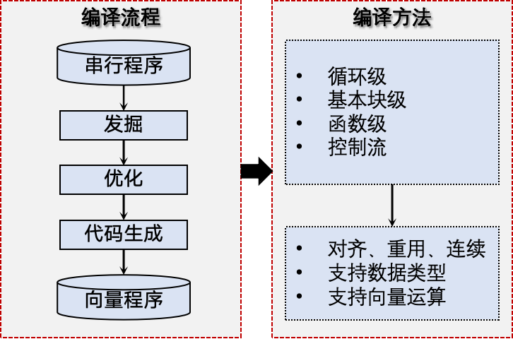
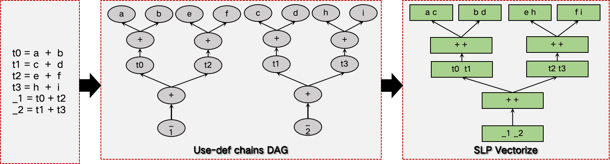
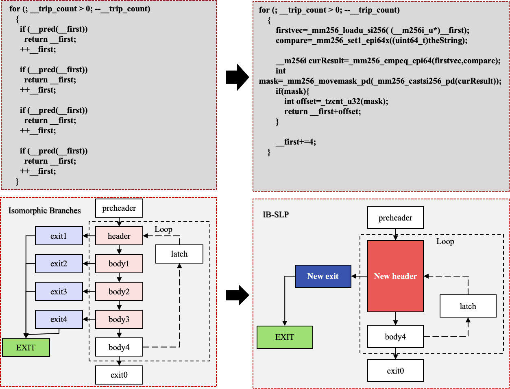
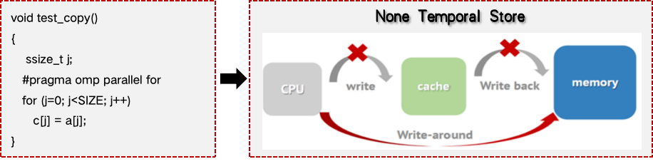
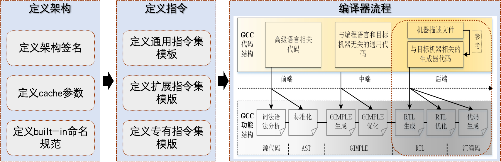
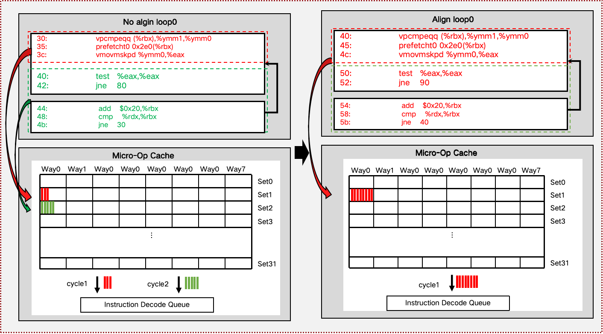

# hgcc简介

### 前言

本手册提供hgcc编译器使用方法和构建业务场景的注意事项。

### 概述

hgcc 是一款专为 Hygon 处理器打造的高性能、易扩展编译器。它基于 GCC 12.3.0 开发，通过增强和引入多种编译优化技术，显著提升了目标代码的执行效率，并完整支持 C、C++ 及 Fortran 等编程语言。

### 编程语言

GCC编译器支持多种编程语言(C/C++/Fortran/Ada/Go/D…)和多种目标处理器(x86/ARM/RISC-V/MIPS…)，hgcc编译器聚焦于C、C++和Fortran语言，同时也聚焦于这三种语言支持扩展的OpenMP程序。

**C/C++程序**

gcc/g++ 不仅是将 C/C++ 源代码编译为中间表示（IR）的前端工具，更是一个完整的编译驱动程序。在常规非 LTO（链接时优化）模式下，其工作流程如下：首先调用 `cc1` 完成预处理与编译优化，生成汇编代码；接着调用 `as` 汇编器，将汇编代码转换为机器码并输出目标文件；最后通过 `ld`/`collect2` 链接器将多个目标文件与库文件链接，生成最终的可执行文件或共享库

**Fortran程序**

gfortran 编译 Fortran 源代码的流程与gcc编译 C 程序相似。在常规非LTO模式下，它首先调用 `f951` 进行预处理和编译优化，生成汇编代码；随后由 `as` 汇编器将汇编代码转换为机器码，生成目标文件；最后由 `ld`/`collect2` 链接器整合多个目标文件及必要的库文件，生成可执行文件或共享库。

# 安装使用

本章介绍 hgcc 的部署与初始化，涵盖环境前置要求、多种安装方式、环境变量设置、多版本共存与切换，以及安装结果验证。

## 环境依赖

### 硬件要求

| 项目 | 要求 |
| --- | --- |
| 处理器架构 | 海光 C86（x86\_64 兼容） |
| 微架构优化 | `-march=c86-4g-m4`、`-march=c86-4g-m7` 面向海光 4G 及 4G 升级版平台；其他平台可沿用基线 GCC 12.3.0 的通用 x86 选项 |
| 磁盘空间 | 安装包约 165 MB，解压后约 0.5 GB，建议预留 2 GB 以上 |

### 支持系统

CentOS-8.0、Ubuntu-18.04、Ubuntu-22.04、openEuler-24.03、麒麟OS-v11

### 软件依赖

| Package Name | Version(s) | Notes |
| --- | --- | --- |
| libstdc++ | 3.4.19 or later | GNU Standard C++ Library |
| glibc | 2.17 or later | 2.31 or later is better which could recognize Hygon Platform |

## 安装方式

hgcc 提供多种安装方式，可按部署场景选择：

| 方式 | 适用场景 | 复杂度 |
| --- | --- | --- |
| 方式一：压缩包安装 | 单机部署，需精确控制安装路径与版本 | 低 |
| 方式二：C86-DevKit 套件安装 | 一次性获取编译器 + 库 + 工具的完整开发环境 | 低 |

### 方式一：压缩包安装（推荐）

#### 1. 下载安装包

请访问以下地址下载安装包：https://download.sourcefind.cn:65024/8/main/c86-devkit/latest/compiler/hgcc

```bash
wget https://download.sourcefind.cn:65024/file/8/c86-devkit/latest/compiler/hgcc/hgcc-{version}.x86_64.tar.gz
```

以当前最新版本为例：

```bash
wget https://download.sourcefind.cn:65024/file/8/c86-devkit/latest/compiler/hgcc/hgcc-12.3.0-260901.4.x86_64.tar.gz
```

版本号规则为 `hgcc-<GCC基线版本>-<BUILDID>.<model step>.<架构>`，其中 BUILDID 由「年份 + 月份 + 当月第 N 次 merge/构建」组成（如 `260901` 表示 2026 年 9 月第 1 次构建）。详见技术白皮书"与上游 GCC 的基线关系"一节。

#### 2. 校验安装包（建议）

```bash
# 一并下载随包发布的校验文件
wget https://download.sourcefind.cn:65024/file/8/c86-devkit/latest/compiler/hgcc/hgcc-12.3.0-260901.4.x86_64.tar.gz.sha256

# 查看随包发布的哈希值
cat hgcc-12.3.0-260901.4.x86_64.tar.gz.sha256

# 计算本地安装包的哈希值
sha256sum hgcc-12.3.0-260901.4.x86_64.tar.gz
```

两条命令输出中的哈希值（行首的 64 位十六进制串）一致，即校验通过。

#### 3. 解压安装

```bash
sudo mkdir -p /opt/hygon
sudo tar -zvxf hgcc-{version}.x86_64.tar.gz -C /opt/hygon
```

解压后得到 `/opt/hygon/hgcc/` 目录，结构如下：

```bash
hgcc/
├── bin/                 # gcc / g++ / gfortran / cpp 及 BOLT 工具
├── include/             # C++ 标准库头文件
├── lib/                 # BOLT 插桩运行库
├── lib64/               # libstdc++ / libgomp / libgfortran 等运行时库
├── libexec/             # cc1 / cc1plus / f951 前端，LTO 与 BOLT 插件
├── share/               # man 手册等
└── setenv_hgcc.sh       # 环境变量初始化脚本
```

> 安装路径可自定义，建议使用不含空格与中文的绝对路径。若无 root 权限，可解压至用户目录（如 `~/hgcc-12.3.0`），此时无需 `sudo`。

### 方式二：C86-DevKit 套件安装

如需一次性获取编译器、配套库与工具，可下载 C86-DevKit 整包：

```bash
wget https://download.sourcefind.cn:65024/file/8/c86-devkit/latest/c86-devkit_20260824.beta.tar.gz
tar -zvxf c86-devkit_20260824.beta.tar.gz
```

套件内已包含 `compiler/hgcc/` 目录，按套件自带的安装说明部署即可。

## 环境变量设置

hgcc 通过自带的 `setenv_hgcc.sh` 注入编译与运行所需的环境变量。

### 脚本用法

```bash
cd /path/to/install/hgcc
source setenv_hgcc.sh
```

执行成功后会输出编译器根目录、C/C++ 编译器路径与版本信息：

```
GCC compiler environment has been set up!
Compiler root directory: /opt/hygon/hgcc
C compiler: /opt/hygon/hgcc/bin/gcc
C++ compiler: /opt/hygon/hgcc/bin/g++
GCC version:
gcc (hgcc 1.3.11-260901-4) 12.3.0
```

**说明**，示例中的目录仅供参考，请以实际的安装路径为准。脚本需在当前 shell 中 source（或用 `. setenv_hgcc.sh`）才能生效，且仅影响当前 shell 会话；支持 bash 与 zsh。

### 脚本设置的环境变量

`setenv_hgcc.sh` 以脚本所在目录为 `COMPILER_ROOT`，设置以下变量：

| 变量 | 取值 | 用途 |
| --- | --- | --- |
| `PATH` | `$COMPILER_ROOT/bin` 前置 | 使 `gcc` / `g++` / `gfortran` 指向 hgcc |
| `CC` / `CXX` / `CPP` | `$COMPILER_ROOT/bin/{gcc,g++,cpp}` | 供 CMake、Autotools、Meson 等构建系统识别 |
| `LIBRARY_PATH` | `$COMPILER_ROOT/lib`、`lib64` 前置 | 链接期库搜索路径 |
| `LD_LIBRARY_PATH` | `$COMPILER_ROOT/lib`、`lib64` 前置 | 运行期动态库搜索路径 |
| `C_INCLUDE_PATH` / `CPLUS_INCLUDE_PATH` | `$COMPILER_ROOT/include` 前置 | 头文件搜索路径 |
| `MANPATH` | `$COMPILER_ROOT/share/man` 前置 | man 手册搜索路径 |

> 该脚本不定义 `COMPILER_LIBS_PATH`。本文档"函数库优化"章节中出现的 `COMPILER_LIBS_PATH` 仅为库路径示例，如需使用请自行定义并以 `-L` / `-Wl,-rpath` 传入。

### 取消环境变量

推荐直接退出当前 shell 或新开终端。若确需在当前 shell 中清理：

```bash
unset CC CXX CPP
export PATH=$(echo "$PATH" | sed -E 's|[^:]*/hgcc/bin:||')
```

## 多版本共存与切换

hgcc 各版本相互独立，将不同版本解压到不同目录，再按需 source 对应版本的 `setenv_hgcc.sh`，即可实现共存与按需切换。

### 目录规划

```bash
/opt/hygon/hgcc-12.3.0-260901.4/     # 版本 A
/opt/hygon/hgcc-12.3.0-260601.4/     # 版本 B
```

### 方式一：手动 source

```bash
# 切换到版本 A
source /opt/hygon/hgcc-12.3.0-260901.4/setenv_hgcc.sh

# 切换到版本 B
source /opt/hygon/hgcc-12.3.0-260601.4/setenv_hgcc.sh
```

由于脚本以**前置**方式修改 `PATH`，后 source 的版本优先生效。但在同一 shell 中反复切换会在 `PATH` 与 `LD_LIBRARY_PATH` 中累积条目，因此建议切换前新开 shell。

### 方式二：封装切换函数（推荐）

在 `~/.bashrc` 中加入：

```bash
# 切换 hgcc 版本：hgcc-use 12.3.0-260901.4
hgcc-use() {
    local root="/opt/hygon/hgcc-$1"
    if [ ! -d "$root" ]; then
        echo "未找到版本: $root" >&2
        return 1
    fi

    # 清理上一个版本写入的路径条目，避免反复切换时累积
    if [ -n "$HGCC_ROOT" ]; then
        local old="$HGCC_ROOT"
        PATH=$(echo "$PATH" | sed -E "s|$old/bin:||g")
        LIBRARY_PATH=$(echo "$LIBRARY_PATH" | sed -E "s|$old/lib:||g; s|$old/lib64:||g")
        LD_LIBRARY_PATH=$(echo "$LD_LIBRARY_PATH" | sed -E "s|$old/lib:||g; s|$old/lib64:||g")
        C_INCLUDE_PATH=$(echo "$C_INCLUDE_PATH" | sed -E "s|$old/include:||g")
        CPLUS_INCLUDE_PATH=$(echo "$CPLUS_INCLUDE_PATH" | sed -E "s|$old/include:||g")
        MANPATH=$(echo "$MANPATH" | sed -E "s|$old/share/man:||g")
    fi

    export HGCC_ROOT="$root"
    source "$root/setenv_hgcc.sh"
}

# 可选：登录时默认使用某个版本
# hgcc-use 12.3.0-260901.4
```

使用时直接执行 `hgcc-use 12.3.0-260901.4` 即可切换到指定版本，`HGCC_ROOT` 记录当前生效的版本以便下次切换时清理。

### 方式三：Environment Modules（集群场景）

在多用户集群中，可结合 Environment Modules 管理：

```bash
module use /opt/hygon/modulefiles
module load hgcc/12.3.0-260901.4
module list
module unload hgcc
```

> 说明：集群环境中的 modulefile 通常由管理员结合各版本安装目录自行维护，具体形式可沿用所在集群的既有惯例。

### 共存注意事项

- 切换版本后建议重新完整编译，避免不同版本的中间产物混用
- 若工程中已通过 `-L` / `-Wl,-rpath` 硬编码了某一版本的库路径，切换后需同步调整
- 使用 LTO 时，参与链接的所有目标文件应由同一版本编译生成

## 安装结果验证

安装完成后执行以下命令验证是否成功

```bash
gcc -v
```

若返回结果包含hgcc版本信息，说明安装成功。

进一步验证：

```bash
# 确认解析到的编译器路径
which gcc g++ gfortran

# 确认目标微架构选项可用
gcc -march=c86-4g-m4 -Q --help=target | head

# 编译并运行 Hello World
gcc hello.c -o hello && ./hello
```

## 卸载

hgcc 为绿色部署，卸载时先确认无进程占用该目录，再删除安装目录并清理环境变量：

```bash
# 1. 确认当前使用的版本
gcc -v

# 2. 删除安装目录
rm -rf /opt/hygon/hgcc

# 3. 移除 shell 启动文件中相关的 setenv_hgcc.sh 引用与 PATH 条目
```

## 使用方式

### 编译运行C/C++程序

```jsx
$ gcc [command options] hello.c -o hello
$ ./hello

$ g++ [command options] hello.cc -o hello
$ ./hello
```

### 编译运行Fortran程序

```jsx
$ gfortran [command options] hello.f90 -o hello
$ ./hello
```

# 优化说明

## 通用优化

支持gcc12.3.0所有优化选项，包括不限于（O0/O1/O2/O3/Ofast…）。

- \-O0：无优化，此级别编译速度最快，生成的可调试代码最多
- \-O1：简单优化
- \-O2：启用大多数优化
- \-O3：启用所有优化，这些优化需要更长的时间执行或可能生成更大的代码，包括向量化等选项
- \-Ofast：启用所有来自-O3的优化，以及其他可能违反严格遵守语言标准的激进优化

## 向量化优化

向量化优化是一种关键的程序转换技术，其核心在于将原本在标量处理器上逐个执行的操作，转换为在向量处理器上同时对多个数据元素执行，即利用SIMD指令集实现数据级并行。这通过使用CPU中的SIMD寄存器来大幅提升计算吞吐量。

其主要类型包括循环向量化、基本块向量化和函数向量化。海光编译器在传统向量化基础上，进一步加强与扩展了多项向量化特性，以更充分地挖掘硬件潜能。

该优化的编译流程通常分为三个阶段：

1. 发掘：识别可转换为SIMD指令的代码模式（如循环、基本块），并处理控制依赖对发掘的制约。
2. 优化：在生成向量代码后，致力于减少因内存访问不对齐、不连续而引入的辅助指令开销，同时进行数据局部性优化和寄存器重用等。
3. 代码生成：根据目标硬件平台（如海光处理器）所支持的具体数据类型和向量运算指令，生成最终的高效机器码。



### 循环向量化（Loop Vectorize）

循环向量化是一种将循环内迭代并行执行的核心编译优化技术，其标准流程主要包含四个阶段：合法性分析、依赖分析、类型转换和代码生成。

1. 合法性分析
   
   此阶段用于初步筛选，排除无法进行向量化的循环结构。典型的阻碍包括循环体内存在函数调用、复杂的控制流跳转（如 `goto`）或非结构化语句。

2. 依赖分析
   
   这是决定向量化可行性的关键。编译器会分析循环迭代间的数据依赖关系，并构建语句依赖图。
   
    - 在依赖图中，真依赖是影响向量化正确性的根本约束。如果图中存在真依赖环，且环上所有依赖距离之和大于向量化因子（即单条SIMD指令能并行处理的数据元素个数），则循环仍可向量化；反之则不可
    - 反依赖和输出依赖属于存储相关依赖，可通过循环分布、节点分裂、标量扩展等a程序变换技术予以消除，通常不构成向量化的绝对障碍。

3. 类型转换
   
   在确认循环可向量化后，编译器将循环体内的标量数据类型和操作，系统地提升为对应的向量数据类型和操作，为生成SIMD指令做准备。

4. 代码生成
   
   这是最终的输出阶段。编译器将向量化后的三地址码中间表示，转换为具体目标平台支持的SIMD指令。此阶段必须充分考虑硬件特性，如可用的向量寄存器宽度、支持的数据类型及专用的向量运算指令集

编译选项：-ftree-loop-vectorize

### 基本块向量化（SLP，superword level parallelism）

SLP 向量化旨在将程序中多个独立的同构标量操作，合并为单个向量指令。其实现过程如下：

- 前置准备（循环展开）：为确保循环体内存在足够数量、且地址连续的同构内存访问以供打包，SLP 通常会预先对循环进行展开。
- 核心打包流程：算法首先以相邻地址的内存访问作为初始“种子”包，然后利用定义-使用链进行启发式探索，将更多同构操作扩展进该包中。
- 最终调度：打包完成后，算法依据包内语句的依赖关系进行指令调度，以生成正确且高效的向量化代码。

编译选项：-ftree-slp-vectorize



### 函数向量化

函数向量化，也称为函数内建向量化，是一种将循环体内对同一标量函数的多次连续调用，合并为单次向量函数调用的高级优化技术。其核心思想是将原本分散的标量参数打包成向量参数，调用一个能够并行处理整个向量的特殊函数版本，并接收一个向量类型的返回值。

现代编译器和数学库（如 GNU LIBMVEC、Intel SVML、Hygon VML）紧密协作，能够自动将循环中的 `sin`、`cos`、`sqrt`、`pow` 等标量数学函数调用，映射到底层极其高效的 SIMD 指令序列上。

编译选项：mveclibabi=【option】

- 默认支持GNU提供的libmvec向量数学库
- hygonvml：Hygon向量数学库
- svml：Intel短向量数学库
- acml：AMD核心数学库

### 同构分支向量化（ib-slp，Isomorphic-Branches SLP）

同构分支向量化，是面向包含复杂控制流的循环进行向量化的一种高级编译优化技术。其核心思想在于，当循环中存在多个结构相似的条件分支时，编译器能够将这些原本在标量执行中逐一判断的分支条件进行聚合，转换为一次性的向量化条件判断，并利用掩码（Mask）或选择（Select/Blend）指令，实现对多个分支路径上计算操作的并行执行。

此项技术主要针对两类场景进行优化：一是循环体内本身存在多路条件分支（如 `if-else if` 链）；二是通过循环展开，将跨迭代的同构分支模式暴露出来，形成更大的向量化打包机会。其关键在于识别分支结构的同构性（即控制流图子图同构），并生成高效的向量化条件计算与数据选择逻辑。



## NTStore优化（None Temporal Store）

现代CPU采用多级缓存结构（L1/L2/L3缓存）来弥合CPU和内存之间的速度差异。当CPU需要写入数据时，传统操作流程是：

1. 写入缓存：数据首先写入L1缓存
2. 逐级传递：根据缓存一致性协议，数据逐级传递到L2、L3缓存
3. 最终回写：最终写入主内存（DRAM）

这种机制对于频繁读写的数据非常高效，因为后续读取可以直接从高速缓存获取。但对于只写一次、短时间内不再访问的数据，这种机制反而成为性能瓶颈。

Non-Temporal Store（非临时存储）采用完不同的写入策略：绕过缓存层级。性能优势主要是减少缓存污染，热数据保留在缓存中、提高缓存命中率、改善整体系统性能，提升有效带宽，降低功耗。



## 链接时优化（LTO，Link Time Optimization）

### **优化流程**

LTO 设计的初衷就是希望能够在链接时，拥有跨编译单元的调用信息的时候，进行编译优化，提供更多的优化机会。为了达到这个目的，LTO 需要将编译优化所需的 IR 信息保留到链接时。在链接时，链接器会调用 LTO 插件，执行全程序分析，生成更加有效的优化决策，再经由编译优化生成更高效的IR，进一步转成包含汇编代码的目标对象文件，最后由链接器完成常规的链接工作。

GCC实现了两种模式，分别是LTO模式和WHOPR模式

- LTO模式，整个程序在链接时被读入编译器，作为整个编译单元来优化。
- WHOPR模式（aka Partition Mode）。利用多CPU或分布式编译环境，以快速链接大型程序。它把多个不同中间文件（.o）中的callgraph拆分成sub-graphs，并分布到不同的CPU中进行编译。该模式把LTO划分为三个阶段，如下
    - LGEN，这个阶段并行执行，程序中的每个file都被编译成中间语言，并和本地call-graph、summary信息打包在一起。
    - WPA，这个阶段顺序执行，生成全局call-graph，利用一个全局的分析例程来做优化决策；为促进并行优化，全局的call-graph又被拆分；WPA阶段的结果被存入新的目标文件（包含程序分区和优化决策）。
    - LTRANS，这个阶段并行执行，每个目标文件根据WPA的优化决策在本地实现优化，生成最终的目标码。WPA中不能高效决定的优化也可能在本地call-graph分区中被实现。

### **编译选项**

- flto：此选项代表打开链接时优化
- \-flto-partition=\[value\]
    - balanced（默认）：尽量把符号划分成大小相近的分区（尽量平衡每个分区的工作量/二进制大小）。
    - none：禁用分区与流式（streaming）处理；直接从 WPA 阶段进入后续的 LTO 处理（即不拆分或不使用分区流式模式）
    - one：在编译链接时，将所有module文件作为一个整体分析
    - max：尽可能为每个符号创建单独的分区（每个函数/符号单独一分区）
    - lto1：按原始源文件一一对应地创建分区——每个源文件（或翻译单元）对应一个分区（尽可能镜像源文件的划分）

## 反馈式优化（PGO）

### **特性简介**

PGO（Profile-Guided Optimization，配置文件引导优化）是一种基于运行时性能分析数据的编译优化技术。它通过收集程序实际执行时的“热点”路径、分支预测和函数调用频率等信息，反馈给编译器，从而生成更高效的机器码。这种优化不限于特定语言，而是通用技术，能显著提升大型应用的性能，尤其在启动时间、内存占用和执行效率上。传统优化（如算法复杂度调整或缓存机制）往往基于静态假设，而PGO则依赖动态数据，使其成为重要优化之一。
PGO 的工作原理可以概括为一个三阶段流程：

1. 插桩编译阶段：编译器在编译源代码时，通过额外的选项向生成的中间代码或最终代码中插入探针，生成一个包含插桩代码的可执行文件或共享库
2. 训练运行阶段：运行插桩版本的程序，收集真实的运行时性能数据。
3. 引导优化编译阶段 ：使用收集到的性能数据文件指导编译器进行高度针对性的优化。

**优化方法**

1. 分支预测优化：根据运行时收集的分支跳转概率，编译器可以把最常走的路径放在顺序执行路径上，减少分支预测失败带来的 pipeline flush（流水线清空）。
2. 代码布局优化：把热点函数和热点路径连续排布，减少 I-cache miss 和指令 TLB miss。I-cache miss 通常要几十到上百 cycles，PGO 通过减少这些 miss 来缩短平均执行周期。
3. 内联决策优化：PGO 能基于真实调用频率决定哪些函数更适合内联。内联可以减少函数调用开销（如寄存器保存/恢复、跳转），并暴露更多优化机会（循环展开、向量化等），从而减少 cycles。
4. 寄存器分配优化：PGO 知道哪些代码块常用，会优先优化这些路径上的寄存器分配，减少溢出到内存的情况。内存访问一般要比寄存器操作慢很多 cycles。
5. 循环优化：对热点循环，PGO 能指导展开（loop unrolling）、向量化（vectorization）和预取（prefetching），减少每次迭代的 cycles。

### **编译选项**

- \-fprofile-generate
- \-fprofile-use

## 微架构优化

### 海光架构支持

hgcc编译器支持通过-march=选项指定目标CPU型号，使能该CPU所有默认特性。使用-march=native选项，可识别hygon平台的微架构。在使能对应的微架构亲和选项后，hgcc编译器会依据对应架构的指令实现进行指令流水线调优，提升性能。硬件平台与该选项的配置项对应关系如下：

| 硬件平台 | 编译选项 |
| --- | --- |
| 4G | c86-4g-m4 |
| 4G升级版 | c86-4g-m7 |



### 指令对齐优化（align loops）

指令对齐优化是一种针对现代CPU微架构特性的编译器优化技术，主要目标是优化指令在内存中的布局，减少操作缓存（op cache）的带宽压力，提高指令获取和解码效率。



## 函数库优化

### 数学库

**标量数学库**

使用示例如下：

```jsx
编译时：gcc -O3 -lm
链接时：gcc -Wl,-rpath=$[COMPILER_LIBS_PATH] -L$[COMPILER_LIBS_PATH] -lm
```

备注：COMPILER\_LIBS\_PATH为库路径，可自行定义。

**向量数学库**

libvml-hg是针对海光平台高性能向量数学库，针对浮点计算密集型、调用三角函数等程序，性能突出。

使用示例如下：

```jsx
编译时：gcc -O3 -ffast-math -mveclibabi=hygonvml 
链接时：gcc -Wl,-rpath=$[COMPILER_LIBS_PATH] -L$[COMPILER_LIBS_PATH] -lvml-hg
```

### 内存库

hjemalloc是针对海光平台实现的一个高效内存库，主要为了减少内存碎片，在访存密集型程序中，性能突出。

使用示例如下：

```jsx
链接时：gcc -Wl,-rpath=$[COMPILER_LIBS_PATH] -L$[COMPILER_LIBS_PATH] -lhjemalloc
```

# 公版编译器漏洞修复

## 漏洞1：loop unswitch优化特性

### 问题描述

公版 GCC loop unswitch特性在记录优化日志时，存在一个缺陷：它没有预先判断日志文件是否可正常访问。当用户未开启 `-fdump-tree-unswitch` 选项，而代码在编译过程中进入该优化分支时，编译器会因无法找到对应的日志转储文件而触发内部编译错误（ICE）。

### 解决办法

在loop unswitch优化特性对应的日志输出代码前，增加对 `-fdump-tree-unswitch` 等选项是否启用的判断。

## 漏洞2：循环向量化优化特性

### 问题描述

在X86平台启用多级尾部（epilogue）向量化后，发现当存在数据地址未对齐的情况时，编译器仍然生成了对齐加载指令（如vmovadq），导致程序在运行时触发段错误。

问题根因主要是当主循环因数据对齐问题执行了prolog peeling（循环前导对齐剥离）后，后续尾部（epilogue）循环中的数据地址对齐状态是无法保证的。然而在尾部向量化分析阶段，多级epilogue的数据引用（DR）错误地继承了主循环中对齐的状态假设，最终导致编译器为未对齐的内存地址生成了对齐加载指令，从而引发运行时错误。

### 解决办法

由于主循环（main loop）因对齐问题已执行了prolog peeling，尾部循环（epilogue）的数据地址对齐状态无法确定，因此需要将epilogue中数据引用（DR）的对齐状态设置为未知。

在多级epilogue向量化过程中，数据对齐状态应始终继承自主循环（main loop），而不是参考上一级epilogue。为此，在关键分析函数 `vect_compute_data_ref_alignment` 中，将原先检查原始循环信息（`orig_loop_info`）的peeling情况，改为检查主循环信息（`main_loop_info`）的peeling情况，以确保epilogue获得正确的对齐状态。

## 漏洞3：自动并行化优化特性

### 问题描述

在自动并行化特性(parloops)的分析过程中,循环内自依赖的分析可以用于分析是否存在读写依赖，但依赖距离计算有误。

在使用`-ftree-parallelize-loops=24`编译SPEC CPU2017 628课题时，公版GCC 12.3.0出现编译报错。问题与parloops的循环依赖分析有关：当SCEV分析生成的仿射矩阵不完整时，依赖距离计算可能得到错误结果，导致编译器错误地尝试对存在依赖的外层循环进行并行化。该问题已在HGCC中修复，修复方式是对不完整的仿射矩阵按存在依赖进行保守处理，不再执行外层循环并行化。

### 解决办法

仿射矩阵的计算源于gcc的scev（scalar evolution）分析框架，修复方法是当仿射矩阵计算不完整时，默认按存在依赖保守的不进行外层循环的并行化。

## 漏洞4：循环不变量外提优化特性

### 问题描述

在LIM（Loop Invariant Motion）优化过程中，编译器执行了store motion优化。该优化的逻辑是：如果一个循环内存在对内存的写入操作，则将该内存值先读入临时变量（通常保存在寄存器中），循环内部改为对临时变量进行操作，并在循环退出时，将临时变量的值一次性写回内存。这种转换可以将多次内存写入减少为一次，从而提升性能。

然而，对于没有明确退出路径（即没有 exit 基本块）的循环，该优化会导致问题。因为循环没有出口，循环退出时的写回操作无法被安插。因此，虽然循环中寄存器的值被更新，但内存中的实际值却永远不会被修改，造成程序行为错误。

使用公版GCC 12.3.0编译UnixBench的`dhry2reg`测试时，测试结果异常，而关闭相关优化后可以正常运行。问题根因是LIM的store motion对无出口循环进行了错误转换：循环内存储被提升到临时寄存器中，但由于循环没有exit基本块，循环结束时没有位置将寄存器值写回内存，最终导致内存中的实际值未更新。修复方式是检测循环是否存在exit基本块；对于没有出口的循环，不应用LIM store motion。该修复已合入HGCC 12.3.0分支。

### 解决办法

对于不存在退出（exit）基本块的循环，禁止应用LIM中的store motion优化。这样可以确保只在有明确退出点的循环中执行该优化，避免因无法写回内存而导致数据不一致。

## 漏洞5：`-march=c86-4g-m4`优化组合导致运行结果错误

### 问题描述

在公版GCC 12.3.0上，使用`-O3`、`-flto`、`-fharden-conditional-branches`、调度优化及循环展开等选项编译SPEC CPU2017 554课题时，程序运行出现Miscompare。

该问题属于公版优化组合下的错误代码生成问题，涉及条件分支硬化、指令调度、循环优化以及浮点结果一致性。

### 解决办法

HGCC对该公版问题进行了修复，并通过SPEC CPU2017 554课题验证，避免在上述激进优化选项组合下产生错误运行结果。

## 漏洞6：tree dump选项组合处理错误

### 问题描述

公版GCC在同时使用`-fdump-tree-all`和`-fdevirtualize`等tree dump相关选项时，存在选项处理异常，导致编译命令报错，属于公版编译器的 dump 选项处理问题。

### 解决办法

修正tree dump选项与指定优化阶段之间的处理逻辑，使`-fdump-tree-all`与`-fdevirtualize`等选项可以正常组合使用。

## 漏洞7：LTO与`-z muldefs`组合编译错误

### 问题描述

在使用公版GCC编译SPEC CPU2017 602课题时，同时启用`-flto`和链接器选项`-z muldefs`会出现编译或链接报错。该问题发生在GCC的LTO处理流程中。

### 解决办法

修正LTO阶段对重复定义符号及`-z muldefs`选项的处理，保证SPEC CPU2017 602课题在`-flto`场景下能够正常完成编译。

## 漏洞8：优化级别升高导致SPEC CPU2006 416运行失败

### 问题描述

使用公版GCC 12.3.0编译SPEC CPU2006 416课题时，采用`-O1`、`-O2`或`-O3`会导致程序运行失败，而使用`-O0`可以正常运行。该问题出在公版编译器的优化流程中。

### 解决办法

修正相关优化流程的代码生成逻辑，使SPEC CPU2006 416课题在`-O1`、`-O2`和`-O3`优化级别下均可正常运行。

# 常见问题及解决办法

## 栈溢出问题

### 背景

系统默认栈大小有限的情况下，可能随着激进的优化出现segmentation fault错误。原因是由于循环展开导致寄存器压力变大或者复杂的计算表达，导致栈溢出。

### 解决办法

通过ulimit -s将栈空间设大，如ulimit -s 20000（栈大小上限设为20000K），或ulimit -s unlimited（栈大小不受限），可规避该问题。

可以使用ulimit -a命令可以查看系统默认栈大小限制。

```jsx
hygon@ZiYou:~#  ulimit -a
real-time non-blocking time  (microseconds, -R) unlimited
core file size              (blocks, -c) 0
data seg size               (kbytes, -d) unlimited
scheduling priority                 (-e) 0
file size                   (blocks, -f) unlimited
pending signals                     (-i) 3078388
max locked memory           (kbytes, -l) 98522712
max memory size             (kbytes, -m) unlimited
open files                          (-n) 1024
pipe size                (512 bytes, -p) 8
POSIX message queues         (bytes, -q) 819200
real-time priority                  (-r) 0
stack size                  (kbytes, -s) 8192
cpu time                   (seconds, -t) unlimited
max user processes                  (-u) 3078388
virtual memory              (kbytes, -v) unlimited
file locks                          (-x) unlimited
```

### 动态库文件找不到

### 背景

在编译时或程序运行时，第三方动态库文件找不到。

### 解决办法

办法1：设置LIBRARY\_PATH/LD\_LIBRARY\_PATH环境变量，将第三方动态库文件绝对路径设置在这两个环境变量上

方法2：在编译时通过-L和-Wl,-rpath设置动态库路径
