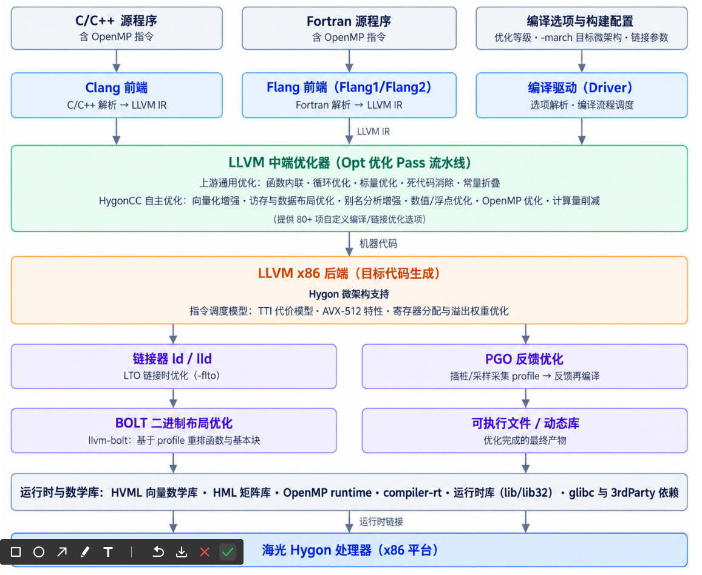

# 01-HygonCC编译器产品概述

| 项目 | 内容 |
|---|---|
| 文档名称 | HygonCC 编译器产品概述 |
| 文档版本 | V1.0 |
| 目标读者 | 使用海光平台、期望通过 HygonCC 编译器提升程序性能的客户、生态伙伴及集成商 |
| 文档性质 | 产品化通用说明文档 |

## 1. 产品定位

HygonCC 是海光信息面向自研 Hygon(海光)处理器打造的高性能编译器产品，以开源 LLVM 作为上游基线，在其框架基础上 fork 自主仓库进行定制开发，支持 C/C++/Fortran 编程语言，为用户提供从源代码到高性能二进制的全流程编译工具链。

- 技术定位：以开源 LLVM 生态为基座,在保持上游兼容性的同时,针对 Hygon CPU 微架构特性与典型业务场景进行深度定制优化,是海光"为数字中国提供核心计算引擎"使命中软件工具链的关键组成。
- 场景定位：面向 HPC(高性能计算)、科学计算、通用业务服务等对性能敏感的应用场景,提供编译期、链接期与二进制级的全周期性能优化能力。
- 生态定位：命令与参数体系与 LLVM/Clang 保持一致，支持 -march=native 自动识别海光处理器，兼容主流构建工具链,降低用户从 GCC/其他 Clang 系编译器迁移的成本。

## 2. 产品优势

### 2.1. 面向 Hygon 微架构的深度适配

- 支持 c86-4g-m4 / c86-4g-m6 / c86-4g-m7 / c86-4g-m8 等 Hygon 微架构，提供 ISA、微架构特性标签、指令调度模型与 TTI 代价模型的完整支持；
- 支持 CPUID 识别：-march=native 自动后端识别；
- 针对 AVX-512 架构特性进行专门优化(如跨 256 位高低半区开销建模、k-mask 计算链降级、gather 指令拆分等)；
- 针对海光平台优化寄存器分配、指令选择与高开销指令替换。

### 2.2. 全周期性能优化能力

| 阶段 | 能力 | 典型手段 |
|---|---|---|
| 编译期 | 80+ 项自定义优化选项 | 向量化增强、访存与数据布局优化、别名分析、数值优化、OpenMP 优化、计算量削减 |
| 链接期 | LTO 链接时优化 | -flto：链接阶段自定义优化 Pass |
| 二进制级 | PGO 反馈优化 | 插桩(-fprofile-generate / -fcs-profile-generate / -fprofile-instr-generate)与采样，基于运行时数据反馈再编译 |
| 二进制级 | BOLT 布局优化 | 基于 profile 重排函数与基本块，优化指令缓存与分支预测 |

### 2.3. 核心优化技术方向

- SIMD 相关：循环向量化与 SLP 向量化，利用 C86 的 SIMD 指令提升计算吞吐；
- 访存与数据布局：优化数组/结构体布局、访问顺序和数据重用，减少 cache miss 与带宽压力；
- 控制流与函数优化：循环不变式外提、函数内联、常量传播、死代码删除、间接调用消除；
- 数学计算优化：围绕 sqrt/log/exp/pow/div/fma 等浮点核心计算优化，结合海光高性能向量数学库(HVML)；
- OpenMP 多线程支持及优化：并行区域切分、线程调度、NUMA 亲和性与负载均衡优化；
- 指令选择与指令调度优化：面向 C86 指令集选择更合适的机器指令，减少流水线停顿与寄存器压力。

### 2.4. 数学库协同优化

- HVML 向量数学库 -fveclib=HVML：海光自研高性能向量数学库，支持循环内数学函数向量化调用；
- HML 矩阵库：识别源码中的矩阵乘法并替换为 HML 库优化实现；
- 支持标量数学库版本选择（如指定 glibc 2.32）与链接路径配置。

### 2.5. 生态兼容、低迁移成本

- 基于 LLVM 工具链，编译器驱动、选项体系与 Clang 高度一致；
- 链接器支持系统 ld 与 LLVM lld（-fuse-ld=lld）；
- 提供 -finit-local-zero、-fveclib 等语言扩展选项，兼顾 Fortran/OpenMP 场景；
- 完整工具链:编译、链接、分析、调试工具配套齐全。

## 3. 组件构成

HygonCC 由以下核心组件构成：

| 组件 | 职责说明 |
|---|---|
| Clang 前端 | 对 C/C++ 程序做前端编译，同时承担整个编译优化过程的驱动 |
| Flang 前端 | 由 Flang1 和 Flang2 组成，将 Fortran 源代码编译为 LLVM IR，之后由 Clang 驱动完成优化与目标代码生成 |
| LLVM 中端 | 编译中端优化：上游通用优化 Pass + HygonCC 自主优化 Pass |
| LLVM x86 后端 | 目标机器代码生成：含 Hygon 微架构支持、指令调度模型与代价模型 |
| 链接器 | 系统 ld(默认)或 LLVM lld，支持 LTO 链接时优化 |
| 运行时库 | 64 位/32 位运行时库、compiler-rt、OpenMP runtime、Hygon 优化库 |
| 数学库 | HVML 向量数学库(libhygonvml)、HML 高性能矩阵库 |
| 性能工具 | PGO 工具链(llvm-profdata)、BOLT(llvm-bolt)、llvm-exegesis(基于 libpfm) |
| 第三方依赖 | glibc、libstdc++、libquadmath 及 gcc 头文件等(以 3rdParty 包形式随发布件提供) |

## 4. 整体架构

HygonCC 整体架构如下图所示，自顶向下分为：输入层 → 前端 → 中端优化 → 后端代码生成 → 链接与反馈优化 → 二进制级优化，运行时与数学库贯穿链接与运行阶段，最终面向海光 C86 处理器平台。



各层职责:

1. 前端：Clang(C/C++)与 Classic Flang(Fortran，Flang1/Flang2)将源代码解析为统一的 LLVM IR；
2. 中端：LLVM opt 流水线在上游通用优化基础上叠加 HygonCC 自主优化 Pass；
3. 后端：LLVM x86 后端针对海光 C86 微架构生成目标机器代码；
4. 链接与反馈优化：ld/lld 完成链接(可选 LTO)，PGO 基于 profile 反馈再编译；
5. 二进制级优化：BOLT 可基于运行时 profile 对最终二进制做函数/基本块布局优化；
6. 运行时与数学库：HVML、HML、OpenMP runtime 等为运行阶段提供高性能支撑。

## 5. 语言及标准支持

| 语言 | 支持情况 |
|---|---|
| C | 支持，由 Clang 前端编译 |
| C++ | 支持，由 Clang 前端编译 |
| Fortran | 支持，由 Flang 前端(Flang1/Flang2)编译 |
| OpenMP | 支持，-fopenmp启用编译/链接期优化与运行时支持,提供线程任务划分、别名分析增强、并行区域扩展等优化选项 |

- 语言标准级别与所基于的上游 LLVM 16.0.4 的 Clang/Flang 实现保持一致(如 C11/C17、C++14/17/20、Fortran 2003/2008 的支持水平)，具体标准支持细节以对应发布版本的 HygonCC 用户手册为准；
- 提供 -fveclib={libmvec/SVML/HVML}、-finit-local-zero、-fstack-argument-array、-fstrict-aliasing 等语言扩展与编译特性选项。

## 6. 环境要求与获取方式

### 6.1. 环境依赖

硬件平台：

- 架构：x86；
- 微架构：c86-4g-m4 / c86-4g-m6 / c86-4g-m7 / c86-4g-m8 (通过 -march 指定或 -march=native 自动识别； c86-4g-m7 默认开启 AVX-512，可通过 -mno-avx512f 关闭)。

操作系统与依赖：

| 操作系统 | 支持版本 |
|---|---|
| CentOS | 8.0 |
| Ubuntu | 18.04 / 22.04 |
| openEuler | 24.03 |
| KylinOS | v11 |

| 软件依赖 | 版本要求 | 说明 |
|---|---|---|
| libstdc++ | 3.4.19 或更高版本 | GNU Standard C++ Library |
| glibc | 2.17 或更高版本 | 建议 2.31 或更高版本，可完整识别海光平台特性 |

> 说明：运行 HygonCC 前请确认已将编译器库路径正确配置到环境变量中。

### 6.2. 获取方式

#### 6.2.1. 安装包获取

从光合开发者社区下载安装包:

- 下载入口：光合开发者社区 / C86 Devkit / compiler / hcc
- 地址：[https://download.sourcefind.cn:65024/8/main/c86-devkit/latest/compiler/hcc](https://download.sourcefind.cn:65024/8/main/c86-devkit/latest/compiler/hcc)
- 命令行下载：

```
curl -L -O https://download.sourcefind.cn:65024/file/8/c86-devkit/latest/compiler/hcc/hcc-{version}.x86_64.tar.gz
# or
wget https://download.sourcefind.cn:65024/8/main/c86-devkit/latest/compiler/hcc/hcc-{version}.x86_64.tar.gz
```

#### 6.2.2. 安装与使用

| 说明 | 方法 |
|---|---|
| 1. 安装到目标目录 | `mkdir -p /opt/hygon/hcc/{version}`<br>`tar -zvxf hcc-{version}.x86_64.tar.gz -C /opt/hygon/hcc/{version}` |
| 2.加载环境变量 | `cd /path/to/install/hcc`<br>`source setenv_hcc.sh` |
| 3.设置默认编译器 | `export CC=clang`<br>`export CXX=clang++`<br>`export FC=flang` |
| 4. 版本验证 | `clang -v`<br>`# clang version 16.0.4` |
| 5.编译运行 C/C++ 程序 | `clang [flags] hello.c -o hello`<br>`clang++ [flags] hello.cpp -o hello` |
| 6.编译运行 Fortran 程序 | `flang [flags] hello.f90 -o hello` |
| 7.使用 LLVM lld 链接器 | `clang [flags] -fuse-ld=lld hello.c -o hello` |

> **建议：安装目录、环境脚本、默认编译器设置在集群环境中统一封装到 modulefile 或登录脚本中。**

#### 6.2.3. 运行时库配置

\# 64 位运行时库

```
export LD_LIBRARY_PATH=<compdir>/lib:$LD_LIBRARY_PATH
```

\# 32 位运行时库

```
export LD_LIBRARY_PATH=<compdir>/lib32:$LD_LIBRARY_PATH
```

\# Hygon 优化库

```
export LD_LIBRARY_PATH=<Hygon optimizing lib path>/Hygon-lib:$LD_LIBRARY_PATH
```

## 7. 使用注意事项

- 开启 -ffast-math 可能降低浮点计算精度，精度敏感程序慎用(使用前请确认 fast-math 语义是否可接受)；
- 叠加过多优化选项可能导致大型工程构建时间过长，可按需裁剪；
- 使用 -Werror 时，HygonCC 与 GCC 的警告处理差异可能导致构建失败，可按错误信息用 -Wno-\<警告名\> 关闭对应警告；
- 遇到运行时找不到动态库/未定义引用时，请检查 HygonCC 库路径等环境变量配置。
