<!-- 独立文档，表格按页面宽度自适应显示。 -->

# 7. HygonVSIP库函数说明

## 7.1 函数说明

HygonVSIP库是海光数学库中的VSIP库，即海光VSIP库（以下简称：HygonVSIP），本章主要介绍HygonVSIP的数据结构、运算以及主要函数。文档涉及的功能函数主要包括基础向量运算、基础矩阵运算和快速傅里叶运算等功能。

## 7.2 接口规范说明

### 7.2.1 函数命名规则

- HygonVSIP自函数：
  函数命名需遵循通用格式：`hml_vsip_<name>_(<parameter>)`

- VSIP开源信号函数：
  函数命名需遵循通用格式：`vsip_<name>_<data_type>_(<parameter>)`
  例如：void (`vsip_cvdiv_f`)(const `vsip_cvview_f` \*a, const `vsip_cvview_f` \*b, const `vsip_cvview_f` \*r);

在上述例子中：

- 前缀为vsip（信号库）
- cvdiv是函数名，表明该函数实现的功能是复数向量除法运算。
- f表示该函数所有入参的数据类型为float
- 圆括号里面为该接口传入的参数。

### 7.2.2 函数名 `<name>`

函数名表明该函数的主要功能，格式为：`<name> = [modifier]<operator>`。

- modifier通常由处理的数据结构类型的缩写组成。
- operation通常由一个或多个单词、首字母缩略词、缩写组成，描述该函数的基本功能。

**数据结构类型说明与命名规则**

<table style="width: 100%; table-layout: fixed; word-break: break-word;">
  <colgroup>
    <col style="width: 33.33%;">
    <col style="width: 33.33%;">
    <col style="width: 33.33%;">
  </colgroup>
  <thead>
    <tr><th>数据结构类型</th><th>说明</th><th>缩写规则</th></tr>
  </thead>
  <tbody>
    <tr><td>complex</td><td>复数</td><td>c</td></tr>
    <tr><td>scalar</td><td>标量</td><td>s</td></tr>
    <tr><td>vector</td><td>向量</td><td>v</td></tr>
    <tr><td>matrics</td><td>矩阵</td><td>m</td></tr>
  </tbody>
</table>

### 7.2.3 数据类型 `<datatype>`

数据类型表明该函数处理的数据类型，通常为函数参数的数据类型。VSIP中所使用的数据类型请参见 **数据结构**。
例如，`vsip_cvdiv_f` 计算两个数据类型32位单精度浮点型复数的源向量的除法运算，并将计算结果存储在32位单精度浮点型复数的目标向量中。

### 7.2.4 函数参数 `<parameter>`

`<parameters>`元素指定该函数的所有参数。
参数的排列顺序按如下规则：

1. 源操作数，通常是标量、向量或者矩阵结构体的对象指针。
2. 目标操作数。

### 7.2.5 函数返回值

返回值：即错误码，定义在枚举类型`HML_VSIP_Result`中。反映库函数执行状态。
程序不提供缓冲区来存储最终错误状态，调用者需要自行决定在函数返回时是否检查错误码。

**错误码说明**

<table style="width: 100%; table-layout: fixed; word-break: break-word;">
  <colgroup>
    <col style="width: 50.00%;">
    <col style="width: 50.00%;">
  </colgroup>
  <thead>
    <tr><th>值</th><th>说明</th></tr>
  </thead>
  <tbody>
    <tr><td>0</td><td>HML_VSIP_STS_NO_ERR，无错误。</td></tr>
    <tr><td>>=1</td><td>通用错误，例如空指针，大小错误，内存占用失败错误等。</td></tr>
  </tbody>
</table>

**注：返回非0的错误码并不表示函数没有执行完成。具体依函数处理逻辑而定**

### 7.2.6 函数前缀

HygonVSIP自函数前缀命名需要遵循的规则：全小写即`hml_vsip`。开源函数前缀命名需要遵循的规则：全小写即`vsip`。

### 7.2.7 函数功能

HygonVSIP自函数功能命名规则：全小写+首字母缩写。
开源函数功能命名规则：全小写+首字母缩写。

### 7.2.8 函数入参

函数入参格式为：`<参数类型> <形参变量名>`。
其中，`<参数类型>`包括基本数据类型（请参见基本数据类型）、结构体和枚举类型（请参见结构体与枚举）。
`<形参变量名>`以小驼峰形式命名，如`alpha`。

## 7.3 数据结构

方便用户阅读，介绍HygonVSIP中用到的别名、数据类型和枚举类型的意义。

### 7.3.1 类型别名

**类型别名与C标准库定义的数据类型对照表**

<table style="width: 100%; table-layout: fixed; word-break: break-word;">
  <colgroup>
    <col style="width: 50.00%;">
    <col style="width: 50.00%;">
  </colgroup>
  <thead>
    <tr><th>类型别名</th><th>C标准库</th></tr>
  </thead>
  <tbody>
    <tr><td>uc</td><td>uint8_t</td></tr>
    <tr><td>si</td><td>int16_t</td></tr>
    <tr><td>ue32</td><td>uint32_t</td></tr>
    <tr><td>i,bl</td><td>int32_t</td></tr>
    <tr><td>f</td><td>float</td></tr>
    <tr><td>li</td><td>int64_t</td></tr>
    <tr><td>vi</td><td>uint64_t</td></tr>
    <tr><td>d</td><td>double</td></tr>
  </tbody>
</table>

### 7.3.2 数据类型

**复数类型**

HygonVSIP的复数类型由两个基本数据类型的成员组成的结构体来描述，分别表示复数的实部和虚部。

定义格式如下：

```c
typedef struct{
    <数据类型> r;
    <数据类型> i;
}vsip_cscalar_<类型>;
```

**说明**:

格式中的\<类型\>和\<数据类型\>的对应请参见 **类型别名**。

HygonVSIP中使用的复数类型定义在vsip.h中，包括：`vsip_cscalar_f`、`vsip_cscalar_d`。

**Bool类型**

使用signed int代替Bool类型，0表示false，非0表示true。

### 7.3.3 结构体和枚举类型

**HygonVSIP自函数结构体与枚举分类说明**

结构体包含：函数上下文结构体。
枚举包含：函数返回值等。
结构体与枚举类型命名规则及形式如下表所示。

**结构体命名规则**

<table style="width: 100%; table-layout: fixed; word-break: break-word;">
  <colgroup>
    <col style="width: 33.33%;">
    <col style="width: 33.33%;">
    <col style="width: 33.33%;">
  </colgroup>
  <thead>
    <tr><th>结构体类型</th><th>命名规则</th><th>形式</th></tr>
  </thead>
  <tbody>
    <tr><td>类型名</td><td>以HygonVSIP为前缀的大驼峰，下划线分割</td><td>例如：HML_VSIP_ProVersion</td></tr>
    <tr><td>成员变量名</td><td>小驼峰</td><td>例如：componentName, packageVersion</td></tr>
  </tbody>
</table>

**枚举类型命名规则**

<table style="width: 100%; table-layout: fixed; word-break: break-word;">
  <colgroup>
    <col style="width: 33.33%;">
    <col style="width: 33.33%;">
    <col style="width: 33.33%;">
  </colgroup>
  <thead>
    <tr><th>枚举类型</th><th>命名规则</th><th>形式</th></tr>
  </thead>
  <tbody>
    <tr><td>类型名</td><td>以HygonVSIP为前缀的大驼峰，下划线分割</td><td>例如：HML_VSIP_Result</td></tr>
    <tr><td>成员变量名</td><td>全大写，下划线分割</td><td>例如：HML_VSIP_STS_NO_ERR</td></tr>
  </tbody>
</table>

### 7.3.4 VSIP开源结构体

**复数型结构体**

请参见复数类型

**函数上下文结构体**

VSIP开源函数库中定义了一些特殊的结构体，用来存储特定函数的上下文信息。例如，结构体`vsip_fft_f`存储了快速傅里叶变换所需的旋转因子和位反转索引。
以下列举float型一些常用的结构体：

- 如`vsip_cblock_f`复数数据块结构体。
- 如`vsip_cvview_f`复数向量结构体。
- 如`vsip_cmview_f`复数矩阵结构体。

函数上下文结构体依赖于处理器。因此，这些上下文相关的结构没有在公共头文件中定义，它们的字段也不可访问。HygonVSIP函数库没有提供修改这些结构体或创建函数上下文作为自动变量的功能，可通过相关函数构建上下文结构体。

### 7.3.5 VSIP开源枚举类型

- 枚举类型 `vsip_major` 定义了矩阵运算方向：

```c
typedef enum {
    VSIP_ROW = 0, // 矩阵横向运算
    VSIP_COL = 1 // 矩阵纵向运算
} vsip_major;
```

- 枚举类型`vsip_ffttype`定义了fft使用的算法类型

```c
typedef enum {
    VSIP_CCFFTOP, // 复数To复数非原地操作
    VSIP_CCFFTIP, // 复数To复数原地操作
    VSIP_RCFFTOP, // 实数To复数非原地操作
    VSIP_CRFFTOP // 复数To实数非原地操作
} vsip_fft_dir
```

- 枚举类型`vsip_fft_dir`定义了fft运算方向。

```c
typedef enum {
    VSIP_FFT_FWD = -1, // 正向
    VSIP_FFT_INV = +1 // 逆向
} vsip_fft_dir
```

- 枚举类型`vsip_memory_hint`定义了fft运算内存运用方式，不使用：

```c
typedef enum {
    VSIP_MEM_NONE = 0,
    VSIP_MEM_RDONLY = 1,
    VSIP_MEM_CONST = 2,
    VSIP_MEM_SHARED = 3,
    VSIP_MEM_SHARED_RDONLY = 4,
    VSIP_MEM_SHARED_CONST = 5
} vsip_memory_hint;
```

- 枚举类型`vsip_alg_hint`定义了fft运算算法，不使用：

```c
typedef enum {
    VSIP_ALG_SPACE = 0, // 内存空间
    VSIP_ALG_TIME = 1, // 耗时
    VSIP_ALG_NOISE = 2 // 噪声
} vsip_alg_hint;
```

## 7.4 头文件与函数库使用

### 7.4.1 头文件

下表简要介绍了HygonVSIP各个头文件的说明。

**HygonVSIP头文件说明**

<table style="width: 100%; table-layout: fixed; word-break: break-word;">
  <colgroup>
    <col style="width: 50.00%;">
    <col style="width: 50.00%;">
  </colgroup>
  <thead>
    <tr><th>文件名</th><th>说明</th></tr>
  </thead>
  <tbody>
    <tr><td>vsip.h</td><td>开源VSIP信号库的声明文件</td></tr>
    <tr><td>hml_vsip.h</td><td>HygonVSIP自有函数的头文件，包含打印软件版本号，格式化格式化数据内容等功能函数。</td></tr>
  </tbody>
</table>

### 7.4.2 函数库使用方法

**设置HygonVSIP线程数**

HygonVSIP的多线程由Openmp实现，设置线程数方式可以由环境变量“OMP\_NUM\_THREADS”进行控制。
设置HygonVSIP的线程数的方式如下：

```shell

# 设置OMP线程数
export OMP_NUM_THREADS=8 
```

## 7.6 函数定义

HygonVSIP的函数功能主要分为以下几个部分：支持函数、标量计算、向量计算、信号量处理、随机数生成、线性代数计算函数。

### 7.6.1 支持函数

这部分主要介绍HygonVSIP需要的支持功能。

这些支持功能包括初始化和结束VSIPL函数使用的例程，以及创建、销毁和操作VSIPL块和视图对象的例程。支持功能分为五个部分，描述了库初始化和结束函数、数组和块对象函数、向量视图函数、矩阵视图函数和张量视图函数。在后面的四个部分中，函数可能分为创建、销毁和操作函数。

#### 7.6.1.1 初始化\&完成

##### 7.6.1.1.1 vsip\_init

**函数功能**

提供初始化，允许实现分配和设置任何全局状态，并准备支持用户对VSIPL功能的使用。

**接口定义**

C interface：

```c
int vsip_init(void*);
```

##### 7.6.1.1.2 vsip\_finalize

**函数功能**

提供清理和释放VSIPL使用的资源（如果是嵌套系列调用的最后一次调用），允许实现在调用完成后保证 `vsip_init` 分配的任何资源不再被使用。

**接口定义**

C interface：

```c
int vsip_finalize(void*);
```

#### 7.6.1.2 数组和块对象支持函数

**当前版本已实现函数**

<table style="width: 100%; table-layout: fixed; word-break: break-word;">
  <colgroup>
    <col style="width: 33.33%;">
    <col style="width: 33.33%;">
    <col style="width: 33.33%;">
  </colgroup>
  <tbody>
    <tr><td>vsip_blockcreate_f</td><td>vsip_blockcreate_i</td><td>vsip_cblockcreate_f</td></tr>
    <tr><td>vsip_blockbind_f</td><td>vsip_blockbind_i</td><td>vsip_cblockbind_f</td></tr>
    <tr><td>vsip_blockfind_f</td><td>vsip_blockfind_i</td><td>vsip_cblockfind_f</td></tr>
    <tr><td>vsip_blockdestroy_f</td><td>vsip_blockdestroy_i</td><td>vsip_cblockdestroy_f</td></tr>
    <tr><td>vsip_blockadmit_f</td><td>vsip_blockadmit_i</td><td>vsip_cblockadmit_f</td></tr>
    <tr><td>vsip_blockrelease_f</td><td>vsip_blockrelease_i</td><td>vsip_cblockrelease_f</td></tr>
    <tr><td>vsip_blockrebind_f</td><td>vsip_blockrebind_i</td><td>vsip_cblockrebind_f</td></tr>
    <tr><td>vsip_blockcreate_bl</td><td>vsip_blockcreate_vi</td><td>vsip_blockcreate_mi</td></tr>
    <tr><td>vsip_blockbind_bl</td><td>vsip_blockbind_vi</td><td>vsip_blockbind_mi</td></tr>
    <tr><td>vsip_blockfind_bl</td><td>vsip_blockfind_vi</td><td>vsip_blockfind_mi</td></tr>
    <tr><td>vsip_blockdestroy_bl</td><td>vsip_blockdestroy_vi</td><td>vsip_blockdestroy_mi</td></tr>
    <tr><td>vsip_blockadmit_bl</td><td>vsip_blockadmit_vi</td><td>vsip_cblockadmit_mi</td></tr>
    <tr><td>vsip_blockrelease_bl</td><td>vsip_blockrelease_vi</td><td>vsip_cblockrelease_mi</td></tr>
    <tr><td>vsip_blockrebind_bl</td><td>vsip_blockrebind_vi</td><td>vsip_cblockrebind_mi</td></tr>
    <tr><td colspan="3">vsip_cstorage</td></tr>
  </tbody>
</table>

##### 7.6.1.2.1 vsip\_\[d\]blockadmit\_\[p\]

接受一个VSIPL块用于VSIPL操作。

**函数功能**

接受一个与之相关的VSIPL视图用于VSIPL操作的VSIPL块，`vsip_[d]block_[p]`。

允许操作会将用户数据数组的所有权转移给VSIPL，用户在块被接受后不应再对数据数组进行操作。如果接受失败，则返回非零值。真实的更新标志表示块中的数据将与用户指定的数据数组保持一致。如果更新标志为假，则块中的数据由实现决定，用户应该将块视为包含未定义数据。

**接口定义**

C interface：

```c
int vsip_blockadmit_f(vsip_block_f *block, vsip_scalar_bl update);
int vsip_cblockadmit_f(vsip_cblock_f *block, vsip_scalar_bl update);
int vsip_blockadmit_i(vsip_block_i *block, vsip_scalar_bl update);
int vsip_blockadmit_bl(vsip_block_bl *block, vsip_scalar_bl update);
int vsip_blockadmit_vi(vsip_block_vi *block, vsip_scalar_bl update);
int vsip_blockadmit_mi(vsip_block_mi *block, vsip_scalar_bl update);
```

**参数**

<table style="width: 100%; table-layout: fixed; word-break: break-word;">
  <colgroup>
    <col style="width: 18.00%;">
    <col style="width: 46.00%;">
    <col style="width: 20.00%;">
    <col style="width: 16.00%;">
  </colgroup>
  <thead>
    <tr><th>参数名</th><th>描述</th><th>取值范围</th><th>输入输出</th></tr>
  </thead>
  <tbody>
    <tr><td>block</td><td>指向block对象的指针</td><td>非空</td><td>输入</td></tr>
    <tr><td>update</td><td>布尔标志，其中 true 表示在状态更改期间必须维护数据数组的值。</td><td>0,1</td><td>输入</td></tr>
  </tbody>
</table>

##### 7.6.1.2.2 vsip\_blockbind\_\[p\]

创建并将一个VSIPL块绑定到用户分配的内存（用户数据数组）上。

**函数功能**

创建一个实数VSIPL块对象，`vsip_block_[p]`，并将该块对象绑定到用户定义的用户数据数组上。数据数组应至少包含N个`vsip_scalar_[p]`元素。该函数返回一个指向块对象的指针。该块以释放状态创建，在调用操作数据的VSIPL函数之前必须将其提交给VSIPL。

**接口定义**

C interface：

```c
vsip_block_f *vsip_blockbind_f(vsip_scalar_f *data, vsip_length N, vsip_memory_hint hint);
vsip_block_i *vsip_blockbind_i(vsip_scalar_i *data, vsip_length N, vsip_memory_hint hint);
vsip_block_bl *vsip_blockbind_bl(vsip_scalar_bl *data, vsip_length N,vsip_memory_hint hint);
vsip_block_vi *vsip_blockbind_vi(vsip_scalar_vi *data, vsip_length N, vsip_memory_hint hint);
vsip_block_mi *vsip_blockbind_mi(vsip_scalar_vi *data, vsip_length N, vsip_memory_hint hint);
```

**参数**

<table style="width: 100%; table-layout: fixed; word-break: break-word;">
  <colgroup>
    <col style="width: 18.00%;">
    <col style="width: 46.00%;">
    <col style="width: 20.00%;">
    <col style="width: 16.00%;">
  </colgroup>
  <thead>
    <tr><th>参数名</th><th>描述</th><th>取值范围</th><th>输入输出</th></tr>
  </thead>
  <tbody>
    <tr><td>data</td><td>指向一个包含至少 N 个 vsip_scalar_p 元素的连续内存数据数组的指针。</td><td>非空</td><td>输入</td></tr>
    <tr><td>N</td><td>用户数据数组中与用户块（vsip_block_p）绑定的元素数量。</td><td>> 0</td><td>输入</td></tr>
    <tr><td>hint</td><td>内存提示</td><td>枚举类型vsip_memory_hint</td><td>输入</td></tr>
  </tbody>
</table>

**返回值**

返回 `vsip_block_p` 类型的指针，如果绑定失败，则返回空指针

**示例**

C interface：

```c
#include <vsip.h>
...
vsip_scalar_d A[M * N];
vsip_block_d *Ablock = vsip_blockbind_d(A, M * N, VSIP_MEM_NONE);
if (NULL == Ablock) 
    error("Bind of A to Ablock failed");
```

##### 7.6.1.2.3 vsip\_\[d\]blockcreate\_\[p\]

创建一个VSIPL块并将一个（由VSIPL分配的）数据数组（内存）绑定到它上面。

**函数功能**

创建一个已接受的VSIPL块对象（`vsip_[d]block_[p]`），并为N个元素分配数据数组内存（VSIPL数据）。

对于实数数据，数据数组的大小至少为N\*sizeof(vsip\_scalar\_\[p\])字节；对于复数数据，数据数组的大小至少为2N\*sizeof(vsip\_scalar\_\[p\])字节。该函数将块对象绑定到分配的数据内存上，并返回指向块对象的指针。使用 `vsip_dblockcreate_[p]`创建的数据数组只能使用VSIPL函数访问。不提供直接操作的信息，比如数据数组的指针。

**接口定义**

C interface：

```c
vsip_block_f *vsip_blockcreate_f(vsip_length N, vsip_memory_hint hint);
vsip_block_i *vsip_blockcreate_i(vsip_length N, vsip_memory_hint hint);
vsip_cblock_f *vsip_cblockcreate_f(vsip_length N, vsip_memory_hint hint);
vsip_block_bl *vsip_blockcreate_bl(vsip_length N, vsip_memory_hint hint);
vsip_block_vi *vsip_blockcreate_vi(vsip_length N, vsip_memory_hint hint);
vsip_block_mi *vsip_blockcreate_mi(vsip_length N, vsip_memory_hint hint);
```

**参数**

<table style="width: 100%; table-layout: fixed; word-break: break-word;">
  <colgroup>
    <col style="width: 18.00%;">
    <col style="width: 46.00%;">
    <col style="width: 20.00%;">
    <col style="width: 16.00%;">
  </colgroup>
  <thead>
    <tr><th>参数名</th><th>描述</th><th>取值范围</th><th>输入输出</th></tr>
  </thead>
  <tbody>
    <tr><td>N</td><td>要为数据数组分配的元素数量。</td><td>>0</td><td>输入</td></tr>
    <tr><td>hint</td><td>内存提示</td><td>枚举类型vsip_memory_hint</td><td>输入</td></tr>
  </tbody>
</table>

**返回值**

返回 `vsip_dblock_p` 类型的指针，如果创建块失败，则返回 null。

**示例**

要创建一个足够大的块，以容纳一个类型为 float 的 M 行 N 列矩阵：
C interface：

```c
vsip_block_f *Ablock = vsip_blockcreate_f(M*N, VSIP_MEM_NONE);
if (NULL == Ablock) 
    error("Create of Ablock failed");
```

要创建一个足够大的块，以容纳类型为复数双精度的复向量，长度为 N：
C interface：

```c
vsip_cblock_f *Ablock = vsip_cblockcreate_f(N, VSIP_MEM_NONE);
if (NULL == Ablock) 
    error("Create of Ablock failed");
```

##### 7.6.1.2.4 vsip\_cblockbind\_\[p\]

创建并将一个VSIPL复数块绑定到用户分配的内存（用户数据数组）上。

**函数功能**

创建一个复数VSIPL块对象，`vsip_cblock_p`，并将该复数块对象绑定到单个用户定义的用户数据数组或两个用户定义的数据数组上。对于单个数据数组的情况，该数组必须包含 2N个`vsip_scalar_p` 元素。对于两个数据数组，每个数组应包含N个`vsip_scalar_p`元素。该块以释放状态创建，在调用操作数据的VSIPL函数之前必须将其提交给VSIPL。

**接口定义**

C interface：

```c
vsip_cblock_f*(vsip_cblockbind_f)(vsip_scalar_f* data1,
                                  vsip_scalar_f* data2,
                                  size_t,
                                  vsip_memory_hint);
```

**参数**

<table style="width: 100%; table-layout: fixed; word-break: break-word;">
  <colgroup>
    <col style="width: 18.00%;">
    <col style="width: 46.00%;">
    <col style="width: 20.00%;">
    <col style="width: 16.00%;">
  </colgroup>
  <thead>
    <tr><th>参数名</th><th>描述</th><th>取值范围</th><th>输入输出</th></tr>
  </thead>
  <tbody>
    <tr><td>data1</td><td>如果 data2 为 null，则 data1 是指向一个包含至少 2N 个 vsip_scalar_p 元素的连续内存数据数组的指针。数据数组的偶数元素包含实部值，奇数元素包含虚部值。数据以交错复数形式存储。请注意，第一个元素被认为是偶数，因为索引值从零开始。<br>如果 data2 不为 null，则 data1 是指向一个包含至少 N 个 vsip_scalar_p 元素的连续内存数据数组的指针。数据数组包含实部值。数据以分裂复数形式存储。</td><td>非空</td><td>输入</td></tr>
    <tr><td>data2</td><td>如果 data2 为 null，则数据以"interleaved"复数形式存储。<br>如果 data2 不为 null，则它是指向一个包含至少 N 个 vsip_scalar_p 元素的连续内存数据数组的指针。数据数组包含虚部值。数据以"split"复数形式存储。</td><td>可为空</td><td>输入</td></tr>
    <tr><td>N</td><td>用户数据数组中与类型为 vsip_cblock_[p] 的用户块绑定的复数元素数量。</td><td>>0</td><td>输入</td></tr>
    <tr><td>hint</td><td>内存提示</td><td>枚举类型vsip_memory_hint</td><td>输入</td></tr>
  </tbody>
</table>

**返回值**

返回 `vsip_block_[p]` 类型的指针，如果绑定失败，则返回空指针

**示例**

C interface：

```c
#include <vsip.h>
...
vsip_scalar_f Ai[M*N], Aq[M*N];
vsip_cblock_f *Ablock = vsip_cblockbind_f(Ai, Aq, M*N, VSIP_MEM_NONE);
if (NULL == Ablock) 
    error("Bind of A to Ablock failed");
```

##### 7.6.1.2.5 vsip\_\[d\]blockdestroy\_\[p\]

销毁（释放）一个VSIPL块对象以及由VSIPL分配的任何数据数组。

**函数功能**

销毁（释放）一个VSIPL块对象`vsip_block_[p]`，以及任何VSIPL数据数组。

**接口定义**

C interface：

```c
void vsip_blockdestroy_f(vsip_block_f *block);
void vsip_blockdestroy_i(vsip_block_i *block);
void vsip_cblockdestroy_f(vsip_cblock_f *block);
void vsip_blockdestroy_bl(vsip_block_bl *block);
void vsip_blockdestroy_vi(vsip_block_vi *block);
void vsip_blockdestroy_mi(vsip_block_mi *block);
```

**参数**

<table style="width: 100%; table-layout: fixed; word-break: break-word;">
  <colgroup>
    <col style="width: 18.00%;">
    <col style="width: 46.00%;">
    <col style="width: 20.00%;">
    <col style="width: 16.00%;">
  </colgroup>
  <thead>
    <tr><th>参数名</th><th>描述</th><th>取值范围</th><th>输入输出</th></tr>
  </thead>
  <tbody>
    <tr><td>block</td><td>指向vsipl 块的指针</td><td>非空</td><td>输入</td></tr>
  </tbody>
</table>

**返回值**

None

**示例**

C interface：

```c
{
  vsip_block_bl* xblock = vsip_blockcreate_bl(1000, VSIP_MEM_NONE);
  ...
  vsip_blockdestroy_bl(xblock);
}
```

##### 7.6.1.2.6 vsip\_blockfind\_\[p\]

查找绑定到已释放的VSIPL块对象的数据的指针。

**函数功能**

返回绑定到已释放的VSIPL块的用户数据数组的地址。如果块未被释放，则返回空指针。请注意，如果块绑定到 NULL 并且处于已释放状态，则将返回空指针。

**接口定义**

C interface：

```c
vsip_scalar_f *vsip_blockfind_f(const vsip_block_f *block);
vsip_scalar_i *vsip_blockfind_i(const vsip_block_i *block);
vsip_scalar_bl *vsip_blockfind_bl(const vsip_block_bl *block);
vsip_scalar_vi *vsip_blockfind_vi(const vsip_block_vi *block);
vsip_scalar_vi *vsip_blockfind_mi(const vsip_block_mi *block);
```

**参数**

<table style="width: 100%; table-layout: fixed; word-break: break-word;">
  <colgroup>
    <col style="width: 18.00%;">
    <col style="width: 46.00%;">
    <col style="width: 20.00%;">
    <col style="width: 16.00%;">
  </colgroup>
  <thead>
    <tr><th>参数名</th><th>描述</th><th>取值范围</th><th>输入输出</th></tr>
  </thead>
  <tbody>
    <tr><td>block</td><td>指向vsipl 块的指针</td><td>非空</td><td>输入</td></tr>
  </tbody>
</table>

**返回值**

返回一个 `vsip_scalar_[p]` 类型的指针，指向已释放块的数据数组，如果块对象不处于已释放状态，则返回空指针。请注意，如果块已释放并且绑定到 NULL，则也会返回空指针。

##### 7.6.1.2.7 vsip\_cblockfind\_\[p\]

如果复杂块对象数据处于已接受状态，则返回绑定到已释放的VSIPL复杂块对象 `vsip_cblock_[p]` 的用户数据数组的指针，否则返回空指针。

**函数功能**

返回指向已释放的VSIPL复杂块对象`vsip_cblock_p`绑定的用户数据数组的指针，如果块对象数据处于已接受状态，则返回空指针。

**接口定义**

C interface：

```c
void(vsip_cblockfind_f)(const vsip_cblock_f* b,
                        vsip_scalar_f** data1,
                        vsip_scalar_f** data2);
```

**参数**

<table style="width: 100%; table-layout: fixed; word-break: break-word;">
  <colgroup>
    <col style="width: 18.00%;">
    <col style="width: 46.00%;">
    <col style="width: 20.00%;">
    <col style="width: 16.00%;">
  </colgroup>
  <thead>
    <tr><th>参数名</th><th>描述</th><th>取值范围</th><th>输入输出</th></tr>
  </thead>
  <tbody>
    <tr><td>block</td><td>指向vsipl 块的指针</td><td>非空</td><td>输入</td></tr>
    <tr><td>data1</td><td>输出 - 指向指向数据数组的指针的指针，或者实部值的数据数组。如果复杂块处于已接受状态，则返回空指针。</td><td>非空</td><td>输出</td></tr>
    <tr><td>datg2</td><td>输出 - 指向空指针的指针，或者指向以前的数据数组的指针以获取虚部值。如果复杂块处于已接受状态或者以前的绑定是到复数交错形式的数据，则返回空指针。</td><td>非空</td><td>输出</td></tr>
  </tbody>
</table>

**返回值**

None

##### 7.6.1.2.8 vsip\_blockrefind\_\[p\]

重新将一个VSIPL块绑定到用户指定的数据上。

**函数功能**

重新将现有的已释放的VSIPL实数块对象`vsip_block_p`重新绑定到一个新的（先前分配的）用户数据数组上。

该数组必须至少包含N个`vsip_scalar_[p]`元素，其中N是现有块对象中的元素数量。尝试重新绑定一个派生块对象或处于已接受状态的块对象都将失败。在任何情况下都会返回空指针。否则，它将返回指向旧用户数据数组的指针。

**接口定义**

C interface：

```c
vsip_scalar_f *vsip_blockrebind_f(vsip_block_f *block, vsip_scalar_f *data);
vsip_scalar_i *vsip_blockrebind_i(vsip_block_i *block, vsip_scalar_i *data);
vsip_scalar_bl *vsip_blockrebind_bl(vsip_block_bl *block, vsip_scalar_bl *data);
vsip_scalar_vi *vsip_blockrebind_vi(vsip_block_vi *block, vsip_scalar_vi *data);
vsip_scalar_vi *vsip_blockrebind_mi(vsip_block_mi *block, vsip_scalar_vi *data);
```

**参数**

<table style="width: 100%; table-layout: fixed; word-break: break-word;">
  <colgroup>
    <col style="width: 18.00%;">
    <col style="width: 46.00%;">
    <col style="width: 20.00%;">
    <col style="width: 16.00%;">
  </colgroup>
  <thead>
    <tr><th>参数名</th><th>描述</th><th>取值范围</th><th>输入输出</th></tr>
  </thead>
  <tbody>
    <tr><td>block</td><td>指向vsipl 块的指针</td><td>非空</td><td>输入</td></tr>
  </tbody>
</table>

**返回值**

如果块处于已接受状态，则返回指向先前绑定到块的数据数组的指针，否则返回空指针。

**示例**

C interface：

```c
#include <vsip.h>

#define BUFSIZE 1000
extern const volatile vsip_scalar_f *buf_ping, *buf_pong;
int pingpong = 0;

vsip_block_f* buf_blk = vsip_blockbind_f(buf_ping, BUFSIZE, VSIP_MEM_NONE);
vsip_vview_f* buf = vsip_vbind_f(buf_blk,0,1,N);

while(1) {
    /* Wait until data ready in buf_ping (buf_pong) */
    wait_until_data_ready();
    pingpong = !pingpong;
    /* Release buf_pong (buf_ping) */
    vsip_blockrelease_f(buf_blk,VSIP_FALSE);
    /* Start DMA of next data frame into buf_pong (buf_ping) */
    /* Rebind and admit buf_ping (buf_pong) */
    dma_write(vsip_blockrebind_f(buf_blk, (pingpong ? buf_ping : buf_pong)));
    vsip_blockadmit_f(buf_blk, VSIP_TRUE);
    /* Do some processing using buf_ping */
    do_some_processing_with_buf();
}
```

##### 7.6.1.2.9 vsip\_cblockrefind\_\[p\]

重新绑定一个VSIPL复数块到用户指定的数据。

**函数功能**

将已释放的VSIPL复数块对象`vsip_cblock_p`重新绑定到一个新的（先前分配的）用户定义的数据数组，或者绑定到两个新的（先前分配的）用户定义的数据数组。

在使用单个数据数组的情况下，该数组必须包含2N个`vsip_scalar_p`元素。对于两个数据数组的情况，每个数组应包含N个`vsip_scalar_p`元素。如果尝试重新绑定处于已接纳状态的块对象，将会失败，并返回空值。否则，它将返回指向旧的用户数据数组的指针。

**接口定义**

C interface：

```c
void vsip_cblockrebind_f(vsip_cblock_f* block,
                         vsip_scalar_f* data1,
                         vsip_scalar_f* data2,
                         vsip_scalar_f** prevdata1,
                         vsip_scalar_f** prevdata2);
```

**参数**

<table style="width: 100%; table-layout: fixed; word-break: break-word;">
  <colgroup>
    <col style="width: 18.00%;">
    <col style="width: 46.00%;">
    <col style="width: 20.00%;">
    <col style="width: 16.00%;">
  </colgroup>
  <thead>
    <tr><th>参数名</th><th>描述</th><th>取值范围</th><th>输入输出</th></tr>
  </thead>
  <tbody>
    <tr><td>block</td><td>指向复数vsipl块的指针</td><td>非空</td><td>输入</td></tr>
    <tr><td>data1</td><td>指向新数据或者新数据的实数部分的指针</td><td>如果data2为NULL，长度为2N，否则为N</td><td>输入</td></tr>
    <tr><td>data1</td><td>指向新数据的虚数部分的指针</td><td>可空，如不为空，长度为N</td><td>输入</td></tr>
    <tr><td>prevdata1</td><td>指向之前的用户数据数组或者用户数组的实数部分。</td><td>可空，如不为空，长度为N</td><td>输出</td></tr>
    <tr><td>prevdata2</td><td>指向之前的用户数组的虚数部分。</td><td>可空，如不为空，长度为N</td><td>输出</td></tr>
  </tbody>
</table>

##### 7.6.1.2.10 vsip\_blockrelease\_\[p\]

释放一个VSIPL块以供直接用户访问。

**函数功能**

释放一个VSIPL块对象`vsip_block_[p]`，以允许直接用户访问数据数组。

通过`vsip_[d]blockcreate_[p]`创建的块对象和派生块不能被释放。尝试释放这些块将返回空指针。真实的更新标志表示用户指定的数据数组中的数据将被更新以匹配与块相关联的数据。如果更新标志为假，则用户数据的状态取决于实现，并且应假定用户数据数组包含未定义数据。

**接口定义**

C interface：

```c
vsip_scalar_f *vsip_blockrelease_f(vsip_block_f *block, vsip_scalar_bl update);
vsip_scalar_i *vsip_blockrelease_i(vsip_block_i *block, vsip_scalar_bl update);
vsip_scalar_bl *vsip_blockrelease_bl(vsip_block_bl *block, vsip_block_bl update);
vsip_scalar_vi *vsip_blockrelease_vi(vsip_block_vi *block, vsip_scalar_bl update);
vsip_scalar_vi *vsip_blockrelease_mi(vsip_block_mi *block, vsip_scalar_bl update);
```

**参数**

<table style="width: 100%; table-layout: fixed; word-break: break-word;">
  <colgroup>
    <col style="width: 18.00%;">
    <col style="width: 46.00%;">
    <col style="width: 20.00%;">
    <col style="width: 16.00%;">
  </colgroup>
  <thead>
    <tr><th>参数名</th><th>描述</th><th>取值范围</th><th>输入输出</th></tr>
  </thead>
  <tbody>
    <tr><td>block</td><td>指向vsipl 块的指针</td><td>非空</td><td>输入</td></tr>
    <tr><td>update</td><td>布尔标志，其中 true 表示在状态更改期间必须维护数据数组的值。</td><td>0,1</td><td>输入</td></tr>
  </tbody>
</table>

**返回值**

如果释放块失败，则返回空指针，否则返回指向数据数组的指针。

**示例**

C interface：

```c
#include <vsip.h>
...
int i;
vsip_scalar_f a[N], c[N];
vsip_block_f
    *ablk = vsip_blockbind_f(a, N, VSIP_MEM_NONE),
    *cblk = vsip_blockbind_f(c, N, VSIP_MEM_NONE);
vsip_vview_f
    *va = vsip_vbind_f(ablk, 0, 1, N),
    *vb = vsip_vcreate_f(N, VSIP_MEM_NONE),
    *vc = vsip_vbind_f(cblk, 0, 1, N);
for (i=0; i<N; i++) 
    a[i] = cosh(2*M_PI*i/N);
vsip_vramp_f(0.0, 1.0/N, vb);
vsip_blockadmit_f(ablk,VSIP_TRUE);
vsip_vadd_f(va,vb,vc);
vsip_blockrelease_f(cblk,VSIP_TRUE);
for (i=0; i<N; i++) 
    printf("c[%i] = %d\n",i,c[i]);
```

##### 7.6.1.2.11 vsip\_cblockrelease\_\[p\]

释放一个复数块，使其可以直接由用户访问。

**函数功能**

释放一个VSIPL复杂块对象`vsip_cblock_[p]`，以供直接用户访问数据数组。

通过 `vsip_dblockcreate_[p]`创建的块对象不能被释放。尝试释放这些块将在指针值中返回空指针。真实的更新标志表示用户指定的数据数组中的数据将被更新以匹配与块相关联的数据。如果更新标志为假，则用户数据的状态取决于实现，并且应假定用户数据数组包含未定义数据。

**接口定义**

C interface：

```c
void(vsip_cblockrelease_f)(vsip_cblock_f* block,
                           vsip_scalar_bl update,
                           vsip_scalar_f** data1,
                           vsip_scalar_f** data2);
```

**参数**

<table style="width: 100%; table-layout: fixed; word-break: break-word;">
  <colgroup>
    <col style="width: 18.00%;">
    <col style="width: 46.00%;">
    <col style="width: 20.00%;">
    <col style="width: 16.00%;">
  </colgroup>
  <thead>
    <tr><th>参数名</th><th>描述</th><th>取值范围</th><th>输入输出</th></tr>
  </thead>
  <tbody>
    <tr><td>block</td><td>指向vsipl 块的指针</td><td>非空</td><td>输入</td></tr>
    <tr><td>update</td><td>布尔标志，其中 true 表示在状态更改期间必须维护数据数组的值。</td><td>0,1</td><td>输入</td></tr>
    <tr><td>data1</td><td>如果 data2 为 null，则 data1 是指向一个包含至少 2N 个 vsip_scalar_p 元素的连续内存数据数组的指针。数据数组的偶数元素包含实部值，奇数元素包含虚部值。数据以交错复数形式存储。请注意，第一个元素被认为是偶数，因为索引值从零开始。<br>如果 data2 不为 null，则 data1 是指向一个包含至少 N 个 vsip_scalar_p 元素的连续内存数据数组的指针。数据数组包含实部值。数据以分裂复数形式存储。</td><td>非空</td><td>输入</td></tr>
    <tr><td>data2</td><td>如果 data2 为 null，则数据以"interleaved"复数形式存储。<br>如果 data2 不为 null，则它是指向一个包含至少 N 个 vsip_scalar_p 元素的连续内存数据数组的指针。数据数组包含虚部值。数据以"split"复数形式存储。</td><td>可为空</td><td>输入</td></tr>
  </tbody>
</table>

**示例**

第一个例子是说明了一个"split"存储形式的cblockrelease调用方式。
C interface：

```c
#include <stdio.h>
#include <stdlib.h>
#include <vsip.h>
#define N 829
int main() {
    int i;
    vsip_cscalar_f X, Y;
    vsip_scalar_f dat1[N], dat2[N];
/* input data arrays */
    vsip_scalar_f *addr1, *addr2;
/* returned data pointers */
    /* Input complex scalar */
    X.r = 2.0;
    X.i = 0.0;
    /* Input data sets */
    for (i = 0; i < N; i++) {
        dat1[i] = (vsip_scalar_f)(i);
        dat2[i] = (vsip_scalar_f)(-i);
    }
    /* InitializeVSIPL*/
    vsip_init((void*)0);
    {
        /* Bind data to a complex block */
        vsip_cblock_f* cblock = vsip_cblockbind_f(dat1, dat2, N, VSIP_MEM_NONE);
        vsip_cvview_f* cdat = vsip_cvbind_f(cblock, 0, 1, N);
        /* Admit the block intoVSIPL*/
        vsip_cblockadmit_f(cblock, VSIP_TRUE);
        /* Multiply in-place the complex data type (dat1,dat2) by X */
        vsip_csvmul_f(X, cdat, cdat);
        /* Release the block back to the user */
        vsip_cblockrelease_f(cblock, VSIP_TRUE, &addr1, &addr2);
        /* Destroy the block and its views and data */
        vsip_cvdestroy_f(cdat);
        vsip_cblockdestroy_f(cblock);
    }
    /* FinalizeVSIPL*/
    vsip_finalize((void*)0);
    /* Print results using original pointers */
    for (i = 0; i < N; i++)
        printf("result %d : %.1f %.1f\n", i, dat1[i], dat2[i]);
    printf("\n\n");
    /* Print results using returned pointers */
    for (i = 0; i < N; i++)
        printf("result(again) %d : %.1f %.1f\n", i, *(addr1 + i), *(addr2 + i));
    printf("\n\n");
    return 0;
}
```

第二个例子是说明了一个"interleaved"存储形式的cblockrelease调用方式。
C interface：

```c
#include <stdio.h>
#include <stdlib.h>
#include <vsip.h>
#define N 829
int main() {
    int i;
    vsip_cscalar_f X, Y;
    vsip_scalar_f dat1[2 * N];
    vsip_scalar_f *addr1, *addr2;
    /* InitializeVSIPL*/
    vsip_init((void*)0);
    /* Input complex scalar */
    X.r = 2.0;
    X.i = 0.0;
    /* Input data sets */
    for (i = 0; i < 2 * N; i += 2) {
        dat1[i] = (vsip_scalar_f)(i);
        dat1[i + 1] = (vsip_scalar_f)(-i);
    }
    {
        /* Bind data to a complex block */
        vsip_cblock_f* cblock = vsip_cblockbind_f(dat1, NULL, N, VSIP_MEM_NONE);
        vsip_cvview_f* cdat = vsip_cvbind_f(cblock, 0, 1, N);
        /* Admit the block intoVSIPL*/
        vsip_cblockadmit_f(cblock, VSIP_TRUE);
        /* Multiply in-place the complex data by X */
        vsip_csvmul_f(X, cdat, cdat);
        /* Release the block back to the user */
        vsip_cblockrelease_f(cblock, VSIP_TRUE, &addr1, &addr2);
        /* Destroy the block and its views and data */
        vsip_cvdestroy_f(cdat);
        vsip_cblockdestroy_f(cblock);
    }
    /* FinalizeVSIPL*/
    vsip_finalize((void*)0);
    /* Print results using the original pointer */
    
    for (i = 0; i < 2 * N; i += 2)
        printf("result %d : %.1f %.1f\n", i, dat1[i], dat1[i + 1]);
    printf("\n\n");
    /* Note that a pointer to NULL is returned in addr2.
     * Only addr1 is useful. Then print results using
     * the returned pointer.*/
    for (i = 0; i < 2 * N; i += 2)
        printf("result(again) %d : %.1f %.1f\n",
               i,
               *(addr1 + i),
               *(addr1 + i + 1));
    printf("\n\n");
    return 0;
}
```

##### 7.6.1.2.12 vsip\_cstorage\_\[p\]

返回此实现的给定精度类型的首选复数存储格式，是"interleaved"、"split" 还是无。

**函数功能**

返回首选的复数存储格式。如果需要以获得最佳性能，则首选存储类型可能取决于精度。例如，float 精度可能具有首选的用户数据类型为"split"，而 double 精度可能具有首选的用户数据类型为"interleaved"。

**接口定义**

C interface：

```c
vsip_cmplx_mem vsip_cstorage_p();
```

#### 7.6.1.3 向量对象支持函数

**当前版本已实现函数**

<table style="width: 100%; table-layout: fixed; word-break: break-word;">
  <colgroup>
    <col style="width: 33.33%;">
    <col style="width: 33.33%;">
    <col style="width: 33.33%;">
  </colgroup>
  <tbody>
    <tr><td>vsip_vbind_f</td><td>vsip_vbind_i</td><td>vsip_cvbind_f</td></tr>
    <tr><td>vsip_vcreate_f</td><td>vsip_vcreate_i</td><td>vsip_cvcreate_f</td></tr>
    <tr><td>vsip_vdestroy_f</td><td>vsip_vdestroy_i</td><td>vsip_cvdestroy_f</td></tr>
    <tr><td>vsip_valldestroy_f</td><td>vsip_valldestroy_i</td><td>vsip_cvalldestroy_f</td></tr>
    <tr><td>vsip_vcloneview_f</td><td>vsip_vcloneview_i</td><td>vsip_cvcloneview_f</td></tr>
    <tr><td>vsip_vrealview_f</td><td>vsip_vimagview_f</td><td>vsip_vsubview_f</td></tr>
    <tr><td>vsip_vsubview_i</td><td>vsip_cvsubview_f</td><td>vsip_vgetattrib_f</td></tr>
    <tr><td>vsip_vgetattrib_i</td><td>vsip_cvgetattrib_f</td><td>vsip_vgetblock_f</td></tr>
    <tr><td>vsip_vgetblock_i</td><td>vsip_cvgetblock_f</td><td>vsip_vgetoffset_f</td></tr>
    <tr><td>vsip_vgetoffset_i</td><td>vsip_cvgetoffset_f</td><td>vsip_vgetstride_f</td></tr>
    <tr><td>vsip_vgetstride_i</td><td>vsip_cvgetstride_f</td><td>vsip_vgetlength_f</td></tr>
    <tr><td>vsip_vgetlength_i</td><td>vsip_cvgetlength_f</td><td>vsip_vputattrib_f</td></tr>
    <tr><td>vsip_vputattrib_i</td><td>vsip_cvputattrib_f</td><td>vsip_vputoffset_f</td></tr>
    <tr><td>vsip_vputoffset_i</td><td>vsip_cvputoffset_f</td><td>vsip_vputstride_f</td></tr>
    <tr><td>vsip_vputstride_i</td><td>vsip_cvputstride_f</td><td>vsip_vputlength_f</td></tr>
    <tr><td>vsip_vputlength_i</td><td>vsip_cvputlength_f</td><td>vsip_vget_f</td></tr>
    <tr><td>vsip_vget_i</td><td>vsip_cvget_f</td><td>vsip_vput_f</td></tr>
    <tr><td>vsip_vput_i</td><td>vsip_cvput_f</td><td>vsip_vbind_bl</td></tr>
    <tr><td>vsip_vbind_vi</td><td>vsip_vbind_mi</td><td>vsip_vcreate_bl</td></tr>
    <tr><td>vsip_vcreate_vi</td><td>vsip_vcreate_mi</td><td>vsip_vdestroy_bl</td></tr>
    <tr><td>vsip_vdestroy_vi</td><td>vsip_cvdestroy_mi</td><td>vsip_valldestroy_bl</td></tr>
    <tr><td>vsip_valldestroy_vi</td><td>vsip_cvalldestroy_mi</td><td>vsip_vcloneview_bl</td></tr>
    <tr><td>vsip_vcloneview_vi</td><td>vsip_cvcloneview_mi</td><td>vsip_vsubview_bl</td></tr>
    <tr><td>vsip_vsubview_vi</td><td>vsip_cvsubview_mi</td><td>vsip_vgetattrib_bl</td></tr>
    <tr><td>vsip_vgetattrib_vi</td><td>vsip_cvgetattrib_mi</td><td>vsip_vgetblock_bl</td></tr>
    <tr><td>vsip_vgetblock_vi</td><td>vsip_cvgetblock_mi</td><td>vsip_vgetoffset_bl</td></tr>
    <tr><td>vsip_vgetoffset_vi</td><td>vsip_cvgetoffset_mi</td><td>vsip_vgetstride_bl</td></tr>
    <tr><td>vsip_vgetstride_vi</td><td>vsip_cvgetstride_mi</td><td>vsip_vgetlength_bl</td></tr>
    <tr><td>vsip_vgetlength_vi</td><td>vsip_cvgetlength_mi</td><td>vsip_vputattrib_bl</td></tr>
    <tr><td>vsip_vputattrib_vi</td><td>vsip_cvputattrib_mi</td><td>vsip_vputoffset_bl</td></tr>
    <tr><td>vsip_vputoffset_vi</td><td>vsip_cvputoffset_mi</td><td>vsip_vputstride_bl</td></tr>
    <tr><td>vsip_vputstride_vi</td><td>vsip_cvputstride_mi</td><td>vsip_vputlength_bl</td></tr>
    <tr><td>vsip_vputlength_vi</td><td>vsip_cvputlength_mi</td><td>vsip_vget_bl</td></tr>
    <tr><td>vsip_vget_vi</td><td>vsip_cvget_mi</td><td>vsip_vput_bl</td></tr>
    <tr><td>vsip_vput_vi</td><td>vsip_cvput_mi</td><td>vsip_vcopy_f_f</td></tr>
    <tr><td>vsip_vcopy_f_i</td><td>vsip_vcopy_i_f</td><td>vsip_cvcopy_f_f</td></tr>
    <tr><td>vsip_vcopy_i_i</td><td>vsip_vcopy_vi_vi</td><td>vsip_vcopy_i_vi</td></tr>
    <tr><td>vsip_vcopy_vi_i</td><td>vsip_vcopy_mi_mi</td><td>vsip_vcopy_bl_bl</td></tr>
    <tr><td colspan="2">vsip_vcopy_bl_f</td><td>vsip_vcopy_f_bl</td></tr>
  </tbody>
</table>

##### 7.6.1.3.1 vsip\_\[d\]valldestroy\_\[p\]

销毁（释放）一个向量、与之关联的块，以及绑定到该块的任何VSIPL数据数组。

**函数功能**

销毁（释放）一个向量视图对象，以及与其绑定的块对象和任何VSIPL数据数组。如果 v 是类型为`vsip_[d]vview_[p]`的向量，则`vsip_[d]valldestroy_[p]`(v); 等同于 `vsip_[d]blockdestroy_[p]`(`vsip_[d]vdestroy_[p]`(v)); 这是 `vsip_[d]vcreate_[p]`的补充函数，仅应用于销毁只有一个视图绑定到块对象的向量。

**接口定义**

C interface：

```c
void vsip_valldestroy_f(vsip_vview_f *v);
void vsip_valldestroy_i(vsip_vview_i *v);
void vsip_cvalldestroy_f(vsip_cvview_f *v);
void vsip_cvalldestroy_i(vsip_cvview_i *v);
void vsip_valldestroy_bl(vsip_vview_bl *v);
void vsip_valldestroy_vi(vsip_vview_vi *v);
void vsip_valldestroy_mi(vsip_vview_mi *v);
```

**参数**

<table style="width: 100%; table-layout: fixed; word-break: break-word;">
  <colgroup>
    <col style="width: 18.00%;">
    <col style="width: 46.00%;">
    <col style="width: 20.00%;">
    <col style="width: 16.00%;">
  </colgroup>
  <thead>
    <tr><th>参数名</th><th>描述</th><th>取值范围</th><th>输入输出</th></tr>
  </thead>
  <tbody>
    <tr><td>v</td><td>向量视图对象。</td><td>非空</td><td>输入</td></tr>
  </tbody>
</table>

**示例**

C interface：

```c
/* Create and destroy a simple vector of 100 elements. */
vsip_vview_f *v = vsip_vcreate_f((vsip_length)100, VSIP_MEM_NONE);
...
vsip_valldestroy_f(v);
```

##### 7.6.1.3.2 vsip\_\[d\]vbind\_\[p\]

创建一个向量视图对象并将其绑定到一个块对象。

**函数功能**

创建一个向量视图对象，如果创建失败则返回空指针。如果视图创建成功，它会执行以下操作：(1)将向量视图对象绑定到块对象，(2)设置从数据数组开头到向量开头的偏移量，标量元素之间的步长以及元素的长度（标量元素的数量），(3)然后返回向量视图对象的指针。

**接口定义**

C interface：

```c
vsip_vview_f* vsip_vbind_f(const vsip_block_f* block,
                           vsip_offset offset,
                           vsip_stride stride,
                           vsip_length length);
vsip_vview_i* vsip_vbind_i(const vsip_block_i* block,
                           vsip_offset offset,
                           vsip_stride stride,
                           vsip_length length);
vsip_cvview_f* vsip_cvbind_f(const vsip_cblock_f* block,
                             vsip_offset offset,
                             vsip_stride stride,
                             vsip_length length);
vsip_cvview_i* vsip_cvbind_i(const vsip_cblock_i* block,
                             vsip_offset offset,
                             vsip_stride stride,
                             vsip_length length);
vsip_vview_bl* vsip_vbind_bl(const vsip_block_bl* block,
                             vsip_offset offset,
                             vsip_stride stride,
                             vsip_length length);
vsip_vview_vi* vsip_vbind_vi(const vsip_block_vi* block,
                             vsip_offset offset,
                             vsip_stride stride,
                             vsip_length length);
vsip_vview_mi* vsip_vbind_mi(const vsip_block_mi* block,
                             vsip_offset offset,
                             vsip_stride stride,
                             vsip_length length);
```

**参数**

<table style="width: 100%; table-layout: fixed; word-break: break-word;">
  <colgroup>
    <col style="width: 18.00%;">
    <col style="width: 46.00%;">
    <col style="width: 20.00%;">
    <col style="width: 16.00%;">
  </colgroup>
  <thead>
    <tr><th>参数名</th><th>描述</th><th>取值范围</th><th>输入输出</th></tr>
  </thead>
  <tbody>
    <tr><td>block</td><td>指向VSIPLblock对象的指针</td><td>非空</td><td>输入</td></tr>
    <tr><td>offset</td><td>向量视图相对于块对象基址的元素偏移量。</td><td>整数</td><td>输入</td></tr>
    <tr><td>stride</td><td>向量视图中标量元素之间的步长。</td><td>>=1</td><td>输入</td></tr>
    <tr><td>length</td><td>向量视图中的元素长度。</td><td>>=1</td><td>输入</td></tr>
  </tbody>
</table>

**返回值**

该函数返回指向已创建的向量视图对象的指针，如果为新对象的内存分配失败，则返回空指针。

##### 7.6.1.3.3 vsip\_\[d\]vcloneview\_\[p\]

创建一个向量视图的克隆。

**函数功能**

创建一个新的向量视图对象，将源向量视图对象的所有属性复制到新的向量视图对象中，然后将新的向量视图对象绑定到源向量视图对象的块对象。如果内存分配（创建）失败，则此函数返回空指针；否则，它返回指向新的向量视图对象的指针。

**接口定义**

C interface：

```c
vsip_vview_f *vsip_vcloneview_f(const vsip_vview_f *v);
vsip_vview_i *vsip_vcloneview_i(const vsip_vview_i *v);
vsip_cvview_f *vsip_cvcloneview_f(const vsip_cvview_f *v);
vsip_cvview_i *vsip_cvcloneview_i(const vsip_cvview_i *v);
vsip_vview_bl *vsip_vcloneview_bl(const vsip_vview_bl *v);
vsip_vview_vi *vsip_vcloneview_vi(const vsip_vview_vi *v);
vsip_vview_mi *vsip_vcloneview_mi(const vsip_vview_mi *v);
```

**参数**

<table style="width: 100%; table-layout: fixed; word-break: break-word;">
  <colgroup>
    <col style="width: 18.00%;">
    <col style="width: 46.00%;">
    <col style="width: 20.00%;">
    <col style="width: 16.00%;">
  </colgroup>
  <thead>
    <tr><th>参数名</th><th>描述</th><th>取值范围</th><th>输入输出</th></tr>
  </thead>
  <tbody>
    <tr><td>v</td><td>向量视图对象。</td><td>非空</td><td>输入</td></tr>
  </tbody>
</table>

**返回值**

返回指向已创建的向量视图对象克隆的指针，如果为新对象的内存分配失败，则返回空指针。

##### 7.6.1.3.4 vsip\_\[d\]vcreate\_\[p\]

创建一个块对象和一个该块的向量视图（对象）。

**函数功能**

创建一个具有N个元素的VSIPL数据数组的块对象，创建一个单位步长的向量视图对象，然后将块对象绑定到它上面。
函数 `vsip_vview_[p] *vsip_vcreate_[p](N, hint);` 返回的结果与 `vsip_[d]vbind_[p]`(`vsip_[d]blockcreate_[p]`(N, hint), (`vsip_offset`)0, (`vsip_stride`)1, N); 相同，除非 `vsip_[d]blockcreate_[p]`(N, hint) 返回 null，否则 `vsip_vcreate_[p]` 返回 null。

**接口定义**

C interface：

```c
vsip_vview_f *vsip_vcreate_f(vsip_length N, vsip_memory_hint hint);
vsip_vview_i *vsip_vcreate_i(vsip_length N, vsip_memory_hint hint);
vsip_cvview_f *vsip_cvcreate_f(vsip_length N, vsip_memory_hint hint);
vsip_cvview_i *vsip_cvcreate_i(vsip_length N, vsip_memory_hint hint);
vsip_vview_bl *vsip_vcreate_bl(vsip_length length, vsip_memory_hint hint);
vsip_vview_vi *vsip_vcreate_vi(vsip_length N, vsip_memory_hint hint);
vsip_vview_mi *vsip_vcreate_mi(vsip_length N, vsip_memory_hint hint);
```

**参数**

<table style="width: 100%; table-layout: fixed; word-break: break-word;">
  <colgroup>
    <col style="width: 18.00%;">
    <col style="width: 46.00%;">
    <col style="width: 20.00%;">
    <col style="width: 16.00%;">
  </colgroup>
  <thead>
    <tr><th>参数名</th><th>描述</th><th>取值范围</th><th>输入输出</th></tr>
  </thead>
  <tbody>
    <tr><td>N</td><td>向量的元素数量。</td><td>>0</td><td>输入</td></tr>
    <tr><td>hint</td><td>内存提示</td><td>枚举类型vsip_memory_hint</td><td>输入</td></tr>
  </tbody>
</table>

**示例**

C interface：

```c
/* Make a block of type double, and length 32, and attach to it
   a vector view of type double, unit stride, and of length 32. */
vsip_vview_f *vector = vsip_vcreate_f((vsip_length) 32, VSIP_MEM_NONE);
```

##### 7.6.1.3.5 vsip\_\[d\]vdestroy\_\[p\]

销毁（释放）一个向量视图对象，并返回指向相关联的块对象的指针。

**函数功能**

释放一个向量视图对象，解除其与绑定的块对象的关联，销毁向量视图对象，然后返回指向块对象的指针。如果向量视图参数为 null，则返回 null。

**接口定义**

C interface：

```c
vsip_block_f *vsip_vdestroy_f(vsip_vview_f *v);
vsip_block_i *vsip_vdestroy_i(vsip_vview_i *v);
vsip_cblock_f *vsip_cvdestroy_f(vsip_cvview_f *v);
vsip_cblock_i *vsip_cvdestroy_i(vsip_cvview_i *v);
vsip_block_bl *vsip_vdestroy_bl(vsip_vview_bl *v);
vsip_block_vi *vsip_vdestroy_vi(vsip_vview_vi *v);
vsip_block_mi *vsip_vdestroy_mi(vsip_vview_mi *v);
```

**参数**

<table style="width: 100%; table-layout: fixed; word-break: break-word;">
  <colgroup>
    <col style="width: 18.00%;">
    <col style="width: 46.00%;">
    <col style="width: 20.00%;">
    <col style="width: 16.00%;">
  </colgroup>
  <thead>
    <tr><th>参数名</th><th>描述</th><th>取值范围</th><th>输入输出</th></tr>
  </thead>
  <tbody>
    <tr><td>v</td><td>向量视图对象。</td><td>非空</td><td>输入</td></tr>
  </tbody>
</table>

**返回值**

返回指向向量视图绑定的块对象的指针，如果调用参数为 null，则返回 null。

##### 7.6.1.3.6 vsip\_\[d\]vget\_\[p\]

获取向量视图对象的指定元素的值。

**函数功能**

返回向量视图对象指定元素的值 x\_j.

**接口定义**

C interface：

```c
vsip_scalar_f vsip_vget_f(const vsip_vview_f *x, vsip_index j);
vsip_scalar_i vsip_vget_i(const vsip_vview_i *x, vsip_index j);
vsip_cscalar_f vsip_cvget_f(const vsip_cvview_f *x, vsip_index j);
vsip_cscalar_i vsip_cvget_i(const vsip_cvview_i *x, vsip_index j);
vsip_scalar_bl vsip_vget_bl(const vsip_vview_bl *x, vsip_index j);
vsip_scalar_vi vsip_vget_vi(const vsip_vview_vi *x, vsip_index j);
vsip_scalar_mi vsip_vget_mi(const vsip_vview_mi *x, vsip_index j);
```

**参数**

<table style="width: 100%; table-layout: fixed; word-break: break-word;">
  <colgroup>
    <col style="width: 18.00%;">
    <col style="width: 46.00%;">
    <col style="width: 20.00%;">
    <col style="width: 16.00%;">
  </colgroup>
  <thead>
    <tr><th>参数名</th><th>描述</th><th>取值范围</th><th>输入输出</th></tr>
  </thead>
  <tbody>
    <tr><td>x</td><td>向量视图对象。</td><td>非空</td><td>输入</td></tr>
    <tr><td>j</td><td>向量元素的索引</td><td>0<=j<length</td><td>输入</td></tr>
  </tbody>
</table>

**返回值**

返回向量视图对象指定元素的值。

##### 7.6.1.3.7 vsip\_\[d\]vgetattrib\_\[p\]

获取向量视图对象的属性。

**函数功能**

返回向量视图对象的属性：绑定的块对象的指针、偏移量、步长和长度。

**接口定义**

C interface：

```c
typedef struct
{
    vsip_offset offset;
    vsip_stride stride;
    vsip_length length;
    vsip_block_p *block;
/* Get only, ignored on Put */
} vsip_vattr_p;
typedef struct
{
    vsip_offset offset;
    vsip_stride stride;
    vsip_length length;
    vsip_cblock_p *block;
/* Get only, ignored on Put */
} vsip_cvattr_p;
void vsip_vgetattrib_f(const vsip_vview_f *v, vsip_vattr_f *attrib);
void vsip_vgetattrib_i(const vsip_vview_i *v, vsip_vattr_i *attrib);
void vsip_cvgetattrib_f(const vsip_cvview_f *v, vsip_cvattr_f *attrib);
void vsip_cvgetattrib_i(const vsip_cvview_i *v, vsip_cvattr_i *attrib);
void vsip_vgetattrib_bl(const vsip_vview_bl *v, vsip_vattr_bl *attrib);
void vsip_vgetattrib_vi(const vsip_vview_vi *v, vsip_vattr_vi *attrib);
void vsip_vgetattrib_mi(const vsip_vview_mi *v, vsip_vattr_mi *attrib);
```

**参数**

<table style="width: 100%; table-layout: fixed; word-break: break-word;">
  <colgroup>
    <col style="width: 18.00%;">
    <col style="width: 46.00%;">
    <col style="width: 20.00%;">
    <col style="width: 16.00%;">
  </colgroup>
  <thead>
    <tr><th>参数名</th><th>描述</th><th>取值范围</th><th>输入输出</th></tr>
  </thead>
  <tbody>
    <tr><td>v</td><td>向量视图对象。</td><td>非空</td><td>输入</td></tr>
    <tr><td>attrib</td><td>输出向量属性结构的指针。</td><td>非空</td><td>输出</td></tr>
  </tbody>
</table>

##### 7.6.1.3.8 vsip\_\[d\]vgetblock\_\[p\]

获取向量视图对象的块属性。

**函数功能**

返回指向向量视图对象绑定的VSIPL块对象的指针。

**接口定义**

C interface：

```c
vsip_block_f *vsip_vgetblock_f(const vsip_vview_f *v);
vsip_block_i *vsip_vgetblock_i(const vsip_vview_i *v);
vsip_cblock_f *vsip_cvgetblock_f(const vsip_cvview_f *v);
vsip_cblock_i *vsip_cvgetblock_i(const vsip_cvview_i *v);
vsip_block_bl *vsip_vgetblock_bl(const vsip_vview_bl *v);
vsip_block_vi *vsip_vgetblock_vi(const vsip_vview_vi *v);
vsip_block_mi *vsip_vgetblock_mi(const vsip_vview_mi *v);
```

**参数**

<table style="width: 100%; table-layout: fixed; word-break: break-word;">
  <colgroup>
    <col style="width: 18.00%;">
    <col style="width: 46.00%;">
    <col style="width: 20.00%;">
    <col style="width: 16.00%;">
  </colgroup>
  <thead>
    <tr><th>参数名</th><th>描述</th><th>取值范围</th><th>输入输出</th></tr>
  </thead>
  <tbody>
    <tr><td>v</td><td>向量视图对象。</td><td>非空</td><td>输入</td></tr>
  </tbody>
</table>

**返回值**

返回指向向量视图对象绑定的块对象的指针。

##### 7.6.1.3.9 vsip\_\[d\]vgetlength\_\[p\]

获取向量视图对象的长度属性。

**函数功能**

返回向量视图对象的长度（元素数量）属性的值。

**接口定义**

C interface：

```c
vsip_length vsip_vgetlength_f(const vsip_vview_f *v);
vsip_length vsip_vgetlength_i(const vsip_vview_i *v);
vsip_length vsip_cvgetlength_f(const vsip_cvview_f *v);
vsip_length vsip_cvgetlength_i(const vsip_cvview_i *v);
vsip_length vsip_vgetlength_bl(const vsip_vview_bl *v);
vsip_length vsip_vgetlength_vi(const vsip_vview_vi *v);
vsip_length vsip_vgetlength_mi(const vsip_vview_mi *v);
```

**参数**

<table style="width: 100%; table-layout: fixed; word-break: break-word;">
  <colgroup>
    <col style="width: 18.00%;">
    <col style="width: 46.00%;">
    <col style="width: 20.00%;">
    <col style="width: 16.00%;">
  </colgroup>
  <thead>
    <tr><th>参数名</th><th>描述</th><th>取值范围</th><th>输入输出</th></tr>
  </thead>
  <tbody>
    <tr><td>v</td><td>向量视图对象。</td><td>非空</td><td>输入</td></tr>
  </tbody>
</table>

**返回值**

返回向量视图对象的 length 属性的值。

##### 7.6.1.3.10 vsip\_\[d\]vgetoffset\_\[p\]

获取向量视图对象的 offset 属性。

**函数功能**

返回从向量视图绑定的块对象的起始位置到第一个标量元素的偏移量（以元素为单位）。

**接口定义**

C interface：

```c
vsip_offset vsip_vgetoffset_f(const vsip_vview_f *v);
vsip_offset vsip_vgetoffset_i(const vsip_vview_i *v);
vsip_offset vsip_cvgetoffset_f(const vsip_cvview_f *v);
vsip_offset vsip_cvgetoffset_i(const vsip_cvview_i *v);
vsip_offset vsip_vgetoffset_bl(const vsip_vview_bl *v);
vsip_offset vsip_vgetoffset_vi(const vsip_vview_vi *v);
vsip_offset vsip_vgetoffset_mi(const vsip_vview_mi *v);
```

**参数**

<table style="width: 100%; table-layout: fixed; word-break: break-word;">
  <colgroup>
    <col style="width: 18.00%;">
    <col style="width: 46.00%;">
    <col style="width: 20.00%;">
    <col style="width: 16.00%;">
  </colgroup>
  <thead>
    <tr><th>参数名</th><th>描述</th><th>取值范围</th><th>输入输出</th></tr>
  </thead>
  <tbody>
    <tr><td>v</td><td>向量视图对象。</td><td>非空</td><td>输入</td></tr>
  </tbody>
</table>

**返回值**

返回向量视图对象的 offset 属性的值。

##### 7.6.1.3.11 vsip\_\[d\]vgetstride\_\[p\]

获取向量视图对象的 stride 属性。

**函数功能**

返回向量视图中连续标量元素之间的步幅（以绑定块的元素为单位）。

**接口定义**

C interface：

```c
vsip_stride vsip_vgetstride_f(const vsip_vview_f *v);
vsip_stride vsip_vgetstride_i(const vsip_vview_i *v);
vsip_stride vsip_cvgetstride_f(const vsip_cvview_f *v);
vsip_stride vsip_cvgetstride_i(const vsip_cvview_i *v);
vsip_stride vsip_vgetstride_bl(const vsip_vview_bl *v);
vsip_stride vsip_vgetstride_vi(const vsip_vview_vi *v);
vsip_stride vsip_vgetstride_mi(const vsip_vview_mi *v)
```

**参数**

<table style="width: 100%; table-layout: fixed; word-break: break-word;">
  <colgroup>
    <col style="width: 18.00%;">
    <col style="width: 46.00%;">
    <col style="width: 20.00%;">
    <col style="width: 16.00%;">
  </colgroup>
  <thead>
    <tr><th>参数名</th><th>描述</th><th>取值范围</th><th>输入输出</th></tr>
  </thead>
  <tbody>
    <tr><td>v</td><td>向量视图对象。</td><td>非空</td><td>输入</td></tr>
  </tbody>
</table>

**返回值**

返回向量视图对象的 stride 属性的值。

##### 7.6.1.3.12 vsip\_vimagview\_\[p\]

从复数向量视图对象创建一个复数向量的虚部的向量视图对象。

**函数功能**

从复数向量的虚部向量视图对象创建一个实数向量的向量视图对象，如果失败则返回 null。
在成功时，该函数会创建一个派生的块对象（派生自复数块对象）。派生的块对象绑定到原始复数块的虚部数据，然后将一个实数向量视图对象绑定到该块。新的向量包含输入复数向量的虚部。

**接口定义**

C interface：

```c
vsip_vview_f *vsip_vimagview_f(const vsip_cvview_f *v);
```

**参数**

<table style="width: 100%; table-layout: fixed; word-break: break-word;">
  <colgroup>
    <col style="width: 18.00%;">
    <col style="width: 46.00%;">
    <col style="width: 20.00%;">
    <col style="width: 16.00%;">
  </colgroup>
  <thead>
    <tr><th>参数名</th><th>描述</th><th>取值范围</th><th>输入输出</th></tr>
  </thead>
  <tbody>
    <tr><td>v</td><td>向量视图对象。</td><td>非空</td><td>输入</td></tr>
  </tbody>
</table>

**返回值**

返回指向创建的虚部向量视图对象的指针，如果为新对象的内存分配失败则返回null。

##### 7.6.1.3.13 vsip\_\[d\]vput\_\[p\]

设置向量视图对象的指定元素的值。

**函数功能**

设置向量视图对象的指定元素的值。y\_j = x

**接口定义**

C interface：

```c
void vsip_vput_f(const vsip_vview_f *y, vsip_index j, vsip_scalar_f x);
void vsip_vput_i(const vsip_vview_i *y, vsip_index j, vsip_scalar_i x);
void vsip_cvput_f(const vsip_cvview_f *y, vsip_index j, vsip_cscalar_f x);
void vsip_cvput_i(const vsip_cvview_i *y, vsip_index j, vsip_cscalar_i x);
void vsip_vput_bl(const vsip_vview_bl *y, vsip_index j, vsip_scalar_bl x);
void vsip_vput_vi(const vsip_vview_vi *y, vsip_index j, vsip_scalar_vi x);
void vsip_vput_mi(const vsip_vview_mi *y, vsip_index j, vsip_scalar_mi x);
```

**参数**

<table style="width: 100%; table-layout: fixed; word-break: break-word;">
  <colgroup>
    <col style="width: 18.00%;">
    <col style="width: 46.00%;">
    <col style="width: 20.00%;">
    <col style="width: 16.00%;">
  </colgroup>
  <thead>
    <tr><th>参数名</th><th>描述</th><th>取值范围</th><th>输入输出</th></tr>
  </thead>
  <tbody>
    <tr><td>y</td><td>向量视图对象。</td><td>非空</td><td>输入</td></tr>
    <tr><td>j</td><td>向量元素的索引</td><td>0<= j <length</td><td>输入</td></tr>
  </tbody>
</table>

##### 7.6.1.3.14 vsip\_\[d\]vputattrib\_\[p\]

设置向量视图对象的属性。

**函数功能**

设置向量视图对象的属性。

**接口定义**

C interface：

```c
typedef struct {
    vsip_offset offset;
    vsip_stride stride;
    vsip_length length;
    vsip_block_p* block;
    Get only, ignored on Put
} vsip_vattr_p;
typedef struct {
    vsip_offset offset;
    vsip_stride stride;
    vsip_length length;
    vsip_cblock_p* block;
    Get only, ignored on Put
} vsip_cvattr_p;
vsip_vview_f* vsip_vputattrib_f(vsip_vview_f* v, const vsip_vattr_f* attrib);
vsip_vview_i* vsip_vputattrib_i(vsip_vview_i* v, const vsip_vattr_i* attrib);
vsip_cvview_f* vsip_cvputattrib_f(vsip_cvview_f* v,
                                  const vsip_cvattr_f* attrib);
vsip_cvview_i* vsip_cvputattrib_i(vsip_cvview_i* v,
                                  const vsip_cvattr_i* attrib);
vsip_vview_bl* vsip_vputattrib_bl(vsip_vview_bl* v,
                                  const vsip_vattr_bl* attrib);
vsip_vview_vi* vsip_vputattrib_vi(vsip_vview_vi* v,
                                  const vsip_vattr_vi* attrib);
vsip_vview_mi* vsip_vputattrib_mi(vsip_vview_mi* v,
                                  const vsip_vattr_mi* attrib);
```

**参数**

<table style="width: 100%; table-layout: fixed; word-break: break-word;">
  <colgroup>
    <col style="width: 18.00%;">
    <col style="width: 46.00%;">
    <col style="width: 20.00%;">
    <col style="width: 16.00%;">
  </colgroup>
  <thead>
    <tr><th>参数名</th><th>描述</th><th>取值范围</th><th>输入输出</th></tr>
  </thead>
  <tbody>
    <tr><td>v</td><td>向量视图对象。</td><td>非空</td><td>输入</td></tr>
    <tr><td>attrib</td><td>输出向量属性结构的指针。</td><td>非空</td><td>输入</td></tr>
  </tbody>
</table>

**返回值**

返回指向源向量视图对象的指针，作为编程方便性的一种体现。

**示例代码**

```c
#include <vsip.h>
...
vsip_vview_f *vect;
vsip_scalar_f sum;
...
{
    /* Modify vector view to view "odd" elements and sum the odd values */
    vsip_vattr_f attrib;
    vsip_vgetattrib_f(vect, &attrib);
    attrib.stride *= 2;
    attrib.offset += 1;
    attrib.length /=2;
    sum = vsip_vsumval_f(vsip_vputattrib_f(vect, &attrib));
}
```

##### 7.6.1.3.15 vsip\_\[d\]vputlength\_\[p\]

设置向量视图对象的 length 属性。

**函数功能**

设置向量视图的长度（元素数量）。

**接口定义**

C interface：

```c
vsip_vview_f *vsip_vputlength_f(vsip_vview_f *v, vsip_length length);
vsip_vview_i *vsip_vputlength_i(vsip_vview_i *v, vsip_length length);
vsip_vview_f *vsip_cvputlength_f(vsip_cvview_f *v, vsip_length length);
vsip_vview_i *vsip_cvputlength_i(vsip_cvview_i *v, vsip_length length);
vsip_vview_bl *vsip_vputlength_bl(vsip_vview_bl *v, vsip_length length);
vsip_vview_vi *vsip_vputlength_vi(vsip_vview_vi *v, vsip_length length);
vsip_vview_mi *vsip_vputlength_mi(vsip_vview_mi *v, vsip_length length)
```

**参数**

<table style="width: 100%; table-layout: fixed; word-break: break-word;">
  <colgroup>
    <col style="width: 18.00%;">
    <col style="width: 46.00%;">
    <col style="width: 20.00%;">
    <col style="width: 16.00%;">
  </colgroup>
  <thead>
    <tr><th>参数名</th><th>描述</th><th>取值范围</th><th>输入输出</th></tr>
  </thead>
  <tbody>
    <tr><td>v</td><td>向量视图对象。</td><td>非空</td><td>输入</td></tr>
    <tr><td>length</td><td>向量视图中的元素长度。</td><td>>=1</td><td>输入</td></tr>
  </tbody>
</table>

**返回值**

返回指向源向量视图对象的指针，作为编程方便性的一种体现。

##### 7.6.1.3.16 vsip\_\[d\]vputoffset\_\[p\]

设置向量视图对象的offset属性。

**函数功能**

设置向量视图对象的偏移量属性，即从其绑定的块对象数据数组的起始位置到第一个标量元素的偏移量（以元素为单位）。

**接口定义**

C interface：

```c
vsip_vview_f *vsip_vputoffset_f(vsip_vview_f *v, vsip_offset offset);
vsip_vview_i *vsip_vputoffset_i(vsip_vview_i *v, vsip_offset offset);
vsip_vview_f *vsip_cvputoffset_f(vsip_cvview_f *v, vsip_offset offset);
vsip_vview_i *vsip_cvputoffset_i(vsip_cvview_i *v, vsip_offset offset);
vsip_vview_bl *vsip_vputoffset_bl(vsip_vview_bl *v, vsip_offset offset);
vsip_vview_vi *vsip_vputoffset_vi(vsip_vview_vi *v, vsip_offset offset);
vsip_vview_mi *vsip_vputoffset_mi(vsip_vview_mi *v, vsip_offset offset);
```

**参数**

<table style="width: 100%; table-layout: fixed; word-break: break-word;">
  <colgroup>
    <col style="width: 18.00%;">
    <col style="width: 46.00%;">
    <col style="width: 20.00%;">
    <col style="width: 16.00%;">
  </colgroup>
  <thead>
    <tr><th>参数名</th><th>描述</th><th>取值范围</th><th>输入输出</th></tr>
  </thead>
  <tbody>
    <tr><td>v</td><td>向量视图对象。</td><td>非空</td><td>输入</td></tr>
    <tr><td>offset</td><td>向量视图中的偏移量属性。</td><td>整数</td><td>输入</td></tr>
  </tbody>
</table>

**返回值**

返回指向源向量视图对象的指针，作为编程方便性的一种体现。

##### 7.6.1.3.17 vsip\_\[d\]vputstride\_\[p\]

设置向量视图对象的stride属性。

**函数功能**

设置向量视图对象的stride属性。stride是指在向量视图中相邻元素之间的块中元素的距离。

**接口定义**

C interface：

```c
vsip_vview_f *vsip_vputstride_f(vsip_vview_f *v, vsip_stride stride);
vsip_vview_i *vsip_vputstride_i(vsip_vview_i *v, vsip_stride stride);
vsip_cvview_f *vsip_cvputstride_f(vsip_cvview_f *v, vsip_stride stride);
vsip_cvview_i *vsip_cvputstride_i(vsip_cvview_i *v, vsip_stride stride);
vsip_vview_bl *vsip_vputstride_bl(vsip_vview_bl *v, vsip_stride stride);
vsip_vview_vi *vsip_vputstride_vi(vsip_vview_vi *v, vsip_stride stride);
vsip_vview_mi *vsip_vputstride_mi(vsip_vview_mi *v, vsip_stride stride);
```

**参数**

<table style="width: 100%; table-layout: fixed; word-break: break-word;">
  <colgroup>
    <col style="width: 18.00%;">
    <col style="width: 46.00%;">
    <col style="width: 20.00%;">
    <col style="width: 16.00%;">
  </colgroup>
  <thead>
    <tr><th>参数名</th><th>描述</th><th>取值范围</th><th>输入输出</th></tr>
  </thead>
  <tbody>
    <tr><td>v</td><td>向量视图对象。</td><td>非空</td><td>输入</td></tr>
    <tr><td>stride</td><td>向量视图中的stride属性。</td><td>>=1</td><td>输入</td></tr>
  </tbody>
</table>

**返回值**

返回指向源向量视图对象的指针，作为编程方便性的一种体现。

##### 7.6.1.3.18 vsip\_vrealview\_\[p\]

创建一个复数向量视图对象的实部向量视图对象。

**函数功能**

从“复数向量”的实部向量视图对象创建一个实数向量的向量视图对象，如果失败则返回 null。
在成功时，该函数会创建一个派生的块对象（派生自复数块对象）。派生的块对象绑定到原始复数块的实部数据，然后将一个实数向量视图对象绑定到该块。新的向量包含输入复数向量的实部。

**接口定义**

C interface：

```c
vsip_vview_f *vsip_vrealview_f(const vsip_cvview_f *v);
```

**参数**

<table style="width: 100%; table-layout: fixed; word-break: break-word;">
  <colgroup>
    <col style="width: 18.00%;">
    <col style="width: 46.00%;">
    <col style="width: 20.00%;">
    <col style="width: 16.00%;">
  </colgroup>
  <thead>
    <tr><th>参数名</th><th>描述</th><th>取值范围</th><th>输入输出</th></tr>
  </thead>
  <tbody>
    <tr><td>v</td><td>向量视图对象。</td><td>非空</td><td>输入</td></tr>
  </tbody>
</table>

**返回值**

返回指向创建的“实部”向量视图对象的指针，如果新对象的内存分配失败则返回 null。

##### 7.6.1.3.19 vsip\_\[d\]vsubview\_\[p\]

创建一个向量视图对象，它是源向量视图对象的子视图（偏移量和长度相对于源视图对象，而不是绑定的块对象）。

**函数功能**

从源向量视图对象创建一个子视图向量视图对象，并将其绑定到相同的块对象，如果失败则返回 null。新子视图的零索引元素对应于源向量视图的索引元素。

(子视图相对于源视图，并且步幅从源视图继承。)

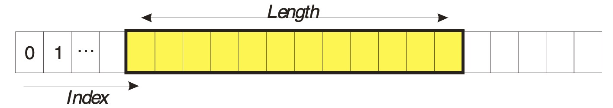

**接口定义**

C interface：

```c
vsip_vview_f* vsip_vsubview_f(const vsip_vview_f* v,
                              vsip_index index,
                              vsip_length length);
vsip_vview_i* vsip_vsubview_i(const vsip_vview_i* v,
                              vsip_index index,
                              vsip_length length);
vsip_cvview_f* vsip_cvsubview_f(const vsip_cvview_f* v,
                                vsip_index index,
                                vsip_length length);
vsip_cvview_i* vsip_cvsubview_i(const vsip_cvview_i* v,
                                vsip_index index,
                                vsip_length length);
vsip_vview_bl* vsip_vsubview_bl(const vsip_vview_bl* v,
                                vsip_index index,
                                vsip_length length);
vsip_vview_vi* vsip_vsubview_vi(const vsip_vview_vi* v,
                                vsip_index index,
                                vsip_length length);
vsip_vview_mi* vsip_vsubview_mi(const vsip_vview_mi* v,
                                vsip_index index,
                                vsip_length length);
```

**参数**

<table style="width: 100%; table-layout: fixed; word-break: break-word;">
  <colgroup>
    <col style="width: 18.00%;">
    <col style="width: 46.00%;">
    <col style="width: 20.00%;">
    <col style="width: 16.00%;">
  </colgroup>
  <thead>
    <tr><th>参数名</th><th>描述</th><th>取值范围</th><th>输入输出</th></tr>
  </thead>
  <tbody>
    <tr><td>v</td><td>向量视图对象。</td><td>非空</td><td>输入</td></tr>
    <tr><td>index</td><td>子视图向量的第一个元素（索引为0）位于源向量的索引为“index”的位置。</td><td>0<= index < N</td><td>输入</td></tr>
    <tr><td>length</td><td>新向量视图的长度（以元素为单位）。</td><td>0 < length <= N</td><td>输入</td></tr>
  </tbody>
</table>

**返回值**

返回指向创建的子视图向量视图对象的指针，如果新对象的内存分配失败则返回 null。

#### 7.6.1.4 矩阵对象支持函数

##### 7.6.1.4.0 vsip\_\[d\]malldestroy\_\[p\]

销毁（释放）一个矩阵，其关联的块以及绑定到块的任何 VSIPL 数据数组。

**函数功能**

销毁（释放）一个矩阵视图对象，以及它绑定的块对象和任何VSIPL数据数组。如果X是类型为`vsip_dmview_p`的矩阵，则`vsip_dmalldestroy_p`(X);相当于 `vsip_dblockdestroy_p`(`vsip_dmdestroy_p`(X);这是与`vsip_dmcreate_p`对应的函数，应仅用于销毁只有一个视图绑定到块对象的矩阵。

**接口定义**

C interface：

```c
void vsip_malldestroy_f(vsip_mview_f *X);
void vsip_malldestroy_i(vsip_mview_i *X);
void vsip_cmalldestroy_f(vsip_cmview_f *X);
void vsip_cmalldestroy_i(vsip_cmview_i *X);
void vsip_malldestroy_bl(vsip_mview_bl *X);
```

**参数**

<table style="width: 100%; table-layout: fixed; word-break: break-word;">
  <colgroup>
    <col style="width: 18.00%;">
    <col style="width: 46.00%;">
    <col style="width: 20.00%;">
    <col style="width: 16.00%;">
  </colgroup>
  <thead>
    <tr><th>参数名</th><th>描述</th><th>取值范围</th><th>输入输出</th></tr>
  </thead>
  <tbody>
    <tr><td>X</td><td>矩阵视图对象</td><td>非空</td><td>输入</td></tr>
  </tbody>
</table>

**示例**

C interface：

```c
/* Create and destroy a simple matrix of 10 by 15 elements. */
vsip_mview_f *X = vsip_mcreate_f((vsip_length)10,(vsip_length)15,VSIP_MEM_NONE);
...
vsip_malldestroy_f(X);
```

##### 7.6.1.4.1 vsip\_\[d\]mbind\_\[p\]

创建一个矩阵视图对象并将其绑定到一个块对象。

**函数功能**

创建一个矩阵对象，如果失败则返回null。如果视图创建成功，则：（1）将矩阵视图对象绑定到块对象；（2）设置从数据数组开头到矩阵开头的偏移量，步幅，列中标量元素之间的列步幅，列中标量元素的数量，行中标量元素之间的行步幅，行中标量元素的数量；（3）然后返回指向创建的矩阵视图对象的指针。

**接口定义**

C interface：

```c
vsip_mview_f* vsip_mbind_f(const vsip_block_f* block,
                           vsip_offset offset,
                           vsip_stride col_stride,
                           vsip_length col_length,
                           vsip_stride row_stride,
                           vsip_length row_length);
vsip_mview_i* vsip_mbind_i(const vsip_block_i* block,
                           vsip_offset offset,
                           vsip_stride col_stride,
                           vsip_length col_length,
                           vsip_stride row_stride,
                           vsip_length row_length);
vsip_cmview_f* vsip_cmbind_f(const vsip_cblock_f* block,
                             vsip_offset offset,
                             vsip_stride col_stride,
                             vsip_length col_length,
                             vsip_stride row_stride,
                             vsip_length row_length);
vsip_cmview_i* vsip_cmbind_i(const vsip_cblock_i* block,
                             vsip_offset offset,
                             vsip_stride col_stride,
                             vsip_length col_length,
                             vsip_stride row_stride,
                             vsip_length row_length);
vsip_mview_bl* vsip_mbind_bl(const vsip_block_bl* block,
                             vsip_offset offset,
                             vsip_stride col_stride,
                             vsip_length col_length,
                             vsip_stride row_stride,
                             vsip_length row_length);
```

**参数**

<table style="width: 100%; table-layout: fixed; word-break: break-word;">
  <colgroup>
    <col style="width: 18.00%;">
    <col style="width: 46.00%;">
    <col style="width: 20.00%;">
    <col style="width: 16.00%;">
  </colgroup>
  <thead>
    <tr><th>参数名</th><th>描述</th><th>取值范围</th><th>输入输出</th></tr>
  </thead>
  <tbody>
    <tr><td>block</td><td>指向block对象的指针</td><td>非空</td><td>输入</td></tr>
    <tr><td>offset</td><td>矩阵视图相对于块对象基址的元素偏移量。</td><td>整数</td><td>输入</td></tr>
    <tr><td>col_stride</td><td>矩阵视图中列中元素之间的步幅。</td><td>整数</td><td>输入</td></tr>
    <tr><td>col_length</td><td>矩阵视图中一列的元素长度（以元素为单位）。</td><td>>0</td><td>输入</td></tr>
    <tr><td>row_stride</td><td>矩阵视图中行中元素之间的步幅。</td><td>整数</td><td>输入</td></tr>
    <tr><td>row_length</td><td>矩阵视图中一行的元素长度（以元素为单位）。</td><td>>0</td><td>输入</td></tr>
  </tbody>
</table>

**返回值**

返回指向创建的矩阵视图对象的指针，如果新对象的内存分配失败则返回null。

##### 7.6.1.4.2 vsip\_\[d\]mcloneview\_\[p\]

创建矩阵视图的克隆。

**函数功能**

创建一个新的矩阵视图对象，将源矩阵视图对象的所有属性复制到新的矩阵视图对象中，然后将新的矩阵视图对象绑定到源矩阵视图对象的块对象。如果内存分配（创建）失败，则该函数返回null；否则，返回指向新矩阵视图对象的指针。

**接口定义**

C interface：

```c
vsip_mview_f *vsip_mcloneview_f(const vsip_mview_f *X);
vsip_mview_i *vsip_mcloneview_i(const vsip_mview_i *X);
vsip_cmview_f *vsip_cmcloneview_f(const vsip_cmview_f *X);
vsip_cmview_i *vsip_cmcloneview_i(const vsip_cmview_i *X);
vsip_mview_bl *vsip_mcloneview_bl(const vsip_mview_bl *X);
```

**参数**

<table style="width: 100%; table-layout: fixed; word-break: break-word;">
  <colgroup>
    <col style="width: 18.00%;">
    <col style="width: 46.00%;">
    <col style="width: 20.00%;">
    <col style="width: 16.00%;">
  </colgroup>
  <thead>
    <tr><th>参数名</th><th>描述</th><th>取值范围</th><th>输入输出</th></tr>
  </thead>
  <tbody>
    <tr><td>X</td><td>矩阵视图对象</td><td>非空</td><td>输入</td></tr>
  </tbody>
</table>

**返回值**

返回指向创建的矩阵视图对象克隆的指针，如果新对象的内存分配失败则返回null。

##### 7.6.1.4.3 vsip\_\[d\]mcolview\_\[p\]

创建源矩阵视图对象的指定列的向量视图对象。

**函数功能**

从源矩阵视图对象的指定列创建一个向量视图对象，如果失败则返回null。否则，将新的向量视图对象绑定到与源矩阵视图对象相同的块对象，并设置其属性以查看源矩阵对象的指定列。

**接口定义**

C interface：

```c
vsip_vview_f *vsip_mcolview_f(const vsip_mview_f *X, vsip_index col_index);
vsip_vview_i *vsip_mcolview_i(const vsip_mview_i *X, vsip_index col_index);
vsip_cvview_f *vsip_cmcolview_f(const vsip_cmview_f *X, vsip_index col_index);
vsip_cvview_i *vsip_cmcolview_i(const vsip_cmview_i *X, vsip_index col_index);
vsip_vview_bl *vsip_mcolview_bl(const vsip_mview_bl *X, vsip_index col_index);
```

**参数**

<table style="width: 100%; table-layout: fixed; word-break: break-word;">
  <colgroup>
    <col style="width: 18.00%;">
    <col style="width: 46.00%;">
    <col style="width: 20.00%;">
    <col style="width: 16.00%;">
  </colgroup>
  <thead>
    <tr><th>参数名</th><th>描述</th><th>取值范围</th><th>输入输出</th></tr>
  </thead>
  <tbody>
    <tr><td>X</td><td>矩阵视图对象</td><td>非空</td><td>输入</td></tr>
    <tr><td>col_index</td><td>源矩阵视图对象的列索引。</td><td>vsip_index类型</td><td>输入</td></tr>
  </tbody>
</table>

**返回值**

返回指向创建的列向量视图对象的指针，如果新对象的内存分配失败则返回null。

##### 7.6.1.4.4 vsip\_\[d\]mcreate\_\[p\]

创建一个块对象并生成该块的矩阵视图对象。

**函数功能**

创建一个具有MxN元素VSIPL数据数组的块对象，然后创建一个MxN的密集矩阵视图对象，并将块对象绑定到该视图对象。

**接口定义**

C interface：

```c
vsip_mview_f* vsip_mcreate_f(vsip_length M,
                             vsip_length N,
                             vsip_major major,
                             vsip_memory_hint hint);
vsip_mview_i* vsip_mcreate_i(vsip_length M,
                             vsip_length N,
                             vsip_major major,
                             vsip_memory_hint hint);
vsip_cmview_f* vsip_cmcreate_f(vsip_length M,
                               vsip_length N,
                               vsip_major major,
                               vsip_memory_hint hint);
vsip_mview_bl* vsip_mcreate_bl(vsip_length M,
                               vsip_length N,
                               vsip_major major,
                               vsip_memory_hint hint);
```

**参数**

<table style="width: 100%; table-layout: fixed; word-break: break-word;">
  <colgroup>
    <col style="width: 18.00%;">
    <col style="width: 46.00%;">
    <col style="width: 20.00%;">
    <col style="width: 16.00%;">
  </colgroup>
  <thead>
    <tr><th>参数名</th><th>描述</th><th>取值范围</th><th>输入输出</th></tr>
  </thead>
  <tbody>
    <tr><td>M</td><td>矩阵视图的行数（列长度）。</td><td>>0</td><td>输入</td></tr>
    <tr><td>N</td><td>矩阵视图的列数（行长度）。</td><td>>0</td><td>输入</td></tr>
    <tr><td>major</td><td>Row or Column major</td><td>枚举类型vsip_major</td><td>输入</td></tr>
    <tr><td>hint</td><td>内存提示</td><td>枚举类型vsip_memory_hint</td><td>输入</td></tr>
  </tbody>
</table>

**返回值**

返回指向创建的矩阵视图对象的指针，如果创建失败则返回null。

##### 7.6.1.4.5 vsip\_\[d\]mdestroy\_\[p\]

销毁（释放）一个矩阵视图对象，并返回与之关联的块对象的指针。

**函数功能**

释放一个与其绑定的块对象的矩阵视图对象，销毁该矩阵视图对象，然后返回与之关联的块对象的指针。如果向量视图参数为空，则返回空指针。

**接口定义**

C interface：

```c
vsip_block_f *vsip_mdestroy_f(vsip_mview_f *X);
vsip_block_i *vsip_mdestroy_i(vsip_mview_i *X);
vsip_cblock_f *vsip_cmdestroy_f(vsip_cmview_f *X);
vsip_block_bl *vsip_mdestroy_bl(vsip_mview_bl *X);
```

**参数**

<table style="width: 100%; table-layout: fixed; word-break: break-word;">
  <colgroup>
    <col style="width: 18.00%;">
    <col style="width: 46.00%;">
    <col style="width: 20.00%;">
    <col style="width: 16.00%;">
  </colgroup>
  <thead>
    <tr><th>参数名</th><th>描述</th><th>取值范围</th><th>输入输出</th></tr>
  </thead>
  <tbody>
    <tr><td>X</td><td>矩阵视图对象</td><td>非空</td><td>输入</td></tr>
  </tbody>
</table>

**返回值**

返回矩阵视图绑定的块对象的指针，如果调用参数为空则返回空指针。

##### 7.6.1.4.6 vsip\_\[d\]mdiagview\_\[p\]

创建矩阵视图对象的对角线的向量视图对象。

**函数功能**

创建源矩阵视图对象的指定对角线的向量视图对象，如果失败则返回null。成功时，将新的向量视图对象绑定到与源矩阵视图对象相同的块对象，并设置其属性以查看源矩阵对象的指定对角线。索引为'0'指定主对角线，正索引表示在主对角线上方，负索引表示在主对角线下方。

**接口定义**

C interface：

```c
vsip_vview_f *vsip_mdiagview_f(const vsip_mview_f *X, vsip_stride index);
vsip_vview_i *vsip_mdiagview_i(const vsip_mview_i *X, vsip_stride index);
vsip_cvview_f *vsip_cmdiagview_f(const vsip_cmview_f *X, vsip_stride index);
vsip_vview_bl *vsip_mdiagview_bl(const vsip_mview_bl *X, vsip_stride index);
```

**参数**

<table style="width: 100%; table-layout: fixed; word-break: break-word;">
  <colgroup>
    <col style="width: 18.00%;">
    <col style="width: 46.00%;">
    <col style="width: 20.00%;">
    <col style="width: 16.00%;">
  </colgroup>
  <thead>
    <tr><th>参数名</th><th>描述</th><th>取值范围</th><th>输入输出</th></tr>
  </thead>
  <tbody>
    <tr><td>X</td><td>矩阵视图对象</td><td>非空</td><td>输入</td></tr>
    <tr><td>index</td><td>对角线索引：0 表示主对角线，+ 表示在主对角线上方，- 表示在主对角线下方。</td><td>整数</td><td>输入</td></tr>
  </tbody>
</table>

**返回值**

返回指向创建的对角线向量视图对象的指针，如果新对象的内存分配失败则返回null。

##### 7.6.1.4.7 vsip\_\[d\]mget\_\[p\]

获取矩阵视图对象的指定元素的值。

**函数功能**

返回矩阵视图对象指定元素的值，X\_{i,j}。

**接口定义**

C interface：

```c
vsip_scalar_f vsip_mget_f(const vsip_mview_f* X, vsip_index i, vsip_index j);
vsip_scalar_i vsip_mget_i(const vsip_mview_i* X, vsip_index i, vsip_index j);
vsip_cscalar_f vsip_cmget_f(const vsip_cmview_f* X, vsip_index i, vsip_index j);
vsip_scalar_bl vsip_mget_bl(const vsip_mview_bl* X, vsip_index i, vsip_index j);
```

**参数**

<table style="width: 100%; table-layout: fixed; word-break: break-word;">
  <colgroup>
    <col style="width: 18.00%;">
    <col style="width: 46.00%;">
    <col style="width: 20.00%;">
    <col style="width: 16.00%;">
  </colgroup>
  <thead>
    <tr><th>参数名</th><th>描述</th><th>取值范围</th><th>输入输出</th></tr>
  </thead>
  <tbody>
    <tr><td>X</td><td>矩阵视图对象</td><td>非空</td><td>输入</td></tr>
    <tr><td>i</td><td>矩阵索引i是(i,j)中的行索引。</td><td>>0</td><td>输入</td></tr>
    <tr><td>j</td><td>矩阵索引j是(i,j)中的行索引。</td><td>>0</td><td>输入</td></tr>
  </tbody>
</table>

**返回值**

返回矩阵视图对象指定元素的值。

##### 7.6.1.4.8 vsip\_\[d\]mgetattrib\_\[p\]

获取矩阵视图对象的属性。

**函数功能**

检索矩阵视图对象的属性：绑定的块对象指针，偏移量，列步幅，列长度，行步幅和行长度。

**接口定义**

C interface：

```c
typedef struct {
    vsip_offset offset;
    vsip_stride row_stride;
    vsip_length row_length;
    vsip_stride col_stride;
    vsip_length col_length;
    vsip_block_p* block;
/* Get only, ignored on Put */
} vsip_mattr_[p];
typedef struct {
    vsip_offset offset;
    vsip_stride row_stride;
    vsip_length row_length;
    vsip_stride col_stride;
    vsip_length col_length;
    vsip_cblock_p* block;
/* Get only, ignored on Put */
} vsip_cmattr_[p];
void vsip_mgetattrib_f(vsip_mview_f* X, vsip_mattr_f* attrib);
void vsip_mgetattrib_i(vsip_mview_i* X, vsip_mattr_i* attrib);
void vsip_cmgetattrib_f(vsip_cmview_f* X, vsip_cmattr_f* attrib);
void vsip_mgetattrib_bl(vsip_mview_bl* X, vsip_mattr_bl* attrib);
```

**参数**

<table style="width: 100%; table-layout: fixed; word-break: break-word;">
  <colgroup>
    <col style="width: 18.00%;">
    <col style="width: 46.00%;">
    <col style="width: 20.00%;">
    <col style="width: 16.00%;">
  </colgroup>
  <thead>
    <tr><th>参数名</th><th>描述</th><th>取值范围</th><th>输入输出</th></tr>
  </thead>
  <tbody>
    <tr><td>X</td><td>矩阵视图对象</td><td>非空</td><td>输入</td></tr>
    <tr><td>attrib</td><td>输出矩阵属性结构的指针。</td><td>类型vsip_mattr_[p], vsip_cmattr_[p]</td><td>输出</td></tr>
  </tbody>
</table>

##### 7.6.1.4.9 vsip\_\[d\]mgetblock\_\[p\]

获取矩阵视图对象的块属性。

**函数功能**

返回指向矩阵视图对象绑定的VSIPL块对象的指针。

**接口定义**

C interface：

```c
vsip_block_f *vsip_mgetblock_f(const vsip_mview_f *X);
vsip_block_i *vsip_mgetblock_i(const vsip_mview_i *X);
vsip_cblock_f *vsip_cmgetblock_f(const vsip_cmview_f *X);
vsip_block_bl *vsip_mgetblock_bl(const vsip_mview_bl *X);
```

**参数**

<table style="width: 100%; table-layout: fixed; word-break: break-word;">
  <colgroup>
    <col style="width: 18.00%;">
    <col style="width: 46.00%;">
    <col style="width: 20.00%;">
    <col style="width: 16.00%;">
  </colgroup>
  <thead>
    <tr><th>参数名</th><th>描述</th><th>取值范围</th><th>输入输出</th></tr>
  </thead>
  <tbody>
    <tr><td>X</td><td>矩阵视图对象</td><td>非空</td><td>输入</td></tr>
  </tbody>
</table>

**返回值**

返回指向矩阵视图对象绑定的块对象的指针。

##### 7.6.1.4.10 vsip\_\[d\]mgetcollength\_\[p\]

获取矩阵视图对象的列长度属性。

**函数功能**

返回矩阵视图中一列的长度（元素数量）。

**接口定义**

C interface：

```c
vsip_length vsip_mgetcollength_f(const vsip_mview_f *X);
vsip_length vsip_mgetcollength_i(const vsip_mview_i *X);
vsip_length vsip_cmgetcollength_f(const vsip_cmview_f *X);
vsip_length vsip_mgetcollength_bl(const vsip_mview_bl *X);
```

**参数**

<table style="width: 100%; table-layout: fixed; word-break: break-word;">
  <colgroup>
    <col style="width: 18.00%;">
    <col style="width: 46.00%;">
    <col style="width: 20.00%;">
    <col style="width: 16.00%;">
  </colgroup>
  <thead>
    <tr><th>参数名</th><th>描述</th><th>取值范围</th><th>输入输出</th></tr>
  </thead>
  <tbody>
    <tr><td>X</td><td>矩阵视图对象</td><td>非空</td><td>输入</td></tr>
  </tbody>
</table>

**返回值**

返回矩阵视图对象的 col\_length 属性的值。

##### 7.6.1.4.11 vsip\_\[d\]mgetcolstride\_\[p\]

获取矩阵视图对象的列步幅属性。

**函数功能**

返回矩阵视图对象中沿列方向连续标量元素之间的步幅（以绑定块的元素为单位）。

**接口定义**

C interface：

```c
vsip_stride vsip_mgetcolstride_f(const vsip_mview_f *X);
vsip_stride vsip_mgetcolstride_i(const vsip_mview_i *X);
vsip_stride vsip_cmgetcolstride_f(const vsip_cmview_f *X);
vsip_stride vsip_mgetcolstride_bl(const vsip_mview_bl *X);
```

**参数**

<table style="width: 100%; table-layout: fixed; word-break: break-word;">
  <colgroup>
    <col style="width: 18.00%;">
    <col style="width: 46.00%;">
    <col style="width: 20.00%;">
    <col style="width: 16.00%;">
  </colgroup>
  <thead>
    <tr><th>参数名</th><th>描述</th><th>取值范围</th><th>输入输出</th></tr>
  </thead>
  <tbody>
    <tr><td>X</td><td>矩阵视图对象</td><td>非空</td><td>输入</td></tr>
  </tbody>
</table>

**返回值**

返回矩阵视图对象的列步幅属性的值。

##### 7.6.1.4.12 vsip\_\[d\]mgetoffset\_\[p\]

获取矩阵视图对象的偏移属性。

**函数功能**

返回从矩阵视图绑定的块对象的起始位置到第一个标量元素的偏移量（以元素为单位）。

**接口定义**

C interface：

```c
vsip_offset vsip_mgetoffset_f(const vsip_mview_f *X);
vsip_offset vsip_mgetoffset_i(const vsip_mview_i *X);
vsip_offset vsip_cmgetoffset_f(const vsip_cmview_f *X);
vsip_offset vsip_mgetoffset_bl(const vsip_mview_bl *X);
```

**参数**

<table style="width: 100%; table-layout: fixed; word-break: break-word;">
  <colgroup>
    <col style="width: 18.00%;">
    <col style="width: 46.00%;">
    <col style="width: 20.00%;">
    <col style="width: 16.00%;">
  </colgroup>
  <thead>
    <tr><th>参数名</th><th>描述</th><th>取值范围</th><th>输入输出</th></tr>
  </thead>
  <tbody>
    <tr><td>X</td><td>矩阵视图对象</td><td>非空</td><td>输入</td></tr>
  </tbody>
</table>

**返回值**

返回矩阵视图对象的偏移属性的值。

##### 7.6.1.4.13 vsip\_\[d\]mgetrowlength\_\[p\]

获取矩阵视图对象的行长度属性。

**函数功能**

返回矩阵视图中一行的长度（元素数量）。

**接口定义**

C interface：

```c
vsip_length vsip_mgetrowlength_f(const vsip_mview_f *X);
vsip_length vsip_mgetrowlength_i(const vsip_mview_i *X);
vsip_length vsip_cmgetrowlength_f(const vsip_cmview_f *X);
vsip_length vsip_mgetrowlength_bl(const vsip_mview_bl *X);
```

**参数**

<table style="width: 100%; table-layout: fixed; word-break: break-word;">
  <colgroup>
    <col style="width: 18.00%;">
    <col style="width: 46.00%;">
    <col style="width: 20.00%;">
    <col style="width: 16.00%;">
  </colgroup>
  <thead>
    <tr><th>参数名</th><th>描述</th><th>取值范围</th><th>输入输出</th></tr>
  </thead>
  <tbody>
    <tr><td>X</td><td>矩阵视图对象</td><td>非空</td><td>输入</td></tr>
  </tbody>
</table>

**返回值**

返回矩阵视图对象的 row\_length 属性的值

##### 7.6.1.4.14 vsip\_\[d\]mgetrowstride\_\[p\]

获取矩阵视图对象的行步幅属性。

**函数功能**

返回矩阵视图对象中沿行方向连续标量元素之间的步幅（以绑定块的元素为单位）。

**接口定义**

C interface：

```c
vsip_stride vsip_mgetrowstride_f(const vsip_mview_f *X);
vsip_stride vsip_mgetrowstride_i(const vsip_mview_i *X);
vsip_stride vsip_cmgetrowstride_f(const vsip_cmview_f *X);
vsip_stride vsip_mgetrowstride_bl(const vsip_mview_bl *X);
```

**参数**

<table style="width: 100%; table-layout: fixed; word-break: break-word;">
  <colgroup>
    <col style="width: 18.00%;">
    <col style="width: 46.00%;">
    <col style="width: 20.00%;">
    <col style="width: 16.00%;">
  </colgroup>
  <thead>
    <tr><th>参数名</th><th>描述</th><th>取值范围</th><th>输入输出</th></tr>
  </thead>
  <tbody>
    <tr><td>X</td><td>矩阵视图对象</td><td>非空</td><td>输入</td></tr>
  </tbody>
</table>

**返回值**

返回矩阵视图对象的行步幅属性的值。

##### 7.6.1.4.15 vsip\_mimagview\_\[p\]

从复数矩阵视图对象创建一个复数矩阵的虚部的矩阵视图对象。

**函数功能**

从复数矩阵视图对象的虚部创建一个实数矩阵视图对象，如果失败则返回null。
如果成功，该函数创建一个派生的块对象（派生自复数块对象），该块对象绑定到原始复数块的虚部数据，然后将一个实数矩阵视图对象绑定到该块。新的矩阵包含源复数矩阵的虚部。

**接口定义**

C interface：

```c
vsip_mview_f *vsip_mimagview_f(const vsip_cmview_f *X);
```

**参数**

<table style="width: 100%; table-layout: fixed; word-break: break-word;">
  <colgroup>
    <col style="width: 18.00%;">
    <col style="width: 46.00%;">
    <col style="width: 20.00%;">
    <col style="width: 16.00%;">
  </colgroup>
  <thead>
    <tr><th>参数名</th><th>描述</th><th>取值范围</th><th>输入输出</th></tr>
  </thead>
  <tbody>
    <tr><td>X</td><td>矩阵视图对象</td><td>非空</td><td>输入</td></tr>
  </tbody>
</table>

**返回值**

返回指向创建的“虚部”矩阵视图对象的指针，如果新对象的内存分配失败则返回null。

##### 7.6.1.4.16 vsip\_\[d\]mput\_\[p\]

设置矩阵视图对象的指定元素的值。

**函数功能**

设置矩阵视图对象的指定元素的值。y\_{i,j}=x

**接口定义**

C interface：

```c
void vsip_mput_f(const vsip_mview_f* y,
                 vsip_index i,
                 vsip_index j,
                 vsip_scalar_f x);
void vsip_mput_i(const vsip_mview_i* y,
                 vsip_index i,
                 vsip_index j,
                 vsip_scalar_i x);
void vsip_cmput_f(const vsip_cmview_f* y,
                  vsip_index i,
                  vsip_index j,
                  vsip_cscalar_f x);
void vsip_mput_bl(const vsip_mview_bl* y,
                  vsip_index i,
                  vsip_index j,
                  vsip_scalar_bl x);
```

**参数**

<table style="width: 100%; table-layout: fixed; word-break: break-word;">
  <colgroup>
    <col style="width: 18.00%;">
    <col style="width: 46.00%;">
    <col style="width: 20.00%;">
    <col style="width: 16.00%;">
  </colgroup>
  <thead>
    <tr><th>参数名</th><th>描述</th><th>取值范围</th><th>输入输出</th></tr>
  </thead>
  <tbody>
    <tr><td>y</td><td>矩阵视图对象</td><td>非空</td><td>输入</td></tr>
    <tr><td>i</td><td>矩阵索引i是(i,j)中的行索引。</td><td>>=0</td><td>输入</td></tr>
    <tr><td>j</td><td>矩阵索引j是(i,j)中的行索引。</td><td>>=0</td><td>输入</td></tr>
    <tr><td>x</td><td>要放入矩阵中的标量值。</td><td>任意</td><td>输入</td></tr>
  </tbody>
</table>

##### 7.6.1.4.17 vsip\_\[d\]mputattrib\_\[p\]

设置矩阵视图对象的属性。

**函数功能**

存储矩阵视图对象的偏移量、列步幅、列长度、行步幅和行长度等属性，并作为编程方便性，返回指向矩阵视图对象的指针。

**接口定义**

C interface：

```c
typedef struct {
    vsip_offset offset;
    vsip_stride row_stride;
    vsip_length row_length;
    vsip_stride col_stride;
    vsip_length col_length;
    vsip_block_p* block;
/* Get only, ignored on Put */
} vsip_mattr_p;
typedef struct {
    vsip_offset offset;
    vsip_stride row_stride;
    vsip_length row_length;
    vsip_stride col_stride;
    vsip_length col_length;
    vsip_cblock_p* block;
/* Get only, ignored on Put */
} vsip_cmattr_[p];
vsip_mview_f* vsip_mputattrib_f(vsip_mview_f* X, const vsip_mattr_f* attrib);
vsip_mview_i* vsip_mputattrib_i(vsip_mview_i* X, const vsip_mattr_i* attrib);
vsip_cmview_f* vsip_cmputattrib_f(vsip_cmview_f* X,
                                  const vsip_cmattr_f* attrib);
vsip_mview_bl* vsip_mputattrib_bl(vsip_mview_bl* X,
                                  const vsip_mattr_bl* attrib);
```

**参数**

<table style="width: 100%; table-layout: fixed; word-break: break-word;">
  <colgroup>
    <col style="width: 18.00%;">
    <col style="width: 46.00%;">
    <col style="width: 20.00%;">
    <col style="width: 16.00%;">
  </colgroup>
  <thead>
    <tr><th>参数名</th><th>描述</th><th>取值范围</th><th>输入输出</th></tr>
  </thead>
  <tbody>
    <tr><td>X</td><td>矩阵视图对象</td><td>非空</td><td>输入</td></tr>
    <tr><td>attrib</td><td>矩阵属性结构的指针。</td><td>非空</td><td>输入</td></tr>
  </tbody>
</table>

**返回值**

返回指向源矩阵视图对象的指针，作为编程方便性的一种体现。

##### 7.6.1.4.18 vsip\_\[d\]mputcollength\_\[p\]

设置矩阵视图对象的列长度属性。

**函数功能**

设置矩阵视图中一列的长度（元素数量）。

**接口定义**

C interface：

```c
vsip_mview_f *vsip_mputcollength_f(const vsip_mview_f *X, vsip_length length);
vsip_mview_i *vsip_mputcollength_i(const vsip_mview_i *X, vsip_length length);
vsip_mview_f *vsip_cmputcollength_f(const vsip_cmview_f *X, vsip_length length);
vsip_mview_bl *vsip_mputcollength_bl(const vsip_mview_bl *X, vsip_length length);
```

**参数**

<table style="width: 100%; table-layout: fixed; word-break: break-word;">
  <colgroup>
    <col style="width: 18.00%;">
    <col style="width: 46.00%;">
    <col style="width: 20.00%;">
    <col style="width: 16.00%;">
  </colgroup>
  <thead>
    <tr><th>参数名</th><th>描述</th><th>取值范围</th><th>输入输出</th></tr>
  </thead>
  <tbody>
    <tr><td>X</td><td>矩阵视图对象</td><td>非空</td><td>输入</td></tr>
    <tr><td>length</td><td>要设置的列长度</td><td>>0</td><td>输入</td></tr>
  </tbody>
</table>

**返回值**

返回指向源矩阵视图对象的指针，作为编程方便性的一种体现。

##### 7.6.1.4.19 vsip\_\[d\]mputcolstride\_\[p\]

设置矩阵视图对象的列步幅属性。

**函数功能**

设置矩阵视图对象中沿列方向连续标量元素之间的步幅（以绑定块的元素为单位）。

**接口定义**

C interface：

```c
vsip_mview_f *vsip_mputcolstride_f(const vsip_mview_f *X, vsip_stride stride);
vsip_mview_i *vsip_mputcolstride_i(const vsip_mview_i *X, vsip_stride stride);
vsip_mview_f *vsip_cmputcolstride_f(const vsip_cmview_f *X, vsip_stride stride);
vsip_mview_bl *vsip_mputcolstride_bl(const vsip_mview_bl *X, vsip_stride stride);
```

**参数**

<table style="width: 100%; table-layout: fixed; word-break: break-word;">
  <colgroup>
    <col style="width: 18.00%;">
    <col style="width: 46.00%;">
    <col style="width: 20.00%;">
    <col style="width: 16.00%;">
  </colgroup>
  <thead>
    <tr><th>参数名</th><th>描述</th><th>取值范围</th><th>输入输出</th></tr>
  </thead>
  <tbody>
    <tr><td>X</td><td>矩阵视图对象</td><td>非空</td><td>输入</td></tr>
    <tr><td>stride</td><td>要设置的步长</td><td>整数</td><td>输入</td></tr>
  </tbody>
</table>

**返回值**

返回指向源矩阵视图对象的指针，作为编程方便性的一种体现。

##### 7.6.1.4.20 vsip\_\[d\]mputoffset\_\[p\]

设置矩阵视图对象的偏移属性。

**函数功能**

设置矩阵视图对象的偏移量属性，即从其绑定的块对象的起始位置到第一个标量元素的偏移量（以元素为单位）。

**接口定义**

C interface：

```c
vsip_mview_f *vsip_mputoffset_f(const vsip_mview_f *X, vsip_offset offset);
vsip_mview_i *vsip_mputoffset_i(const vsip_mview_i *X, vsip_offset offset);
vsip_mview_f *vsip_cmputoffset_f(const vsip_cmview_f *X, vsip_offset offset);
vsip_mview_bl *vsip_mputoffset_bl(const vsip_mview_bl *X, vsip_offset offset);
```

**参数**

<table style="width: 100%; table-layout: fixed; word-break: break-word;">
  <colgroup>
    <col style="width: 18.00%;">
    <col style="width: 46.00%;">
    <col style="width: 20.00%;">
    <col style="width: 16.00%;">
  </colgroup>
  <thead>
    <tr><th>参数名</th><th>描述</th><th>取值范围</th><th>输入输出</th></tr>
  </thead>
  <tbody>
    <tr><td>X</td><td>矩阵视图对象</td><td>非空</td><td>输入</td></tr>
    <tr><td>offset</td><td>要设置的偏移量</td><td>整数</td><td>输入</td></tr>
  </tbody>
</table>

**返回值**

返回指向源矩阵视图对象的指针，作为编程方便性的一种体现。

##### 7.6.1.4.21 vsip\_\[d\]mputrowlength\_\[p\]

设置矩阵视图对象的行长度属性。

**函数功能**

设置矩阵视图中一行的长度（元素数量）。

**接口定义**

C interface：

```c
vsip_mview_f *vsip_mputrowlength_f(const vsip_mview_f *X, vsip_length length);
vsip_mview_i *vsip_mputrowlength_i(const vsip_mview_i *X, vsip_length length);
vsip_mview_f *vsip_cmputrowlength_f(const vsip_cmview_f *X, vsip_length length);
vsip_mview_bl *vsip_mputrowlength_bl(const vsip_mview_bl *X, vsip_length length);
```

**参数**

<table style="width: 100%; table-layout: fixed; word-break: break-word;">
  <colgroup>
    <col style="width: 18.00%;">
    <col style="width: 46.00%;">
    <col style="width: 20.00%;">
    <col style="width: 16.00%;">
  </colgroup>
  <thead>
    <tr><th>参数名</th><th>描述</th><th>取值范围</th><th>输入输出</th></tr>
  </thead>
  <tbody>
    <tr><td>X</td><td>矩阵视图对象</td><td>非空</td><td>输入</td></tr>
    <tr><td>length</td><td>要设置的行长度</td><td>整数</td><td>输入</td></tr>
  </tbody>
</table>

**返回值**

返回指向源矩阵视图对象的指针，作为编程方便性的一种体现。

##### 7.6.1.4.22 vsip\_\[d\]mputrowstride\_\[p\]

设置矩阵视图对象的行步幅属性。

**函数功能**

设置矩阵视图对象中沿行方向连续标量元素之间的步幅（以绑定块的元素为单位）。

**接口定义**

C interface：

```c
vsip_mview_f *vsip_mputrowstride_f(const vsip_mview_f *X, vsip_stride stride);
vsip_mview_i *vsip_mputrowstride_i(const vsip_mview_i *X, vsip_stride stride);
vsip_mview_f *vsip_cmputrowstride_f(const vsip_cmview_f *X, vsip_stride stride);
vsip_mview_bl *vsip_mputrowstride_bl(const vsip_mview_bl *X, vsip_stride stride);
```

**参数**

<table style="width: 100%; table-layout: fixed; word-break: break-word;">
  <colgroup>
    <col style="width: 18.00%;">
    <col style="width: 46.00%;">
    <col style="width: 20.00%;">
    <col style="width: 16.00%;">
  </colgroup>
  <thead>
    <tr><th>参数名</th><th>描述</th><th>取值范围</th><th>输入输出</th></tr>
  </thead>
  <tbody>
    <tr><td>X</td><td>矩阵视图对象</td><td>非空</td><td>输入</td></tr>
    <tr><td>stride</td><td>要设置的行的步长</td><td>整数</td><td>输入</td></tr>
  </tbody>
</table>

**返回值**

返回指向源矩阵视图对象的指针，作为编程方便性的一种体现。

##### 7.6.1.4.23 vsip\_mrealview\_\[p\]

从复数矩阵视图对象创建一个复数矩阵的实部矩阵视图对象。

**函数功能**

从复数矩阵视图对象的实部创建一个实数矩阵视图对象，如果失败则返回 null。
成功时，函数创建一个派生的块对象（派生自复数块对象）。派生的块对象绑定到原始复数块的实部数据，然后将一个实数矩阵视图对象绑定到该块。新的矩阵包含输入复数矩阵的实部。

**接口定义**

C interface：

```c
vsip_mview_f *vsip_mrealview_f(const vsip_cmview_f *X);
```

**参数**

<table style="width: 100%; table-layout: fixed; word-break: break-word;">
  <colgroup>
    <col style="width: 18.00%;">
    <col style="width: 46.00%;">
    <col style="width: 20.00%;">
    <col style="width: 16.00%;">
  </colgroup>
  <thead>
    <tr><th>参数名</th><th>描述</th><th>取值范围</th><th>输入输出</th></tr>
  </thead>
  <tbody>
    <tr><td>X</td><td>矩阵视图对象</td><td>非空</td><td>输入</td></tr>
  </tbody>
</table>

**返回值**

返回指向创建的“实部”矩阵视图对象的指针，如果新对象的内存分配失败则返回null。

##### 7.6.1.4.24 vsip\_\[d\]mrowview\_\[p\]

创建源矩阵视图对象的指定行的向量视图对象。

**函数功能**

从矩阵视图对象的指定行创建一个向量视图对象，如果失败则返回 null。
成功时，将新的向量视图对象绑定到与源矩阵视图对象相同的块对象，并设置其属性以查看源矩阵对象的指定行。

**接口定义**

C interface：

```c
vsip_vview_f *vsip_mrowview_f(const vsip_mview_f *X, vsip_index row_index);
vsip_vview_i *vsip_mrowview_i(const vsip_mview_i *X, vsip_index row_index);
vsip_cvview_f *vsip_cmrowview_f(const vsip_cmview_f *X, vsip_index row_index);
vsip_vview_bl *vsip_mrowview_bl(const vsip_mview_bl *X, vsip_index row_index);
```

**参数**

<table style="width: 100%; table-layout: fixed; word-break: break-word;">
  <colgroup>
    <col style="width: 18.00%;">
    <col style="width: 46.00%;">
    <col style="width: 20.00%;">
    <col style="width: 16.00%;">
  </colgroup>
  <thead>
    <tr><th>参数名</th><th>描述</th><th>取值范围</th><th>输入输出</th></tr>
  </thead>
  <tbody>
    <tr><td>X</td><td>矩阵视图对象</td><td>非空</td><td>输入</td></tr>
    <tr><td>row_index</td><td>源矩阵对象的行索引</td><td>>0</td><td>输入</td></tr>
  </tbody>
</table>

**返回值**

返回指向创建的行向量视图对象的指针，如果新对象的内存分配失败则返回null。

##### 7.6.1.4.25 vsip\_\[d\]msubview\_\[p\]

创建一个矩阵视图对象，它是源矩阵视图对象的子视图。

**函数功能**

创建一个矩阵视图对象，它是源矩阵视图对象的子视图，如果失败则返回null。子视图是一个MxN的矩阵视图，其(0,0)元素对应于源矩阵视图的(行索引，列索引)元素。
（子视图相对于源视图，行步幅和列步幅从源视图继承）。

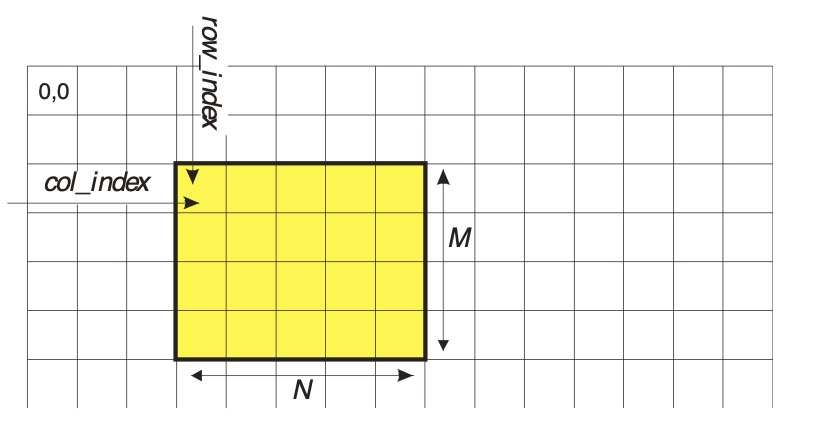

**接口定义**

C interface：

```c
vsip_mview_f* vsip_msubview_f(const vsip_mview_f* X,
                              vsip_index row_index,
                              vsip_index col_index,
                              vsip_length M,
                              vsip_length N);
vsip_mview_i* vsip_msubview_i(const vsip_mview_i* X,
                              vsip_index row_index,
                              vsip_index col_index,
                              vsip_length M,
                              vsip_length N);
vsip_cmview_f* vsip_cmsubview_f(const vsip_cmview_f* X,
                                vsip_index row_index,
                                vsip_index col_index,
                                vsip_length M,
                                vsip_length N);
vsip_mview_bl* vsip_msubview_bl(const vsip_mview_bl* X,
                                vsip_index row_index,
                                vsip_index col_index,
                                vsip_length M,
                                vsip_length N);
```

**参数**

<table style="width: 100%; table-layout: fixed; word-break: break-word;">
  <colgroup>
    <col style="width: 18.00%;">
    <col style="width: 46.00%;">
    <col style="width: 20.00%;">
    <col style="width: 16.00%;">
  </colgroup>
  <thead>
    <tr><th>参数名</th><th>描述</th><th>取值范围</th><th>输入输出</th></tr>
  </thead>
  <tbody>
    <tr><td>X</td><td>矩阵视图对象</td><td>非空</td><td>输入</td></tr>
    <tr><td>row_index</td><td>源矩阵对象的行索引</td><td>>0</td><td>输入</td></tr>
    <tr><td>col_index</td><td>源矩阵对象的列索引</td><td>>0</td><td>输入</td></tr>
    <tr><td>M</td><td>源矩阵对象的行长度</td><td>>0</td><td>输入</td></tr>
    <tr><td>N</td><td>源矩阵对象的列长度</td><td>>0</td><td>输入</td></tr>
  </tbody>
</table>

**返回值**

回指向创建的子视图矩阵视图对象的指针，如果新对象的内存分配失败则返回null。

##### 7.6.1.4.26 vsip\_\[d\]mtransview\_\[p\]

创建一个矩阵视图对象，它是源矩阵视图对象的转置。

**函数功能**

创建一个矩阵视图对象，它提供指定矩阵视图的转置视图，如果失败则返回null。
成功时，将新的矩阵视图对象绑定到与源矩阵视图对象相同的块对象，并设置其属性以查看源矩阵对象的转置。

**接口定义**

C interface：

```c
vsip_mview_f *vsip_mtransview_f(const vsip_mview_f *X);
vsip_mview_i *vsip_mtransview_i(const vsip_mview_i *X);
vsip_cmview_f *vsip_cmtransview_f(const vsip_cmview_f *X);
vsip_mview_bl *vsip_mtransview_bl(const vsip_mview_bl *X);
```

**参数**

<table style="width: 100%; table-layout: fixed; word-break: break-word;">
  <colgroup>
    <col style="width: 18.00%;">
    <col style="width: 46.00%;">
    <col style="width: 20.00%;">
    <col style="width: 16.00%;">
  </colgroup>
  <thead>
    <tr><th>参数名</th><th>描述</th><th>取值范围</th><th>输入输出</th></tr>
  </thead>
  <tbody>
    <tr><td>X</td><td>矩阵视图对象</td><td>非空</td><td>输入</td></tr>
  </tbody>
</table>

**返回值**

返回指向创建的转置矩阵视图对象的指针，如果新对象的内存分配失败则返回null。

### 7.6.2 标量计算

这部分主要介绍HygonVSIP中的标量计算函数，包括实数标量计算函数和复数标量计算函数。

**当前版本已实现函数**

<table style="width: 100%; table-layout: fixed; word-break: break-word;">
  <colgroup>
    <col style="width: 33.33%;">
    <col style="width: 33.33%;">
    <col style="width: 33.33%;">
  </colgroup>
  <tbody>
    <tr><td>vsip_arg_f</td><td>vsip_cadd_f</td><td>vsip_rcadd_f</td></tr>
    <tr><td>vsip_conj_f</td><td>vsip_cdiv_f</td><td>vsip_crdiv_f</td></tr>
    <tr><td>vsip_cexp_f</td><td>vsip_cjmul_f</td><td>vsip_cmag_f</td></tr>
    <tr><td>vsip_cmagsq_f</td><td>vsip_cmplx_f</td><td>vsip_cmul_f</td></tr>
    <tr><td>vsip_rcmul_f</td><td>vsip_cneg_f</td><td>vsip_crecip_f</td></tr>
    <tr><td>vsip_csub_f</td><td>vsip_rcsub_f</td><td>vsip_crsub_f</td></tr>
    <tr><td>vsip_csqrt_f</td><td>vsip_imag_f</td><td>vsip_polar_f</td></tr>
    <tr><td>vsip_real_f</td><td>vsip_rect_f</td><td>vsip_CADD_f</td></tr>
    <tr><td>vsip_RCADD_f</td><td>vsip_CONJ_f</td><td>vsip_CDIV_f</td></tr>
    <tr><td>vsip_CRDIV_f</td><td>vsip_CEXP_f</td><td>vsip_CJMUL_f</td></tr>
    <tr><td>vsip_CMUL_f</td><td>vsip_RCMUL_f</td><td>vsip_CNEG_f</td></tr>
    <tr><td>vsip_CRECIP_f</td><td>vsip_CSUB_f</td><td>vsip_RCSUB_f</td></tr>
    <tr><td>vsip_CRSUB_f</td><td>vsip_CSQRT_f</td><td>vsip_CMPLX_f</td></tr>
  </tbody>
</table>

#### 7.6.2.1 实数标量函数

#### 7.6.2.2 复数标量函数

##### 7.6.2.2.1 vsip\_arg\_\[p\]

返回复数标量的弧度值（范围为\[-π, π\]）。

**函数功能**

$$
r = \\tan^{-1}\\frac{Im{a}}{Re{a}}
$$

**接口定义**

C interface：

```c
vsip_scalar_f vsip_arg_f(vsip_cscalar_f a);
```

**参数**

<table style="width: 100%; table-layout: fixed; word-break: break-word;">
  <colgroup>
    <col style="width: 18.00%;">
    <col style="width: 46.00%;">
    <col style="width: 20.00%;">
    <col style="width: 16.00%;">
  </colgroup>
  <thead>
    <tr><th>参数名</th><th>描述</th><th>取值范围</th><th>输入输出</th></tr>
  </thead>
  <tbody>
    <tr><td>a</td><td>复数标量参数</td><td>任意合法复数标量</td><td>输入</td></tr>
  </tbody>
</table>

**返回值**

返回实数标量计算结果。

##### 7.6.2.2.2 vsip\_cadd\_\[p\]

计算两个复数标量的和。

**函数功能**

$$
r = a + b
$$

**接口定义**

C interface：

通过参数返回

```c
void vsip_CADD_f(vsip_cscalar_f a, vsip_cscalar_f b, vsip_cscalar_f *r);
void vsip_RCADD_f(vsip_scalar_f a, vsip_cscalar_f b, vsip_cscalar_f *r);
```

通过返回值返回

```c
vsip_cscalar_f vsip_cadd_f(vsip_cscalar_f a, vsip_cscalar_f b);
vsip_cscalar_f vsip_rcadd_f(vsip_scalar_f a, vsip_cscalar_f b);
```

**参数**

<table style="width: 100%; table-layout: fixed; word-break: break-word;">
  <colgroup>
    <col style="width: 18.00%;">
    <col style="width: 46.00%;">
    <col style="width: 20.00%;">
    <col style="width: 16.00%;">
  </colgroup>
  <thead>
    <tr><th>参数名</th><th>描述</th><th>取值范围</th><th>输入输出</th></tr>
  </thead>
  <tbody>
    <tr><td>a</td><td>复数标量参数</td><td>任意合法复数标量</td><td>输入</td></tr>
    <tr><td>b</td><td>复数标量参数</td><td>任意合法复数标量</td><td>输入</td></tr>
    <tr><td>r</td><td>输出结果的复数指针</td><td>非空</td><td>输入</td></tr>
  </tbody>
</table>

**返回值**

返回复数计算结果。

##### 7.6.2.2.3 vsip\_cdiv\_\[p\]

计算两个复数标量的商。

**函数功能**

$$
a / b
$$

**接口定义**

C interface：

通过参数返回

```c
void vsip_CRDIV_f(vsip_cscalar_f a, vsip_scalar_f b, vsip_cscalar_f *r);
void vsip_CDIV_f(vsip_cscalar_f a, vsip_cscalar_f b, vsip_cscalar_f *r);
```

通过返回值返回

```c
vsip_cscalar_f vsip_crdiv_f(vsip_cscalar_f a, vsip_scalar_f b);
vsip_cscalar_f vsip_cdiv_f(vsip_cscalar_f a, vsip_cscalar_f b);
```

**参数**

<table style="width: 100%; table-layout: fixed; word-break: break-word;">
  <colgroup>
    <col style="width: 18.00%;">
    <col style="width: 46.00%;">
    <col style="width: 20.00%;">
    <col style="width: 16.00%;">
  </colgroup>
  <thead>
    <tr><th>参数名</th><th>描述</th><th>取值范围</th><th>输入输出</th></tr>
  </thead>
  <tbody>
    <tr><td>a</td><td>复数标量参数</td><td>任意合法复数标量</td><td>输入</td></tr>
    <tr><td>b</td><td>复数标量参数</td><td>任意非零合法复数标量</td><td>输入</td></tr>
    <tr><td>r</td><td>输出结果的复数指针</td><td>非空</td><td>输入</td></tr>
  </tbody>
</table>

**返回值**

返回复数标量计算结果。

##### 7.6.2.2.4 vsip\_cexp\_\[p\]

计算复数标量的指数函数。

**函数功能**

$$
r = e^{a} = (\\cos(\\omega) + j\\sin(\\omega))e^{\\sigma}
$$
其中，Re{a} = sigma, Im{a} = omega, j = √(-1)

**接口定义**

C interface：

通过参数返回

```c
void vsip_CEXP_f(vsip_cscalar_f a, vsip_cscalar_f *r);
```

通过返回值返回

```c
vsip_cscalar_f vsip_cexp_f(vsip_cscalar_f a);
```

**参数**

<table style="width: 100%; table-layout: fixed; word-break: break-word;">
  <colgroup>
    <col style="width: 18.00%;">
    <col style="width: 46.00%;">
    <col style="width: 20.00%;">
    <col style="width: 16.00%;">
  </colgroup>
  <thead>
    <tr><th>参数名</th><th>描述</th><th>取值范围</th><th>输入输出</th></tr>
  </thead>
  <tbody>
    <tr><td>a</td><td>复数标量参数</td><td>任意合法复数标量</td><td>输入</td></tr>
    <tr><td>r</td><td>输出结果的复数指针</td><td>非空</td><td>输入</td></tr>
  </tbody>
</table>

**返回值**

返回复数标量计算结果。

##### 7.6.2.2.5 vsip\_cjmul\_\[p\]

计算一个复数标量与第二个复数标量的共轭乘积。

**函数功能**

$$
r = ab^{\\cdot }
$$
其中，\*表示复数共轭计算。

**接口定义**

C interface：

通过参数返回

```c
void vsip_CJMUL_f(vsip_cscalar_f a, vsip_cscalar_f b, vsip_cscalar_f *r);
```

通过返回值返回

```c
vsip_cscalar_f vsip_cjmul_f(vsip_cscalar_f a, vsip_cscalar_f b);
```

**参数**

<table style="width: 100%; table-layout: fixed; word-break: break-word;">
  <colgroup>
    <col style="width: 18.00%;">
    <col style="width: 46.00%;">
    <col style="width: 20.00%;">
    <col style="width: 16.00%;">
  </colgroup>
  <thead>
    <tr><th>参数名</th><th>描述</th><th>取值范围</th><th>输入输出</th></tr>
  </thead>
  <tbody>
    <tr><td>a</td><td>复数标量参数</td><td>任意合法复数标量</td><td>输入</td></tr>
    <tr><td>r</td><td>输出结果的复数指针</td><td>非空</td><td>输入</td></tr>
  </tbody>
</table>

**返回值**

返回复数标量计算结果。

##### 7.6.2.2.6 vsip\_cmag\_\[p\]

计算复数标量的模。

**函数功能**

$$
r = \\lvert a \\rvert = \\sqrt{aa^{\\cdot }}
$$
其中，“\*”代表复数的共轭计算。

**接口定义**

C interface：

通过返回值返回

```c
vsip_cscalar_f vsip_cmag_f(vsip_cscalar_f a);
```

**参数**

<table style="width: 100%; table-layout: fixed; word-break: break-word;">
  <colgroup>
    <col style="width: 18.00%;">
    <col style="width: 46.00%;">
    <col style="width: 20.00%;">
    <col style="width: 16.00%;">
  </colgroup>
  <thead>
    <tr><th>参数名</th><th>描述</th><th>取值范围</th><th>输入输出</th></tr>
  </thead>
  <tbody>
    <tr><td>a</td><td>复数标量参数</td><td>任意合法复数标量</td><td>输入</td></tr>
  </tbody>
</table>

**返回值**

返回实数标量计算结果。

##### 7.6.2.2.7 vsip\_cmagsq\_\[p\]

计算复数标量的模的平方。

**函数功能**

$$
r = \\lvert a \\rvert^{2} = aa^{\\cdot }
$$
其中，“\*”代表复数的共轭计算。

**接口定义**

C interface：

通过返回值返回

```c
vsip_scalar_f vsip_cmagsq_f(vsip_cscalar_f a);
```

**参数**

<table style="width: 100%; table-layout: fixed; word-break: break-word;">
  <colgroup>
    <col style="width: 18.00%;">
    <col style="width: 46.00%;">
    <col style="width: 20.00%;">
    <col style="width: 16.00%;">
  </colgroup>
  <thead>
    <tr><th>参数名</th><th>描述</th><th>取值范围</th><th>输入输出</th></tr>
  </thead>
  <tbody>
    <tr><td>a</td><td>复数标量参数</td><td>任意合法复数标量</td><td>输入</td></tr>
  </tbody>
</table>

**返回值**

返回实数标量计算结果。

##### 7.6.2.2.8 vsip\_cmplx\_\[p\]

从两个实标量形成一个复数标量。

**函数功能**

$$
r = a + jb; a,b \\in R
$$
其中，j ≡ √(-1)

**接口定义**

C interface：

通过参数返回

```c
void vsip_CMPLX_f(vsip_scalar_f a, vsip_scalar_f b, vsip_cscalar_f *r);
```

通过返回值返回

```c
vsip_cscalar_f vsip_cmplx_f(vsip_scalar_f a, vsip_scalar_f b);
```

**参数**

<table style="width: 100%; table-layout: fixed; word-break: break-word;">
  <colgroup>
    <col style="width: 18.00%;">
    <col style="width: 46.00%;">
    <col style="width: 20.00%;">
    <col style="width: 16.00%;">
  </colgroup>
  <thead>
    <tr><th>参数名</th><th>描述</th><th>取值范围</th><th>输入输出</th></tr>
  </thead>
  <tbody>
    <tr><td>a</td><td>复数标量参数</td><td>任意合法复数标量</td><td>输入</td></tr>
    <tr><td>b</td><td>复数标量参数</td><td>任意非零合法复数标量</td><td>输入</td></tr>
    <tr><td>r</td><td>输出结果的复数指针</td><td>非空</td><td>输入</td></tr>
  </tbody>
</table>

**返回值**

返回实数标量计算结果。

##### 7.6.2.2.9 vsip\_cmul\_\[p\]

计算两个标量的复数乘积。

**函数功能**

$$
r = ab
$$

**接口定义**

C interface：

通过参数返回

```c
void vsip_CMUL_f(vsip_cscalar_f a, vsip_cscalar_f b, vsip_cscalar_f *r);
void vsip_RCMUL_f(vsip_scalar_f a, vsip_cscalar_f b, vsip_cscalar_f *r);
```

通过返回值返回

```c
vsip_cscalar_f vsip_cmul_f(vsip_cscalar_f a, vsip_cscalar_f b);
vsip_cscalar_f vsip_rcmul_f(vsip_scalar_f a, vsip_cscalar_f b);
```

**参数**

<table style="width: 100%; table-layout: fixed; word-break: break-word;">
  <colgroup>
    <col style="width: 18.00%;">
    <col style="width: 46.00%;">
    <col style="width: 20.00%;">
    <col style="width: 16.00%;">
  </colgroup>
  <thead>
    <tr><th>参数名</th><th>描述</th><th>取值范围</th><th>输入输出</th></tr>
  </thead>
  <tbody>
    <tr><td>a</td><td>复数标量参数</td><td>任意合法复数标量</td><td>输入</td></tr>
    <tr><td>b</td><td>复数标量参数</td><td>任意非零合法复数标量</td><td>输入</td></tr>
    <tr><td>r</td><td>输出结果的复数指针</td><td>非空</td><td>输入</td></tr>
  </tbody>
</table>

**返回值**

返回实数标量计算结果。

##### 7.6.2.2.10 vsip\_cneg\_\[p\]

计算复数标量的相反数。

**函数功能**

$$
r = -a
$$

**接口定义**

C interface：

通过参数返回

```c
void vsip_CNEG_f(vsip_cscalar_f a, vsip_cscalar_f *r);
```

通过返回值返回

```c
vsip_cscalar_f vsip_cneg_f(vsip_cscalar_f a);
```

**参数**

<table style="width: 100%; table-layout: fixed; word-break: break-word;">
  <colgroup>
    <col style="width: 18.00%;">
    <col style="width: 46.00%;">
    <col style="width: 20.00%;">
    <col style="width: 16.00%;">
  </colgroup>
  <thead>
    <tr><th>参数名</th><th>描述</th><th>取值范围</th><th>输入输出</th></tr>
  </thead>
  <tbody>
    <tr><td>a</td><td>复数标量参数</td><td>任意合法复数标量</td><td>输入</td></tr>
    <tr><td>r</td><td>输出结果的复数指针</td><td>非空</td><td>输入</td></tr>
  </tbody>
</table>

**返回值**

返回复数标量计算结果。

##### 7.6.2.2.11 vsip\_crecip\_\[p\]

计算复数标量的倒数。

**函数功能**

$$
r = \\frac{1}{a}
$$

**接口定义**

C interface：

通过参数返回

```c
void vsip_CRECIP_f(vsip_cscalar_f a, vsip_cscalar_f *r);
```

通过返回值返回

```c
vsip_cscalar_f vsip_crecip_f(vsip_cscalar_f a);
```

**参数**

<table style="width: 100%; table-layout: fixed; word-break: break-word;">
  <colgroup>
    <col style="width: 18.00%;">
    <col style="width: 46.00%;">
    <col style="width: 20.00%;">
    <col style="width: 16.00%;">
  </colgroup>
  <thead>
    <tr><th>参数名</th><th>描述</th><th>取值范围</th><th>输入输出</th></tr>
  </thead>
  <tbody>
    <tr><td>a</td><td>复数标量参数</td><td>任意合法复数标量</td><td>输入</td></tr>
    <tr><td>r</td><td>输出结果的复数指针</td><td>非空</td><td>输入</td></tr>
  </tbody>
</table>

**返回值**

返回复数标量计算结果。

##### 7.6.2.2.12 vsip\_csub\_\[p\]

计算两个复数标量的差。

**函数功能**

$$
r = a - b
$$

**接口定义**

C interface：

通过参数返回

```c
void vsip_CSUB_f(vsip_cscalar_f a, vsip_cscalar_f b, vsip_cscalar_f *r,);
void vsip_RCSUB_f(vsip_scalar_f a, vsip_cscalar_f b, vsip_cscalar_f *r,);
void vsip_CRSUB_f(vsip_cscalar_f a, vsip_scalar_f b, vsip_cscalar_f *r,);
```

通过返回值返回

```c
vsip_cscalar_f vsip_csub_f(vsip_cscalar_f a, vsip_cscalar_f b);
vsip_cscalar_f vsip_rcsub_f(vsip_scalar_f a, vsip_cscalar_f b);
vsip_cscalar_f vsip_crsub_f(vsip_cscalar_f a, vsip_scalar_f b);
```

**参数**

<table style="width: 100%; table-layout: fixed; word-break: break-word;">
  <colgroup>
    <col style="width: 18.00%;">
    <col style="width: 46.00%;">
    <col style="width: 20.00%;">
    <col style="width: 16.00%;">
  </colgroup>
  <thead>
    <tr><th>参数名</th><th>描述</th><th>取值范围</th><th>输入输出</th></tr>
  </thead>
  <tbody>
    <tr><td>a</td><td>复数标量参数</td><td>任意合法复数标量</td><td>输入</td></tr>
    <tr><td>b</td><td>复数标量参数</td><td>任意合法复数标量</td><td>输入</td></tr>
    <tr><td>r</td><td>输出结果的复数指针</td><td>非空</td><td>输入</td></tr>
  </tbody>
</table>

**返回值**

返回复数标量计算结果。

##### 7.6.2.2.13 vsip\_imag\_\[p\]

提取复数标量的虚部。

**函数功能**

$$
r = Im{a}
$$

**接口定义**

C interface：

通过返回值返回

```c
vsip_scalar_f vsip_imag_f(vsip_cscalar_f a);
```

**参数**

<table style="width: 100%; table-layout: fixed; word-break: break-word;">
  <colgroup>
    <col style="width: 18.00%;">
    <col style="width: 46.00%;">
    <col style="width: 20.00%;">
    <col style="width: 16.00%;">
  </colgroup>
  <thead>
    <tr><th>参数名</th><th>描述</th><th>取值范围</th><th>输入输出</th></tr>
  </thead>
  <tbody>
    <tr><td>a</td><td>复数标量参数</td><td>任意合法复数标量</td><td>输入</td></tr>
  </tbody>
</table>

**返回值**

返回包含复数标量输入的虚部的实数标量。

##### 7.6.2.2.14 vsip\_polar\_\[p\]

将复数标量从直角坐标形式转换为极坐标形式。极坐标数据包括一个包含半径的实数标量，以及一个包含复数标量的幅角（角度）的对应实数标量。

**函数功能**

$$
\\rho = \\lvert a \\rvert
$$
$$
\\theta = \\arctan{\\frac{Im{a}}{Re{a}}}
$$

**接口定义**

C interface：

通过参数返回

```c
void vsip_polar_f(vsip_cscalar_f a, vsip_scalar_f *radius, vsip_scalar_f *theta)
```

**参数**

<table style="width: 100%; table-layout: fixed; word-break: break-word;">
  <colgroup>
    <col style="width: 18.00%;">
    <col style="width: 46.00%;">
    <col style="width: 20.00%;">
    <col style="width: 16.00%;">
  </colgroup>
  <thead>
    <tr><th>参数名</th><th>描述</th><th>取值范围</th><th>输入输出</th></tr>
  </thead>
  <tbody>
    <tr><td>a</td><td>复数标量参数</td><td>任意合法复数标量</td><td>输入</td></tr>
    <tr><td>radius</td><td>输出半径的指针-实数标量</td><td>任意标量</td><td>输出</td></tr>
    <tr><td>theta</td><td>输出角度的指针-实数标量</td><td>任意标量</td><td>输出</td></tr>
  </tbody>
</table>

**返回值**

无返回值

##### 7.6.2.2.15 vsip\_real\_\[p\]

提取复数标量的实部。

**函数功能**

$$
r = Re{a}
$$

**接口定义**

C interface：

通过参数返回

```c
vsip_scalar_f vsip_real_f(vsip_cscalar_f a);
```

**参数**

<table style="width: 100%; table-layout: fixed; word-break: break-word;">
  <colgroup>
    <col style="width: 18.00%;">
    <col style="width: 46.00%;">
    <col style="width: 20.00%;">
    <col style="width: 16.00%;">
  </colgroup>
  <thead>
    <tr><th>参数名</th><th>描述</th><th>取值范围</th><th>输入输出</th></tr>
  </thead>
  <tbody>
    <tr><td>a</td><td>复数标量参数</td><td>任意合法复数标量</td><td>输入</td></tr>
  </tbody>
</table>

**返回值**

返回一个包含复数标量输入的实部的实数标量。

##### 7.6.2.2.16 vsip\_rect\_\[p\]

将一对实数标量从复数极坐标形式转换为复数直角坐标形式。

**函数功能**

$$
\\rho = radius(\\cos(\\theta) + j\\sin(\\theta))
$$
其中，j ≡ √(-1)

**接口定义**

C interface：

通过参数返回

```c
void vsip_RECT_f(vsip_scalar_f radius, vsip_scalar_f theta, vsip_cscalar_f *r);
```

通过返回值返回

```c
void vsip_cscalar_f vsip_rect_f(vsip_scalar_f radius, vsip_scalar_f theta);
```

**参数**

<table style="width: 100%; table-layout: fixed; word-break: break-word;">
  <colgroup>
    <col style="width: 18.00%;">
    <col style="width: 46.00%;">
    <col style="width: 20.00%;">
    <col style="width: 16.00%;">
  </colgroup>
  <thead>
    <tr><th>参数名</th><th>描述</th><th>取值范围</th><th>输入输出</th></tr>
  </thead>
  <tbody>
    <tr><td>radius</td><td>输入半径的指针-实数标量</td><td>任意标量</td><td>输入</td></tr>
    <tr><td>theta</td><td>输入角度的指针-实数标量</td><td>任意标量</td><td>输入</td></tr>
    <tr><td>r</td><td>输出指针-复数直角形式</td><td>人意</td><td>输出</td></tr>
  </tbody>
</table>

**返回值**

返回直角形式的复数标量。

### 7.6.3 向量计算

这一部分主要涵盖对HygonVSIP对象的单个元素或对应元素进行的简单操作。

历史上，这一部分最初只涉及向量对象；然而很快就意识到，例如，按元素相加两个向量和按元素相加两个矩阵，或者对向量或矩阵的每个元素取正弦或余弦，本质上是相同的。因此，该部分被扩展以涵盖尽可能多的按元素操作，而不考虑底层对象的形状。

**当前版本已实现函数**

<table style="width: 100%; table-layout: fixed; word-break: break-word;">
  <colgroup>
    <col style="width: 33.33%;">
    <col style="width: 33.33%;">
    <col style="width: 33.33%;">
  </colgroup>
  <tbody>
    <tr><td>vsip_vacos_f</td><td>vsip_vasin_f</td><td>vsip_vatan_f</td></tr>
    <tr><td>vsip_vatan2_f</td><td>vsip_vcos_f</td><td>vsip_vexp_f</td></tr>
    <tr><td>vsip_cvexp_f</td><td>vsip_vexp10_f</td><td>vsip_vlog_f</td></tr>
    <tr><td>vsip_vlog10_f</td><td>vsip_vsin_f</td><td>vsip_vsqrt_f</td></tr>
    <tr><td>vsip_cvsqrt_f</td><td>vsip_vtan_f</td><td>vsip_cvconj_f</td></tr>
    <tr><td>vsip_veuler_f</td><td>vsip_vmag_f</td><td>vsip_cvmag_f</td></tr>
    <tr><td>vsip_vcmagsq_f</td><td>vsip_vmeanval_f</td><td>vsip_cvmeanval_f</td></tr>
    <tr><td>vsip_vmeansqval_f</td><td>vsip_cvmeansqval_f</td><td>vsip_vneg_f</td></tr>
    <tr><td>vsip_cvneg_f</td><td>vsip_vrecip_f</td><td>vsip_cvrecip_f</td></tr>
    <tr><td>vsip_vrsqrt_f</td><td>vsip_vsq_f</td><td>vsip_vsumval_f</td></tr>
    <tr><td>vsip_vsumsqval_f</td><td>vsip_vadd_f</td><td>vsip_cvadd_f</td></tr>
    <tr><td>vsip_rcvadd_f</td><td>vsip_svadd_f</td><td>vsip_csvadd_f</td></tr>
    <tr><td>vsip_rscvadd_f</td><td>vsip_cvjdot_f</td><td>vsip_vdiv_f</td></tr>
    <tr><td>vsip_cvdiv_f</td><td>vsip_svdiv_f</td><td>vsip_vdot_f</td></tr>
    <tr><td>vsip_cvdot_f</td><td>vsip_vhypot_f</td><td>vsip_cvjmul_f</td></tr>
    <tr><td>vsip_cvjmul_f</td><td>vsip_vmul_f</td><td>vsip_cvmul_f</td></tr>
    <tr><td>vsip_rcvmul_f</td><td>vsip_vmmul_f</td><td>vsip_cvmmul_f</td></tr>
    <tr><td>vsip_rvcmmul_f</td><td>vsip_svmul_f</td><td>vsip_csvmul_f</td></tr>
    <tr><td>vsip_rscvmul_f</td><td>vsip_vsub_f</td><td>vsip_cvsub_f</td></tr>
    <tr><td>vsip_rcvsub_f</td><td>vsip_crvsub_f</td><td>vsip_svsub_f</td></tr>
    <tr><td>vsip_csvsub_f</td><td>vsip_rscvsub_f</td><td>vsip_vam_f</td></tr>
    <tr><td>vsip_cvam_f</td><td>vsip_vma_f</td><td>vsip_cvma_f</td></tr>
    <tr><td>vsip_vmsa_f</td><td>vsip_cvmsa_f</td><td>vsip_vmsb_f</td></tr>
    <tr><td>vsip_cvmsb_f</td><td>vsip_vsam_f</td><td>vsip_cvsam_f</td></tr>
    <tr><td>vsip_vsbm_f</td><td>vsip_cvsbm_f</td><td>vsip_vsma_f</td></tr>
    <tr><td>vsip_cvsma_f</td><td>vsip_vsmsa_f</td><td>vsip_cvsmsa_f</td></tr>
    <tr><td>vsip_vleq_f</td><td>vsip_vlge_f</td><td>vsip_vlgt_f</td></tr>
    <tr><td>vsip_vlle_f</td><td>vsip_vllt_f</td><td>vsip_vlne_f</td></tr>
    <tr><td>vsip_vclip_f</td><td>vsip_vmax_f</td><td>vsip_vinvclip_f</td></tr>
    <tr><td>vsip_vmax_f</td><td>vsip_vmaxmg_f</td><td>vsip_vcmaxmgsq_f</td></tr>
    <tr><td>vsip_vcmaxmqsqval_f</td><td>vsip_vmaxmgval_f</td><td>vsip_vmaxval_f</td></tr>
    <tr><td>vsip_vmin_f</td><td>vsip_vminmg_f</td><td>vsip_vcminmgsq_f</td></tr>
    <tr><td>vsip_vcminmgsqval_f</td><td>vsip_vminmgval_f</td><td>vsip_vminval_f</td></tr>
    <tr><td>vsip_vfill_f</td><td>vsip_cvfill_f</td><td>vsip_vramp_f</td></tr>
    <tr><td>vsip_vcmplx_f</td><td>vsip_vexpoavg_f</td><td>vsip_cvexpoavg_f</td></tr>
    <tr><td>vsip_vgather_f</td><td>vsip_cvgather_f</td><td>vsip_vimag_f</td></tr>
    <tr><td>vsip_cvmodulate_f</td><td>vsip_vmodulate_f</td><td>vsip_vpolar_f</td></tr>
    <tr><td>vsip_vreal_f</td><td>vsip_vrect_f</td><td>vsip_vscatter_f</td></tr>
    <tr><td>vsip_cvscatter_f</td><td>vsip_vswap_f</td><td>vsip_cvswap_f</td></tr>
  </tbody>
</table>

#### 7.6.3.1 元素级数学计算函数

##### 7.6.3.1.1 vsip\_\[s\]acos\_\[p\]

计算向量/矩阵每个元素的反余弦函数的主要弧度值\[0，+\]。

**函数功能**

$$
r\_j \\leftarrow \\cos^{-1}{a\_j} \\quad\\text{for}\\quad j=0,1,...,N-1
$$
$$
r\_{i,j} \\leftarrow \\cos^{-1}{a\_{i,j}} \\quad\\text{for}\\quad i=0,1,...,M-1;\\quad\\text{for}\\quad j=0,1,...,N-1
$$

**接口定义**

C interface：

```c
void vsip_vacos_f(vsip_vview_f const *a, vsip_vview_f const *r);
void vsip_macos_f(vsip_mview_f const *a, vsip_mview_f const *r);
```

**参数**

<table style="width: 100%; table-layout: fixed; word-break: break-word;">
  <colgroup>
    <col style="width: 18.00%;">
    <col style="width: 46.00%;">
    <col style="width: 20.00%;">
    <col style="width: 16.00%;">
  </colgroup>
  <thead>
    <tr><th>参数名</th><th>描述</th><th>取值范围</th><th>输入输出</th></tr>
  </thead>
  <tbody>
    <tr><td>a</td><td>输入向量/矩阵视图</td><td>非空</td><td>输入</td></tr>
    <tr><td>r</td><td>输出向量或矩阵试图</td><td>非空</td><td>输出</td></tr>
  </tbody>
</table>

**示例**

C interface：

```c
#include <stdio.h>

#include "hml_vsip.h"
#include "vsip.h"

#define L 14 /* length */
int main() {
    float data[L];
/* a user-defined data space */
    int i;
    vsip_vview_f* ramp;
    vsip_vview_f* output;
    vsip_init((void*)0);
    ramp = vsip_vcreate_f(L, VSIP_MEM_NONE);
    output = vsip_vbind_f(vsip_blockbind_f(data, L, VSIP_MEM_NONE), 0, 1, L);
    /* admit the user block with no update */
    vsip_blockadmit_f(vsip_vgetblock_f(output), VSIP_FALSE);
    /*compute a ramp from -1 to 1 */
    vsip_vramp_f(-1.0, 2.0 / (L - 1), ramp);
    /*compute the Arccosine value */
    vsip_vacos_f(ramp, output);
    /* release the user block with update */
    vsip_blockrelease_f(vsip_vgetblock_f(output), VSIP_TRUE);

    /*print it */
    printf("Input:\n");
    hml_vsip_vprintm_f("6.5", ramp);
    printf("Output:\n");
    hml_vsip_vprintm_f("6.5", output);

    /*destroy the vector views and any associated blocks */
    vsip_blockdestroy_f(vsip_vdestroy_f(ramp));
    vsip_blockdestroy_f(vsip_vdestroy_f(output));
    vsip_finalize((void*)0);
    return 0;
}
```

输出结果

```text
Input:
[
-1.00000  -0.84615  -0.69231  -0.53846  -0.38462  -0.23077  -0.07692  0.07692  0.23077  0.38462  
0.53846  0.69231  0.84615  1.00000 ];
Output:
[
3.14159  2.57952  2.33548  2.13941  1.96559  1.80366  1.64780  1.49380  1.33793  1.17601  
1.00219  0.80611  0.56207  0.00000 ];
```

##### 7.6.3.1.2 vsip\_\[s\]asin\_\[p\]

计算向量/矩阵每个元素的反正弦函数的主要弧度值\[-pi/2, pi/2\]。

**函数功能**

$$
r\_j \\leftarrow \\sin^{-1}{a\_j} \\quad\\text{for}\\quad j=0,1,...,N-1
$$
$$
r\_{i,j} \\leftarrow \\sin^{-1}{a\_{i,j}} \\quad\\text{for}\\quad i=0,1,...,M-1;\\quad\\text{for}\\quad j=0,1,...,N-1
$$

**接口定义**

C interface：

```c
void vsip_vasin_f(vsip_vview_f const *a, vsip_vview_f const *r);
void vsip_masin_f(vsip_mview_f const *a, vsip_mview_f const *r);
```

**参数**

<table style="width: 100%; table-layout: fixed; word-break: break-word;">
  <colgroup>
    <col style="width: 18.00%;">
    <col style="width: 46.00%;">
    <col style="width: 20.00%;">
    <col style="width: 16.00%;">
  </colgroup>
  <thead>
    <tr><th>参数名</th><th>描述</th><th>取值范围</th><th>输入输出</th></tr>
  </thead>
  <tbody>
    <tr><td>a</td><td>输入向量/矩阵视图</td><td>非空</td><td>输入</td></tr>
    <tr><td>r</td><td>输出向量或矩阵试图</td><td>非空</td><td>输出</td></tr>
  </tbody>
</table>

**示例**

C interface：

```c
#include <stdio.h>

#include "hml_vsip.h"
#include "vsip.h"

#define L 14 /* length */
int main() {
    float data[L];
/* a user-defined data space */
    int i;
    vsip_vview_f* ramp;
    vsip_vview_f* output;
    vsip_init((void*)0);
    ramp = vsip_vcreate_f(L, VSIP_MEM_NONE);
    output = vsip_vbind_f(vsip_blockbind_f(data, L, VSIP_MEM_NONE), 0, 1, L);
    /* admit the user block with no update */
    vsip_blockadmit_f(vsip_vgetblock_f(output), VSIP_FALSE);
    /*compute a ramp from -1 to 1 */
    vsip_vramp_f(-1.0, 2.0 / (L - 1), ramp);
    /*compute the Arccosine value */
    vsip_vasin_f(ramp, output);
    /* release the user block with update */
    vsip_blockrelease_f(vsip_vgetblock_f(output), VSIP_TRUE);
    /*print it */
    printf("Input:\n");
    hml_vsip_vprintm_f("6.5", ramp);
    printf("Output:\n");
    hml_vsip_vprintm_f("6.5", output);
    /*destroy the vector views and any associated blocks */
    vsip_blockdestroy_f(vsip_vdestroy_f(ramp));
    vsip_blockdestroy_f(vsip_vdestroy_f(output));
    vsip_finalize((void*)0);
    return 0;
}
```

输出结果

```text
Input:
[
-1.00000  -0.84615  -0.69231  -0.53846  -0.38462  -0.23077  -0.07692  0.07692  0.23077  0.38462  
0.53846  0.69231  0.84615  1.00000 ];
Output:
[
-1.57080  -1.00873  -0.76468  -0.56861  -0.39479  -0.23287  -0.07700  0.07700  0.23287  0.39479  
0.56861  0.76468  1.00873  1.57080 ];
```

##### 7.6.3.1.3 vsip\_\[s\]atan\_\[p\]

计算向量/矩阵每个元素的反正切函数的主要弧度值\[-pi/2, pi/2\]。

**函数功能**

$$
r\_j \\leftarrow \\tan^{-1}{a\_j} \\quad\\text{for}\\quad j=0,1,...,N-1
$$
$$
r\_{i,j} \\leftarrow \\tan^{-1}{a\_{i,j}} \\quad\\text{for}\\quad i=0,1,...,M-1;\\quad\\text{for}\\quad j=0,1,...,N-1
$$

**接口定义**

C interface：

```c
void vsip_vatan_f(vsip_vview_f const *a, vsip_vview_f const *r);
void vsip_matan_f(vsip_mview_f const *a, vsip_mview_f const *r);
```

**参数**

<table style="width: 100%; table-layout: fixed; word-break: break-word;">
  <colgroup>
    <col style="width: 18.00%;">
    <col style="width: 46.00%;">
    <col style="width: 20.00%;">
    <col style="width: 16.00%;">
  </colgroup>
  <thead>
    <tr><th>参数名</th><th>描述</th><th>取值范围</th><th>输入输出</th></tr>
  </thead>
  <tbody>
    <tr><td>a</td><td>输入向量/矩阵视图</td><td>非空</td><td>输入</td></tr>
    <tr><td>r</td><td>输出向量或矩阵试图</td><td>非空</td><td>输出</td></tr>
  </tbody>
</table>

**示例**

C interface：

```c
#include <stdio.h>

#include "hml_vsip.h"
#include "vsip.h"

#define PI 3.1415926535
#define N  16
int main() {
    float data[N];
    int i;
    vsip_vview_f* arg;
    vsip_vview_f* x;
    vsip_vview_f* y;
    vsip_init((void*)0);
    arg = vsip_vbind_f(vsip_blockbind_f(data, N, VSIP_MEM_NONE), 0, 1, N);
    x = vsip_vcreate_f(N, VSIP_MEM_NONE);
    y = vsip_vcreate_f(N, VSIP_MEM_NONE);
    vsip_vramp_f(0.0, 2 * PI / N, y);
    vsip_vcos_f(y, x);
    vsip_vsin_f(y, y);
    /*In the next step we assume that x values may be small
      but will not be zero exactly */
    vsip_vdiv_f(y, x, x);
    /* admit the user block with no update */
    vsip_blockadmit_f(vsip_vgetblock_f(arg), VSIP_FALSE);
    /*compute the Arctangent value */
    vsip_vatan_f(x, arg);
    /* release the user block with update */
    vsip_blockrelease_f(vsip_vgetblock_f(arg), VSIP_TRUE);
    /*print it */
    printf("Input:\n");
    hml_vsip_vprintm_f("6.5", x);
    printf("Output:\n");
    hml_vsip_vprintm_f("6.5", arg);
    /*destroy the vector views and any associated blocks */
    vsip_blockdestroy_f(vsip_vdestroy_f(y));
    vsip_blockdestroy_f(vsip_vdestroy_f(x));
    vsip_blockdestroy_f(vsip_vdestroy_f(arg));
    vsip_finalize((void*)0);
    return 0;
}
```

输出结果

```text
Input:
[
0.00000  0.41421  1.00000  2.41421  -22877334.00000  -2.41421  -1.00000  -0.41421  0.00000  0.41421  
1.00000  2.41422  -83858280.00000  -2.41421  -1.00000  -0.41421 ];
Output:
[
0.00000  0.39270  0.78540  1.17810  -1.57080  -1.17810  -0.78540  -0.39270  0.00000  0.39270  
0.78540  1.17810  -1.57080  -1.17810  -0.78540  -0.39270 ];
```

##### 7.6.3.1.4 vsip\_\[s\]atan2\_\[p\]

计算两个输入向量/矩阵元素之比的四象限弧度值的反正切值。

**函数功能**

$$
r\_j \\leftarrow \\tan^{-1}{\\frac{a\_j}{b\_j}} \\quad\\text{for}\\quad j=0,1,...,N-1
$$
$$
r\_{i,j} \\leftarrow \\tan^{-1}{\\frac{a\_{i,j}}{b\_{i,j}}} \\quad\\text{for}\\quad i=0,1,...,M-1; \\quad\\text{for}\\quad j=0,1,...,N-1
$$

**接口定义**

C interface：

```c
void vsip_vatan2_f(vsip_vview_f const *a, 
                   vsip_vview_f const *b,
                   vsip_vview_f const *r);
void vsip_matan2_f(vsip_mview_f const *a, 
                   vsip_mview_f const *b,
                   vsip_mview_f const *r);
```

**参数**

<table style="width: 100%; table-layout: fixed; word-break: break-word;">
  <colgroup>
    <col style="width: 18.00%;">
    <col style="width: 46.00%;">
    <col style="width: 20.00%;">
    <col style="width: 16.00%;">
  </colgroup>
  <thead>
    <tr><th>参数名</th><th>描述</th><th>取值范围</th><th>输入输出</th></tr>
  </thead>
  <tbody>
    <tr><td>a</td><td>输入向量/矩阵视图</td><td>非空</td><td>输入</td></tr>
    <tr><td>b</td><td>输入向量/矩阵视图</td><td>非空</td><td>输入</td></tr>
    <tr><td>r</td><td>输出向量或矩阵试图</td><td>非空</td><td>输出</td></tr>
  </tbody>
</table>

**示例**

C interface：

```c
#include <stdio.h>

#include "hml_vsip.h"
#include "vsip.h"

#define PI 3.1415926535
#define N  16
int main() {
    /* length */
    float data[N];
/* a user-created data space */
    int i;
    vsip_vview_f* arg;
    vsip_vview_f* x;
    vsip_vview_f* y;
    vsip_init((void*)0);
    arg = vsip_vbind_f(vsip_blockbind_f(data, N, VSIP_MEM_NONE), 0, 1, N);
    x = vsip_vcreate_f(N, VSIP_MEM_NONE);
    y = vsip_vcreate_f(N, VSIP_MEM_NONE);
    vsip_vramp_f(0.0, 2 * PI / N, y);
    vsip_vcos_f(y, x);
    vsip_vsin_f(y, y);
    /* admit the user block with no update */
    vsip_blockadmit_f(vsip_vgetblock_f(arg), VSIP_FALSE);
    /*compute the arctan2 value */
    vsip_vatan2_f(y, x, arg);
    /* release the user block with update */
    vsip_blockrelease_f(vsip_vgetblock_f(arg), VSIP_TRUE);
    /*print it */
    printf("Input:\n");
    printf("x:\n");
    hml_vsip_vprintm_f("6.5", x);
    printf("y:\n");
    hml_vsip_vprintm_f("6.5", y);
    printf("Output:\n");
    hml_vsip_vprintm_f("6.5", arg);
    /*destroy the vector views and any associated blocks */
    vsip_blockdestroy_f(vsip_vdestroy_f(y));
    vsip_blockdestroy_f(vsip_vdestroy_f(x));
    vsip_blockdestroy_f(vsip_vdestroy_f(arg));
    vsip_finalize((void*)0);
    return 0;
}
```

输出结果

```text
Input:
x:
[
1.00000  0.92388  0.70711  0.38268  -0.00000  -0.38268  -0.70711  -0.92388  -1.00000  -0.92388  
-0.70711  -0.38268  0.00000  0.38268  0.70711  0.92388 ];
y:
[
0.00000  0.38268  0.70711  0.92388  1.00000  0.92388  0.70711  0.38268  -0.00000  -0.38268  
-0.70711  -0.92388  -1.00000  -0.92388  -0.70711  -0.38268 ];
Output:
[
0.00000  0.39270  0.78540  1.17810  1.57080  1.96350  2.35619  2.74889  -3.14159  -2.74889  
-2.35619  -1.96350  -1.57080  -1.17810  -0.78540  -0.39270 ];
```

##### 7.6.3.1.5 vsip\_\[s\]cos\_\[p\]

计算向量/矩阵每个元素的余弦值。元素的角度值以弧度表示。

**函数功能**

$$
r\_j \\leftarrow \\cos(a\_j) \\quad\\text{for}\\quad j=0,1,...,N-1
$$
$$
r\_{i,j} \\leftarrow \\cos{a\_{i,j}} \\quad\\text{for}\\quad i=0,1,...,M-1; \\quad\\text{for}\\quad j=0,1,...,N-1
$$

**接口定义**

C interface：

```c
void vsip_vcos_f(vsip_vview_f const *a, vsip_vview_f const *r);
void vsip_mcos_f(vsip_mview_f const *a, vsip_mview_f const *r);
```

**参数**

<table style="width: 100%; table-layout: fixed; word-break: break-word;">
  <colgroup>
    <col style="width: 18.00%;">
    <col style="width: 46.00%;">
    <col style="width: 20.00%;">
    <col style="width: 16.00%;">
  </colgroup>
  <thead>
    <tr><th>参数名</th><th>描述</th><th>取值范围</th><th>输入输出</th></tr>
  </thead>
  <tbody>
    <tr><td>a</td><td>输入向量/矩阵视图</td><td>非空</td><td>输入</td></tr>
    <tr><td>r</td><td>输出向量或矩阵试图</td><td>非空</td><td>输出</td></tr>
  </tbody>
</table>

**示例**

C interface：

```c
#include <stdio.h>

#include "hml_vsip.h"
#include "vsip.h"

#define PI 3.1415926535
#define L  14
int main() {
    float data[L];
    int i;
    vsip_vview_f* ramp;
    vsip_vview_f* output;
    /* length */
    /* a user-created data space */
    vsip_init((void*)0);
    ramp = vsip_vcreate_f(L, VSIP_MEM_NONE);
    output = vsip_vbind_f(vsip_blockbind_f(data, L, VSIP_MEM_NONE), 0, 1, L);
    /* compute a ramp from zero to 2 pi */
    vsip_vramp_f(0.0, (2.0 * PI / (double)(L - 1)), ramp);
    /* admit the user block with no update */
    vsip_blockadmit_f(vsip_vgetblock_f(output), VSIP_FALSE);
    /* compute the cosine value */
    vsip_vcos_f(ramp, output);
    /* release the user block with update */
    vsip_blockrelease_f(vsip_vgetblock_f(output), VSIP_TRUE);
    /* print it */
    printf("Input:\n");
    hml_vsip_vprintm_f("6.5", ramp);
    printf("Output:\n");
    hml_vsip_vprintm_f("6.5", output);
    /* destroy the vector views and any associated blocks */
    vsip_blockdestroy_f(vsip_vdestroy_f(ramp));
    vsip_blockdestroy_f(vsip_vdestroy_f(output));
    vsip_finalize((void*)0);
    return 0;
}
```

输出结果

```text
Input:
[
0.00000  0.48332  0.96664  1.44997  1.93329  2.41661  2.89993  3.38325  3.86658  4.34990  
4.83322  5.31654  5.79986  6.28319 ];
Output:
[
1.00000  0.88546  0.56806  0.12054  -0.35460  -0.74851  -0.97094  -0.97094  -0.74851  -0.35461  
0.12054  0.56806  0.88546  1.00000 ];
```

##### 7.6.3.1.6 vsip\_\[d\] \[s\]exp\_\[p\]

计算向量/矩阵每个元素的指数值。

**函数功能**

实数
$$
r\_j \\leftarrow e^{a\_j} \\quad\\text{for}\\quad j=0,1,...,N-1
$$
$$
r\_{i,j} \\leftarrow e^{a\_{i,j}} \\quad\\text{for}\\quad i=0,1,...,M-1; \\quad\\text{for}\\quad j=0,1,...,N-1
$$
复数
令rho = Re(a), omega = Im(a)
$$
r\_k \\leftarrow e^{\\rho\_k}(\\cos{\\omega\_{k}} + j\\sin(\\omega\_k)) = e^{\\rho\_k + j\\omega\_k} \\quad\\text{for}\\quad k=0,1,...,N-1
$$
$$
r\_{k,l} \\leftarrow e^{\\rho\_{k,l}}(\\cos{\\omega\_{k,l}} + j\\sin{\\omega\_{k,l}}) = e^{\\rho\_{k,l} + j\\omega\_{k,l}} \\quad\\text{for}\\quad k=0,1,...,M-1; \\quad\\text{for}\\quad l=0,1,...,N-1
$$

**接口定义**

C interface：

```c
void vsip_vexp_f(vsip_vview_f const *a, vsip_vview_f const *r);
void vsip_cvexp_f(vsip_cvview_f const *a, vsip_cvview_f const *r);
void vsip_mexp_f(vsip_mview_f const *a, vsip_mview_f const *r);
void vsip_cmexp_f(vsip_cmview_f const *a, vsip_cmview_f const *r);
```

**参数**

<table style="width: 100%; table-layout: fixed; word-break: break-word;">
  <colgroup>
    <col style="width: 18.00%;">
    <col style="width: 46.00%;">
    <col style="width: 20.00%;">
    <col style="width: 16.00%;">
  </colgroup>
  <thead>
    <tr><th>参数名</th><th>描述</th><th>取值范围</th><th>输入输出</th></tr>
  </thead>
  <tbody>
    <tr><td>a</td><td>输入向量/矩阵视图</td><td>非空</td><td>输入</td></tr>
    <tr><td>r</td><td>输出向量或矩阵试图</td><td>非空</td><td>输出</td></tr>
  </tbody>
</table>

**示例**

C interface：

```c
#include <stdio.h>

#include "hml_vsip.h"
#include "vsip.h"

#define N 12 /* length */
int main() {
    float data[N];
/* a user-created data space */
    int i;
    vsip_vview_f* a;
    vsip_vview_f* x;
    vsip_init((void*)0);
    a = vsip_vbind_f(vsip_blockbind_f(data, N, VSIP_MEM_NONE), 0, 1, N);
    x = vsip_vcreate_f(N, VSIP_MEM_NONE);
    vsip_vramp_f(0.0, 1.0, x);
    /* admit the user block with no update */
    vsip_blockadmit_f(vsip_vgetblock_f(a), VSIP_FALSE);
    /*compute the exponential value */
    vsip_vexp_f(x, a);
    /* release the user block with update */
    vsip_blockrelease_f(vsip_vgetblock_f(a), VSIP_TRUE);
    /*print it */
    printf("Input:\n");
    hml_vsip_vprintm_f("6.5", x);
    printf("Output:\n");
    hml_vsip_vprintm_f("6.5", a);
    /*destroy the vector views and any associated blocks */
    vsip_blockdestroy_f(vsip_vdestroy_f(x));
    vsip_blockdestroy_f(vsip_vdestroy_f(a));
    vsip_finalize((void*)0);
    return 0;
}
```

输出结果

```text
Input:
[
0.00000  1.00000  2.00000  3.00000  4.00000  5.00000  6.00000  7.00000  8.00000  9.00000  
10.00000  11.00000 ];
Output:
[
1.00000  2.71828  7.38906  20.08554  54.59815  148.41316  403.42877  1096.63306  2980.95776  8103.08301  
22026.46289  59874.13281 ];
```

##### 7.6.3.1.7 vsip\_\[s\]exp10\_\[p\]

对向量/矩阵的每个元素进行以10为底的指数运算。

**函数功能**

$$
r\_j \\leftarrow {10}^{a\_j} \\quad\\text{for}\\quad j=0,1,...,N-1
$$
$$
r\_{i,j} \\leftarrow {10}^{a\_{i,j}} \\quad\\text{for}\\quad i=0,1,...,M-1;\\quad\\text{for}\\quad j=0,1,...,N-1
$$

**接口定义**

C interface：

```c
void vsip_vexp10_f(vsip_vview_f const *a, vsip_vview_f const *r);
void vsip_mexp10_f(vsip_mview_f const *a, vsip_mview_f const *r);
```

**参数**

<table style="width: 100%; table-layout: fixed; word-break: break-word;">
  <colgroup>
    <col style="width: 18.00%;">
    <col style="width: 46.00%;">
    <col style="width: 20.00%;">
    <col style="width: 16.00%;">
  </colgroup>
  <thead>
    <tr><th>参数名</th><th>描述</th><th>取值范围</th><th>输入输出</th></tr>
  </thead>
  <tbody>
    <tr><td>a</td><td>输入向量/矩阵视图</td><td>非空</td><td>输入</td></tr>
    <tr><td>r</td><td>输出向量或矩阵试图</td><td>非空</td><td>输出</td></tr>
  </tbody>
</table>

**示例**

C interface：

```c
#include <stdio.h>

#include "hml_vsip.h"
#include "vsip.h"

#define N 8 /* length */
int main() {
    float data[N];
/* a user-created data space */
    int i;
    vsip_vview_f* a;
    vsip_vview_f* x;
    vsip_init((void*)0);
    a = vsip_vbind_f(vsip_blockbind_f(data, N, VSIP_MEM_NONE), 0, 1, N);
    x = vsip_vcreate_f(N, VSIP_MEM_NONE);
    vsip_vramp_f(0.0, 1.0, x);
    /* admit the user block with no update */
    vsip_blockadmit_f(vsip_vgetblock_f(a), VSIP_FALSE);
    /*compute the 10^x value */
    vsip_vexp10_f(x, a);
    /* release the user block with update */
    vsip_blockrelease_f(vsip_vgetblock_f(a), VSIP_TRUE);
    /*print it */
    printf("Input:\n");
    hml_vsip_vprintm_f("6.5", x);
    printf("Output:\n");
    hml_vsip_vprintm_f("6.5", a);
    /*destroy the vector views and any associated blocks */
    vsip_blockdestroy_f(vsip_vdestroy_f(x));
    vsip_blockdestroy_f(vsip_vdestroy_f(a));
    vsip_finalize((void*)0);
    return 0;
}
```

输出结果

```text
Input:
[
0.00000  1.00000  2.00000  3.00000  4.00000  5.00000  6.00000  7.00000 ];
Output:
[
1.00000  10.00000  99.99995  999.99951  9999.99023  99999.85938  999999.06250  9999977.00000 ];
```

##### 7.6.3.1.8 vsip\_\[d\] \[s\]log\_\[p\]

计算向量/矩阵每个元素的自然对数。

**函数功能**

实数
$$
r\_j \\leftarrow \\log\_e{a\_j} \\quad\\text{for}\\quad j=0,1,...,N-1
$$
$$
r\_{i,j} \\leftarrow \\log\_e{a\_{i,j}} \\quad\\text{for}\\quad i=0,1,...,M-1; \\quad\\text{for}\\quad j=0,1,...,N-1
$$
复数
$$
r\_k \\leftarrow \\log\_e{\\lvert a\_k \\rvert} + jarg(a\_k) \\quad\\text{for}\\quad k=0,1,...,N-1
$$
$$
r\_{k,l} \\leftarrow \\log\_e{\\lvert a\_{k,l} \\rvert} +jarg(a\_{k,l}) \\quad\\text{for}\\quad k=0,1,...,M-1; \\quad\\text{for}\\quad l=0,1,...,N-1
$$

**接口定义**

C interface：

```c
void vsip_vlog_f(vsip_vview_f const *a, vsip_vview_f const *r);
void vsip_cvlog_f(vsip_cvview_f const *a, vsip_cvview_f const *r);
void vsip_mlog_f(vsip_mview_f const *a, vsip_mview_f const *r);
void vsip_cmlog_f(vsip_cmview_f const *a, vsip_cmview_f const *r);
```

**参数**

<table style="width: 100%; table-layout: fixed; word-break: break-word;">
  <colgroup>
    <col style="width: 18.00%;">
    <col style="width: 46.00%;">
    <col style="width: 20.00%;">
    <col style="width: 16.00%;">
  </colgroup>
  <thead>
    <tr><th>参数名</th><th>描述</th><th>取值范围</th><th>输入输出</th></tr>
  </thead>
  <tbody>
    <tr><td>a</td><td>输入向量/矩阵视图</td><td>非空</td><td>输入</td></tr>
    <tr><td>r</td><td>输出向量或矩阵试图</td><td>非空</td><td>输出</td></tr>
  </tbody>
</table>

**示例**

C interface：

```c
#include <stdio.h>

#include "hml_vsip.h"
#include "vsip.h"

#define N 8 /* length */

int main() {
    float data[N];
/* a user-created data space */
    int i;
    vsip_vview_f* a;
    vsip_vview_f* x;
    vsip_init((void*)0);
    a = vsip_vbind_f(vsip_blockbind_f(data, N, VSIP_MEM_NONE), 0, 1, N);
    x = vsip_vcreate_f(N, VSIP_MEM_NONE);
    vsip_vramp_f(1.0, 1.0, x);
    vsip_vsq_f(x, x);
    /* admit the user block with no update */
    vsip_blockadmit_f(vsip_vgetblock_f(a), VSIP_FALSE);
    /* compute the log value */
    vsip_vlog_f(x, a);
    /* release the user block with update */
    vsip_blockrelease_f(vsip_vgetblock_f(a), VSIP_TRUE);
    /* print it */
    printf("Input:\n");
    hml_vsip_vprintm_f("6.5", x);
    printf("Output:\n");
    hml_vsip_vprintm_f("6.5", a);
    /* destroy the vector views and any associated blocks */
    vsip_blockdestroy_f(vsip_vdestroy_f(x));
    vsip_blockdestroy_f(vsip_vdestroy_f(a));
    vsip_finalize((void*)0);
    return 0;
}
```

输出结果

```text
Input:
[
1.00000  4.00000  9.00000  16.00000  25.00000  36.00000  49.00000  64.00000 ];
Output:
[
0.00000  1.38629  2.19722  2.77259  3.21888  3.58352  3.89182  4.15888 ];
```

##### 7.6.3.1.9 vsip\_\[s\]log10\_\[p\]

计算向量/矩阵每个元素的以10为底的对数。

**函数功能**

$$
r\_j \\leftarrow \\log\_{10}{a\_j} \\quad\\text{for}\\quad j=0,1,...,N-1
$$
$$
r\_{i,j} \\leftarrow \\log\_{10}{a\_{i,j}} \\quad\\text{for}\\quad i=0,1,...,M-1; \\quad\\text{for}\\quad j=0,1,...,N-1
$$

**接口定义**

C interface：

```c
void vsip_vlog10_f(vsip_vview_f const *a, vsip_vview_f const *r);
void vsip_mlog10_f(vsip_mview_f const *a, vsip_mview_f const *r);
```

**参数**

<table style="width: 100%; table-layout: fixed; word-break: break-word;">
  <colgroup>
    <col style="width: 18.00%;">
    <col style="width: 46.00%;">
    <col style="width: 20.00%;">
    <col style="width: 16.00%;">
  </colgroup>
  <thead>
    <tr><th>参数名</th><th>描述</th><th>取值范围</th><th>输入输出</th></tr>
  </thead>
  <tbody>
    <tr><td>a</td><td>输入向量/矩阵视图</td><td>非空</td><td>输入</td></tr>
    <tr><td>r</td><td>输出向量或矩阵试图</td><td>非空</td><td>输出</td></tr>
  </tbody>
</table>

**示例**

C interface：

```c
#include <stdio.h>

#include "hml_vsip.h"
#include "vsip.h"

#define N 8 /* length */
int main() {
    float data[N];
/* a user-created data space */
    int i;
    vsip_vview_f* a;
    vsip_vview_f* x;
    vsip_init((void*)0);
    a = vsip_vbind_f(vsip_blockbind_f(data, N, VSIP_MEM_NONE), 0, 1, N);
    x = vsip_vcreate_f(N, VSIP_MEM_NONE);
    vsip_vramp_f(1.0, 1.0, x);
    /* admit the user block with no update */
    vsip_blockadmit_f(vsip_vgetblock_f(a), VSIP_FALSE);
    /*compute the log10 value */
    vsip_vlog10_f(x, a);
    /* release the user block with update */
    vsip_blockrelease_f(vsip_vgetblock_f(a), VSIP_TRUE);
    /*print it */
    printf("Input:\n");
    hml_vsip_vprintm_f("6.5", x);
    printf("Output:\n");
    hml_vsip_vprintm_f("6.5", a);
    /*destroy the vector views and any associated blocks */
    vsip_blockdestroy_f(vsip_vdestroy_f(x));
    vsip_blockdestroy_f(vsip_vdestroy_f(a));
    vsip_finalize((void*)0);
    return 0;
}
```

输出结果

```text
Input:
[
1.00000  2.00000  3.00000  4.00000  5.00000  6.00000  7.00000  8.00000 ];
Output:
[
0.00000  0.30103  0.47712  0.60206  0.69897  0.77815  0.84510  0.90309 ];
```

##### 7.6.3.1.10 vsip\_\[s\]sin\_\[p\]

计算向量/矩阵每个元素的正弦值。元素的角度值以弧度表示。

**函数功能**

$$
r\_j \\leftarrow \\sin(a\_j) \\quad\\text{for}\\quad j=0,1,...,N-1
$$
$$
r\_{i,j} \\leftarrow \\sin{a\_{i,j}} \\quad\\text{for}\\quad i=0,1,...,M-1; \\quad\\text{for}\\quad j=0,1,...,N-1
$$

**接口定义**

C interface：

```c
void vsip_vsin_f(vsip_vview_f const *a, vsip_vview_f const *r);
void vsip_msin_f(vsip_mview_f const *a, vsip_mview_f const *r);
```

**参数**

<table style="width: 100%; table-layout: fixed; word-break: break-word;">
  <colgroup>
    <col style="width: 18.00%;">
    <col style="width: 46.00%;">
    <col style="width: 20.00%;">
    <col style="width: 16.00%;">
  </colgroup>
  <thead>
    <tr><th>参数名</th><th>描述</th><th>取值范围</th><th>输入输出</th></tr>
  </thead>
  <tbody>
    <tr><td>a</td><td>输入向量/矩阵视图</td><td>非空</td><td>输入</td></tr>
    <tr><td>r</td><td>输出向量或矩阵试图</td><td>非空</td><td>输出</td></tr>
  </tbody>
</table>

**示例**

C interface：

```c
#include <stdio.h>

#include "hml_vsip.h"
#include "vsip.h"

#define PI 3.1415926535
#define L  14 /* length */

int main() {
    float data[L];
/* a user-created data space */
    int i;
    vsip_vview_f* ramp;
    vsip_vview_f* output;
    vsip_init((void*)0);
    ramp = vsip_vcreate_f(L, VSIP_MEM_NONE);
    output = vsip_vbind_f(vsip_blockbind_f(data, L, VSIP_MEM_NONE), 0, 1, L);
    /*compute a ramp from zero to 2 pi */
    vsip_vramp_f(0.0, (2.0 * PI / (double)(L - 1)), ramp);
    /* admit the user block with no update */
    vsip_blockadmit_f(vsip_vgetblock_f(output), VSIP_FALSE);
    /*compute the sine value */
    vsip_vsin_f(ramp, output);
    /* release the user block with update */
    vsip_blockrelease_f(vsip_vgetblock_f(output), VSIP_TRUE);
    /*print it */
    printf("Input:\n");
    hml_vsip_vprintm_f("6.5", ramp);
    printf("Output:\n");
    hml_vsip_vprintm_f("6.5", output);
    /*destroy the vector views and any associated blocks */
    vsip_blockdestroy_f(vsip_vdestroy_f(ramp));
    vsip_blockdestroy_f(vsip_vdestroy_f(output));
    vsip_finalize((void*)0);
    return 0;
}
```

输出结果

```text
Input:
[
0.00000  0.48332  0.96664  1.44997  1.93329  2.41661  2.89993  3.38325  3.86658  4.34990  
4.83322  5.31654  5.79986  6.28319 ];
Output:
[
0.00000  0.46472  0.82298  0.99271  0.93502  0.66312  0.23932  -0.23932  -0.66312  -0.93502  
-0.99271  -0.82298  -0.46472  -0.00000 ];
```

##### 7.6.3.1.11 vsip\_\[d\] \[s\]sqrt\_\[p\]

计算向量/矩阵每个元素的平方根。

**函数功能**

实数
$$
r\_j \\leftarrow \\sqrt{a\_j} \\quad\\text{for}\\quad j=0,1,...,N-1
$$
$$
r\_{i,j} \\leftarrow \\sqrt{a\_{i,j}} \\quad\\text{for}\\quad i=0,1,...,M-1; \\quad\\text{for}\\quad j=0,1,...,N-1
$$
复数
$$
\\phi\_K \\equiv arg(a\_k)
$$
$$
r\_k \\leftarrow \\sqrt{\\lvert a\_k \\rvert}(\\cos(\\phi\_k/2) + j\\sin(\\phi\_k/2)) \\quad\\text{for}\\quad k=0,1,...,N-1
$$
$$
r\_{k,l} \\leftarrow \\sqrt{\\lvert a\_{k,l} \\rvert}(\\cos{\\phi\_{k,l}/2 + j\\sin{\\phi\_{k,l}/2}}) \\quad\\text{for}\\quad k=0,1,...,M-1; \\quad\\text{for}\\quad l=0,1,...,N-1
$$

**接口定义**

C interface：

```c
void vsip_vsqrt_f(vsip_vview_f const *a, vsip_vview_f const *r);
void vsip_msqrt_f(vsip_mview_f const *a, vsip_mview_f const *r);
void vsip_cvsqrt_f(vsip_cvview_f const *a, vsip_cvview_f const *r);
void vsip_cmsqrt_f(vsip_cmview_f const *a, vsip_cmview_f const *r);
```

**参数**

<table style="width: 100%; table-layout: fixed; word-break: break-word;">
  <colgroup>
    <col style="width: 18.00%;">
    <col style="width: 46.00%;">
    <col style="width: 20.00%;">
    <col style="width: 16.00%;">
  </colgroup>
  <thead>
    <tr><th>参数名</th><th>描述</th><th>取值范围</th><th>输入输出</th></tr>
  </thead>
  <tbody>
    <tr><td>a</td><td>输入向量/矩阵视图</td><td>非空</td><td>输入</td></tr>
    <tr><td>r</td><td>输出向量或矩阵试图</td><td>非空</td><td>输出</td></tr>
  </tbody>
</table>

**示例**

C interface：

```c
#include <stdint.h>
#include <stdio.h>
#include <stdlib.h>

#include "hml_vsip.h"
#include "vsip.h"

#define L 10 /* length */

int main(void) {
    float src[L] =
        {1.64f, 1.63f, 1.09f, 0.71f, 3.20f, 0.43f, 0.41f, 4.83f, 5.36f, 4.40f};
    float dst[L];
    int64_t stride = 1;
    uint64_t offset = 0;
    vsip_block_f* block_a = vsip_blockbind_f(src, L, VSIP_MEM_NONE);
    vsip_block_f* block_r = vsip_blockbind_f(dst, L, VSIP_MEM_NONE);
    vsip_vview_f* a = vsip_vbind_f(block_a, offset, stride, L);
    vsip_blockadmit_f(block_a, VSIP_TRUE);
    vsip_vview_f* r = vsip_vbind_f(block_r, offset, stride, L);
    vsip_blockadmit_f(block_r, VSIP_TRUE);
    vsip_vsqrt_f(a, r);

    printf("src:\n");
    hml_vsip_vprintm_f("6.5", a);
    printf("dst:\n");
    hml_vsip_vprintm_f("6.5", r);

    vsip_valldestroy_f(a);
    vsip_valldestroy_f(r);
    return 0;
}
```

输出结果

```text
src:
[
1.64000  1.63000  1.09000  0.71000  3.20000  0.43000  0.41000  4.83000  5.36000  4.40000 ];
dst:
[
1.28062  1.27671  1.04403  0.84261  1.78885  0.65574  0.64031  2.19773  2.31517  2.09762 ];
```

##### 7.6.3.1.12 vsip\_\[s\]tan\_\[p\]

计算向量/矩阵每个元素的正切值。元素的角度值以弧度表示。

**函数功能**

$$
r\_j \\leftarrow \\tan(a\_j) \\quad\\text{for}\\quad j=0,1,...,N-1
$$
$$
r\_{i,j} \\leftarrow \\tan{a\_{i,j}} \\quad\\text{for}\\quad i=0,1,...,M-1; \\quad\\text{for}\\quad j=0,1,...,N-1
$$

**接口定义**

C interface：

```c
void vsip_vtan_f(vsip_vview_f const *a, vsip_vview_f const *r);
void vsip_mtan_f(vsip_mview_f const *a, vsip_mview_f const *r);
```

**参数**

<table style="width: 100%; table-layout: fixed; word-break: break-word;">
  <colgroup>
    <col style="width: 18.00%;">
    <col style="width: 46.00%;">
    <col style="width: 20.00%;">
    <col style="width: 16.00%;">
  </colgroup>
  <thead>
    <tr><th>参数名</th><th>描述</th><th>取值范围</th><th>输入输出</th></tr>
  </thead>
  <tbody>
    <tr><td>a</td><td>输入向量/矩阵视图</td><td>非空</td><td>输入</td></tr>
    <tr><td>r</td><td>输出向量或矩阵试图</td><td>非空</td><td>输出</td></tr>
  </tbody>
</table>

**示例**

C interface：

```c
#include <stdio.h>

#include "hml_vsip.h"
#include "vsip.h"

#define PI 3.1415926535
#define N  10 /* length */

int main() {
    float data[N];
/* a user-created data space */
    int i;
    vsip_vview_f* a;
    vsip_vview_f* x;
    vsip_init((void*)0);
    a = vsip_vbind_f(vsip_blockbind_f(data, N, VSIP_MEM_NONE), 0, 1, N);
    x = vsip_vcreate_f(N, VSIP_MEM_NONE);
    vsip_vramp_f(PI / 4.0, 2.0 * PI / N, x);
    /* admit the user block with no update */
    vsip_blockadmit_f(vsip_vgetblock_f(a), VSIP_FALSE);
    /*compute the tan value */
    vsip_vtan_f(x, a);
    /*print it */
    printf("src:\n");
    hml_vsip_vprintm_f("6.5", x);
    printf("dst:\n");
    hml_vsip_vprintm_f("6.5", a);
    /* release the user block with update */
    vsip_blockrelease_f(vsip_vgetblock_f(a), VSIP_TRUE);
    /*destroy the vector views and any associated blocks */
    vsip_blockdestroy_f(vsip_vdestroy_f(x));
    vsip_blockdestroy_f(vsip_vdestroy_f(a));
    vsip_finalize((void*)0);
    return 0;
}
```

输出结果

```text
src:
[
0.78540, 1.41372, 2.04204, 2.67035, 3.29867, 3.92699, 4.55531, 5.18363, 5.81195, 6.44027];
dst:
[
1.00000, 6.31376, -1.96261, -0.50953, 0.15838, 1.00000, 6.31375, -1.96261, -0.50953, 0.15838];
```

#### 7.6.3.2 一元计算函数

##### 7.6.3.2.1 vsip\_c\[s\]conj\_\[p\]

计算复向量/矩阵每个元素的共轭。

**函数功能**

$$
r\_j \\leftarrow a\_j^{\\cdot } \\quad\\text{for}\\quad j=0,1,...,N-1
$$
$$
r\_{i,j} \\leftarrow \\quad for i=0,1,...,M-1;\\quad\\text{for}\\quad j=0,1,...,N-1
$$

**接口定义**

C interface：

```c
void vsip_cvconj_f(vsip_cvview_f const *a, vsip_cvview_f const *r);
void vsip_cmconj_f(vsip_cmview_f const *a, vsip_cmview_f const *r);
```

**参数**

<table style="width: 100%; table-layout: fixed; word-break: break-word;">
  <colgroup>
    <col style="width: 18.00%;">
    <col style="width: 46.00%;">
    <col style="width: 20.00%;">
    <col style="width: 16.00%;">
  </colgroup>
  <thead>
    <tr><th>参数名</th><th>描述</th><th>取值范围</th><th>输入输出</th></tr>
  </thead>
  <tbody>
    <tr><td>a</td><td>输入向量/矩阵视图</td><td>非空</td><td>输入</td></tr>
    <tr><td>r</td><td>输出向量或矩阵试图</td><td>非空</td><td>输出</td></tr>
  </tbody>
</table>

**示例**

C interface：

```c
#include <stdio.h>

#include "hml_vsip.h"
#include "vsip.h"

#define PI 3.1415926535
#define L  7 /* length */
int main() {
    int i;
    vsip_vview_f* dataRe;
    vsip_vview_f* dataIm;
    vsip_cvview_f* dataCmplx;
    vsip_cvview_f* dataCmplxConj;
    vsip_cscalar_f cscalar;
    vsip_cscalar_f cconjscalar;
    vsip_init((void*)0);
    dataRe = vsip_vcreate_f(L, VSIP_MEM_NONE);
    dataIm = vsip_vcreate_f(L, VSIP_MEM_NONE);
    dataCmplx = vsip_cvcreate_f(L, VSIP_MEM_NONE);
    dataCmplxConj = vsip_cvcreate_f(L, VSIP_MEM_NONE);
    /* Make up some data to find the complex conjugate of */
    /* First compute a ramp from zero to 2pi */
    vsip_vramp_f(0.0, (2.0 * PI / (double)(L - 1)), dataRe);
    /*and transform it to a sin.*/
    vsip_vsin_f(dataRe, dataRe);
    /* Then compute a ramp from zero to 3pi */
    vsip_vramp_f(0.0, (3.0 * PI / (double)(L - 1)), dataIm);
    /* and transform it to a cos. */
    vsip_vcos_f(dataIm, dataIm);
    /* Finally make a complex vector. */
    vsip_vcmplx_f(dataRe, dataIm, dataCmplx);
    /* Find the Complex Conjugate */
    vsip_cvconj_f(dataCmplx, dataCmplxConj);
    /* now print out dataCmplex and its Conjugate */
    printf("Input:\n");
    hml_vsip_cvprintm_f("6.5", dataCmplx);
    printf("Output:\n");
    hml_vsip_cvprintm_f("6.5", dataCmplxConj);
    vsip_blockdestroy_f(vsip_vdestroy_f(dataRe));
    vsip_blockdestroy_f(vsip_vdestroy_f(dataIm));
    vsip_cblockdestroy_f(vsip_cvdestroy_f(dataCmplx));
    vsip_cblockdestroy_f(vsip_cvdestroy_f(dataCmplxConj));
    vsip_finalize((void*)0);
    return 0;
}
```

输出结果

```text
Input:
[
(0.00000 +1.00000i) (0.86603 -0.00000i) (0.86603 -1.00000i) (-0.00000 +0.00000i) (-0.86603 +1.00000i) 
(-0.86603 -0.00000i) (0.00000 -1.00000i)];
Output:
[
(0.00000 -1.00000i) (0.86603 +0.00000i) (0.86603 +1.00000i) (-0.00000 -0.00000i) (-0.86603 -1.00000i) 
(-0.86603 +0.00000i) (0.00000 +1.00000i)];
```

##### 7.6.3.2.2 vsip\_\[s\]euler\_\[p\]

计算向量/矩阵每个元素在复平面中单位向量角度对应的复数。

**函数功能**

$$
r\_j \\leftarrow cosa\_k + j sina\_k \\quad\\text{for}\\quad k=0,1,...,N-1
$$
$$
r\_{i,j} \\leftarrow cosa\_{k,l} + j sina\_{k,l} \\quad\\text{for}\\quad k=0,1,...,M-1; \\quad for l=0,1,...,N-1
$$

**接口定义**

C interface：

```c
void vsip_veuler_f(vsip_vview_f const *a, vsip_cvview_f const *r);
void vsip_meuler_f(vsip_mview_f const *a, vsip_cmview_f const *r);
```

**参数**

<table style="width: 100%; table-layout: fixed; word-break: break-word;">
  <colgroup>
    <col style="width: 18.00%;">
    <col style="width: 46.00%;">
    <col style="width: 20.00%;">
    <col style="width: 16.00%;">
  </colgroup>
  <thead>
    <tr><th>参数名</th><th>描述</th><th>取值范围</th><th>输入输出</th></tr>
  </thead>
  <tbody>
    <tr><td>a</td><td>输入向量/矩阵视图</td><td>非空</td><td>输入</td></tr>
    <tr><td>r</td><td>输出向量或矩阵试图</td><td>非空</td><td>输出</td></tr>
  </tbody>
</table>

**示例**

C interface：

```c
#include <stdio.h>

#include "hml_vsip.h"
#include "vsip.h"

#define PI 3.1415926535
#define N  10 /* length */

int main() {
    int i;
    vsip_cvview_f* dataEuler;
    vsip_vview_f* data;
    vsip_init((void*)0);
    dataEuler = vsip_cvcreate_f(N, VSIP_MEM_NONE);
    data = vsip_vcreate_f(N, VSIP_MEM_NONE);
    /* Make up some data */
    /* Compute a ramp from zero to 2pi */
    vsip_vramp_f(0.0, (2.0 * PI / (float)(N - 1)), data);
    /* Compute Euler */
    vsip_veuler_f(data, dataEuler);
    /* Now print out data and dataEuler */
    printf("src:\n");
    hml_vsip_vprintm_f("6.5", data);
    printf("dst:\n");
    hml_vsip_cvprintm_f("6.5", dataEuler);
    /* Destroy the vector views and any associated blocks */
    vsip_blockdestroy_f(vsip_vdestroy_f(data));
    vsip_cblockdestroy_f(vsip_cvdestroy_f(dataEuler));
    vsip_finalize((void*)0);
    return 0;
}
```

**输出结果**

```text
src:
[
0.00000, 0.69813, 1.39626, 2.09440, 2.79253, 3.49066, 4.18879, 4.88692, 5.58505, 6.28319];
dst:
[
(1.00000 +0.00000i) (0.76604 +0.64279i) (0.17365 +0.98481i) (-0.50000 +0.86603i) (-0.93969 +0.34202i) 
(-0.93969 -0.34202i) (-0.50000 -0.86603i) (0.17365 -0.98481i) (0.76604 -0.64279i) (1.00000 -0.00000i)];
```

##### 7.6.3.2.3 vsip\_\[d\] \[s\]mag\_\[p\]

计算向量/矩阵每个元素的模（magnitude）。

**函数功能**

$$
r\_j \\leftarrow \\lvert a\_j \\rvert \\quad\\text{for}\\quad j=0,1,...,N-1
$$
$$
r\_{i,j} \\leftarrow for \\quad i=0,1,...,M-1; \\quad for j=0,1,...,N-1
$$

**接口定义**

C interface：

```c
void vsip_vmag_f(vsip_vview_f const *a, vsip_vview_f const *r);
void vsip_cvmag_f(vsip_cvview_f const *a, vsip_vview_f const *r);
void vsip_mmag_f(vsip_mview_f const *a, vsip_mview_f const *r);
void vsip_cmmag_f(vsip_cmview_f const *a, vsip_mview_f const *r);
```

**参数**

<table style="width: 100%; table-layout: fixed; word-break: break-word;">
  <colgroup>
    <col style="width: 18.00%;">
    <col style="width: 46.00%;">
    <col style="width: 20.00%;">
    <col style="width: 16.00%;">
  </colgroup>
  <thead>
    <tr><th>参数名</th><th>描述</th><th>取值范围</th><th>输入输出</th></tr>
  </thead>
  <tbody>
    <tr><td>a</td><td>输入向量/矩阵视图</td><td>非空</td><td>输入</td></tr>
    <tr><td>r</td><td>输出向量或矩阵试图</td><td>非空</td><td>输出</td></tr>
  </tbody>
</table>

**示例**

C interface：

```c
#include <stdio.h>

#include "hml_vsip.h"
#include "vsip.h"

#define PI 3.1415926535
#define L  7 /* length */
int main() {
    int i;
    vsip_vview_f* dataRe;
    vsip_vview_f* dataIm;
    vsip_vview_f* dataMag;
    vsip_cvview_f* dataCmplx;
    vsip_cscalar_f cscalar;
    vsip_init((void*)0);
    dataRe = vsip_vcreate_f(L, VSIP_MEM_NONE);
    dataIm = vsip_vcreate_f(L, VSIP_MEM_NONE);
    dataMag = vsip_vcreate_f(L, VSIP_MEM_NONE);
    dataCmplx = vsip_cvcreate_f(L, VSIP_MEM_NONE);
    /* Make up some data to find the magnitude of */
    /* First compute a ramp from zero to 2pi and apply sin */
    vsip_vramp_f(0.0, (2.0 * PI / (double)(L - 1)), dataRe);
    vsip_vsin_f(dataRe, dataRe);
    /* Then compute a ramp from zero to 3pi and apply cos */
    vsip_vramp_f(0.0, (3.0 * PI / (double)(L - 1)), dataIm);
    vsip_vcos_f(dataIm, dataIm);
    /* Finally make a complex vector. */
    vsip_vcmplx_f(dataRe, dataIm, dataCmplx);
    /* Find the Magnitude */
    vsip_cvmag_f(dataCmplx, dataMag);
    /*now print out dataCmplex and its arguments*/
    printf("Input\n");
    hml_vsip_cvprintm_f("6.5", dataCmplx);
    printf("Output\n");
    hml_vsip_vprintm_f("6.5", dataMag);
    /*destroy the vector views and any associated blocks */
    vsip_blockdestroy_f(vsip_vdestroy_f(dataRe));
    vsip_blockdestroy_f(vsip_vdestroy_f(dataIm));
    vsip_blockdestroy_f(vsip_vdestroy_f(dataMag));
    vsip_cblockdestroy_f(vsip_cvdestroy_f(dataCmplx));
    vsip_finalize((void*)0);
    return 0;
}
```

**输出结果**

```text
Input
[
(0.00000 +1.00000i) (0.86603 -0.00000i) (0.86603 -1.00000i) (-0.00000 +0.00000i) (-0.86603 +1.00000i) 
(-0.86603 -0.00000i) (0.00000 -1.00000i)];
Output
[
1.00000  0.86603  1.32288  0.00000  1.32288  0.86603  1.00000 ];
```

##### 7.6.3.2.4 vsip\_\[s\]cmagsq\_\[p\]

计算向量/矩阵每个元素的模的平方。

**函数功能**

$$
r\_j \\leftarrow (Re(a\_j))^2 + (Im(a\_j))^2 = \\lvert a\_j \\rvert^2 \\quad\\text{for}\\quad j=0,1,...,N-1
$$
$$
r\_{i,j} \\leftarrow (Re(a\_{i,j}))^2 + (Im(a\_{i,j}))^2 = \\lvert a\_{i,j} \\rvert^2 \\quad\\text{for}\\quad i=0,1,...,M-1 \\quad\\text{for}\\quad j=0,1,...,N-1
$$

**接口定义**

C interface：

```c
void vsip_vcmagsq_f(vsip_cvview_f const *a, vsip_vview_f const *r);
void vsip_mcmagsq_f(vsip_cmview_f const *a, vsip_mview_f const *r);
```

**参数**

<table style="width: 100%; table-layout: fixed; word-break: break-word;">
  <colgroup>
    <col style="width: 18.00%;">
    <col style="width: 46.00%;">
    <col style="width: 20.00%;">
    <col style="width: 16.00%;">
  </colgroup>
  <thead>
    <tr><th>参数名</th><th>描述</th><th>取值范围</th><th>输入输出</th></tr>
  </thead>
  <tbody>
    <tr><td>a</td><td>输入向量/矩阵视图</td><td>非空</td><td>输入</td></tr>
    <tr><td>r</td><td>输出向量或矩阵试图</td><td>非空</td><td>输出</td></tr>
  </tbody>
</table>

**示例**

C interface：

```c
#include <stdio.h>

#include "hml_vsip.h"
#include "vsip.h"

#define PI 3.1415926535
#define L  14 /* length */
int main() {
    int i;
    vsip_vview_f* dataRe;
    vsip_vview_f* dataIm;
    vsip_vview_f* dataMagsq;
    vsip_cvview_f* dataCmplx;
    vsip_cscalar_f cscalar;
    vsip_init((void*)0);
    dataRe = vsip_vcreate_f(L, VSIP_MEM_NONE);
    dataIm = vsip_vcreate_f(L, VSIP_MEM_NONE);
    dataMagsq = vsip_vcreate_f(L, VSIP_MEM_NONE);
    dataCmplx = vsip_cvcreate_f(L, VSIP_MEM_NONE);
    /* Make up some data to find the magnitude of */
    /* First compute a ramp from zero to 2pi and apply sin */
    vsip_vramp_f(0.0, (2.0 * PI / (double)(L - 1)), dataRe);
    vsip_vsin_f(dataRe, dataRe);
    /* Then compute a ramp from zero to 3pi and apply cos */
    vsip_vramp_f(0.0, (3.0 * PI / (double)(L - 1)), dataIm);
    vsip_vcos_f(dataIm, dataIm);
    /* Finally make a complex vector. */
    vsip_vcmplx_f(dataRe, dataIm, dataCmplx);
    /* Find the Magnitude */
    vsip_vcmagsq_f(dataCmplx, dataMagsq);
    /*now print out dataCmplex and its arguments*/
    printf("Input\n");
    hml_vsip_cvprintm_f("6.5", dataCmplx);
    printf("Output\n");
    hml_vsip_vprintm_f("6.5", dataMagsq);
    /*destroy the vector views and any associated blocks */
    vsip_blockdestroy_f(vsip_vdestroy_f(dataRe));
    vsip_blockdestroy_f(vsip_vdestroy_f(dataIm));
    vsip_blockdestroy_f(vsip_vdestroy_f(dataMagsq));
    vsip_cblockdestroy_f(vsip_cvdestroy_f(dataCmplx));
    vsip_finalize((void*)0);
    return 0;
}
```

输出结果

```text
Input
[
(0.00000 +1.00000i) (0.46472 +0.74851i) (0.82298 +0.12054i) (0.99271 -0.56806i) (0.93502 -0.97094i) 
(0.66312 -0.88546i) (0.23932 -0.35461i) (-0.23932 +0.35461i) (-0.66312 +0.88546i) (-0.93502 +0.97094i) 
(-0.99271 +0.56806i) (-0.82298 -0.12054i) (-0.46472 -0.74851i) (-0.00000 -1.00000i)];
Output
[
1.00000  0.77624  0.69183  1.30817  1.81698  1.22376  0.18302  0.18302  1.22376  1.81698  
1.30817  0.69183  0.77624  1.00000 ];
```

##### 7.6.3.2.5 vsip\_\[d\] \[s\]meanval\_\[p\]

返回向量/矩阵元素的均值。

**函数功能**

$$
mean \\leftarrow \\frac{1}{N}\\sum\_{j=0}^{N-1}a\_j
$$
$$
mean \\leftarrow \\frac{1}{MN}\\sum\_{j=-}^{N-1}\\sum\_{i=0}^{M-1}a\_{i,j}
$$

**接口定义**

C interface：

```c
vsip_scalar_f vsip_vmeanval_f(vsip_vview_f const *a);
vsip_cscalar_f vsip_cvmeanval_f(vsip_cvview_f const *a);
vsip_scalar_f vsip_mmeanval_f(vsip_mview_f const *a);
vsip_cscalar_f vsip_cmmeanval_f(vsip_cmview_f const *a);
```

**参数**

<table style="width: 100%; table-layout: fixed; word-break: break-word;">
  <colgroup>
    <col style="width: 18.00%;">
    <col style="width: 46.00%;">
    <col style="width: 20.00%;">
    <col style="width: 16.00%;">
  </colgroup>
  <thead>
    <tr><th>参数名</th><th>描述</th><th>取值范围</th><th>输入输出</th></tr>
  </thead>
  <tbody>
    <tr><td>a</td><td>输入向量/矩阵视图</td><td>非空</td><td>输入</td></tr>
  </tbody>
</table>

**示例**

C interface：

```c
#include <stdio.h>

#include "hml_vsip.h"
#include "vsip.h"

#define L 10 /* length */

int main() {
    vsip_vview_f* data;
    vsip_init((void*)0);
    data = vsip_vcreate_f(L, VSIP_MEM_NONE);
    /* Make up some data to find the mean value of */
    /* Compute a ramp from zero to L-1 */
    vsip_vramp_f(0.0, 1.0 / L, data);
    /* And find and print its mean */
    printf("src\n");
    hml_vsip_vprintm_f("6.5", data);
    printf("dst: %f \n", vsip_vmeanval_f(data));
    /*destroy the vector views and any associated blocks */
    vsip_blockdestroy_f(vsip_vdestroy_f(data));
    vsip_finalize((void*)0);
    return 0;
}
```

输出结果

```text
src
[
0.00000, 0.10000, 0.20000, 0.30000, 0.40000, 0.50000, 0.60000, 0.70000, 0.80000, 0.90000];
dst: 0.450000 
```

##### 7.6.3.2.6 vsip\_\[d\] \[s\]meansqval\_\[p\]

返回向量/矩阵元素的平均平方幅值。

**函数功能**

$$
meansq \\leftarrow \\frac{1}{N}\\sum\_{j=0}^{N-1}|a\_j|^2
$$
$$
mean \\leftarrow \\frac{1}{MN}\\sum\_{j=-}^{N-1}\\sum\_{i=0}^{M-1}|a\_{i,j}|^2
$$

**接口定义**

C interface：

```c
vsip_scalar_f vsip_vmeansqval_f(vsip_vview_f const *a);
vsip_scalar_f vsip_cvmeansqval_f(vsip_cvview_f const *a);
vsip_scalar_f vsip_mmeansqval_f(vsip_mview_f const *a);
vsip_scalar_f vsip_cmmeansqval_f(vsip_cmview_f const *a);
```

**参数**

<table style="width: 100%; table-layout: fixed; word-break: break-word;">
  <colgroup>
    <col style="width: 18.00%;">
    <col style="width: 46.00%;">
    <col style="width: 20.00%;">
    <col style="width: 16.00%;">
  </colgroup>
  <thead>
    <tr><th>参数名</th><th>描述</th><th>取值范围</th><th>输入输出</th></tr>
  </thead>
  <tbody>
    <tr><td>a</td><td>输入向量/矩阵视图</td><td>非空</td><td>输入</td></tr>
  </tbody>
</table>

**示例**

C interface：

```c
#include <stdio.h>

#include "hml_vsip.h"
#include "vsip.h"

#define L 10 /* length */

int main() {
    vsip_vview_f* data;
    vsip_init((void*)0);
    data = vsip_vcreate_f(L, VSIP_MEM_NONE);
    /* Make up some data to find the mean square value of */
    /* Compute a ramp from zero to L-1 */
    vsip_vramp_f(0.0, 1.0 / L, data);
    /* And find and print its mean square value */
    printf("src\n");
    hml_vsip_vprintm_f("6.5", data);
    printf("dst: %f \n", vsip_vmeansqval_f(data));
    /*destroy the vector views and any associated blocks */
    vsip_blockdestroy_f(vsip_vdestroy_f(data));
    vsip_finalize((void*)0);
    return 0;
}
```

输出结果

```text
src
[
0.00000, 0.10000, 0.20000, 0.30000, 0.40000, 0.50000, 0.60000, 0.70000, 0.80000, 0.90000];
dst: 0.285000 
```

##### 7.6.3.2.7 vsip\_\[d\] \[s\]neg\_\[p\]

计算向量/矩阵每个元素的相反数。

**函数功能**

$$
r\_j \\leftarrow -a\_j \\quad\\text{for}\\quad j=0,1,...,N-1
$$
$$
r\_{i,j} \\leftarrow -a\_{i,j} \\quad\\text{for}\\quad i=0,1,...,M-1;\\quad\\text{for} j=0,1,...,N-1
$$

**接口定义**

C interface：

```c
void vsip_vneg_i(const vsip_vview_i *a, const vsip_vview_i *r);
void vsip_vneg_f(const vsip_vview_f *a, const vsip_vview_f *r);
void vsip_cvneg_f(const vsip_cvview_f *a, const vsip_cvview_f *r);
void vsip_mneg_i(const vsip_mview_i *a, const vsip_mview_i *r);
void vsip_mneg_f(const vsip_mview_f *a, const vsip_mview_f *r);
void vsip_cmneg_f(const vsip_cmview_f *a, const vsip_cmview_f *r);
```

**参数**

<table style="width: 100%; table-layout: fixed; word-break: break-word;">
  <colgroup>
    <col style="width: 18.00%;">
    <col style="width: 46.00%;">
    <col style="width: 20.00%;">
    <col style="width: 16.00%;">
  </colgroup>
  <thead>
    <tr><th>参数名</th><th>描述</th><th>取值范围</th><th>输入输出</th></tr>
  </thead>
  <tbody>
    <tr><td>a</td><td>输入向量/矩阵视图</td><td>非空</td><td>输入</td></tr>
    <tr><td>r</td><td>输出向量或矩阵试图</td><td>非空</td><td>输出</td></tr>
  </tbody>
</table>

**示例**

C interface：

```c
#include <stdio.h>

#include "hml_vsip.h"
#include "vsip.h"

#define PI 3.1415926535

#define L 7
int main() {
    /* length */
    int i;
    vsip_cvview_f* dataCmplx;
    vsip_vview_f* dataRe;
    vsip_vview_f* dataIm;
    vsip_cvview_f* dataNeg;
    vsip_cscalar_f cscalar;
    vsip_cscalar_f cnegscalar;
    vsip_init((void*)0);
    dataCmplx = vsip_cvcreate_f(L, VSIP_MEM_NONE);
    dataRe = vsip_vrealview_f(dataCmplx);
    dataIm = vsip_vimagview_f(dataCmplx);
    dataNeg = vsip_cvcreate_f(L, VSIP_MEM_NONE);
    /* Make up some data to find the negative of */
    /* First compute a ramp from zero to 2pi and apply sin */
    vsip_vramp_f(0.0, (2.0 * PI / (double)(L - 1)), dataRe);
    vsip_vsin_f(dataRe, dataRe);
    /* Then compute a ramp from zero to 3pi and apply sin */
    vsip_vramp_f(0.0, (3.0 * PI / (double)(L - 1)), dataIm);
    vsip_vcos_f(dataIm, dataIm);
    /* Find the negative */
    vsip_cvneg_f(dataCmplx, dataNeg);
    /*now print out dataCmplex and its negative*/
    printf("Input\n");
    hml_vsip_cvprintm_f("6.5", dataCmplx);
    printf("Output\n");
    hml_vsip_cvprintm_f("6.5", dataNeg);
    vsip_vdestroy_f(dataRe);
    vsip_vdestroy_f(dataIm);
    vsip_cblockdestroy_f(vsip_cvdestroy_f(dataCmplx));
    vsip_cblockdestroy_f(vsip_cvdestroy_f(dataNeg));
    vsip_finalize((void*)0);
    return 0;
}
```

输出结果

```text
Input
[
(0.00000 +1.00000i) (0.86603 -0.00000i) (0.86603 -1.00000i) (-0.00000 +0.00000i) (-0.86603 +1.00000i) 
(-0.86603 -0.00000i) (0.00000 -1.00000i)];
Output
[
(-0.00000 -1.00000i) (-0.86603 +0.00000i) (-0.86603 +1.00000i) (0.00000 -0.00000i) (0.86603 -1.00000i) 
(0.86603 +0.00000i) (-0.00000 +1.00000i)];
```

##### 7.6.3.2.8 vsip\_\[d\] \[s\]recip\_\[p\]

计算向量/矩阵每个元素的倒数。

**函数功能**

$$
r\_j = \\frac{1}{a\_j} \\quad\\text{for}\\quad j=0,1,...,N-1
$$
$$
r\_{i,j} = \\frac{1}{a\_{i,j}}\\quad\\text{for}\\quad i=0,1,...,M-1 \\quad\\text{for}\\quad j=0,1,...,N-1
$$

**接口定义**

C interface：

```c
void vsip_vrecip_f(const vsip_vview_f *a, const vsip_vview_f *r);
void vsip_cvrecip_f(const vsip_cvview_f *a, const vsip_cvview_f *r);
void vsip_mrecip_f(const vsip_mview_f *a, const vsip_mview_f *r);
void vsip_cmrecip_f(const vsip_cmview_f *a, const vsip_cmview_f *r);
```

**参数**

<table style="width: 100%; table-layout: fixed; word-break: break-word;">
  <colgroup>
    <col style="width: 18.00%;">
    <col style="width: 46.00%;">
    <col style="width: 20.00%;">
    <col style="width: 16.00%;">
  </colgroup>
  <thead>
    <tr><th>参数名</th><th>描述</th><th>取值范围</th><th>输入输出</th></tr>
  </thead>
  <tbody>
    <tr><td>a</td><td>输入向量/矩阵视图</td><td>非空</td><td>输入</td></tr>
    <tr><td>r</td><td>输出向量或矩阵试图</td><td>非空</td><td>输出</td></tr>
  </tbody>
</table>

**示例**

C interface：

```c
#include <stdio.h>

#include "hml_vsip.h"
#include "vsip.h"

#define L 14 /* length */
int main() {
    int i;
    vsip_vview_f* dataVec;
    vsip_vview_f* dataRecip;
    vsip_scalar_f scalar;
    vsip_scalar_f recipscalar;
    vsip_init((void*)0);
    dataVec = vsip_vcreate_f(L, VSIP_MEM_NONE);
    dataRecip = vsip_vcreate_f(L, VSIP_MEM_NONE);
    /* Make up some data to find the reciprocal of */
    /* First compute a ramp from 1 to L */
    vsip_vramp_f(1.0, 1.0, dataVec);
    /* Find the Reciprocal of dataCmplx*/
    vsip_vrecip_f(dataVec, dataRecip);
    /*now print out dataCmplex and its reciprocal */
    printf("Input\n");
    hml_vsip_vprintm_f("6.5", dataVec);
    printf("Output\n");
    hml_vsip_vprintm_f("6.5", dataRecip);
    /*destroy the vector views and any associated blocks */
    vsip_blockdestroy_f(vsip_vdestroy_f(dataVec));
    vsip_blockdestroy_f(vsip_vdestroy_f(dataRecip));
    vsip_finalize((void*)0);
    return 0;
}
```

输出结果

```text
Input
[
1.00000  2.00000  3.00000  4.00000  5.00000  6.00000  7.00000  8.00000  9.00000  10.00000  
11.00000  12.00000  13.00000  14.00000 ];
Output
[
0.99976  0.49988  0.33331  0.24994  0.19995  0.16666  0.14282  0.12497  0.11111  0.10000  
0.09091  0.08333  0.07692  0.07143 ];
```

##### 7.6.3.2.9 vsip\_\[d\] \[s\]rsqrt\_\[p\]

计算向量/矩阵每个元素的平方根的倒数。

**函数功能**

$$
r\_j \\leftarrow \\frac{1}{\\sqrt{a\_j}} \\quad\\text{for}\\quad j=0,1,...,N-1
$$
$$
r\_{i,j} \\leftarrow \\frac{1}{\\sqrt{a\_{i,j}}}\\quad\\text{for}\\quad i=0,1,...,M-1; \\quad\\text{for}\\quad j=0,1,...,N-1
$$

**接口定义**

C interface：

```c
void vsip_vrsqrt_f(const vsip_vview_f *a, const vsip_vview_f *r);
void vsip_mrsqrt_f(const vsip_mview_f *a, const vsip_mview_f *r);
```

**参数**

<table style="width: 100%; table-layout: fixed; word-break: break-word;">
  <colgroup>
    <col style="width: 18.00%;">
    <col style="width: 46.00%;">
    <col style="width: 20.00%;">
    <col style="width: 16.00%;">
  </colgroup>
  <thead>
    <tr><th>参数名</th><th>描述</th><th>取值范围</th><th>输入输出</th></tr>
  </thead>
  <tbody>
    <tr><td>a</td><td>输入向量/矩阵视图</td><td>非空</td><td>输入</td></tr>
    <tr><td>r</td><td>输出向量或矩阵试图</td><td>非空</td><td>输出</td></tr>
  </tbody>
</table>

**示例**

C interface：

```c
#include <stdio.h>

#include "hml_vsip.h"
#include "vsip.h"

#define L 7 /* length */
int main() {
    int i;
    vsip_vview_f* data;
    vsip_vview_f* dataRsqrt;
    vsip_init((void*)0);
    data = vsip_vcreate_f(L, VSIP_MEM_NONE);
    dataRsqrt = vsip_vcreate_f(L, VSIP_MEM_NONE);
    /* Make up some data */
    /* Compute a ramp from 1 to L */
    vsip_vramp_f(1.0, 1.0, data);
    /* Find the inverse square root and print it */
    vsip_vrsqrt_f(data, dataRsqrt);
    printf("Input\n");
    hml_vsip_vprintm_f("6.5", data);
    printf("Output\n");
    hml_vsip_vprintm_f("6.5", dataRsqrt);
    /*destroy the vector views and any associated blocks */
    vsip_blockdestroy_f(vsip_vdestroy_f(data));
    vsip_blockdestroy_f(vsip_vdestroy_f(dataRsqrt));
    vsip_finalize((void*)0);
    return 0;
}
```

输出结果

```text
Input
[
1.00000, 2.00000, 3.00000, 4.00000, 5.00000, 6.00000, 7.00000];
Output
[
1.00000, 0.70711, 0.57735, 0.50000, 0.44721, 0.40825, 0.37796];
```

##### 7.6.3.2.10 vsip\_\[d\] \[s\]sq\_\[p\]

计算向量/矩阵每个元素的平方。

**函数功能**

$$
r\_j \\leftarrow (a\_j)^2 \\quad\\text{for}\\quad j=0,1,..,N-1
$$
$$
r\_{i,j} \\leftarrow (a\_{i,j})^2 \\quad\\text{for}\\quad i=0,1,..,M-1; \\quad\\text{for}\\quad j=0,1,..,N-1
$$

**接口定义**

C interface：

```c
void vsip_vsq_f(const vsip_vview_f *a, const vsip_vview_f *r);
void vsip_msq_f(const vsip_mview_f *a, const vsip_mview_f *r);
```

**参数**

<table style="width: 100%; table-layout: fixed; word-break: break-word;">
  <colgroup>
    <col style="width: 18.00%;">
    <col style="width: 46.00%;">
    <col style="width: 20.00%;">
    <col style="width: 16.00%;">
  </colgroup>
  <thead>
    <tr><th>参数名</th><th>描述</th><th>取值范围</th><th>输入输出</th></tr>
  </thead>
  <tbody>
    <tr><td>a</td><td>输入向量/矩阵视图</td><td>非空</td><td>输入</td></tr>
    <tr><td>r</td><td>输出向量或矩阵试图</td><td>非空</td><td>输出</td></tr>
  </tbody>
</table>

**示例**

C interface：

```c
#include <stdio.h>

#include "hml_vsip.h"
#include "vsip.h"

#define L 14 /* length */
int main() {
    int i;
    vsip_vview_f* data;
    vsip_vview_f* dataSq;
    vsip_init((void*)0);
    data = vsip_vcreate_f(L, VSIP_MEM_NONE);
    dataSq = vsip_vcreate_f(L, VSIP_MEM_NONE);
    /* Make up some data to find the square of */
    /* Compute a ramp from 1 to L */
    vsip_vramp_f(1.0, 1.0, data);
    /* Find the square */
    vsip_vsq_f(data, dataSq);
    /* print the results */
    printf("Input\n");
    hml_vsip_vprintm_f("6.5", data);
    printf("Output\n");
    hml_vsip_vprintm_f("6.5", dataSq);
    /*destroy the vector views and any associated blocks */
    vsip_blockdestroy_f(vsip_vdestroy_f(data));
    vsip_blockdestroy_f(vsip_vdestroy_f(dataSq));
    vsip_finalize((void*)0);
    return 0;
}
```

输出结果

```text
Input
[
1.00000  2.00000  3.00000  4.00000  5.00000  6.00000  7.00000  8.00000  9.00000  10.00000  
11.00000  12.00000  13.00000  14.00000 ];
Output
[
1.00000  4.00000  9.00000  16.00000  25.00000  36.00000  49.00000  64.00000  81.00000  100.00000  
121.00000  144.00000  169.00000  196.00000 ];
```

##### 7.6.3.2.11 vsip\_\[d\] \[s\]sumval\_\[p\]

返回向量/矩阵元素的总和。

**函数功能**

$$
sum \\leftarrow \\sum\_{j=0}^{N-1}a\_j
$$
$$
sum \\leftarrow \\sum\_{j=0}^{M-1}a\_{i,j}
$$

**接口定义**

C interface：

```c
vsip_scalar_i vsip_vsumval_i(const vsip_vview_i *a);
vsip_cscalar_i vsip_cvsumval_i(const vsip_cvview_i *a);
vsip_scalar_i vsip_msumval_i(const vsip_mview_i *a);
vsip_cscalar_i vsip_cmsumval_i(const vsip_cmview_i *a);
vsip_scalar_f vsip_vsumval_f(const vsip_vview_f *a);
vsip_cscalar_f vsip_cvsumval_f(const vsip_cvview_f *a);
vsip_scalar_f vsip_msumval_f(const vsip_mview_f *a);
vsip_cscalar_f vsip_cmsumval_f(const vsip_cmview_f *a);
vsip_scalar_vi vsip_vsumval_bl(const vsip_vview_bl *a);
vsip_scalar_vi vsip_msumval_bl(const vsip_mview_bl *a);
```

**参数**

<table style="width: 100%; table-layout: fixed; word-break: break-word;">
  <colgroup>
    <col style="width: 18.00%;">
    <col style="width: 46.00%;">
    <col style="width: 20.00%;">
    <col style="width: 16.00%;">
  </colgroup>
  <thead>
    <tr><th>参数名</th><th>描述</th><th>取值范围</th><th>输入输出</th></tr>
  </thead>
  <tbody>
    <tr><td>a</td><td>输入向量/矩阵视图</td><td>非空</td><td>输入</td></tr>
    <tr><td>r</td><td>输出向量或矩阵试图</td><td>非空</td><td>输出</td></tr>
  </tbody>
</table>

**示例**

C interface：

```c
#include <stdio.h>

#include "hml_vsip.h"
#include "vsip.h"

#define L 7 /* length */
int main() {
    vsip_vview_f* data;
    vsip_init((void*)0);
    data = vsip_vcreate_f(L, VSIP_MEM_NONE);
    /* Make up some data to find the sum of */
    /* Compute a ramp from zero to L-1 */
    vsip_vramp_f(0.0, 1.0, data);
    /* And find and print its sum */
    printf("Input\n");
    hml_vsip_vprintm_f("6.5", data);
    printf("Output\n%f \n", vsip_vsumval_f(data));
    /*destroy the vector views and any associated blocks */
    vsip_blockdestroy_f(vsip_vdestroy_f(data));
    vsip_finalize((void*)0);
    return 0;
}
```

输出结果

```text
Input
[
0.00000  1.00000  2.00000  3.00000  4.00000  5.00000  6.00000 ];
Output
21.000000
```

##### 7.6.3.2.12 vsip\_\[d\] \[s\]sumsqval\_\[p\]

返回向量/矩阵元素平方的总和。

**函数功能**

$$
sumsq \\leftarrow \\sum\_{j=0}^{N-1}(a\_j)^2
$$
$$
sumsq \\leftarrow \\sum\_{j=0}^{N-1}\\sum\_{i=0}^{M-1}(a\_{i,j})^2
$$

**接口定义**

C interface：

```c
vsip_scalar_f vsip_vsumsqval_f(const vsip_vview_f *a);
vsip_scalar_f vsip_msumsqval_f(const vsip_mview_f *a);
```

**参数**

<table style="width: 100%; table-layout: fixed; word-break: break-word;">
  <colgroup>
    <col style="width: 18.00%;">
    <col style="width: 46.00%;">
    <col style="width: 20.00%;">
    <col style="width: 16.00%;">
  </colgroup>
  <thead>
    <tr><th>参数名</th><th>描述</th><th>取值范围</th><th>输入输出</th></tr>
  </thead>
  <tbody>
    <tr><td>a</td><td>输入向量/矩阵视图</td><td>非空</td><td>输入</td></tr>
  </tbody>
</table>

**示例**

C interface：

```c
#include <stdio.h>

#include "hml_vsip.h"
#include "vsip.h"

#define L 14 /* length */

int main() {
    vsip_vview_f* data;
    vsip_init((void*)0);
    data = vsip_vcreate_f(L, VSIP_MEM_NONE);
    /* Make up some data to find the sum of squares of */
    vsip_vramp_f(0.0, 1.0, data);
    printf("Input\n");
    hml_vsip_vprintm_f("6.5", data);
    printf("Output\n%f \n", vsip_vsumsqval_f(data));
    vsip_blockdestroy_f(vsip_vdestroy_f(data));
    vsip_finalize((void*)0);
    return 0;
}
```

输出结果

```text
Input
[
0.00000  1.00000  2.00000  3.00000  4.00000  5.00000  6.00000  7.00000  8.00000  9.00000  
10.00000  11.00000  12.00000  13.00000 ];
Output
819.000000
```

#### 7.6.3.3 二元计算函数

##### 7.6.3.3.1 vsip\_\[d\] \[s\]add\_\[p\]

计算两个向量/矩阵的对应元素之和。

**函数功能**

$$
r\_j \\leftarrow a\_j + b\_j \\quad\\text{for}\\quad j=0,1,...,N-1
$$
$$
r\_{i,j} \\leftarrow a\_{i,j} + b\_{i,j} \\quad\\text{for}\\quad i=0,1,...,N-1;\\quad\\text{for}\\quad j=0,1,...,N-1
$$

**接口定义**

C interface：

```c
void vsip_vadd_i(const vsip_vview_i *a, const vsip_vview_i *b, const vsip_vview_i *r);
void vsip_vadd_f(const vsip_vview_f *a, const vsip_vview_f *b, const vsip_vview_f *r);
void vsip_rcvadd_f(const vsip_vview_f *a, const vsip_cvview_f *b, const vsip_cvview_f *r);
void vsip_cvadd_f(const vsip_cvview_f *a, const vsip_cvview_f *b, const vsip_cvview_f *r);
void vsip_madd_i(const vsip_mview_i *a, const vsip_mview_i *b, const vsip_mview_i *r);
void vsip_madd_f(const vsip_mview_f *a, const vsip_mview_f *b, const vsip_mview_f *r);
void vsip_rcmadd_f(const vsip_mview_f *a, const vsip_cmview_f *b, const vsip_cmview_f *r);
void vsip_cmadd_f(const vsip_cmview_f *a, const vsip_cmview_f *b, const vsip_cmview_f *r);
```

**参数**

<table style="width: 100%; table-layout: fixed; word-break: break-word;">
  <colgroup>
    <col style="width: 18.00%;">
    <col style="width: 46.00%;">
    <col style="width: 20.00%;">
    <col style="width: 16.00%;">
  </colgroup>
  <thead>
    <tr><th>参数名</th><th>描述</th><th>取值范围</th><th>输入输出</th></tr>
  </thead>
  <tbody>
    <tr><td>a</td><td>输入向量/矩阵视图</td><td>非空</td><td>输入</td></tr>
    <tr><td>b</td><td>输入向量/矩阵视图</td><td>非空</td><td>输入</td></tr>
    <tr><td>r</td><td>输出向量或矩阵试图</td><td>非空</td><td>输出</td></tr>
  </tbody>
</table>

**示例**

C interface：

```c
#include <stdio.h>

#include "hml_vsip.h"
#include "vsip.h"

#define L 7 /* length */
int main() {
    int i;
    vsip_vview_f* dataLeft;
    vsip_vview_f* dataRight;
    vsip_vview_f* dataSum;
    vsip_init((void*)0);
    dataLeft = vsip_vcreate_f(L, VSIP_MEM_NONE);
    dataRight = vsip_vcreate_f(L, VSIP_MEM_NONE);
    dataSum = vsip_vcreate_f(L, VSIP_MEM_NONE);
    /* Make up some data to find the magnitude of */
    vsip_vramp_f(1.0, 1.0, dataLeft);
    vsip_vramp_f(1.0, -2.0 / (double)(L - 1), dataRight);
    /* Add the vectors */
    vsip_vadd_f(dataLeft, dataRight, dataSum);
    /* now print out the data and its sum */
    printf("Input\n");
    hml_vsip_vprintm_f("6.5", dataLeft);
    hml_vsip_vprintm_f("6.5", dataRight);
    printf("Output\n");
    hml_vsip_vprintm_f("6.5", dataSum);
    /* destroy the vector views and any associated blocks */
    vsip_blockdestroy_f(vsip_vdestroy_f(dataLeft));
    vsip_blockdestroy_f(vsip_vdestroy_f(dataRight));
    vsip_blockdestroy_f(vsip_vdestroy_f(dataSum));
    vsip_finalize((void*)0);
    return 0;
}
```

输出结果

```text
Input
[
1.00000  2.00000  3.00000  4.00000  5.00000  6.00000  7.00000 ];
[
1.00000  0.66667  0.33333  0.00000  -0.33333  -0.66667  -1.00000 ];
Output
[
2.00000  2.66667  3.33333  4.00000  4.66667  5.33333  6.00000 ];
```

##### 7.6.3.3.2 vsip\_\[d\]s\[s\]add\_\[p\]

计算标量和向量/矩阵的对应元素之和。

**函数功能**

$$
r\_j \\leftarrow \\alpha + b\_j \\quad\\text{for}\\quad j=0,1,...,N-1
$$
$$
r\_{i,j} \\leftarrow \\alpha + b\_{i,j}\\quad\\text{for}\\quad i=0,1,...,M-1 \\quad\\text{for}\\quad j=0,1,...,N-1
$$

**接口定义**

C interface：

```c
void vsip_svadd_i(vsip_scalar_i alpha,
                  const vsip_vview_i* b,
                  const vsip_vview_i* r);
void vsip_svadd_f(vsip_scalar_f alpha,
                  const vsip_vview_f* b,
                  const vsip_vview_f* r);
void vsip_rscvadd_f(vsip_scalar_f alpha,
                    const vsip_cvview_f* b,
                    const vsip_cvview_f* r);
void vsip_csvadd_f(vsip_cscalar_f alpha,
                   const vsip_cvview_f* b,
                   const vsip_cvview_f* r);
void vsip_smadd_i(vsip_scalar_i alpha,
                  const vsip_mview_i* b,
                  const vsip_mview_i* r);
void vsip_smadd_f(vsip_scalar_f alpha,
                  const vsip_mview_f* b,
                  const vsip_mview_f* r);
void vsip_rscmadd_f(vsip_scalar_f alpha,
                    const vsip_cmview_f* b,
                    const vsip_cmview_f* r);
void vsip_csmadd_f(vsip_cscalar_f alpha,
                   const vsip_cmview_f* b,
                   const vsip_cmview_f* r);
```

**参数**

<table style="width: 100%; table-layout: fixed; word-break: break-word;">
  <colgroup>
    <col style="width: 18.00%;">
    <col style="width: 46.00%;">
    <col style="width: 20.00%;">
    <col style="width: 16.00%;">
  </colgroup>
  <thead>
    <tr><th>参数名</th><th>描述</th><th>取值范围</th><th>输入输出</th></tr>
  </thead>
  <tbody>
    <tr><td>a</td><td>输入向量/矩阵视图</td><td>非空</td><td>输入</td></tr>
    <tr><td>b</td><td>输入向量/矩阵视图</td><td>非空</td><td>输入</td></tr>
    <tr><td>r</td><td>输出向量或矩阵试图</td><td>非空</td><td>输出</td></tr>
  </tbody>
</table>

**示例**

C interface：

```c
#include <stdio.h>

#include "hml_vsip.h"
#include "vsip.h"

#define L 14 /* length */
int main() {
    int i;
    vsip_scalar_f dataLeft;
    vsip_vview_f* dataRight;
    vsip_vview_f* dataSum;
    vsip_init((void*)0);
    dataRight = vsip_vcreate_f(L, VSIP_MEM_NONE);
    dataSum = vsip_vcreate_f(L, VSIP_MEM_NONE);
    /* Make up some data to find the magnitude of */
    /* First set the scalar equal to 1*/
    dataLeft = 1.0;
    /* Then compute a ramp from one to minus one */
    vsip_vramp_f(1.0, -2.0 / (double)(L - 1), dataRight);
    /* Add the scalar and the vector */
    vsip_svadd_f(dataLeft, dataRight, dataSum);
    /* now print out the data and its sum */
    printf("Input\n");
    printf("%f\n", dataLeft);
    hml_vsip_vprintm_f("6.5", dataRight);
    printf("Output\n");
    hml_vsip_vprintm_f("6.5", dataSum);
    /* destroy the vector views and any associated blocks */
    vsip_blockdestroy_f(vsip_vdestroy_f(dataRight));
    vsip_blockdestroy_f(vsip_vdestroy_f(dataSum));
    vsip_finalize((void*)0);
    return 0;
}
```

输出结果

```text
Input
1.000000
[
1.00000  0.84615  0.69231  0.53846  0.38462  0.23077  0.07692  -0.07692  -0.23077  -0.38462  
-0.53846  -0.69231  -0.84615  -1.00000 ];
Output
[
2.00000  1.84615  1.69231  1.53846  1.38462  1.23077  1.07692  0.92308  0.76923  0.61538  
0.46154  0.30769  0.15385  0.00000 ];
```

##### 7.6.3.3.3 vsip\_cvjdot\_\[p\]

计算两个复数向量的共轭内积（点积）。

**函数功能**

$$
r\_j \\leftarrow a^Tb^*=\\sum^{N-1}\_{j=0}a\_jb\_j^*
$$
其中"\*"代表复数共轭计算。

**接口定义**

C interface：

```c
vsip_cscalar_f vsip_cvjdot_f(const vsip_cvview_f *a, const vsip_cvview_f *b);
```

**参数**

<table style="width: 100%; table-layout: fixed; word-break: break-word;">
  <colgroup>
    <col style="width: 18.00%;">
    <col style="width: 46.00%;">
    <col style="width: 20.00%;">
    <col style="width: 16.00%;">
  </colgroup>
  <thead>
    <tr><th>参数名</th><th>描述</th><th>取值范围</th><th>输入输出</th></tr>
  </thead>
  <tbody>
    <tr><td>a</td><td>输入向量/矩阵视图</td><td>非空</td><td>输入</td></tr>
    <tr><td>b</td><td>输入向量/矩阵视图</td><td>非空</td><td>输入</td></tr>
  </tbody>
</table>

**示例**

C interface：

```c
#include <stdint.h>
#include <stdio.h>
#include <stdlib.h>

#include "hml_vsip.h"
#include "vsip.h"

#define L 10

int main() {
    int i;
    vsip_vview_f* dataRe;
    vsip_vview_f* dataIm;
    vsip_cvview_f* cvectorLeft;
    vsip_cvview_f* cvectorRight;
    vsip_cscalar_f cjdotpr, cLeft, cRight;
    vsip_init((void*)0);
    dataRe = vsip_vcreate_f(L, VSIP_MEM_NONE);
    dataIm = vsip_vcreate_f(L, VSIP_MEM_NONE);
    cvectorLeft = vsip_cvcreate_f(L, VSIP_MEM_NONE);
    cvectorRight = vsip_cvcreate_f(L, VSIP_MEM_NONE);
    /* Make up some data to use for a dot product*/
    vsip_vramp_f(1.0, 1.0, dataRe);
    vsip_vramp_f(1.0, -2.0 / (double)(L - 1), dataIm);
    vsip_vcmplx_f(dataRe, dataIm, cvectorLeft);
    vsip_vcmplx_f(dataIm, dataRe, cvectorRight);
    cjdotpr = vsip_cvjdot_f(cvectorLeft, cvectorRight);
    for (i = 0; i < L - 1; i++) {
        cLeft = vsip_cvget_f(cvectorLeft, i);
        cRight = vsip_cvget_f(cvectorRight, i);
        printf("(%7.4f + %7.4fi) * conj(%7.4f + %7.4fi) +\n",
               vsip_real_d(cLeft),
               vsip_imag_d(cLeft),
               vsip_real_d(cRight),
               vsip_imag_d(cRight));
    }
    cLeft = vsip_cvget_f(cvectorLeft, L - 1);
    cRight = vsip_cvget_f(cvectorRight, L - 1);
    printf("(%7.4f + %7.4fi) * conj(%7.4f + %7.4fi) = "
           "(%7.4f + %7.4fi)\n",
           vsip_real_d(cLeft),
           vsip_real_d(cLeft),
           vsip_real_d(cRight),
           vsip_imag_d(cRight),
           vsip_real_d(cjdotpr),
           vsip_imag_d(cjdotpr));
    printf("\n");
    /* Do the same conjugate dot product with inputs reversed */
    cjdotpr = vsip_cvjdot_f(cvectorRight, cvectorLeft);
    /* now print out the data and the Result */
    for (i = 0; i < L - 1; i++) {
        cLeft = vsip_cvget_f(cvectorLeft, i);
        cRight = vsip_cvget_f(cvectorRight, i);
        printf("(%7.4f + %7.4fi) * conj(%7.4f + %7.4fi) +\n",
               vsip_real_d(cRight),
               cRight.i,
               vsip_real_d(cLeft),
               cLeft.i);
    }
    cLeft = vsip_cvget_f(cvectorLeft, L - 1);
    cRight = vsip_cvget_f(cvectorRight, L - 1);
    printf("(%7.4f + %7.4fi) * conj(%7.4f + %7.4fi) = "
           "(%7.4f + %7.4fi)\n",
           vsip_real_d(cRight),
           vsip_imag_d(cRight),
           vsip_real_d(cLeft),
           vsip_imag_d(cLeft),
           vsip_real_d(cjdotpr),
           vsip_imag_d(cjdotpr));
    /* destroy the vector views and any associated blocks */
    vsip_blockdestroy_f(vsip_vdestroy_f(dataRe));
    vsip_blockdestroy_f(vsip_vdestroy_f(dataIm));
    vsip_cblockdestroy_f(vsip_cvdestroy_f(cvectorLeft));
    vsip_cblockdestroy_f(vsip_cvdestroy_f(cvectorRight));
    vsip_finalize((void*)0);
    return 0;

    return 0;
}
```

输出结果

```text
( 1.0000 +  1.0000i) * conj( 1.0000 +  1.0000i) +
( 2.0000 +  0.7778i) * conj( 0.7778 +  2.0000i) +
( 3.0000 +  0.5556i) * conj( 0.5556 +  3.0000i) +
( 4.0000 +  0.3333i) * conj( 0.3333 +  4.0000i) +
( 5.0000 +  0.1111i) * conj( 0.1111 +  5.0000i) +
( 6.0000 + -0.1111i) * conj(-0.1111 +  6.0000i) +
( 7.0000 + -0.3333i) * conj(-0.3333 +  7.0000i) +
( 8.0000 + -0.5556i) * conj(-0.5556 +  8.0000i) +
( 9.0000 + -0.7778i) * conj(-0.7778 +  9.0000i) +
(10.0000 + 10.0000i) * conj(-1.0000 + 10.0000i) = (-36.6667 + -380.9259i)

( 1.0000 +  1.0000i) * conj( 1.0000 +  1.0000i) +
( 0.7778 +  2.0000i) * conj( 2.0000 +  0.7778i) +
( 0.5556 +  3.0000i) * conj( 3.0000 +  0.5556i) +
( 0.3333 +  4.0000i) * conj( 4.0000 +  0.3333i) +
( 0.1111 +  5.0000i) * conj( 5.0000 +  0.1111i) +
(-0.1111 +  6.0000i) * conj( 6.0000 + -0.1111i) +
(-0.3333 +  7.0000i) * conj( 7.0000 + -0.3333i) +
(-0.5556 +  8.0000i) * conj( 8.0000 + -0.5556i) +
(-0.7778 +  9.0000i) * conj( 9.0000 + -0.7778i) +
(-1.0000 + 10.0000i) * conj(10.0000 + -1.0000i) = (-36.6667 + 380.9259i)
```

##### 7.6.3.3.4 vsip\_\[d\] \[s\]div\_\[p\]

计算两个向量/矩阵的对应元素之商。

**函数功能**

$$
r\_j \\leftarrow \\frac{a\_j}{b\_j} \\quad\\text{for}\\quad j=0,1,...,N-1
$$
$$
r\_{i,j} \\leftarrow \\frac{a\_{i,j}}{b\_{i,j}} \\quad\\text{for}\\quad i=0,1,...,M-1 \\quad\\text{for}\\quad j=0,1,...,N-1
$$

**接口定义**

C interface：

```c
void vsip_vdiv_f(const vsip_vview_f* a,
                 const vsip_vview_f* b,
                 const vsip_vview_f* r);
void vsip_rcvdiv_f(const vsip_vview_f* a,
                   const vsip_cvview_f* b,
                   const vsip_cvview_f* r);
void vsip_crvdiv_f(const vsip_cvview_f* a,
                   const vsip_vview_f* b,
                   const vsip_cvview_f* r);
void vsip_cvdiv_f(const vsip_cvview_f* a,
                  const vsip_cvview_f* b,
                  const vsip_cvview_f* r);
void vsip_mdiv_f(const vsip_mview_f* a,
                 const vsip_mview_f* b,
                 const vsip_mview_f* r);
void vsip_rcmdiv_f(const vsip_mview_f* a,
                   const vsip_cmview_f* b,
                   const vsip_cmview_f* r);
void vsip_crmdiv_f(const vsip_cmview_f* a,
                   const vsip_mview_f* b,
                   const vsip_cmview_f* r);
void vsip_cmdiv_f(const vsip_cmview_f* a,
                  const vsip_cmview_f* b,
                  const vsip_cmview_f* r);
```

**参数**

<table style="width: 100%; table-layout: fixed; word-break: break-word;">
  <colgroup>
    <col style="width: 18.00%;">
    <col style="width: 46.00%;">
    <col style="width: 20.00%;">
    <col style="width: 16.00%;">
  </colgroup>
  <thead>
    <tr><th>参数名</th><th>描述</th><th>取值范围</th><th>输入输出</th></tr>
  </thead>
  <tbody>
    <tr><td>a</td><td>输入向量/矩阵视图</td><td>非空</td><td>输入</td></tr>
    <tr><td>b</td><td>输入向量/矩阵视图</td><td>非空</td><td>输入</td></tr>
    <tr><td>r</td><td>输出向量或矩阵试图</td><td>非空</td><td>输出</td></tr>
  </tbody>
</table>

**示例**

C interface：

```c
#include <stdio.h>

#include "hml_vsip.h"
#include "vsip.h"

#define L 10
int main() {
    int i;
    /* define some vectors */
    vsip_vview_f* dataReOne;
    vsip_vview_f* dataReTwo;
    vsip_vview_f* dataReQuotient;
    vsip_init((void*)0);
    dataReOne = vsip_vcreate_f(L, VSIP_MEM_NONE);
    dataReTwo = vsip_vcreate_f(L, VSIP_MEM_NONE);
    dataReQuotient = vsip_vcreate_f(L, VSIP_MEM_NONE);
    /* make up some data */
    vsip_vramp_f(1, 1, dataReOne);
    vsip_vfill_f(2, dataReTwo);
    /*divide one by two and print the input and output */
    vsip_vdiv_f(dataReOne, dataReTwo, dataReQuotient);
    printf("Input\n");
    hml_vsip_vprintm_f("6.5", dataReOne);
    hml_vsip_vprintm_f("6.5", dataReTwo);
    printf("Output\n");
    hml_vsip_vprintm_f("6.5", dataReQuotient);

    /* destroy created objects */
    vsip_blockdestroy_f(vsip_vdestroy_f(dataReOne));
    vsip_blockdestroy_f(vsip_vdestroy_f(dataReTwo));
    vsip_blockdestroy_f(vsip_vdestroy_f(dataReQuotient));
    vsip_finalize((void*)0);
    return 0;
}
```

输出结果

```text
Input
[
1.00000  2.00000  3.00000  4.00000  5.00000  6.00000  7.00000  8.00000  9.00000  10.00000 ];
[
2.00000  2.00000  2.00000  2.00000  2.00000  2.00000  2.00000  2.00000  2.00000  2.00000 ];
Output
[
0.50000  1.00000  1.50000  2.00000  2.50000  3.00000  3.50000  4.00000  4.50000  5.00000 ];
```

##### 7.6.3.3.5 vsip\_\[d\] \[s\]sdiv\_\[p\]

计算一个标量和一个向量/矩阵的对应元素之商。

**函数功能**

$$
r\_j \\leftarrow \\frac{\\alpha}{b\_j} \\quad\\text{for}\\quad j=0,1,...,N-1
$$
$$
r\_{i,j} \\leftarrow \\frac{\\alpha}{b\_{i,j}}\\quad\\text{for}\\quad i=0,1,...,M-1; \\quad\\text{for}\\quad j=0,1,...,N-1
$$

**接口定义**

C interface：

```c
void vsip_svdiv_f(vsip_scalar_f alpha,
                  const vsip_vview_f* b,
                  const vsip_vview_f* r);
void vsip_rscvdiv_f(vsip_scalar_f alpha,
                    const vsip_cvview_f* b,
                    const vsip_cvview_f* r);
void vsip_csvdiv_f(vsip_cscalar_f alpha,
                   const vsip_cvview_f* b,
                   const vsip_cvview_f* r);
void vsip_smdiv_f(vsip_scalar_f alpha,
                  const vsip_mview_f* b,
                  const vsip_mview_f* r);
void vsip_rscmdiv_f(vsip_scalar_f alpha,
                    const vsip_cmview_f* b,
                    const vsip_cmview_f* r);
void vsip_csmdiv_f(vsip_cscalar_f alpha,
                   const vsip_cmview_f* b,
                   const vsip_cmview_f* r);
```

**参数**

<table style="width: 100%; table-layout: fixed; word-break: break-word;">
  <colgroup>
    <col style="width: 18.00%;">
    <col style="width: 46.00%;">
    <col style="width: 20.00%;">
    <col style="width: 16.00%;">
  </colgroup>
  <thead>
    <tr><th>参数名</th><th>描述</th><th>取值范围</th><th>输入输出</th></tr>
  </thead>
  <tbody>
    <tr><td>a</td><td>输入向量/矩阵视图</td><td>非空</td><td>输入</td></tr>
    <tr><td>b</td><td>输入向量/矩阵视图</td><td>非空</td><td>输入</td></tr>
    <tr><td>r</td><td>输出向量或矩阵试图</td><td>非空</td><td>输出</td></tr>
  </tbody>
</table>

**示例**

C interface：

```c
#include <stdio.h>

#include "hml_vsip.h"
#include "vsip.h"

#define L 14
int main() {
    int i;
    vsip_vview_f* data;
    vsip_scalar_f scalar;
    vsip_vview_f* dataQuotient;
    vsip_init((void*)0);
    data = vsip_vcreate_f(L, VSIP_MEM_NONE);
    dataQuotient = vsip_vcreate_f(L, VSIP_MEM_NONE);
    /* put some  data in data */
    for (i = 0; i < L; i++)
        vsip_vput_f(data, i, (float)(i + 1));
    /* define a complex scalar */
    scalar = 3.0;
    /*divide scalarComplex by dataComplex and print the input and output */
    vsip_svdiv_f(scalar, data, dataQuotient);
    printf("Input\n");
    printf("%f\n", scalar);
    hml_vsip_vprintm_f("6.5", data);
    printf("Output\n");
    hml_vsip_vprintm_f("6.5", dataQuotient);

    vsip_blockdestroy_f(vsip_vdestroy_f(data));
    vsip_blockdestroy_f(vsip_vdestroy_f(dataQuotient));
    vsip_finalize((void*)0);
    return 0;
}
```

输出结果

```text
Input
3.000000
[
1.00000  2.00000  3.00000  4.00000  5.00000  6.00000  7.00000  8.00000  9.00000  10.00000  
11.00000  12.00000  13.00000  14.00000 ];
Output
[
3.00000  1.50000  1.00000  0.75000  0.60000  0.50000  0.42857  0.37500  0.33333  0.30000  
0.27273  0.25000  0.23077  0.21429 ];
```

##### 7.6.3.3.6 vsip\_vdot\_\[p\]

计算两个向量的内积（点积）。

**函数功能**

$$
r \\leftarrow a^Tb=\\sum^{N-1}\_{j=0}a\_jb\_j
$$

**接口定义**

C interface：

```c
vsip_scalar_f vsip_vdot_f(const vsip_vview_f *a, const vsip_vview_f *b);
vsip_cscalar_f vsip_cvdot_f(const vsip_cvview_f *a, const vsip_cvview_f *b);
```

**参数**

<table style="width: 100%; table-layout: fixed; word-break: break-word;">
  <colgroup>
    <col style="width: 18.00%;">
    <col style="width: 46.00%;">
    <col style="width: 20.00%;">
    <col style="width: 16.00%;">
  </colgroup>
  <thead>
    <tr><th>参数名</th><th>描述</th><th>取值范围</th><th>输入输出</th></tr>
  </thead>
  <tbody>
    <tr><td>a</td><td>输入向量/矩阵视图</td><td>非空</td><td>输入</td></tr>
    <tr><td>b</td><td>输入向量/矩阵视图</td><td>非空</td><td>输入</td></tr>
  </tbody>
</table>

**示例**

C interface：

```c
#include <stdio.h>

#include "hml_vsip.h"
#include "vsip.h"

#define L 7 /* length */
int main() {
    int i;
    vsip_vview_f* dataRe;
    vsip_vview_f* dataIm;
    vsip_cvview_f* cvectorLeft;
    vsip_cvview_f* cvectorRight;
    vsip_cscalar_f cdotpr, cLeft, cRight;
    vsip_init((void*)0);
    dataRe = vsip_vcreate_f(L, VSIP_MEM_NONE);
    dataIm = vsip_vcreate_f(L, VSIP_MEM_NONE);
    cvectorLeft = vsip_cvcreate_f(L, VSIP_MEM_NONE);
    cvectorRight = vsip_cvcreate_f(L, VSIP_MEM_NONE);
    vsip_vramp_f(1.0, 1.0, dataRe);
    vsip_vramp_f(1.0, -2.0 / (double)(L - 1), dataIm);
    vsip_vcmplx_f(dataRe, dataIm, cvectorLeft);
    vsip_vcmplx_f(dataIm, dataRe, cvectorRight);
    /* do a real vector dot product and print the data and results*/
    for (i = 0; i < L - 1; i++)
        printf("%7.4f * %7.4fi +\n",
               vsip_vget_f(dataRe, i),
               vsip_vget_f(dataIm, i));
    printf("%7.4f * %7.4fi = %7.4f\n\n",
           vsip_vget_f(dataRe, i),
           vsip_vget_f(dataIm, i),
           vsip_vdot_f(dataRe, dataIm));
    /* do a complex vector dot product and print the data and results*/
    cdotpr = vsip_cvdot_f(cvectorLeft, cvectorRight);
    for (i = 0; i < L - 1; i++) {
        cLeft = vsip_cvget_f(cvectorLeft, i);
        cRight = vsip_cvget_f(cvectorRight, i);
        printf("(%7.4f + %7.4fi) * (%7.4f + %7.4fi) +\n",
               vsip_real_d(cRight),
               vsip_imag_d(cRight),
               vsip_real_d(cLeft),
               vsip_imag_d(cLeft));
    }
    cLeft = vsip_cvget_f(cvectorLeft, L - 1);
    cRight = vsip_cvget_f(cvectorRight, L - 1);
    printf("(%7.4f + %7.4fi) * (%7.4f + %7.4fi) = "
           "(%7.4f + %7.4fi)\n",
           vsip_real_d(cRight),
           vsip_imag_d(cRight),
           vsip_real_d(cLeft),
           vsip_imag_d(cLeft),
           vsip_real_d(cdotpr),
           vsip_imag_d(cdotpr));
    /* destroy the vector views and any associated blocks */
    vsip_blockdestroy_f(vsip_vdestroy_f(dataRe));
    vsip_blockdestroy_f(vsip_vdestroy_f(dataIm));
    vsip_cblockdestroy_f(vsip_cvdestroy_f(cvectorLeft));
    vsip_cblockdestroy_f(vsip_cvdestroy_f(cvectorRight));
    vsip_finalize((void*)0);
    return 0;
}
```

输出结果

```text
1.0000 *  1.0000i +
 2.0000 *  0.6667i +
 3.0000 *  0.3333i +
 4.0000 * -0.0000i +
 5.0000 * -0.3333i +
 6.0000 * -0.6667i +
 7.0000 * -1.0000i = -9.3333

( 1.0000 +  1.0000i) * ( 1.0000 +  1.0000i) +
( 0.6667 +  2.0000i) * ( 2.0000 +  0.6667i) +
( 0.3333 +  3.0000i) * ( 3.0000 +  0.3333i) +
(-0.0000 +  4.0000i) * ( 4.0000 + -0.0000i) +
(-0.3333 +  5.0000i) * ( 5.0000 + -0.3333i) +
(-0.6667 +  6.0000i) * ( 6.0000 + -0.6667i) +
(-1.0000 +  7.0000i) * ( 7.0000 + -1.0000i) = ( 0.0000 + 143.1111i)
```

##### 7.6.3.3.7 vsip\_\[s\]hypot\_\[p\]

计算两个输入向量/矩阵对应元素的平方和的平方根。

**函数功能**

$$
\\begin{align} r\_j \&\\leftarrow \\sqrt{a\_j^2 + b\_j^2} \\end{align}
$$

for j = 0,1,...,N-1
$$
\\begin{align} r\_{i,j} \&\\leftarrow \\sqrt{a\_{i,j}^2 + b\_{i,j}^2) \\end{align}
$$

for i = 0,1,...,M-1; for j = 0,1,...,N-1

**接口定义**

C interface：

```c
void vsip_vhypot_f(const vsip_vview_f *a, const vsip_vview_f *b,
                   const vsip_vview_f *r);
void vsip_mhypot_f(const vsip_mview_f *a, const vsip_mview_f *b,
                   const vsip_mview_f *r);
```

**参数**

<table style="width: 100%; table-layout: fixed; word-break: break-word;">
  <colgroup>
    <col style="width: 18.00%;">
    <col style="width: 46.00%;">
    <col style="width: 20.00%;">
    <col style="width: 16.00%;">
  </colgroup>
  <thead>
    <tr><th>参数名</th><th>描述</th><th>取值范围</th><th>输入输出</th></tr>
  </thead>
  <tbody>
    <tr><td>a</td><td>输入向量/矩阵的视图</td><td>非空</td><td>输入</td></tr>
    <tr><td>b</td><td>输入向量/矩阵的视图</td><td>非空</td><td>输入</td></tr>
    <tr><td>r</td><td>输出向量/矩阵的视图</td><td>非空</td><td>输出</td></tr>
  </tbody>
</table>

**示例**

C interface：

```c
#include <stdio.h>

#include "vsip.h"
#define L 14 /* length */

int main() {
    int i;
    vsip_vview_f* dataA;
    vsip_vview_f* dataB;
    vsip_vview_f* dataHypot;
    vsip_init((void*)0);
    dataA = vsip_vcreate_f(L, VSIP_MEM_NONE);
    dataB = vsip_vcreate_f(L, VSIP_MEM_NONE);
    dataHypot = vsip_vcreate_f(L, VSIP_MEM_NONE);
    /* Make up some data to use */
    vsip_vramp_f(1.0, 1.0, dataA);
    vsip_vramp_f(1.0, -2.0 / (double)(L - 1), dataB);
    /* Now calculate the hypotenuse of A &amp;
B */
    vsip_vhypot_f(dataA, dataB, dataHypot);
    /* and print out the data and the Result */
    for (i = 0; i < L; i++) {
        printf("hypot(%7.4f, %7.4f) => %7.4f\n",
               vsip_vget_f(dataA, i),
               vsip_vget_f(dataB, i),
               vsip_vget_f(dataHypot, i));
    }
    /* and don't forget to recover memory */
    vsip_blockdestroy_f(vsip_vdestroy_f(dataA));
    vsip_blockdestroy_f(vsip_vdestroy_f(dataB));
    vsip_blockdestroy_f(vsip_vdestroy_f(dataHypot));
    vsip_finalize((void*)0);
    return 0;
}

```

输出结果

```text
hypot( 1.0000,  1.0000) =>  1.4142
hypot( 2.0000,  0.8462) =>  2.1716
hypot( 3.0000,  0.6923) =>  3.0788
hypot( 4.0000,  0.5385) =>  4.0361
hypot( 5.0000,  0.3846) =>  5.0148
hypot( 6.0000,  0.2308) =>  6.0044
hypot( 7.0000,  0.0769) =>  7.0004
hypot( 8.0000, -0.0769) =>  8.0004
hypot( 9.0000, -0.2308) =>  9.0030
hypot(10.0000, -0.3846) => 10.0074
hypot(11.0000, -0.5385) => 11.0132
hypot(12.0000, -0.6923) => 12.0200
hypot(13.0000, -0.8462) => 13.0275
hypot(14.0000, -1.0000) => 14.0357
```

##### 7.6.3.3.8 vsip\_s\[s\]jmul\_\[p\]

按元素计算一个复向量/矩阵与第二个复向量/矩阵的共轭乘积。

**函数功能**

$$
r\_j \\leftarrow a\_{j} b\_j^{\\cdot }
$$
$$
r\_{i,j} \\leftarrow a\_{i,j} b\_{i,j}^{\\cdot }
$$

**接口定义**

C interface：

```c
void vsip_cvjmul_f(const vsip_cvview_f *a, 
                   const vsip_cvview_f *b,
                   const vsip_cvview_f *r);
void vsip_cmjmul_f(const vsip_cmview_f *a, 
                   const vsip_cmview_f *b,
                   const vsip_cmview_f *r);
```

**参数**

<table style="width: 100%; table-layout: fixed; word-break: break-word;">
  <colgroup>
    <col style="width: 18.00%;">
    <col style="width: 46.00%;">
    <col style="width: 20.00%;">
    <col style="width: 16.00%;">
  </colgroup>
  <thead>
    <tr><th>参数名</th><th>描述</th><th>取值范围</th><th>输入输出</th></tr>
  </thead>
  <tbody>
    <tr><td>a</td><td>输入向量/矩阵视图</td><td>非空</td><td>输入</td></tr>
    <tr><td>b</td><td>输入向量/矩阵视图</td><td>非空</td><td>输入</td></tr>
    <tr><td>r</td><td>输出向量或矩阵试图</td><td>非空</td><td>输出</td></tr>
  </tbody>
</table>

**示例**

C interface：

```c
#include <stdio.h>

#include "hml_vsip.h"
#include "vsip.h"

#define L 7 /* length */
int main() {
    int i;
    vsip_cvview_f* dataLeft;
    vsip_cvview_f* dataRight;
    vsip_cvview_f* dataJmul;
    vsip_vview_f* reView;
    vsip_vview_f* imView;
    vsip_init((void*)0);
    dataLeft = vsip_cvcreate_f(L, VSIP_MEM_NONE);
    dataRight = vsip_cvcreate_f(L, VSIP_MEM_NONE);
    dataJmul = vsip_cvcreate_f(L, VSIP_MEM_NONE);
    /* Make up some data for the left vector */
    reView = vsip_vrealview_f(dataLeft);
    imView = vsip_vimagview_f(dataLeft);
    vsip_vramp_f(1.0, 1.0, reView);
    vsip_vramp_f(1.0, -2.0 / (double)(L - 1), imView);
    /* remember to destroy the views before making new ones */
    vsip_vdestroy_f(reView);
    vsip_vdestroy_f(imView);
    reView = vsip_vrealview_f(dataRight);
    imView = vsip_vimagview_f(dataRight);
    /* Make up some data for the right vector */
    vsip_vramp_f(-1.0, -1.0, reView);
    vsip_vramp_f(2.0, -3.0 / (double)(L - 1), imView);
    /* Conjugate Multiply the vectors */
    vsip_cvjmul_f(dataLeft, dataRight, dataJmul);
    /*now print out the data and its sum*/
    printf("Input\n");
    hml_vsip_cvprintm_f("6.5", dataLeft);
    hml_vsip_cvprintm_f("6.5", dataRight);
    printf("Output\n");
    hml_vsip_cvprintm_f("6.5", dataJmul);

    vsip_vdestroy_f(reView);
    vsip_vdestroy_f(imView);
    vsip_cblockdestroy_f(vsip_cvdestroy_f(dataLeft));
    vsip_cblockdestroy_f(vsip_cvdestroy_f(dataRight));
    vsip_cblockdestroy_f(vsip_cvdestroy_f(dataJmul));
    vsip_finalize((void*)0);
    return 0;
}
```

输出结果

```text
Input
[
(1.00000 +1.00000i) (2.00000 +0.66667i) (3.00000 +0.33333i) (4.00000 +0.00000i) (5.00000 -0.33333i) 
(6.00000 -0.66667i) (7.00000 -1.00000i)];
[
(-1.00000 +2.00000i) (-2.00000 +1.50000i) (-3.00000 +1.00000i) (-4.00000 +0.50000i) (-5.00000 +0.00000i) 
(-6.00000 -0.50000i) (-7.00000 -1.00000i)];
Output
[
(1.00000 -3.00000i) (-3.00000 -4.33333i) (-8.66667 -4.00000i) (-16.00000 -2.00000i) (-25.00000 +1.66667i) 
(-35.66667 +7.00000i) (-48.00000 +14.00000i)];
```

##### 7.6.3.3.9 vsip\_\[d\] \[s\]mul\_\[p\]

按元素计算两个向量/矩阵的乘积。

**函数功能**

$$
r\_j \\leftarrow a\_j b\_j \\quad\\text{for}\\quad j=0,1,...,N-1
$$
$$
r\_{i,j} \\leftarrow a\_{i,j} b\_{i,j}\\quad\\text{for}\\quad i=0,1,...,M-1; \\quad\\text{for}\\quad j=0,1,...,N-1
$$

**接口定义**

C interface：

```c
void vsip_vmul_i(const vsip_vview_i* a,
                 const vsip_vview_i* b,
                 const vsip_vview_i* r);
void vsip_vmul_f(const vsip_vview_f* a,
                 const vsip_vview_f* b,
                 const vsip_vview_f* r);
void vsip_rcvmul_f(const vsip_vview_f* a,
                   const vsip_cvview_f* b,
                   const vsip_cvview_f* r);
void vsip_cvmul_f(const vsip_cvview_f* a,
                  const vsip_cvview_f* b,
                  const vsip_cvview_f* r);
void vsip_mmul_i(const vsip_mview_i* a,
                 const vsip_mview_i* b,
                 const vsip_mview_i* r);
void vsip_mmul_f(const vsip_mview_f* a,
                 const vsip_mview_f* b,
                 const vsip_mview_f* r);
void vsip_rcmmul_f(const vsip_mview_f* a,
                   const vsip_cmview_f* b,
                   const vsip_cmview_f* r);
void vsip_cmmul_f(const vsip_cmview_f* a,
                  const vsip_cmview_f* b,
                  const vsip_cmview_f* r);
```

**参数**

<table style="width: 100%; table-layout: fixed; word-break: break-word;">
  <colgroup>
    <col style="width: 18.00%;">
    <col style="width: 46.00%;">
    <col style="width: 20.00%;">
    <col style="width: 16.00%;">
  </colgroup>
  <thead>
    <tr><th>参数名</th><th>描述</th><th>取值范围</th><th>输入输出</th></tr>
  </thead>
  <tbody>
    <tr><td>a</td><td>输入向量/矩阵视图</td><td>非空</td><td>输入</td></tr>
    <tr><td>b</td><td>输入向量/矩阵视图</td><td>非空</td><td>输入</td></tr>
    <tr><td>r</td><td>输出向量或矩阵试图</td><td>非空</td><td>输出</td></tr>
  </tbody>
</table>

**示例**

C interface：

```c
#include <stdio.h>

#include "hml_vsip.h"
#include "vsip.h"

#define L 7 /* length */
int main() {
    int i;
    vsip_vview_f* dataRe;
    vsip_vview_f* dataIm;
    vsip_cvview_f* cvectorMul;
    vsip_cvview_f* cvectorLeft;
    vsip_cvview_f* cvectorRight;
    vsip_cscalar_f cscalar, cLeft, cRight;
    vsip_init((void*)0);
    dataRe = vsip_vcreate_f(L, VSIP_MEM_NONE);
    dataIm = vsip_vcreate_f(L, VSIP_MEM_NONE);
    cvectorMul = vsip_cvcreate_f(L, VSIP_MEM_NONE);
    cvectorLeft = vsip_cvcreate_f(L, VSIP_MEM_NONE);
    cvectorRight = vsip_cvcreate_f(L, VSIP_MEM_NONE);
    /* Make up some data to use for a vector multiply */
    vsip_vramp_f(1.0, 1.0, dataRe);
    vsip_vramp_f(1.0, -2.0 / (double)(L - 1), dataIm);
    vsip_vcmplx_f(dataRe, dataIm, cvectorLeft);
    /* We will just use a simple constant vector for the right */
    cscalar = vsip_cmplx_f(2, 1);
    vsip_cvfill_f(cscalar, cvectorRight);
    /* Now multiply the two vectors */
    vsip_cvmul_f(cvectorLeft, cvectorRight, cvectorMul);
    /* and print out the data and the Result */
    printf("Input\n");
    hml_vsip_cvprintm_f("6.5", cvectorLeft);
    hml_vsip_cvprintm_f("6.5", cvectorRight);
    printf("Output\n");
    hml_vsip_cvprintm_f("6.5", cvectorMul);

    /* and don't forget to recover memory */
    vsip_blockdestroy_f(vsip_vdestroy_f(dataRe));
    vsip_blockdestroy_f(vsip_vdestroy_f(dataIm));
    vsip_cblockdestroy_f(vsip_cvdestroy_f(cvectorLeft));
    vsip_cblockdestroy_f(vsip_cvdestroy_f(cvectorRight));
    vsip_cblockdestroy_f(vsip_cvdestroy_f(cvectorMul));
    vsip_finalize((void*)0);
    return 0;
}
```

输出结果

```text
Input
[
(1.00000 +1.00000i) (2.00000 +0.66667i) (3.00000 +0.33333i) (4.00000 +0.00000i) (5.00000 -0.33333i) 
(6.00000 -0.66667i) (7.00000 -1.00000i)];
[
(2.00000 +1.00000i) (2.00000 +1.00000i) (2.00000 +1.00000i) (2.00000 +1.00000i) (2.00000 +1.00000i) 
(2.00000 +1.00000i) (2.00000 +1.00000i)];
Output
[
(1.00000 +3.00000i) (3.33333 +3.33333i) (5.66667 +3.66667i) (8.00000 +4.00000i) (10.33333 +4.33333i) 
(12.66667 +4.66667i) (15.00000 +5.00000i)];
```

##### 7.6.3.3.10 vsip\_\[d\]s\[s\]mul\_\[p\]

按元素计算一个标量和一个向量/矩阵的乘积。

**函数功能**

$$
r\_j \\leftarrow \\alpha b\_j \\quad\\text{for}\\quad j=0,1,...,N-1
$$
$$
r\_{i,j} \\leftarrow \\alpha b\_{i,j}\\quad\\text{for}\\quad i=0,1,...,M-1; \\quad\\text{for}\\quad j=0,1,...,N-1
$$

**接口定义**

C interface：

```c
void vsip_svmul_f(vsip_scalar_f alpha, 
                  const vsip_vview_f *b,
                  const vsip_vview_f *r);
void vsip_rscvmul_f(vsip_scalar_f alpha, 
                    const vsip_cvview_f *b,
                    const vsip_cvview_f *r);
void vsip_csvmul_f(vsip_cscalar_f alpha, 
                   const vsip_cvview_f *b,
                   const vsip_cvview_f *r);
void vsip_smmul_f(vsip_scalar_f alpha, 
                  const vsip_mview_f *b,
                  const vsip_mview_f *r);
void vsip_rscmmul_f(vsip_scalar_f alpha, 
                    const vsip_cmview_f *b,
                    const vsip_cmview_f *r);
void vsip_csmmul_f(vsip_cscalar_f alpha, 
                   const vsip_cmview_f *b,
                   const vsip_cmview_f *r);
```

**参数**

<table style="width: 100%; table-layout: fixed; word-break: break-word;">
  <colgroup>
    <col style="width: 18.00%;">
    <col style="width: 46.00%;">
    <col style="width: 20.00%;">
    <col style="width: 16.00%;">
  </colgroup>
  <thead>
    <tr><th>参数名</th><th>描述</th><th>取值范围</th><th>输入输出</th></tr>
  </thead>
  <tbody>
    <tr><td>a</td><td>输入向量/矩阵视图</td><td>非空</td><td>输入</td></tr>
    <tr><td>b</td><td>输入向量/矩阵视图</td><td>非空</td><td>输入</td></tr>
    <tr><td>r</td><td>输出向量或矩阵试图</td><td>非空</td><td>输出</td></tr>
  </tbody>
</table>

**示例**

C interface：

```c
#include <stdio.h>

#include "hml_vsip.h"
#include "vsip.h"

#define L 10
int main() {
    int i;
    vsip_cvview_f* dataComplex;
    vsip_cscalar_f scalarComplex;
    vsip_cvview_f* dataComplexProduct;
    vsip_init((void*)0);
    dataComplex = vsip_cvcreate_f(L, VSIP_MEM_NONE);
    dataComplexProduct = vsip_cvcreate_f(L, VSIP_MEM_NONE);
    /* put some complex data in dataComplex */
    for (i = 0; i < L; i++)
        vsip_cvput_f(dataComplex,
                     i,
                     vsip_cmplx_f((double)(i * i), (double)(i + 1)));
    /* define a complex scalar */
    scalarComplex = vsip_cmplx_f(3, 4);
    /* Multiply scalarComplex by dataComplex
       and print the input and output */
    vsip_csvmul_f(scalarComplex, dataComplex, dataComplexProduct);
    printf("Input\n");
    printf("%f \n", scalarComplex);
    hml_vsip_cvprintm_f("6.5", dataComplex);
    printf("Output\n");
    hml_vsip_cvprintm_f("6.5", dataComplexProduct);

    vsip_cblockdestroy_f(vsip_cvdestroy_f(dataComplex));
    vsip_cblockdestroy_f(vsip_cvdestroy_f(dataComplexProduct));
    vsip_finalize((void*)0);
    return 0;
}
```

输出结果

```text
Input
512.000123 
[
(0.00000 +1.00000i) (1.00000 +2.00000i) (4.00000 +3.00000i) (9.00000 +4.00000i) (16.00000 +5.00000i) 
(25.00000 +6.00000i) (36.00000 +7.00000i) (49.00000 +8.00000i) (64.00000 +9.00000i) (81.00000 +10.00000i)];
Output
[
(-4.00000 +3.00000i) (-5.00000 +10.00000i) (0.00000 +25.00000i) (11.00000 +48.00000i) (28.00000 +79.00000i) 
(51.00000 +118.00000i) (80.00000 +165.00000i) (115.00000 +220.00000i) (156.00000 +283.00000i) (203.00000 +354.00000i)];
```

##### 7.6.3.3.11 vsip\_\[d\]v\[d\]mmul\_\[p\]

计算向量与矩阵的行或列对应元素的乘积。

**函数功能**

$$
r\_{i,j} \\leftarrow a\_jb\_{i,j} \\quad\\text{for}\\quad i=0,1,...,M-1; \\quad\\text{for}\\quad j=0,1,...,N-1
$$
$$
r\_{i,j} \\leftarrow a\_ib\_{i,j} \\quad\\text{for}\\quad i=0,1,...,M-1; \\quad\\text{for}\\quad j=0,1,...,N-1
$$

**接口定义**

C interface：

```c
void vsip_vmmul_f(const vsip_vview_f* a,
                  const vsip_mview_f* b,
                  vsip_major major,
                  const vsip_mview_f* r);
void vsip_cvmmul_f(const vsip_cvview_f* a,
                   const vsip_cmview_f* b,
                   vsip_major major,
                   const vsip_cmview_f* r);
void vsip_rvcmmul_f(const vsip_vview_f* a,
                    const vsip_cmview_f* b,
                    vsip_major major,
                    const vsip_cmview_f* r);
```

**参数**

<table style="width: 100%; table-layout: fixed; word-break: break-word;">
  <colgroup>
    <col style="width: 18.00%;">
    <col style="width: 46.00%;">
    <col style="width: 20.00%;">
    <col style="width: 16.00%;">
  </colgroup>
  <thead>
    <tr><th>参数名</th><th>描述</th><th>取值范围</th><th>输入输出</th></tr>
  </thead>
  <tbody>
    <tr><td>a</td><td>输入向量/矩阵视图</td><td>非空</td><td>输入</td></tr>
    <tr><td>b</td><td>输入向量/矩阵视图</td><td>非空</td><td>输入</td></tr>
    <tr><td>major</td><td>按元素应用到行或列。</td><td>枚举类型vsip_major</td><td>输入</td></tr>
    <tr><td>r</td><td>输出向量或矩阵试图</td><td>非空</td><td>输出</td></tr>
  </tbody>
</table>

##### 7.6.3.3.12 vsip\_\[d\] \[s\]sub\_\[p\]

按元素计算两个向量/矩阵的差。

**函数功能**

$$
r\_j \\leftarrow a\_j - b\_j \\quad\\text{for}\\quad j=0,1,...,N-1
$$
$$
r\_{i,j} \\leftarrow a\_{i,j} - b\_{i,j}\\quad\\text{for}\\quad i=0,1,...,M-1; \\quad\\text{for}\\quad j=0,1,...,N-1
$$

**接口定义**

C interface：

```c
void vsip_vsub_i(const vsip_vview_i* a,
                 const vsip_vview_i* b,
                 const vsip_vview_i* r);
void vsip_vsub_f(const vsip_vview_f* a,
                 const vsip_vview_f* b,
                 const vsip_vview_f* r);
void vsip_rcvsub_f(const vsip_vview_f* a,
                   const vsip_cvview_f* b,
                   const vsip_cvview_f* r);
void vsip_crvsub_f(const vsip_cvview_f* a,
                   const vsip_vview_f* b,
                   const vsip_cvview_f* r);
void vsip_cvsub_f(const vsip_cvview_f* a,
                  const vsip_cvview_f* b,
                  const vsip_cvview_f* r);
void vsip_msub_i(const vsip_mview_i* a,
                 const vsip_mview_i* b,
                 const vsip_mview_i* r);
void vsip_msub_f(const vsip_mview_f* a,
                 const vsip_mview_f* b,
                 const vsip_mview_f* r);
void vsip_rcmsub_f(const vsip_mview_f* a,
                   const vsip_cmview_f* b,
                   const vsip_cmview_f* r);
void vsip_crmsub_f(const vsip_cmview_f* a,
                   const vsip_mview_f* b,
                   const vsip_cmview_f* r);
void vsip_cmsub_f(const vsip_cmview_f* a,
                  const vsip_cmview_f* b,
                  const vsip_cmview_f* r);
```

**参数**

<table style="width: 100%; table-layout: fixed; word-break: break-word;">
  <colgroup>
    <col style="width: 18.00%;">
    <col style="width: 46.00%;">
    <col style="width: 20.00%;">
    <col style="width: 16.00%;">
  </colgroup>
  <thead>
    <tr><th>参数名</th><th>描述</th><th>取值范围</th><th>输入输出</th></tr>
  </thead>
  <tbody>
    <tr><td>a</td><td>输入向量/矩阵视图</td><td>非空</td><td>输入</td></tr>
    <tr><td>b</td><td>输入向量/矩阵视图</td><td>非空</td><td>输入</td></tr>
    <tr><td>r</td><td>输出向量或矩阵试图</td><td>非空</td><td>输出</td></tr>
  </tbody>
</table>

**示例**

C interface：

```c
#include <stdio.h>

#include "hml_vsip.h"
#include "vsip.h"

#define L 7 /* length */
int main() {
    int i;
    vsip_vview_f* dataLeft;
    vsip_vview_f* dataRight;
    vsip_vview_f* dataSub;
    vsip_init((void*)0);
    dataLeft = vsip_vcreate_f(L, VSIP_MEM_NONE);
    dataRight = vsip_vcreate_f(L, VSIP_MEM_NONE);
    dataSub = vsip_vcreate_f(L, VSIP_MEM_NONE);
    /* Make up some data to find the magnitude of */
    vsip_vramp_f(1.0, 1.0, dataLeft);
    vsip_vramp_f(1.0, -2.0 / (double)(L - 1), dataRight);
    /* Add the vectors */
    vsip_vsub_f(dataLeft, dataRight, dataSub);
    /*now print out the data and its sum*/
    printf("Input\n");
    hml_vsip_vprintm_f("6.5", dataLeft);
    hml_vsip_vprintm_f("6.5", dataRight);
    printf("Output\n");
    hml_vsip_vprintm_f("6.5", dataSub);
    /*destroy the vector views and any associated blocks */
    vsip_blockdestroy_f(vsip_vdestroy_f(dataLeft));
    vsip_blockdestroy_f(vsip_vdestroy_f(dataRight));
    vsip_blockdestroy_f(vsip_vdestroy_f(dataSub));
    vsip_finalize((void*)0);
    return 0;
}
```

输出结果

```text
Input
[
1.00000  2.00000  3.00000  4.00000  5.00000  6.00000  7.00000 ];
[
1.00000  0.66667  0.33333  0.00000  -0.33333  -0.66667  -1.00000 ];
Output
[
0.00000  1.33333  2.66667  4.00000  5.33333  6.66667  8.00000 ];
```

##### 7.6.3.3.13 vsip\_\[d\]s\[s\]sub\_\[p\]

按元素计算一个标量和一个向量/矩阵的差。

**函数功能**

$$
r\_j \\leftarrow \\alpha - b\_j \\quad\\text{for}\\quad j=0,1,...,N-1
$$
$$
r\_{i,j} \\leftarrow \\alpha - b\_{i,j} \\quad\\text{for}\\quad i=0,1,...,M-1;\\quad\\text{for}\\quad j=0,1,...,N-1
$$

**接口定义**

C interface：

```c
void vsip_svsub_i(vsip_scalar_i alpha,
                  const vsip_vview_i* b,
                  const vsip_vview_i* r);
void vsip_svsub_f(vsip_scalar_f alpha,
                  const vsip_vview_f* b,
                  const vsip_vview_f* r);
void vsip_rscvsub_f(vsip_scalar_f alpha,
                    const vsip_cvview_f* b,
                    const vsip_cvview_f* r);
void vsip_csvsub_f(vsip_cscalar_f alpha,
                   const vsip_cvview_f* b,
                   const vsip_cvview_f* r);
void vsip_smsub_i(vsip_scalar_i alpha,
                  const vsip_mview_i* b,
                  const vsip_mview_i* r);
void vsip_smsub_f(vsip_scalar_f alpha,
                  const vsip_mview_f* b,
                  const vsip_mview_f* r);
void vsip_rscmsub_f(vsip_scalar_f alpha,
                    const vsip_cmview_f* b,
                    const vsip_cmview_f* r);
void vsip_csmsub_f(vsip_cscalar_f alpha,
                   const vsip_cmview_f* b,
                   const vsip_cmview_f* r);
```

**参数**

<table style="width: 100%; table-layout: fixed; word-break: break-word;">
  <colgroup>
    <col style="width: 18.00%;">
    <col style="width: 46.00%;">
    <col style="width: 20.00%;">
    <col style="width: 16.00%;">
  </colgroup>
  <thead>
    <tr><th>参数名</th><th>描述</th><th>取值范围</th><th>输入输出</th></tr>
  </thead>
  <tbody>
    <tr><td>a</td><td>输入向量/矩阵视图</td><td>非空</td><td>输入</td></tr>
    <tr><td>b</td><td>输入向量/矩阵视图</td><td>非空</td><td>输入</td></tr>
    <tr><td>r</td><td>输出向量或矩阵试图</td><td>非空</td><td>输出</td></tr>
  </tbody>
</table>

**示例**

C interface：

```c
#include <stdio.h>

#include "hml_vsip.h"
#include "vsip.h"

#define L 7 /* length */
int main() {
    int i;
    vsip_scalar_f dataScalar = 5.5;
    vsip_vview_f* dataVector;
    vsip_vview_f* dataSub;
    vsip_init((void*)0);
    dataVector = vsip_vcreate_f(L, VSIP_MEM_NONE);
    dataSub = vsip_vcreate_f(L, VSIP_MEM_NONE);
    /* Make up some data */
    vsip_vramp_f(1.0, -2.0 / (double)(L - 1), dataVector);
    /* Subtract the vectors from the scalar*/
    vsip_svsub_f(dataScalar, dataVector, dataSub);
    /*now print out the data and the result*/
    printf("Input\n");
    printf("%f \n", dataScalar);
    hml_vsip_vprintm_f("6.5", dataVector);
    printf("Output\n");
    hml_vsip_vprintm_f("6.5", dataSub);
    /*destroy the vector views and any associated blocks */
    vsip_blockdestroy_f(vsip_vdestroy_f(dataVector));
    vsip_blockdestroy_f(vsip_vdestroy_f(dataSub));
    vsip_finalize((void*)0);
    return 0;
}
```

输出结果

```text
Input
5.500000 
[
1.00000, 0.66667, 0.33333, -0.00000, -0.33333, -0.66667, -1.00000];
Output
[
4.50000, 4.83333, 5.16667, 5.50000, 5.83333, 6.16667, 6.50000];
```

#### 7.6.3.4 三元计算函数

##### 7.6.3.4.1 vsip\_\[d\]vam\_\[p\]

计算两个向量的和，并按元素计算第三个向量的乘积。

**函数功能**

$$
r\_j \\leftarrow (a\_j + b\_j)c\_j \\quad\\text{for}\\quad j=0,1,...,N-1
$$

**接口定义**

C interface：

```c
void vsip_vam_f(vsip_vview_f const *a, vsip_vview_f const *b,
                vsip_vview_f const *c, vsip_vview_f const *r);
void vsip_cvam_f(vsip_cvview_f const *a, vsip_cvview_f const *b,
                 vsip_cvview_f const *c, vsip_cvview_f const *r);
```

**参数**

<table style="width: 100%; table-layout: fixed; word-break: break-word;">
  <colgroup>
    <col style="width: 18.00%;">
    <col style="width: 46.00%;">
    <col style="width: 20.00%;">
    <col style="width: 16.00%;">
  </colgroup>
  <thead>
    <tr><th>参数名</th><th>描述</th><th>取值范围</th><th>输入输出</th></tr>
  </thead>
  <tbody>
    <tr><td>a</td><td>输入向量/矩阵视图</td><td>非空</td><td>输入</td></tr>
    <tr><td>b</td><td>输入向量/矩阵视图</td><td>非空</td><td>输入</td></tr>
    <tr><td>c</td><td>输入向量/矩阵视图</td><td>非空</td><td>输入</td></tr>
    <tr><td>r</td><td>输出向量/矩阵视图</td><td>非空</td><td>输出</td></tr>
  </tbody>
</table>

**示例**

C interface：

```c
#include <stdio.h>

#include "hml_vsip.h"
#include "vsip.h"

#define L 7 /* length */
int main() {
    int i;
    vsip_vview_f* dataA;
    vsip_vview_f* dataB;
    vsip_vview_f* dataC;
    vsip_vview_f* dataVam;
    vsip_init((void*)0);
    dataA = vsip_vcreate_f(L, VSIP_MEM_NONE);
    dataB = vsip_vcreate_f(L, VSIP_MEM_NONE);
    dataC = vsip_vcreate_f(L, VSIP_MEM_NONE);
    dataVam = vsip_vcreate_f(L, VSIP_MEM_NONE);
    /* Make up some data */
    /* First compute a ramp from One to L */
    vsip_vramp_f(1.0, 1.0, dataA);
    vsip_vramp_f(1.0, .25, dataB);
    vsip_vramp_f(1.0, -1.5, dataC);
    /* Add A and B and multiply times C */
    vsip_vam_f(dataA, dataB, dataC, dataVam);
    /*now print out the data and the result */
    for (i = 0; i < L; i++)
        printf("(%7.4f + %7.4f) * %7.4f => %7.4f \n",
               vsip_vget_f(dataA, i),
               vsip_vget_f(dataB, i),
               vsip_vget_f(dataC, i),
               vsip_vget_f(dataVam, i));
    /*destroy the vector views and any associated blocks */
    vsip_blockdestroy_f(vsip_vdestroy_f(dataA));
    vsip_blockdestroy_f(vsip_vdestroy_f(dataB));
    vsip_blockdestroy_f(vsip_vdestroy_f(dataC));
    vsip_blockdestroy_f(vsip_vdestroy_f(dataVam));
    vsip_finalize((void*)0);
    return 0;
}
```

输出结果

```text
( 1.0000 +  1.0000) *  1.0000 =>  2.0000 
( 2.0000 +  1.2500) * -0.5000 => -1.6250 
( 3.0000 +  1.5000) * -2.0000 => -9.0000 
( 4.0000 +  1.7500) * -3.5000 => -20.1250 
( 5.0000 +  2.0000) * -5.0000 => -35.0000 
( 6.0000 +  2.2500) * -6.5000 => -53.6250 
( 7.0000 +  2.5000) * -8.0000 => -76.0000 
```

##### 7.6.3.4.2 vsip\_\[d\]vma\_\[p\]

计算两个向量的乘积，并按元素计算第三个向量的和。

**函数功能**

$$
r\_j \\leftarrow (a\_j \\cdot b\_j) + c\_j \\quad\\text{for}\\quad j=0,1,...,N-1
$$

**接口定义**

C interface：

```c
void vsip_vma_f(vsip_vview_f const *a, vsip_vview_f const *b,
                vsip_vview_f const *c, vsip_vview_f const *r);
void vsip_cvma_f(vsip_cvview_f const *a, vsip_cvview_f const *b,
                 vsip_cvview_f const *c, vsip_cvview_f const *r);
```

**参数**

<table style="width: 100%; table-layout: fixed; word-break: break-word;">
  <colgroup>
    <col style="width: 18.00%;">
    <col style="width: 46.00%;">
    <col style="width: 20.00%;">
    <col style="width: 16.00%;">
  </colgroup>
  <thead>
    <tr><th>参数名</th><th>描述</th><th>取值范围</th><th>输入输出</th></tr>
  </thead>
  <tbody>
    <tr><td>a</td><td>输入向量/矩阵视图</td><td>非空</td><td>输入</td></tr>
    <tr><td>b</td><td>输入向量/矩阵视图</td><td>非空</td><td>输入</td></tr>
    <tr><td>c</td><td>输入向量/矩阵视图</td><td>非空</td><td>输入</td></tr>
    <tr><td>r</td><td>输出向量/矩阵视图</td><td>非空</td><td>输出</td></tr>
  </tbody>
</table>

**示例**

C interface：

```c
#include <stdio.h>

#include "hml_vsip.h"
#include "vsip.h"

#define L 7 /* length */
int main() {
    int i;
    vsip_vview_f* dataA;
    vsip_vview_f* dataB;
    vsip_vview_f* dataC;
    vsip_vview_f* dataVma;
    vsip_init((void*)0);
    dataA = vsip_vcreate_f(L, VSIP_MEM_NONE);
    dataB = vsip_vcreate_f(L, VSIP_MEM_NONE);
    dataC = vsip_vcreate_f(L, VSIP_MEM_NONE);
    dataVma = vsip_vcreate_f(L, VSIP_MEM_NONE);
    /* Make up some data */
    /* First compute a ramp from One to L */
    vsip_vramp_f(1.0, 1.0, dataA);
    vsip_vramp_f(1.0, .25, dataB);
    vsip_vramp_f(1.0, -1.5, dataC);
    /* Add A and B and multiply times C */
    vsip_vma_f(dataA, dataB, dataC, dataVma);
    /*now print out the data and the result */
    for (i = 0; i < L; i++)
        printf("(%7.4f * %7.4f) + %7.4f => %7.4f \n",
               vsip_vget_f(dataA, i),
               vsip_vget_f(dataB, i),
               vsip_vget_f(dataC, i),
               vsip_vget_f(dataVma, i));
    /*destroy the vector views and any associated blocks */
    vsip_blockdestroy_f(vsip_vdestroy_f(dataA));
    vsip_blockdestroy_f(vsip_vdestroy_f(dataB));
    vsip_blockdestroy_f(vsip_vdestroy_f(dataC));
    vsip_blockdestroy_f(vsip_vdestroy_f(dataVma));
    vsip_finalize((void*)0);
    return 0;
}
```

输出结果

```text
( 1.0000 *  1.0000) +  1.0000 =>  2.0000 
( 2.0000 *  1.2500) + -0.5000 =>  2.0000 
( 3.0000 *  1.5000) + -2.0000 =>  2.5000 
( 4.0000 *  1.7500) + -3.5000 =>  3.5000 
( 5.0000 *  2.0000) + -5.0000 =>  5.0000 
( 6.0000 *  2.2500) + -6.5000 =>  7.0000 
( 7.0000 *  2.5000) + -8.0000 =>  9.5000 
```

##### 7.6.3.4.3 vsip\_\[d\]vmsa\_\[p\]

按元素计算两个向量的乘积，并将一个标量加到每个元素上。

**函数功能**

$$
r\_j \\leftarrow (a\_j \\cdot b\_j) + \\alpha \\quad\\text{for}\\quad j=0,1,...,N-1
$$

**接口定义**

C interface：

```c
void vsip_vmsa_f(vsip_vview_f const *a, vsip_vview_f const *b,
                 vsip_scalar_f alpha, vsip_vview_f const *r);
void vsip_cvmsa_f(vsip_cvview_f const *a, vsip_cvview_f const *b,
                  vsip_scalar_f alpha, vsip_cvview_f const *r);
```

**参数**

<table style="width: 100%; table-layout: fixed; word-break: break-word;">
  <colgroup>
    <col style="width: 18.00%;">
    <col style="width: 46.00%;">
    <col style="width: 20.00%;">
    <col style="width: 16.00%;">
  </colgroup>
  <thead>
    <tr><th>参数名</th><th>描述</th><th>取值范围</th><th>输入输出</th></tr>
  </thead>
  <tbody>
    <tr><td>a</td><td>输入向量/矩阵视图</td><td>非空</td><td>输入</td></tr>
    <tr><td>b</td><td>输入向量/矩阵视图</td><td>非空</td><td>输入</td></tr>
    <tr><td>alpha</td><td>输入标量</td><td>非空</td><td>输入</td></tr>
    <tr><td>r</td><td>输出向量/矩阵视图</td><td>非空</td><td>输出</td></tr>
  </tbody>
</table>

**示例**

C interface：

```c
#include <stdio.h>

#include "hml_vsip.h"
#include "vsip.h"

#define L 7 /* length */
int main() {
    int i;
    vsip_vview_f* dataA;
    vsip_vview_f* dataB;
    vsip_scalar_f dataC;
    vsip_vview_f* dataVmsa;
    vsip_init((void*)0);
    dataA = vsip_vcreate_f(L, VSIP_MEM_NONE);
    dataB = vsip_vcreate_f(L, VSIP_MEM_NONE);
    dataVmsa = vsip_vcreate_f(L, VSIP_MEM_NONE);
    /* Make up some data*/
    /* First compute some ramps */
    vsip_vramp_f(1.0, 1.0, dataA);
    vsip_vramp_f(1.0, .25, dataB);
    /* and make up a scalar */
    dataC = 4.5;
    /* Multiply A and B and add C */
    vsip_vmsa_f(dataA, dataB, dataC, dataVmsa);
    /*now print out the data and the result */
    for (i = 0; i < L; i++)
        printf("(%7.4f * %7.4f) + %7.4f => %7.4f \n",
               vsip_vget_f(dataA, i),
               vsip_vget_f(dataB, i),
               dataC,
               vsip_vget_f(dataVmsa, i));
    /*destroy the vector views and any associated blocks */
    vsip_blockdestroy_f(vsip_vdestroy_f(dataA));
    vsip_blockdestroy_f(vsip_vdestroy_f(dataB));
    vsip_blockdestroy_f(vsip_vdestroy_f(dataVmsa));
    vsip_finalize((void*)0);
    return 0;
}
```

输出结果

```text
( 1.0000 *  1.0000) +  4.5000 =>  5.5000 
( 2.0000 *  1.2500) +  4.5000 =>  7.0000 
( 3.0000 *  1.5000) +  4.5000 =>  9.0000 
( 4.0000 *  1.7500) +  4.5000 => 11.5000 
( 5.0000 *  2.0000) +  4.5000 => 14.5000 
( 6.0000 *  2.2500) +  4.5000 => 18.0000 
( 7.0000 *  2.5000) +  4.5000 => 22.0000 
```

##### 7.6.3.4.4 vsip\_\[d\]vmsb\_\[p\]

按元素计算两个向量的乘积，并从第三个向量中减去每个元素。

**函数功能**

$$
r\_j \\leftarrow (a\_j \\cdot b\_j) - c\_j \\quad\\text{for}\\quad j=0,1,...,N-1
$$

**接口定义**

C interface：

```c
void vsip_vmsb_f(vsip_vview_f const *a, vsip_vview_f const *b,
                 vsip_vview_f const *c, vsip_vview_f const *r);
void vsip_cvmsb_f(vsip_cvview_f const *a, vsip_cvview_f const *b,
                  vsip_cvview_f const *c, vsip_cvview_f const *r);
```

**参数**

<table style="width: 100%; table-layout: fixed; word-break: break-word;">
  <colgroup>
    <col style="width: 18.00%;">
    <col style="width: 46.00%;">
    <col style="width: 20.00%;">
    <col style="width: 16.00%;">
  </colgroup>
  <thead>
    <tr><th>参数名</th><th>描述</th><th>取值范围</th><th>输入输出</th></tr>
  </thead>
  <tbody>
    <tr><td>a</td><td>输入向量/矩阵视图</td><td>非空</td><td>输入</td></tr>
    <tr><td>b</td><td>输入向量/矩阵视图</td><td>非空</td><td>输入</td></tr>
    <tr><td>c</td><td>输入向量/矩阵视图</td><td>非空</td><td>输入</td></tr>
    <tr><td>r</td><td>输出向量/矩阵视图</td><td>非空</td><td>输出</td></tr>
  </tbody>
</table>

**示例**

C interface：

```c
#include <stdio.h>

#include "hml_vsip.h"
#include "vsip.h"

#define L 7 /* length */
int main() {
    int i;
    vsip_vview_f* dataA;
    vsip_vview_f* dataB;
    vsip_vview_f* dataC;
    vsip_vview_f* dataVmsb;
    vsip_init((void*)0);
    dataA = vsip_vcreate_f(L, VSIP_MEM_NONE);
    dataB = vsip_vcreate_f(L, VSIP_MEM_NONE);
    dataC = vsip_vcreate_f(L, VSIP_MEM_NONE);
    dataVmsb = vsip_vcreate_f(L, VSIP_MEM_NONE);
    /* Make up some data*/
    /* First compute some ramps */
    vsip_vramp_f(1.0, 1.0, dataA);
    vsip_vramp_f(1.0, .25, dataB);
    vsip_vramp_f(1.0, -.25, dataC);
    /* Multiply A and B and Subtract C */
    vsip_vmsb_f(dataA, dataB, dataC, dataVmsb);
    /*now print out the data and the result */
    for (i = 0; i < L; i++)
        printf("(%7.4f * %7.4f) - %7.4f => %7.4f \n",
               vsip_vget_f(dataA, i),
               vsip_vget_f(dataB, i),
               vsip_vget_f(dataC, i),
               vsip_vget_f(dataVmsb, i));
    /*destroy the vector views and any associated blocks */
    vsip_blockdestroy_f(vsip_vdestroy_f(dataA));
    vsip_blockdestroy_f(vsip_vdestroy_f(dataB));
    vsip_blockdestroy_f(vsip_vdestroy_f(dataC));
    vsip_blockdestroy_f(vsip_vdestroy_f(dataVmsb));
    vsip_finalize((void*)0);
    return 0;
}
```

输出结果

```text
( 1.0000 *  1.0000) -  1.0000 =>  0.0000 
( 2.0000 *  1.2500) -  0.7500 =>  1.7500 
( 3.0000 *  1.5000) -  0.5000 =>  4.0000 
( 4.0000 *  1.7500) -  0.2500 =>  6.7500 
( 5.0000 *  2.0000) -  0.0000 => 10.0000 
( 6.0000 *  2.2500) - -0.2500 => 13.7500 
( 7.0000 *  2.5000) - -0.5000 => 18.0000 
```

##### 7.6.3.4.5 vsip\_\[d\]vsam\_\[p\]

按元素计算一个向量和一个标量的和，并与第二个向量进行乘积。

**函数功能**

$$
r\_j \\leftarrow (a\_j + \\beta) \\cdot c\_j \\quad\\text{for}\\quad j=0,1,...,N-1
$$

**接口定义**

C interface：

```c
void vsip_vsam_f(vsip_vview_f const* a,
                 vsip_scalar_f beta,
                 vsip_vview_f const* c,
                 vsip_vview_f const* r);
void vsip_cvsam_f(vsip_cvview_f const* a,
                  vsip_cscalar_f beta,
                  vsip_cvview_f const* c,
                  vsip_cvview_f const* r);
```

**参数**

<table style="width: 100%; table-layout: fixed; word-break: break-word;">
  <colgroup>
    <col style="width: 18.00%;">
    <col style="width: 46.00%;">
    <col style="width: 20.00%;">
    <col style="width: 16.00%;">
  </colgroup>
  <thead>
    <tr><th>参数名</th><th>描述</th><th>取值范围</th><th>输入输出</th></tr>
  </thead>
  <tbody>
    <tr><td>a</td><td>输入向量/矩阵视图</td><td>非空</td><td>输入</td></tr>
    <tr><td>beta</td><td>输入标量</td><td>非空</td><td>输入</td></tr>
    <tr><td>c</td><td>输入向量/矩阵视图</td><td>非空</td><td>输入</td></tr>
    <tr><td>r</td><td>输出向量/矩阵视图</td><td>非空</td><td>输出</td></tr>
  </tbody>
</table>

**示例**

C interface：

```c
#include <stdio.h>

#include "hml_vsip.h"
#include "vsip.h"

#define L 7 /* length */
int main() {
    int i;
    vsip_vview_f* dataA;
    vsip_scalar_f dataB;
    vsip_vview_f* dataC;
    vsip_vview_f* dataVsam;
    vsip_init((void*)0);
    dataA = vsip_vcreate_f(L, VSIP_MEM_NONE);
    dataC = vsip_vcreate_f(L, VSIP_MEM_NONE);
    dataVsam = vsip_vcreate_f(L, VSIP_MEM_NONE);
    /* Make up some data*/
    /* First compute some ramps */
    vsip_vramp_f(1.0, 1.0, dataA);
    vsip_vramp_f(1.0, .25, dataC);
    /* and make up a scalar */
    dataB = 4.5;
    /* Add A and B and Multiply C */
    vsip_vsam_f(dataA, dataB, dataC, dataVsam);
    /*now print out the data and the result */
    for (i = 0; i < L; i++)
        printf("(%7.4f + %7.4f) * %7.4f => %7.4f \n",
               vsip_vget_f(dataA, i),
               dataB,
               vsip_vget_f(dataC, i),
               vsip_vget_f(dataVsam, i));
    /*destroy the vector views and any associated blocks */
    vsip_blockdestroy_f(vsip_vdestroy_f(dataA));
    vsip_blockdestroy_f(vsip_vdestroy_f(dataC));
    vsip_blockdestroy_f(vsip_vdestroy_f(dataVsam));
    vsip_finalize((void*)0);
    return 0;
}

```

输出结果

```text
( 1.0000 +  4.5000) *  1.0000 =>  5.5000 
( 2.0000 +  4.5000) *  1.2500 =>  8.1250 
( 3.0000 +  4.5000) *  1.5000 => 11.2500 
( 4.0000 +  4.5000) *  1.7500 => 14.8750 
( 5.0000 +  4.5000) *  2.0000 => 19.0000 
( 6.0000 +  4.5000) *  2.2500 => 23.6250 
( 7.0000 +  4.5000) *  2.5000 => 28.7500 
```

##### 7.6.3.4.6 vsip\_\[d\]vsbm\_\[p\]

按元素计算两个向量的差，并与第三个向量进行乘积。

**函数功能**

$$
r\_j \\leftarrow (a\_j - b\_j) \\cdot c\_j \\quad\\text{for}\\quad j=0,1,...,N-1
$$

**接口定义**

C interface：

```c
void vsip_vsbm_f(vsip_vview_f const *a, vsip_vview_f const *b,
                 vsip_vview_f const *c, vsip_vview_f const *r);
void vsip_cvsbm_f(vsip_cvview_f const *a, vsip_cvview_f const *b,
                  vsip_cvview_f const *c, vsip_cvview_f const *r);
```

**参数**

<table style="width: 100%; table-layout: fixed; word-break: break-word;">
  <colgroup>
    <col style="width: 18.00%;">
    <col style="width: 46.00%;">
    <col style="width: 20.00%;">
    <col style="width: 16.00%;">
  </colgroup>
  <thead>
    <tr><th>参数名</th><th>描述</th><th>取值范围</th><th>输入输出</th></tr>
  </thead>
  <tbody>
    <tr><td>a</td><td>输入向量/矩阵视图</td><td>非空</td><td>输入</td></tr>
    <tr><td>b</td><td>输入向量/矩阵视图</td><td>非空</td><td>输入</td></tr>
    <tr><td>c</td><td>输入向量/矩阵视图</td><td>非空</td><td>输入</td></tr>
    <tr><td>r</td><td>输出向量/矩阵视图</td><td>非空</td><td>输出</td></tr>
  </tbody>
</table>

**示例**

C interface：

```c
#include <stdio.h>

#include "hml_vsip.h"
#include "vsip.h"

#define L 7 /* length */
int main() {
    int i;
    vsip_vview_f* dataA;
    vsip_vview_f* dataB;
    vsip_vview_f* dataC;
    vsip_vview_f* dataVsbm;
    vsip_init((void*)0);
    dataA = vsip_vcreate_f(L, VSIP_MEM_NONE);
    dataB = vsip_vcreate_f(L, VSIP_MEM_NONE);
    dataC = vsip_vcreate_f(L, VSIP_MEM_NONE);
    dataVsbm = vsip_vcreate_f(L, VSIP_MEM_NONE);
    /* Make up some data*/
    /* First compute a ramp from One to L */
    vsip_vramp_f(1.0, 1.0, dataA);
    vsip_vramp_f(1.0, .25, dataB);
    vsip_vramp_f(1.0, -1.5, dataC);
    /* Subtract A and B and multiply times C */
    vsip_vsbm_f(dataA, dataB, dataC, dataVsbm);
    /*now print out the data and the result */
    for (i = 0; i < L; i++)
        printf("(%7.4f - %7.4f) * %7.4f => %7.4f \n",
               vsip_vget_f(dataA, i),
               vsip_vget_f(dataB, i),
               vsip_vget_f(dataC, i),
               vsip_vget_f(dataVsbm, i));
    /*destroy the vector views and any associated blocks */
    vsip_blockdestroy_f(vsip_vdestroy_f(dataA));
    vsip_blockdestroy_f(vsip_vdestroy_f(dataB));
    vsip_blockdestroy_f(vsip_vdestroy_f(dataC));
    vsip_blockdestroy_f(vsip_vdestroy_f(dataVsbm));
    vsip_finalize((void*)0);
    return 0;
}

```

输出结果

```text
( 1.0000 -  1.0000) *  1.0000 =>  0.0000 
( 2.0000 -  1.2500) * -0.5000 => -0.3750 
( 3.0000 -  1.5000) * -2.0000 => -3.0000 
( 4.0000 -  1.7500) * -3.5000 => -7.8750 
( 5.0000 -  2.0000) * -5.0000 => -15.0000 
( 6.0000 -  2.2500) * -6.5000 => -24.3750 
( 7.0000 -  2.5000) * -8.0000 => -36.0000 
```

##### 7.6.3.4.7 vsip\_\[d\]vsma\_\[p\]

按元素计算一个向量和一个标量的乘积，并与第二个向量进行求和。

**函数功能**

$$
r\_j \\leftarrow (a\_j \\cdot \\beta) + c\_j \\quad\\text{for}\\quad j=0,1,...,N-1
$$

**接口定义**

C interface：

```c
void vsip_vsma_f(vsip_vview_f const *a, vsip_scalar_f beta,
                 vsip_vview_f const *c, vsip_vview_f const *r);
void vsip_cvsma_f(vsip_cvview_f const *a, vsip_cscalar_f beta,
                  vsip_cvview_f const *c, vsip_cvview_f const *r);
```

**参数**

<table style="width: 100%; table-layout: fixed; word-break: break-word;">
  <colgroup>
    <col style="width: 18.00%;">
    <col style="width: 46.00%;">
    <col style="width: 20.00%;">
    <col style="width: 16.00%;">
  </colgroup>
  <thead>
    <tr><th>参数名</th><th>描述</th><th>取值范围</th><th>输入输出</th></tr>
  </thead>
  <tbody>
    <tr><td>a</td><td>输入向量/矩阵视图</td><td>非空</td><td>输入</td></tr>
    <tr><td>beta</td><td>输入标量</td><td>非空</td><td>输入</td></tr>
    <tr><td>c</td><td>输入向量/矩阵视图</td><td>非空</td><td>输入</td></tr>
    <tr><td>r</td><td>输出向量/矩阵视图</td><td>非空</td><td>输出</td></tr>
  </tbody>
</table>

**示例**

C interface：

```c
#include <stdio.h>

#include "hml_vsip.h"
#include "vsip.h"

#define L 7 /* length */
int main() {
    int i;
    vsip_vview_f* dataA;
    vsip_scalar_f dataB;
    vsip_vview_f* dataC;
    vsip_vview_f* dataVsma;
    vsip_init((void*)0);
    dataA = vsip_vcreate_f(L, VSIP_MEM_NONE);
    dataC = vsip_vcreate_f(L, VSIP_MEM_NONE);
    dataVsma = vsip_vcreate_f(L, VSIP_MEM_NONE);
    /* Make up some data*/
    vsip_vramp_f(1.0, 1.0, dataA);
    vsip_vramp_f(1.0, .25, dataC);
    dataB = 4.5;
    /* Multiply A and B and add C */
    vsip_vsma_f(dataA, dataB, dataC, dataVsma);
    /*now print out the data and the result */
    for (i = 0; i < L; i++)
        printf("(%7.4f * %7.4f) + %7.4f => %7.4f \n",
               vsip_vget_f(dataA, i),
               dataB,
               vsip_vget_f(dataC, i),
               vsip_vget_f(dataVsma, i));
    /*destroy the vector views and any associated blocks */
    vsip_blockdestroy_f(vsip_vdestroy_f(dataA));
    vsip_blockdestroy_f(vsip_vdestroy_f(dataC));
    vsip_blockdestroy_f(vsip_vdestroy_f(dataVsma));
    vsip_finalize((void*)0);
    return 0;
}

```

输出结果

```text
( 1.0000 *  4.5000) +  1.0000 =>  5.5000 
( 2.0000 *  4.5000) +  1.2500 => 10.2500 
( 3.0000 *  4.5000) +  1.5000 => 15.0000 
( 4.0000 *  4.5000) +  1.7500 => 19.7500 
( 5.0000 *  4.5000) +  2.0000 => 24.5000 
( 6.0000 *  4.5000) +  2.2500 => 29.2500 
( 7.0000 *  4.5000) +  2.5000 => 34.0000 
```

##### 7.6.3.4.8 vsip\_\[d\]vsmsa\_\[p\]

按元素计算一个向量和一个标量的乘积，并与第二个标量进行求和。

**函数功能**

$$
r\_j \\leftarrow (a\_j \\cdot \\beta) + \\gamma \\quad\\text{for}\\quad j=0,1,...,N-1
$$

**接口定义**

C interface：

```c
void vsip_vsmsa_f(vsip_vview_f const *a, vsip_scalar_f beta,
                  vsip_scalar_f gamma, vsip_vview_f const *r);
void vsip_cvsmsa_f(vsip_cvview_f const *a, vsip_cscalar_f beta,
                   vsip_cscalar_f gamma, vsip_cvview_f const *r);
```

**参数**

<table style="width: 100%; table-layout: fixed; word-break: break-word;">
  <colgroup>
    <col style="width: 18.00%;">
    <col style="width: 46.00%;">
    <col style="width: 20.00%;">
    <col style="width: 16.00%;">
  </colgroup>
  <thead>
    <tr><th>参数名</th><th>描述</th><th>取值范围</th><th>输入输出</th></tr>
  </thead>
  <tbody>
    <tr><td>a</td><td>输入向量/矩阵视图</td><td>非空</td><td>输入</td></tr>
    <tr><td>beta</td><td>输入标量</td><td>非空</td><td>输入</td></tr>
    <tr><td>gamma</td><td>输入标量</td><td>非空</td><td>输入</td></tr>
    <tr><td>r</td><td>输出向量/矩阵视图</td><td>非空</td><td>输出</td></tr>
  </tbody>
</table>

**示例**

C interface：

```c
#include <stdio.h>

#include "hml_vsip.h"
#include "vsip.h"

#define L 7 /* length */
int main() {
    int i;
    vsip_vview_f* dataA;
    vsip_scalar_f dataB;
    vsip_scalar_f dataC;
    vsip_vview_f* dataVsmsa;
    vsip_init((void*)0);
    dataA = vsip_vcreate_f(L, VSIP_MEM_NONE);
    dataVsmsa = vsip_vcreate_f(L, VSIP_MEM_NONE);
    /* Make up some data*/
    vsip_vramp_f(1.0, 1.0, dataA);
    dataB = 4.5;
    dataC = -1.8;
    /* Multiply A and B and add C */
    vsip_vsmsa_f(dataA, dataB, dataC, dataVsmsa);
    /*now print out the data and the result */
    for (i = 0; i < L; i++)
        printf("(%7.4f * %7.4f) + %7.4f => %7.4f \n",
               vsip_vget_f(dataA, i),
               dataB,
               dataC,
               vsip_vget_f(dataVsmsa, i));
    /*destroy the vector views and any associated blocks */
    vsip_blockdestroy_f(vsip_vdestroy_f(dataA));
    vsip_blockdestroy_f(vsip_vdestroy_f(dataVsmsa));
    vsip_finalize((void*)0);
    return 0;
}

```

输出结果

```text
( 1.0000 *  4.5000) + -1.8000 =>  2.7000 
( 2.0000 *  4.5000) + -1.8000 =>  7.2000 
( 3.0000 *  4.5000) + -1.8000 => 11.7000 
( 4.0000 *  4.5000) + -1.8000 => 16.2000 
( 5.0000 *  4.5000) + -1.8000 => 20.7000 
( 6.0000 *  4.5000) + -1.8000 => 25.2000 
( 7.0000 *  4.5000) + -1.8000 => 29.7000 
```

#### 7.6.3.5 逻辑比较函数

##### 7.6.3.5.1 vsip\_\[s\]alltrue\_bl

如果向量/矩阵的所有元素都为true，则返回true。

**函数功能**

$$
\\bigwedge\_j^{N-1} a\_j
$$
$$
\\bigwedge\_j^{N-1}\\bigwedge\_i^{M-1}a\_{i,j}
$$

**接口定义**

C interface：

```c
vsip_scalar_bl vsip_valltrue_bl(const vsip_vview_bl *a);
vsip_scalar_bl vsip_malltrue_bl(const vsip_mview_bl *a);
```

**参数**

<table style="width: 100%; table-layout: fixed; word-break: break-word;">
  <colgroup>
    <col style="width: 18.00%;">
    <col style="width: 46.00%;">
    <col style="width: 20.00%;">
    <col style="width: 16.00%;">
  </colgroup>
  <thead>
    <tr><th>参数名</th><th>描述</th><th>取值范围</th><th>输入输出</th></tr>
  </thead>
  <tbody>
    <tr><td>a</td><td>输入向量/矩阵视图</td><td>非空</td><td>输入</td></tr>
  </tbody>
</table>

##### 7.6.3.5.2 vsip\_\[d\] \[s\]leq\_\[p\]

按元素计算两个向量/矩阵的相等的布尔比较。

**函数功能**

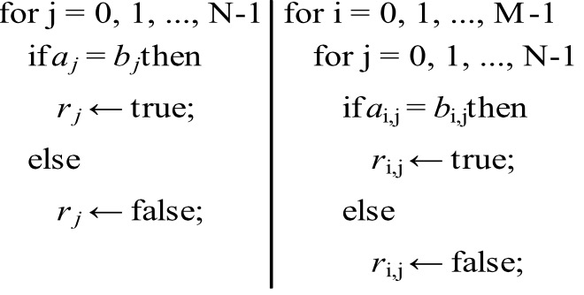

**接口定义**

C interface：

```c
void vsip_vleq_i(const vsip_vview_i* a,
                 const vsip_vview_i* b,
                 const vsip_vview_bl* r);
void vsip_vleq_f(const vsip_vview_f* a,
                 const vsip_vview_f* b,
                 const vsip_vview_bl* r);
void vsip_cvleq_f(const vsip_cvview_f* a,
                  const vsip_cvview_f* b,
                  const vsip_vview_bl* r);
void vsip_mleq_i(const vsip_mview_i* a,
                 const vsip_mview_i* b,
                 const vsip_mview_bl* r);
void vsip_cmleq_i(const vsip_cmview_i* a,
                  const vsip_cmview_i* b,
                  const vsip_mview_bl* r);
void vsip_mleq_f(const vsip_mview_f* a,
                 const vsip_mview_f* b,
                 const vsip_mview_bl* r);
void vsip_cmleq_f(const vsip_cmview_f* a,
                  const vsip_cmview_f* b,
                  const vsip_mview_bl* r);
```

**参数**

<table style="width: 100%; table-layout: fixed; word-break: break-word;">
  <colgroup>
    <col style="width: 18.00%;">
    <col style="width: 46.00%;">
    <col style="width: 20.00%;">
    <col style="width: 16.00%;">
  </colgroup>
  <thead>
    <tr><th>参数名</th><th>描述</th><th>取值范围</th><th>输入输出</th></tr>
  </thead>
  <tbody>
    <tr><td>a</td><td>输入向量/矩阵视图</td><td>非空</td><td>输入</td></tr>
    <tr><td>b</td><td>输入向量/矩阵视图</td><td>非空</td><td>输入</td></tr>
    <tr><td>r</td><td>输出向量/矩阵视图</td><td>非空</td><td>输出</td></tr>
  </tbody>
</table>

**示例**

C interface：

```c
#include <stdio.h>

#include "hml_vsip.h"
#include "vsip.h"

#define L 9 /* length */
int main() {
    vsip_vview_f* dataA;
    vsip_vview_f* dataB;
    vsip_vview_bl* dataBl;
    vsip_vview_vi* dataVi;
    vsip_scalar_vi numTrue = 0;
    int i = 0;
    vsip_init((void*)0);
    dataA = vsip_vcreate_f(L, VSIP_MEM_NONE);
    dataB = vsip_vcreate_f(L, VSIP_MEM_NONE);
    dataBl = vsip_vcreate_bl(L, VSIP_MEM_NONE);
    dataVi = vsip_vcreate_vi(L, VSIP_MEM_NONE);
    /* Make up some data */
    vsip_vramp_f(-2.0, 1, dataA);
    vsip_vramp_f(2.0, -1, dataB);
    printf("index A B\n");
    for (i = 0; i < L; i++)
        printf("%3i %7.1f %7.1f \n",
               i,
               vsip_vget_f(dataA, i),
               vsip_vget_f(dataB, i));
    /* now see if our ramps are equal someplace */
    vsip_vleq_f(dataA, dataB, dataBl);
    /* find the spots where dataA equals dataB */
    if (vsip_vanytrue_bl(dataBl)) {
        numTrue = vsip_vindexbool(dataBl, dataVi);
        /* print out the results */
        for (i = 0; i < numTrue; i++)
            printf("A = B at index %3i\n", (int)vsip_vget_vi(dataVi, i));
    } else {
        printf("No true cases\n");
    }
    /* recover allocated memory */
    vsip_blockdestroy_f(vsip_vdestroy_f(dataA));
    vsip_blockdestroy_f(vsip_vdestroy_f(dataB));
    vsip_blockdestroy_bl(vsip_vdestroy_bl(dataBl));
    vsip_blockdestroy_vi(vsip_vdestroy_vi(dataVi));
    vsip_finalize((void*)0);
    return 0;
}
```

输出结果

```text
index A B
  0    -2.0     2.0 
  1    -1.0     1.0 
  2     0.0     0.0 
  3     1.0    -1.0 
  4     2.0    -2.0 
  5     3.0    -3.0 
  6     4.0    -4.0 
  7     5.0    -5.0 
  8     6.0    -6.0 
A = B at index   2
```

##### 7.6.3.5.3 vsip\_\[d\] \[s\]lge\_\[p\]

计算两个向量/矩阵对应元素的“大于或等于”的布尔比较。

**函数功能**

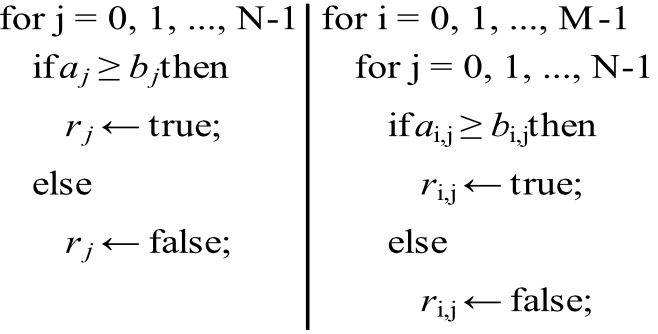

**接口定义**

C interface：

```c
void vsip_vlge_i(const vsip_vview_i *a, const vsip_vview_i *b,
                 const vsip_vview_bl *r);
void vsip_vlge_f(const vsip_vview_f *a, const vsip_vview_f *b,
                 const vsip_vview_bl *r);
void vsip_mlge_i(const vsip_mview_i *a, const vsip_mview_i *b,
                 const vsip_mview_bl *r);
void vsip_mlge_f(const vsip_mview_f *a, const vsip_mview_f *b,
                 const vsip_mview_bl *r);
```

**参数**

<table style="width: 100%; table-layout: fixed; word-break: break-word;">
  <colgroup>
    <col style="width: 18.00%;">
    <col style="width: 46.00%;">
    <col style="width: 20.00%;">
    <col style="width: 16.00%;">
  </colgroup>
  <thead>
    <tr><th>参数名</th><th>描述</th><th>取值范围</th><th>输入输出</th></tr>
  </thead>
  <tbody>
    <tr><td>a</td><td>输入向量/矩阵视图</td><td>非空</td><td>输入</td></tr>
    <tr><td>b</td><td>输入向量/矩阵视图</td><td>非空</td><td>输入</td></tr>
    <tr><td>r</td><td>输出布尔类型的向量/矩阵视图</td><td>非空</td><td>输出</td></tr>
  </tbody>
</table>

##### 7.6.3.5.4 vsip\_\[d\] \[s\]lle\_\[p\]

计算两个向量/矩阵对应元素的“小于或等于”的布尔比较。

**函数功能**

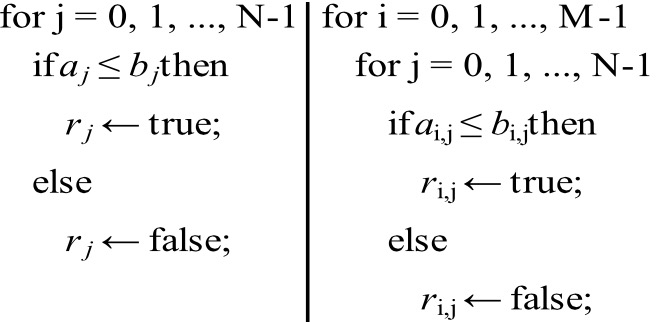

**接口定义**

C interface：

```c
void vsip_vlle_i(const vsip_vview_i *a, const vsip_vview_i *b,
                 const vsip_vview_bl *r);
void vsip_vlle_f(const vsip_vview_f *a, const vsip_vview_f *b,
                 const vsip_vview_bl *r);
void vsip_mlle_i(const vsip_mview_i *a, const vsip_mview_i *b,
                 const vsip_mview_bl *r);
void vsip_mlle_f(const vsip_mview_f *a, const vsip_mview_f *b,
                 const vsip_mview_bl *r);
```

**参数**

<table style="width: 100%; table-layout: fixed; word-break: break-word;">
  <colgroup>
    <col style="width: 18.00%;">
    <col style="width: 46.00%;">
    <col style="width: 20.00%;">
    <col style="width: 16.00%;">
  </colgroup>
  <thead>
    <tr><th>参数名</th><th>描述</th><th>取值范围</th><th>输入输出</th></tr>
  </thead>
  <tbody>
    <tr><td>a</td><td>输入向量/矩阵视图</td><td>非空</td><td>输入</td></tr>
    <tr><td>b</td><td>输入向量/矩阵视图</td><td>非空</td><td>输入</td></tr>
    <tr><td>r</td><td>输出布尔类型的向量/矩阵视图</td><td>非空</td><td>输出</td></tr>
  </tbody>
</table>

**示例**

C interface：

```c
#include <stdio.h>

#include "vsip.h"
#define L  9
#define PI 3.14159265358979323846
int main() {
    int i;
    vsip_vview_f *dataCos, *dataSin;
    vsip_vview_bl* dataLle;
    vsip_init((void*)0);
    dataCos = vsip_vcreate_f(L, VSIP_MEM_NONE),
    dataSin = vsip_vcreate_f(L, VSIP_MEM_NONE);
    dataLle = vsip_vcreate_bl(L, VSIP_MEM_NONE);
    /* Make up some data and do the check*/
    vsip_vramp_f(0.0, 2 * PI / (L - 1), dataCos);
    vsip_vsin_f(dataCos, dataSin);
    vsip_vcos_f(dataCos, dataCos);
    vsip_vlle_f(dataSin, dataCos, dataLle);
    /* Print the results */
    printf(" Sin Cos"
           "Sin < or equal Cos?\n");
    for (i = 0; i < L; i++) {
        printf("%20.17f %20.17f %5s\n",
               vsip_vget_f(dataSin, i),
               vsip_vget_f(dataCos, i),
               vsip_vget_bl(dataLle, i) ? "true" : "false");
    }
    vsip_valldestroy_f(dataCos);
    vsip_valldestroy_f(dataSin);
    vsip_valldestroy_bl(dataLle);
    vsip_finalize((void*)0);
    return 0;
}
```

结果输出

```text
Sin CosSin < or equal Cos?
 0.00000000000000000  1.00000000000000000  true
 0.70710676908493042  0.70710676908493042  true
 1.00000000000000000 -0.00000004371138829 false
 0.70710676908493042 -0.70710676908493042 false
-0.00000008742277657 -1.00000000000000000 false
-0.70710688829421997 -0.70710664987564087  true
-1.00000000000000000  0.00000001192488064  true
-0.70710653066635132  0.70710700750350952  true
 0.00000017484555315  1.00000000000000000  true
```

##### 7.6.3.5.5 vsip\_\[d\] \[s\]llt\_\[p\]

计算两个向量/矩阵对应元素的“小于”的布尔比较。

**函数功能**

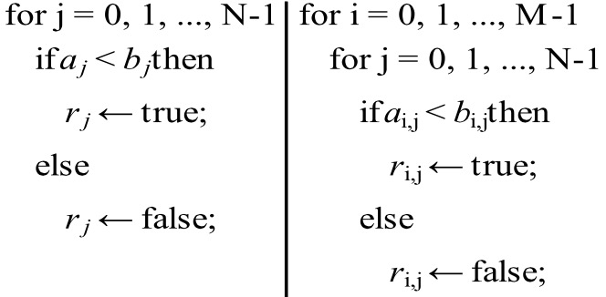

**接口定义**

C interface：

```c
void vsip_vllt_i(const vsip_vview_i *a, 
                 const vsip_vview_i *b,
                 const vsip_vview_bl *r);
void vsip_vllt_f(const vsip_vview_f *a, 
                 const vsip_vview_f *b,
                 const vsip_vview_bl *r);
void vsip_mllt_i(const vsip_mview_i *a, 
                 const vsip_mview_i *b,
                 const vsip_mview_bl *r);
void vsip_mllt_f(const vsip_mview_f *a, 
                 const vsip_mview_f *b,
                 const vsip_mview_bl *r);
```

**参数**

<table style="width: 100%; table-layout: fixed; word-break: break-word;">
  <colgroup>
    <col style="width: 18.00%;">
    <col style="width: 46.00%;">
    <col style="width: 20.00%;">
    <col style="width: 16.00%;">
  </colgroup>
  <thead>
    <tr><th>参数名</th><th>描述</th><th>取值范围</th><th>输入输出</th></tr>
  </thead>
  <tbody>
    <tr><td>a</td><td>输入向量/矩阵视图</td><td>非空</td><td>输入</td></tr>
    <tr><td>b</td><td>输入向量/矩阵视图</td><td>非空</td><td>输入</td></tr>
    <tr><td>r</td><td>输出布尔类型的向量/矩阵视图</td><td>非空</td><td>输出</td></tr>
  </tbody>
</table>

**示例**

C interface：

```c
#include <stdio.h>

#include "vsip.h"
#define L  9
#define PI 3.14159265358979323846
int main() {
    int i;
    vsip_vview_f *dataCos, *dataSin;
    vsip_vview_bl* dataLlt;
    vsip_init((void*)0);
    dataCos = vsip_vcreate_f(L, VSIP_MEM_NONE);
    dataSin = vsip_vcreate_f(L, VSIP_MEM_NONE);
    dataLlt = vsip_vcreate_bl(L, VSIP_MEM_NONE);
    /* Make up some data and do the check*/
    vsip_vramp_f(0.0, 2 * PI / (L - 1), dataCos);
    vsip_vsin_f(dataCos, dataSin);
    vsip_vcos_f(dataCos, dataCos);
    vsip_vllt_f(dataSin, dataCos, dataLlt);
    /* Print the results */
    printf(" Sin   Cos  Sin < Cos?\n");
    for (i = 0; i < L; i++) {
        printf("%20.17f %20.17f %5s\n",
               vsip_vget_f(dataSin, i),
               vsip_vget_f(dataCos, i),
               vsip_vget_bl(dataLlt, i) ? "true" : "false");
    }
    vsip_valldestroy_f(dataCos);
    vsip_valldestroy_f(dataSin);
    vsip_valldestroy_bl(dataLlt);
    vsip_finalize((void*)0);
    return 0;
}
```

输出结果

```text
Sin   Cos  Sin < Cos?
 0.00000000000000000  1.00000000000000000  true
 0.70710676908493042  0.70710676908493042 false
 1.00000000000000000 -0.00000004371138829 false
 0.70710676908493042 -0.70710676908493042 false
-0.00000008742277657 -1.00000000000000000 false
-0.70710688829421997 -0.70710664987564087  true
-1.00000000000000000  0.00000001192488064  true
-0.70710653066635132  0.70710700750350952  true
 0.00000017484555315  1.00000000000000000  true
```

##### 7.6.3.5.6 vsip\_\[d\] \[s\]lne\_\[p\]

计算两个向量/矩阵对应元素的“不等于”的布尔比较。

**函数功能**

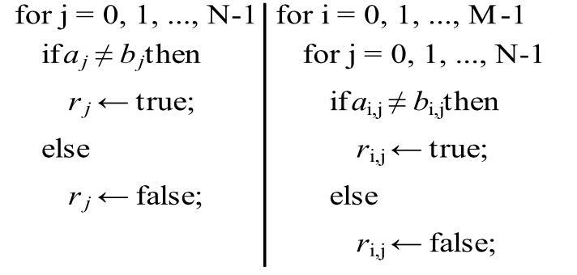

**接口定义**

C interface：

```c
void vsip_vlne_i(const vsip_vview_i *a, 
                 const vsip_vview_i *b,
                 const vsip_vview_bl *r);
void vsip_cvlne_i(const vsip_cvview_i *a, 
                  const vsip_cvview_i *b,
                  const vsip_vview_bl *r);
void vsip_vlne_f(const vsip_vview_f *a, 
                 const vsip_vview_f *b,
                 const vsip_vview_bl *r);
void vsip_cvlne_f(const vsip_cvview_f *a, 
                  const vsip_cvview_f *b,
                  const vsip_vview_bl *r);
void vsip_mlne_i(const vsip_mview_i *a, 
                 const vsip_mview_i *b,
                 const vsip_mview_bl *r);
void vsip_cmlne_i(const vsip_cmview_i *a, 
                  const vsip_cmview_i *b,
                  const vsip_mview_bl *r);
void vsip_mlne_f(const vsip_mview_f *a, 
                 const vsip_mview_f *b,
                 const vsip_mview_bl *r);
void vsip_cmlne_f(const vsip_cmview_f *a, 
                  const vsip_cmview_f *b,
                  const vsip_mview_bl *r);
```

**参数**

<table style="width: 100%; table-layout: fixed; word-break: break-word;">
  <colgroup>
    <col style="width: 18.00%;">
    <col style="width: 46.00%;">
    <col style="width: 20.00%;">
    <col style="width: 16.00%;">
  </colgroup>
  <thead>
    <tr><th>参数名</th><th>描述</th><th>取值范围</th><th>输入输出</th></tr>
  </thead>
  <tbody>
    <tr><td>a</td><td>输入向量/矩阵视图</td><td>非空</td><td>输入</td></tr>
    <tr><td>b</td><td>输入向量/矩阵视图</td><td>非空</td><td>输入</td></tr>
    <tr><td>r</td><td>输出布尔类型的向量/矩阵视图</td><td>非空</td><td>输出</td></tr>
  </tbody>
</table>

#### 7.6.3.6 选择函数

##### 7.6.3.6.1 vsip\_\[s\]clip\_\[p\]

计算两个向量/矩阵对应元素的广义双重剪辑。

**函数功能**

对于一个向量/矩阵a, 按照以下规则逐个过滤每个元素，生成输出向量/矩阵r。请注意，一旦某个元素满足了一个规则，就会忽略后续的规则。

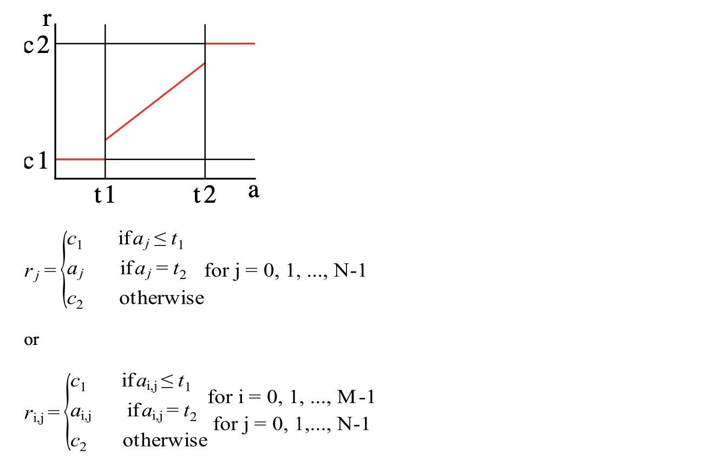

**接口定义**

C interface：

```c
void vsip_vclip_f(const vsip_vview_f *a, vsip_scalar_f t1, vsip_scalar_f t2,
                  vsip_scalar_f c1, vsip_scalar_f c2, const vsip_vview_f *r);
void vsip_vclip_i(const vsip_vview_i *a, vsip_scalar_i t1, vsip_scalar_i t2,
                  vsip_scalar_i c1, vsip_scalar_i c2, const vsip_vview_i *r);
void vsip_mclip_f(const vsip_mview_f *a, vsip_scalar_f t1, vsip_scalar_f t2,
                  vsip_scalar_f c1, vsip_scalar_f c2, const vsip_mview_f *r);
void vsip_mclip_i(const vsip_mview_i *a, vsip_scalar_i t1, vsip_scalar_i t2,
                  vsip_scalar_i c1, vsip_scalar_i c2, const vsip_mview_i *r);
```

**参数**

<table style="width: 100%; table-layout: fixed; word-break: break-word;">
  <colgroup>
    <col style="width: 18.00%;">
    <col style="width: 46.00%;">
    <col style="width: 20.00%;">
    <col style="width: 16.00%;">
  </colgroup>
  <thead>
    <tr><th>参数名</th><th>描述</th><th>取值范围</th><th>输入输出</th></tr>
  </thead>
  <tbody>
    <tr><td>a</td><td>输入向量/矩阵视图</td><td>非空</td><td>输入</td></tr>
    <tr><td>t1</td><td>阈值下限</td><td>标量</td><td>输入</td></tr>
    <tr><td>t2</td><td>阈值上限</td><td>标量</td><td>输入</td></tr>
    <tr><td>c1</td><td>阈值下限剪切值</td><td>标量</td><td>输入</td></tr>
    <tr><td>c2</td><td>阈值上限剪切值</td><td>标量</td><td>输入</td></tr>
    <tr><td>r</td><td>输出向量/矩阵视图</td><td>非空</td><td>输出</td></tr>
  </tbody>
</table>

**示例**

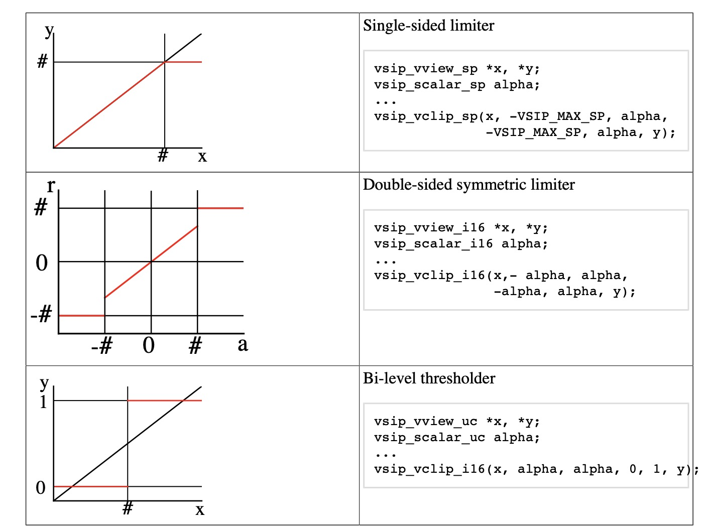

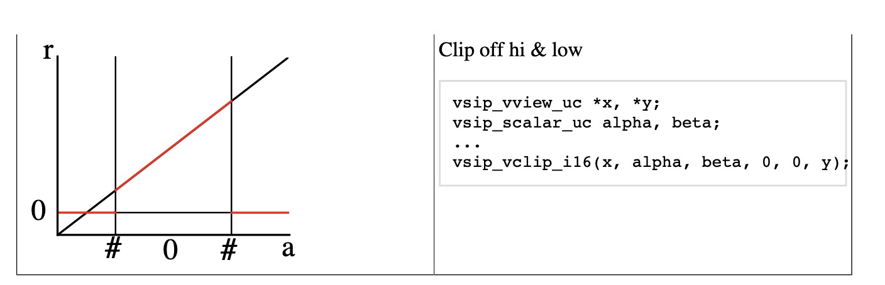

C interface：

```c
#include <stdio.h>

#include "vsip.h"
#define L  9
#define PI 3.14159265359
int main() {
    vsip_vview_f *dataIn, *dataClip;
    vsip_init((void*)0);
    dataIn = vsip_vcreate_f(L, VSIP_MEM_NONE);
    dataClip = vsip_vcreate_f(L, VSIP_MEM_NONE);
    /* make some data */
    vsip_vramp_f(0.0, (2 * PI) / (L - 1.0), dataIn);
    vsip_vcos_f(dataIn, dataIn);
    vsip_vclip_f(dataIn, -.8, .8, -.8, .8, dataClip);
    printf("clip Cosine between -.8 and .8\n in => out\n ");
    {
        int i;
        for (i = 0; i < L; i++)
            printf("%7.4f => %7.4f\n",
                   vsip_vget_f(dataIn, i),
                   vsip_vget_f(dataClip, i));
    }
    vsip_finalize((void*)0);
    return 0;
}
```

输出结果

```text
clip Cosine between -.8 and .8
 in => out
  1.0000 =>  0.8000
 0.7071 =>  0.7071
-0.0000 => -0.0000
-0.7071 => -0.7071
-1.0000 => -0.8000
-0.7071 => -0.7071
 0.0000 =>  0.0000
 0.7071 =>  0.7071
 1.0000 =>  0.8000
```

##### 7.6.3.6.2 vsip\_\[s\]invclip\_\[p\]

计算两个向量/矩阵对应元素的广义反向双重剪辑。

**函数功能**

对于向量/矩阵a，根据以下规则逐个过滤每个元素，生成输出向量/矩阵r。请注意，一旦某个元素满足了一个规则，后续规则将被忽略。

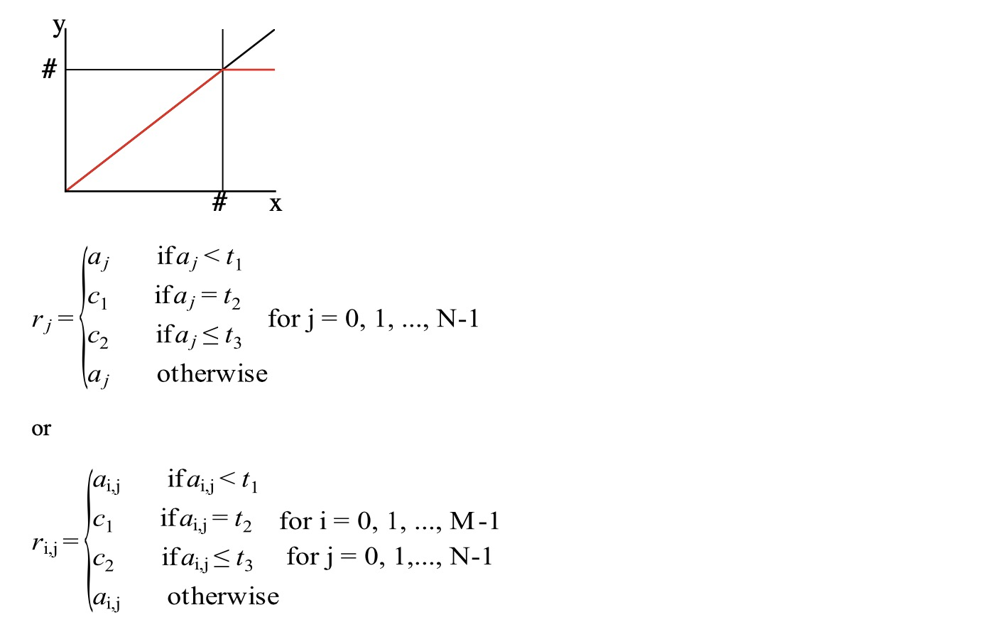

**接口定义**

C interface：

```c
void vsip_vinvclip_f(const vsip_vview_f* a,
                     vsip_scalar_f t1,
                     vsip_scalar_f t2,
                     vsip_scalar_f t3,
                     vsip_scalar_f c1,
                     vsip_scalar_f c2,
                     const vsip_vview_f* r);
void vsip_vinvclip_i(const vsip_vview_i* a,
                     vsip_scalar_i t1,
                     vsip_scalar_i t2,
                     vsip_scalar_i t3,
                     vsip_scalar_i c1,
                     vsip_scalar_i c2,
                     const vsip_vview_i* r);
void vsip_minvclip_f(const vsip_mview_f* a,
                     vsip_scalar_f t1,
                     vsip_scalar_f t2,
                     vsip_scalar_f t3,
                     vsip_scalar_f c1,
                     vsip_scalar_f c2,
                     const vsip_mview_f* r);
void vsip_minvclip_i(const vsip_mview_i* a,
                     vsip_scalar_i t1,
                     vsip_scalar_i t2,
                     vsip_scalar_i t3,
                     vsip_scalar_i c1,
                     vsip_scalar_i c2,
                     const vsip_mview_i* r);
```

**参数**

<table style="width: 100%; table-layout: fixed; word-break: break-word;">
  <colgroup>
    <col style="width: 18.00%;">
    <col style="width: 46.00%;">
    <col style="width: 20.00%;">
    <col style="width: 16.00%;">
  </colgroup>
  <thead>
    <tr><th>参数名</th><th>描述</th><th>取值范围</th><th>输入输出</th></tr>
  </thead>
  <tbody>
    <tr><td>a</td><td>输入向量/矩阵视图</td><td>非空</td><td>输入</td></tr>
    <tr><td>t1</td><td>阈值下限</td><td>标量</td><td>输入</td></tr>
    <tr><td>t2</td><td>阈值中值</td><td>标量</td><td>输入</td></tr>
    <tr><td>t3</td><td>阈值上限</td><td>标量</td><td>输入</td></tr>
    <tr><td>c1</td><td>阈值下限剪切值</td><td>标量</td><td>输入</td></tr>
    <tr><td>c2</td><td>阈值上限剪切值</td><td>标量</td><td>输入</td></tr>
    <tr><td>r</td><td>输出向量/矩阵视图</td><td>非空</td><td>输出</td></tr>
  </tbody>
</table>

**示例**

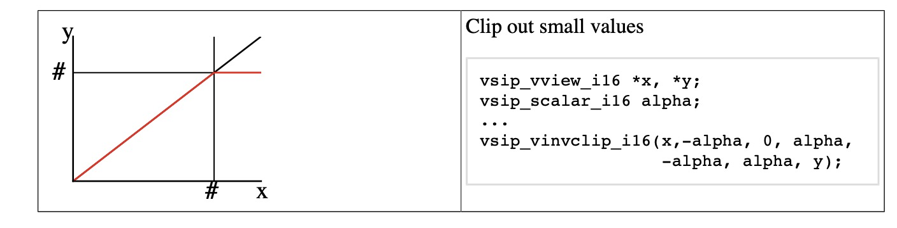

##### 7.6.3.6.3 vsip\_\[s\]indexbool\_\[p\]

计算布尔向量/矩阵中非假元素的索引向量，并返回非假元素的数量。

**函数功能**

返回布尔向量b或布尔矩阵B中非假元素的索引向量。索引向量是有序的；较低的索引排在前面。对于矩阵，索引向量中的元素按矩阵的主排序顺序出现。如果没有找到非假元素，索引向量保持不变；否则，向量视图的长度将设置为非假元素的数量。

返回值是非假元素的数量。

**接口定义**

C interface：

```c
vsip_length vsip_vindexbool(const vsip_vview_bl *b, vsip_vview_vi *index);
vsip_length vsip_mindexbool(const vsip_mview_bl *b, vsip_vview_mi *index);
```

**参数**

<table style="width: 100%; table-layout: fixed; word-break: break-word;">
  <colgroup>
    <col style="width: 18.00%;">
    <col style="width: 46.00%;">
    <col style="width: 20.00%;">
    <col style="width: 16.00%;">
  </colgroup>
  <thead>
    <tr><th>参数名</th><th>描述</th><th>取值范围</th><th>输入输出</th></tr>
  </thead>
  <tbody>
    <tr><td>b</td><td>输入布尔向量/矩阵的视图</td><td>非空</td><td>输入</td></tr>
    <tr><td>index</td><td>输出向量/矩阵的视图</td><td>非空</td><td>输入</td></tr>
  </tbody>
</table>

**返回值**

返回值是非假元素的数量。

##### 7.6.3.6.4 vsip\_\[s\]max\_\[p\]

按元素计算两个向量/矩阵的最大值。

**函数功能**

$$
r\_j = max{a\_j, b\_j} \\quad\\text{for}\\quad j=0,1,...,N-1
$$
$$
r\_{i,j} = max{a\_{i,j}, b\_{i,j}} \\quad\\text{for}\\quad i=0,1,...,M-1; \\quad\\text{for}\\quad j=0,1,...,N-1
$$

**接口定义**

C interface：

```c
void vsip_vmax_f(const vsip_vview_f *a, 
                 const vsip_vview_f *b,
                 const vsip_vview_f *r);
void vsip_mmax_f(const vsip_mview_f *a, 
                 const vsip_mview_f *b,
                 const vsip_mview_f *r);
```

**参数**

<table style="width: 100%; table-layout: fixed; word-break: break-word;">
  <colgroup>
    <col style="width: 18.00%;">
    <col style="width: 46.00%;">
    <col style="width: 20.00%;">
    <col style="width: 16.00%;">
  </colgroup>
  <thead>
    <tr><th>参数名</th><th>描述</th><th>取值范围</th><th>输入输出</th></tr>
  </thead>
  <tbody>
    <tr><td>a</td><td>输入向量/矩阵视图</td><td>非空</td><td>输入</td></tr>
    <tr><td>b</td><td>输入向量/矩阵视图</td><td>非空</td><td>输入</td></tr>
    <tr><td>r</td><td>输出向量/矩阵视图</td><td>非空</td><td>输出</td></tr>
  </tbody>
</table>

**示例**

C interface：

```c
#include <stdio.h>

#include "hml_vsip.h"
#include "vsip.h"

#define L  9
#define PI 3.14159265359
int main() {
    int i = 0;
    vsip_vview_f* dataA;
    vsip_vview_f* dataB;
    vsip_vview_f* dataMax;
    vsip_vview_f* dataMin;
    vsip_vview_f* dataRamp;
    vsip_init((void*)0);
    dataA = vsip_vcreate_f(L, VSIP_MEM_NONE);
    dataB = vsip_vcreate_f(L, VSIP_MEM_NONE);
    dataMax = vsip_vcreate_f(L, VSIP_MEM_NONE);
    dataMin = vsip_vcreate_f(L, VSIP_MEM_NONE);
    dataRamp = vsip_vcreate_f(L, VSIP_MEM_NONE);
    /* Make up some data */
    vsip_vramp_f(0.0, (2 * PI) / ((double)(L - 1)), dataRamp);
    vsip_vsin_f(dataRamp, dataA);
    vsip_vcos_f(dataRamp, dataB);
    /* find the Max and Min of dataA and dataB */
    vsip_vmax_f(dataA, dataB, dataMax);
    vsip_vmin_f(dataA, dataB, dataMin);
    /* print out the results */
    printf(" Vector A\n");
    hml_vsip_vprintm_f("6.5", dataA);
    printf(" Vector B\n");
    hml_vsip_vprintm_f("6.5", dataB);
    printf(" Vector A B max\n");
    hml_vsip_vprintm_f("6.5", dataMax);
    printf(" Vector A B min\n");
    hml_vsip_vprintm_f("6.5", dataMin);

    /* recover allocated memory */
    vsip_blockdestroy_f(vsip_vdestroy_f(dataA));
    vsip_blockdestroy_f(vsip_vdestroy_f(dataB));
    vsip_blockdestroy_f(vsip_vdestroy_f(dataMax));
    vsip_blockdestroy_f(vsip_vdestroy_f(dataRamp));
    vsip_finalize((void*)0);
    return 0;
}
```

输出结果

```text
Vector A
[
0.00000  0.70711  1.00000  0.70711  -0.00000  -0.70711  -1.00000  -0.70711  0.00000 ];
 Vector B
[
1.00000  0.70711  -0.00000  -0.70711  -1.00000  -0.70711  0.00000  0.70711  1.00000 ];
 Vector A B max
[
1.00000  0.70711  1.00000  0.70711  -0.00000  -0.70711  0.00000  0.70711  1.00000 ];
 Vector A B min
[
0.00000  0.70711  -0.00000  -0.70711  -1.00000  -0.70711  -1.00000  -0.70711  0.00000 ];
```

##### 7.6.3.6.5 vsip\_\[s\]maxmg\_\[p\]

计算两个向量/矩阵对应元素的最大绝对值（幅度）。

**函数功能**

r\_j = max{|a\_j|, |b\_j|} for j = 0, 1,, ..., N-1
r\_{i,j} = max{|a\_{i,j}|, |b\_{i,j}|} for i = 0, 1, ..., M-1; for j = 0, 1, ..., N-1

**接口定义**

C interface：

```c
void vsip_vmaxmg_f(const vsip_vview_f* a,
                   const vsip_vview_f* b,
                   const vsip_vview_f* r);
void vsip_mmaxmg_f(const vsip_mview_f* a,
                   const vsip_mview_f* b,
                   const vsip_mview_f* r);
```

**参数**

<table style="width: 100%; table-layout: fixed; word-break: break-word;">
  <colgroup>
    <col style="width: 18.00%;">
    <col style="width: 46.00%;">
    <col style="width: 20.00%;">
    <col style="width: 16.00%;">
  </colgroup>
  <thead>
    <tr><th>参数名</th><th>描述</th><th>取值范围</th><th>输入输出</th></tr>
  </thead>
  <tbody>
    <tr><td>a</td><td>输入向量/矩阵视图</td><td>非空</td><td>输入</td></tr>
    <tr><td>b</td><td>输入向量/矩阵视图</td><td>非空</td><td>输入</td></tr>
    <tr><td>r</td><td>输出向量/矩阵视图</td><td>非空</td><td>输出</td></tr>
  </tbody>
</table>

**示例**

C interface：

```c
#include <stdio.h>

#include "vsip.h"
#define L  9
#define PI 3.14159265359
int main() {
    int i = 0;
    vsip_vview_f* dataA;
    vsip_vview_f* dataB;
    vsip_vview_f* dataMax;
    vsip_vview_f* dataMin;
    vsip_vview_f* dataRamp;
    vsip_init((void*)0);
    dataA = vsip_vcreate_f(L, VSIP_MEM_NONE);
    dataB = vsip_vcreate_f(L, VSIP_MEM_NONE);
    dataMax = vsip_vcreate_f(L, VSIP_MEM_NONE);
    dataMin = vsip_vcreate_f(L, VSIP_MEM_NONE);
    dataRamp = vsip_vcreate_f(L, VSIP_MEM_NONE);
    /* Make up some data */
    vsip_vramp_f(0.0, (2 * PI) / ((double)(L - 1)), dataRamp);
    vsip_vsin_f(dataRamp, dataA);
    vsip_vcos_f(dataRamp, dataB);
    /* find the Maximum Magnitde dataA or dataB*/
    vsip_vmaxmg_f(dataA, dataB, dataMax);
    vsip_vminmg_f(dataA, dataB, dataMin);
    /* print out the results */
    printf("A B Max Mag Min Mag\n");
    for (i = 0; i < L; i++)
        printf("%7.4f %7.4f %7.4f %7.4f\n",
               vsip_vget_f(dataA, i),
               vsip_vget_f(dataB, i),
               vsip_vget_f(dataMax, i),
               vsip_vget_f(dataMin, i));
    /* recover allocated memory */
    vsip_blockdestroy_f(vsip_vdestroy_f(dataA));
    vsip_blockdestroy_f(vsip_vdestroy_f(dataB));
    vsip_blockdestroy_f(vsip_vdestroy_f(dataMax));
    vsip_blockdestroy_f(vsip_vdestroy_f(dataMin));
    vsip_blockdestroy_f(vsip_vdestroy_f(dataRamp));
    vsip_finalize((void*)0);
    return 0;
}
```

输出结果

```text
A B Max Mag Min Mag
 0.0000  1.0000  1.0000  0.0000
 0.7071  0.7071  0.7071  0.7071
 1.0000 -0.0000  1.0000  0.0000
 0.7071 -0.7071  0.7071  0.7071
-0.0000 -1.0000  1.0000  0.0000
-0.7071 -0.7071  0.7071  0.7071
-1.0000  0.0000  1.0000  0.0000
-0.7071  0.7071  0.7071  0.7071
 0.0000  1.0000  1.0000  0.0000
```

##### 7.6.3.6.6 vsip\_\[s\]maxmgsq\_\[p\]

计算两个复数向量/矩阵对应元素的最大幅度平方。

**函数功能**

r\_j = max{|a\_j|^2, |b\_j|^2} for j=0,1, ..., N-1
r\_{i,j} = max{|a\_{i,j}^2|, |b\_{i,j}^2|} for i = 0, 1, ..., M-1; for j=0, 1, ..., N-1

**接口定义**

C interface：

```c
void vsip_vcmaxmg_f(const vsip_cvview_f* a,
                    const vsip_cvview_f* b,
                    const vsip_vview_f* r);
void vsip_mcmaxmg_f(const vsip_cmview_f* a,
                    const vsip_cmview_f* b,
                    const vsip_mview_f* r);
```

**参数**

<table style="width: 100%; table-layout: fixed; word-break: break-word;">
  <colgroup>
    <col style="width: 18.00%;">
    <col style="width: 46.00%;">
    <col style="width: 20.00%;">
    <col style="width: 16.00%;">
  </colgroup>
  <thead>
    <tr><th>参数名</th><th>描述</th><th>取值范围</th><th>输入输出</th></tr>
  </thead>
  <tbody>
    <tr><td>a</td><td>输入向量/矩阵视图</td><td>非空</td><td>输入</td></tr>
    <tr><td>b</td><td>输入向量/矩阵视图</td><td>非空</td><td>输入</td></tr>
    <tr><td>r</td><td>输出向量/矩阵视图</td><td>非空</td><td>输出</td></tr>
  </tbody>
</table>

**示例**

C interface：

```c
#include <stdio.h>

#include "vsip.h"
#define L  9
#define PI 3.14159265359
int main() {
    /* Make up some data space */
    vsip_cvview_f* cdataA;
    vsip_cvview_f* cdataB;
    vsip_vview_f* dataReA;
    vsip_vview_f* dataImA;
    vsip_vview_f* dataReB;
    vsip_vview_f* dataImB;
    vsip_vview_f* dataMaxmgsq;
    vsip_vview_f* dataMinmgsq;
    int i = 0;
    vsip_init((void*)0);
    cdataA = vsip_cvcreate_f(L, VSIP_MEM_NONE);
    cdataB = vsip_cvcreate_f(L, VSIP_MEM_NONE);
    dataReA = vsip_vrealview_f(cdataA);
    dataImA = vsip_vimagview_f(cdataA);
    dataReB = vsip_vrealview_f(cdataB);
    dataImB = vsip_vimagview_f(cdataB);
    dataMaxmgsq = vsip_vcreate_f(L, VSIP_MEM_NONE);
    dataMinmgsq = vsip_vcreate_f(L, VSIP_MEM_NONE);
    vsip_vramp_f(0.001, (2 * PI) / ((double)(L - 1)), dataImB);
    vsip_vsin_f(dataImB, dataReA);
    vsip_vcos_f(dataImB, dataReB);
    vsip_vsqrt_f(dataImB, dataImA);
    vsip_vrsqrt_f(dataImB, dataImB);
    /* find the Maximum Magnitude Sq. of cdataA and cdataB*/
    vsip_vcmaxmgsq_f(cdataA, cdataB, dataMaxmgsq);
    vsip_vcminmgsq_f(cdataA, cdataB, dataMinmgsq);
    /* print out the input */
    printf("A B Max Mag Sq Min Mag Sq\n");
    for (i = 0; i < L; i++)
        printf("(%7.4f, %7.4f) (%7.4f, %7.4f) => %7.4f %7.4f\n",
               vsip_vget_f(dataReA, i),
               vsip_vget_f(dataImA, i),
               vsip_vget_f(dataReB, i),
               vsip_vget_f(dataImB, i),
               vsip_vget_f(dataMaxmgsq, i),
               vsip_vget_f(dataMinmgsq, i));
    vsip_vdestroy_f(dataReA);
    vsip_vdestroy_f(dataImA);
    vsip_vdestroy_f(dataReB);
    vsip_vdestroy_f(dataImB);
    vsip_cblockdestroy_f(vsip_cvdestroy_f(cdataA));
    vsip_cblockdestroy_f(vsip_cvdestroy_f(cdataB));
    vsip_blockdestroy_f(vsip_vdestroy_f(dataMaxmgsq));
    vsip_blockdestroy_f(vsip_vdestroy_f(dataMinmgsq));
    vsip_finalize((void*)0);
    return 0;
}
```

输出结果

```text
A B Max Mag Sq Min Mag Sq
( 0.0010,  0.0316) ( 1.0000, 31.6211) => 1000.8936  0.0010
( 0.7078,  0.8868) ( 0.7064,  1.1277) =>  1.7707  1.2874
( 1.0000,  1.2537) (-0.0010,  0.7976) =>  2.5718  0.6362
( 0.7064,  1.5353) (-0.7078,  0.6514) =>  2.8562  0.9253
(-0.0010,  1.7727) (-1.0000,  0.5641) =>  3.1426  1.3182
(-0.7078,  1.9819) (-0.7064,  0.5046) =>  4.4290  0.7537
(-1.0000,  2.1710) ( 0.0010,  0.4606) =>  5.7134  0.2122
(-0.7064,  2.3449) ( 0.7078,  0.4265) =>  5.9978  0.6829
( 0.0010,  2.5068) ( 1.0000,  0.3989) =>  6.2842  1.1591
```

##### 7.6.3.6.7 vsip\_\[s\]maxmgsqval\_\[p\]

返回复数向量/矩阵元素的最大幅度平方的索引和值。索引作为参数之一通过引用返回。

**函数功能**

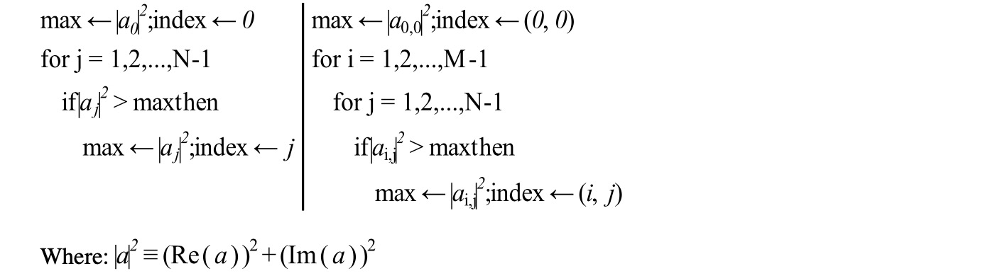

**接口定义**

C interface：

```c
vsip_scalar_f vsip_vcmaxmgsqval_f(const vsip_cvview_f *a, vsip_scalar_vi *index);
vsip_scalar_f vsip_mcmaxmgsqval_f(const vsip_cmview_f *a, vsip_scalar_mi *index);
```

**参数**

<table style="width: 100%; table-layout: fixed; word-break: break-word;">
  <colgroup>
    <col style="width: 18.00%;">
    <col style="width: 46.00%;">
    <col style="width: 20.00%;">
    <col style="width: 16.00%;">
  </colgroup>
  <thead>
    <tr><th>参数名</th><th>描述</th><th>取值范围</th><th>输入输出</th></tr>
  </thead>
  <tbody>
    <tr><td>a</td><td>输入向量/矩阵视图</td><td>非空</td><td>输入</td></tr>
    <tr><td>index</td><td>返回索引的指针，如果为null，则不返回索引。</td><td>可空</td><td>输出</td></tr>
  </tbody>
</table>

**示例**

C interface：

```c
#include <stdio.h>

#include "vsip.h"
#define PI 3.1415926535
#define L  7 /* length */
int main() {
    int i;
    vsip_vview_f* dataMagsq;
    vsip_cvview_f* dataCmplx;
    vsip_vview_f* dataRe;
    vsip_vview_f* dataIm;
    vsip_cscalar_f cscalar;
    vsip_scalar_f mgsqval;
    vsip_scalar_vi index = 0;
    vsip_init((void*)0);
    dataMagsq = vsip_vcreate_f(L, VSIP_MEM_NONE);
    dataCmplx = vsip_cvcreate_f(L, VSIP_MEM_NONE);
    dataRe = vsip_vrealview_f(dataCmplx);
    dataIm = vsip_vimagview_f(dataCmplx);
    /* Make up some data to find the magnitude of */
    vsip_vramp_f(0.0, (2.0 * PI / (double)(L - 1)), dataRe);
    vsip_vsin_f(dataRe, dataRe);
    vsip_vramp_f(0.0, (3.0 * PI / (double)(L - 1)), dataIm);
    vsip_vcos_f(dataIm, dataIm);
    vsip_vdestroy_f(dataRe);
/*don't need these views any more*/
    vsip_vdestroy_f(dataIm);
    /* Find the Magnitude */
    vsip_vcmagsq_f(dataCmplx, dataMagsq);
    /*now print out dataCmplex an its magnitude squared*/
    printf(" complex vector => Mag Squared\n");
    for (i = 0; i < L; i++) {
        cscalar = vsip_cvget_f(dataCmplx, (vsip_scalar_vi)i);
        printf("(%7.4f, %7.4f) => %7.4f\n",
               vsip_real_f(cscalar),
               vsip_imag_f(cscalar),
               vsip_vget_f(dataMagsq, i));
    }
    /* now find the maximum and minimum value and its index */
    mgsqval = vsip_vcmaxmgsqval_f(dataCmplx, &index);
    printf("Max Mag Squared of %7.4f at index %i\n", mgsqval, (int)index);
    mgsqval = vsip_vcminmgsqval_f(dataCmplx, &index);
    printf("Min Mag Squared of %7.4f at index %i\n", mgsqval, (int)index);
    /*destroy the vector views and any associated blocks */
    vsip_blockdestroy_f(vsip_vdestroy_f(dataMagsq));
    vsip_cblockdestroy_f(vsip_cvdestroy_f(dataCmplx));
    vsip_finalize((void*)0);
    return 0;
}
```

输出结果

```text
complex vector => Mag Squared
( 0.0000,  1.0000) =>  1.0000
( 0.8660, -0.0000) =>  0.7500
( 0.8660, -1.0000) =>  1.7500
(-0.0000,  0.0000) =>  0.0000
(-0.8660,  1.0000) =>  1.7500
(-0.8660, -0.0000) =>  0.7500
( 0.0000, -1.0000) =>  1.0000
Max Mag Squared of  1.7500 at index 4
Min Mag Squared of  0.0000 at index 3
```

##### 7.6.3.6.8 vsip\_\[s\]maxmgval\_\[p\]

返回向量/矩阵元素的最大绝对值的索引和值。索引作为参数之一通过引用返回。

**函数功能**

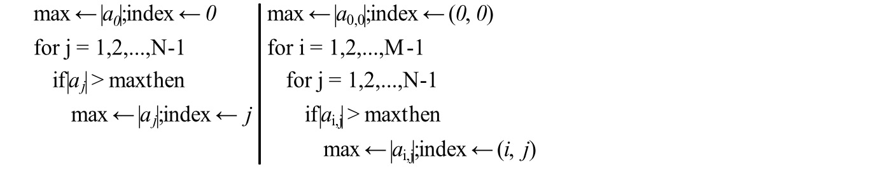

**接口定义**

C interface：

```c
vsip_scalar_f vsip_vmaxmgval_f(const vsip_vview_f *a, vsip_scalar_vi *index);
vsip_scalar_f vsip_mmaxmgval_f(const vsip_mview_f *a, vsip_scalar_mi *index);
```

**参数**

<table style="width: 100%; table-layout: fixed; word-break: break-word;">
  <colgroup>
    <col style="width: 18.00%;">
    <col style="width: 46.00%;">
    <col style="width: 20.00%;">
    <col style="width: 16.00%;">
  </colgroup>
  <thead>
    <tr><th>参数名</th><th>描述</th><th>取值范围</th><th>输入输出</th></tr>
  </thead>
  <tbody>
    <tr><td>a</td><td>输入向量/矩阵视图</td><td>非空</td><td>输入</td></tr>
    <tr><td>index</td><td>返回索引的指针，如果为null，则不返回索引。</td><td>可空</td><td>输出</td></tr>
  </tbody>
</table>

**示例**

C interface：

```c
#include <stdio.h>

#include "vsip.h"

#define PI 3.1415926535
#define L  7 /* length */
int main() {
    int i;
    vsip_vview_f* data;
    vsip_scalar_f mgval;
    vsip_scalar_vi index = 0;
    vsip_init((void*)0);
    data = vsip_vcreate_f(L, VSIP_MEM_NONE);
    /* Make up some data to find the magnitude of */
    vsip_vramp_f(0.0, (2.0 * PI / (double)(L - 1)), data);
    vsip_vsin_f(data, data);
    printf(" data \n");
    for (i = 0; i < L; i++)
        printf("%7.4f\n", vsip_vget_f(data, i));
    /* now find the max and min magnitude value and their index */
    mgval = vsip_vmaxmgval_f(data, &index);
    printf("Max Mag of %7.4f at index %i\n", mgval, (int)index);
    mgval = vsip_vminmgval_f(data, &index);
    printf("Min Mag of %7.4f at index %i\n", mgval, (int)index);
    /*destroy the vector views and any associated blocks */
    vsip_blockdestroy_f(vsip_vdestroy_f(data));
    vsip_finalize((void*)0);
    return 0;
}
```

输出结果

```text
data 
 0.0000
 0.8660
 0.8660
-0.0000
-0.8660
-0.8660
 0.0000
Max Mag of  0.8660 at index 1
Min Mag of  0.0000 at index 0
```

##### 7.6.3.6.9 vsip\_\[s\]maxval\_\[p\]

返回向量/矩阵元素的最大值的索引和值。索引作为参数之一通过引用返回。

**函数功能**

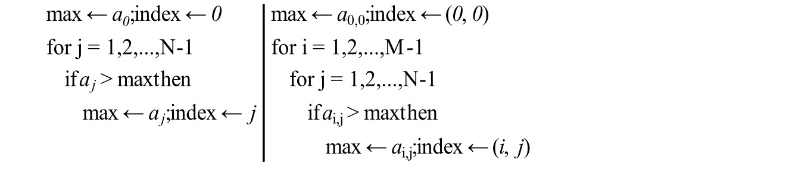

**接口定义**

C interface：

```c
vsip_scalar_f vsip_vmaxval_f(const vsip_vview_f *a, vsip_scalar_vi *index);
vsip_scalar_f vsip_mmaxval_f(const vsip_mview_f *a, vsip_scalar_mi *index);
```

**参数**

<table style="width: 100%; table-layout: fixed; word-break: break-word;">
  <colgroup>
    <col style="width: 18.00%;">
    <col style="width: 46.00%;">
    <col style="width: 20.00%;">
    <col style="width: 16.00%;">
  </colgroup>
  <thead>
    <tr><th>参数名</th><th>描述</th><th>取值范围</th><th>输入输出</th></tr>
  </thead>
  <tbody>
    <tr><td>a</td><td>输入向量/矩阵视图</td><td>非空</td><td>输入</td></tr>
    <tr><td>index</td><td>返回索引的指针，如果为null，则不返回索引。</td><td>可空</td><td>输出</td></tr>
  </tbody>
</table>

**示例**

C interface：

```c
#include <stdio.h>

#include "hml_vsip.h"
#include "vsip.h"

#define PI 3.1415926535
#define L  9 /* length */
int main() {
    int i;
    vsip_vview_f* data;
    vsip_scalar_vi index = 0;
    vsip_scalar_f maxval = 0, minval = 0;
    vsip_init((void*)0);
    data = vsip_vcreate_f(L, VSIP_MEM_NONE);
    /* Make up some data */
    vsip_vramp_f(0.0, (2.0 * PI / (double)(L - 1)), data);
    vsip_vsin_f(data, data);
    /*now print out data */
    printf("Input Vector \n");
    hml_vsip_vprintm_f("6.5", data);
    /* Now find the maximum and minimum value and their indices */
    maxval = vsip_vmaxval_f(data, &index);
    printf("Max Value of %7.4f at index %i\n", maxval, (int)index);
    minval = vsip_vminval_f(data, &index);
    printf("Min Value of %7.4f at index %i\n", minval, (int)index);
    /* Destroy the vector views and any associated blocks */
    vsip_blockdestroy_f(vsip_vdestroy_f(data));
    vsip_finalize((void*)0);
    return 0;
}
```

输出结果

```text
Input Vector 
[
0.00000  0.70711  1.00000  0.70711  -0.00000  -0.70711  -1.00000  -0.70711  0.00000 ];
Max Value of  1.0000 at index 2
Min Value of -1.0000 at index 6
```

##### 7.6.3.6.10 vsip\_\[s\]min\_\[p\]

按元素计算两个向量/矩阵的最小值。

**函数功能**

$$
r\_j = min{a\_j, b\_j} \\quad\\text{for}\\quad j=0,1,...,N-1
$$
$$
r\_{i,j} = min{a\_{i,j}, b\_{i,j}} \\quad\\text{for}\\quad i=0,1,...,M-1; \\quad\\text{for}\\quad j=0,1,...,N-1
$$

**接口定义**

C interface：

```c
void vsip_vmin_f(const vsip_vview_f *a, 
                 const vsip_vview_f *b,
                 const vsip_vview_f *r);
void vsip_mmin_f(const vsip_mview_f *a, 
                 const vsip_mview_f *b,
                 const vsip_mview_f *r);
```

**参数**

<table style="width: 100%; table-layout: fixed; word-break: break-word;">
  <colgroup>
    <col style="width: 18.00%;">
    <col style="width: 46.00%;">
    <col style="width: 20.00%;">
    <col style="width: 16.00%;">
  </colgroup>
  <thead>
    <tr><th>参数名</th><th>描述</th><th>取值范围</th><th>输入输出</th></tr>
  </thead>
  <tbody>
    <tr><td>a</td><td>输入向量/矩阵视图</td><td>非空</td><td>输入</td></tr>
    <tr><td>b</td><td>输入向量/矩阵视图</td><td>非空</td><td>输入</td></tr>
    <tr><td>r</td><td>输出向量/矩阵视图</td><td>非空</td><td>输出</td></tr>
  </tbody>
</table>

**示例**

见`vsip_[s]max_[p]`

##### 7.6.3.6.11 vsip\_\[s\]minmg\_\[p\]

计算两个向量/矩阵对应元素的最小绝对值（幅度）。

**函数功能**

r\_j = min{|a\_j|, |b\_j|} for j=0,1,...,N-1
r\_{i,j} = min{|a\_{i,j}|, |b\_{i,j}|} for i=0,1,...,M-1; for j=0,1,...,N-1

**接口定义**

C interface：

```c
void vsip_vminmg_f(const vsip_vview_f* a,
                   const vsip_vview_f* b,
                   const vsip_vview_f* r);
void vsip_mminmg_f(const vsip_mview_f* a,
                   const vsip_mview_f* b,
                   const vsip_mview_f* r);
```

**参数**

<table style="width: 100%; table-layout: fixed; word-break: break-word;">
  <colgroup>
    <col style="width: 18.00%;">
    <col style="width: 46.00%;">
    <col style="width: 20.00%;">
    <col style="width: 16.00%;">
  </colgroup>
  <thead>
    <tr><th>参数名</th><th>描述</th><th>取值范围</th><th>输入输出</th></tr>
  </thead>
  <tbody>
    <tr><td>a</td><td>输入向量/矩阵视图</td><td>非空</td><td>输入</td></tr>
    <tr><td>b</td><td>输入向量/矩阵视图</td><td>非空</td><td>输入</td></tr>
    <tr><td>r</td><td>输出向量/矩阵视图</td><td>非空</td><td>输出</td></tr>
  </tbody>
</table>

##### 7.6.3.6.12 vsip\_\[s\]cminmgsq\_\[p\]

计算两个复数向量/矩阵对应元素的最小幅度平方。

**函数功能**

r\_j = min{|a\_j|^2, |b\_j|^2} for j=0,1,...,N-1
r\_{i,j} = max{|a\_{i,j}|^2, |b\_{i,j}|^2} for i=0,1,...,M-1; for j=0,1,...,N-1

**接口定义**

C interface：

```c
void vsip_vcminmg_f(const vsip_cvview_f* a,
                    const vsip_cvview_f* b,
                    const vsip_vview_f* r);
void vsip_mcminmg_f(const vsip_cmview_f* a,
                    const vsip_cmview_f* b,
                    const vsip_mview_f* r);
```

**参数**

<table style="width: 100%; table-layout: fixed; word-break: break-word;">
  <colgroup>
    <col style="width: 18.00%;">
    <col style="width: 46.00%;">
    <col style="width: 20.00%;">
    <col style="width: 16.00%;">
  </colgroup>
  <thead>
    <tr><th>参数名</th><th>描述</th><th>取值范围</th><th>输入输出</th></tr>
  </thead>
  <tbody>
    <tr><td>a</td><td>输入向量/矩阵视图</td><td>非空</td><td>输入</td></tr>
    <tr><td>b</td><td>输入向量/矩阵视图</td><td>非空</td><td>输入</td></tr>
    <tr><td>r</td><td>输出向量/矩阵视图</td><td>非空</td><td>输出</td></tr>
  </tbody>
</table>

##### 7.6.3.6.13 vsip\_\[s\]cminmgsqval\_\[p\]

返回复数向量/矩阵元素的最小幅度平方的索引和值。索引作为参数之一通过引用返回。

**函数功能**

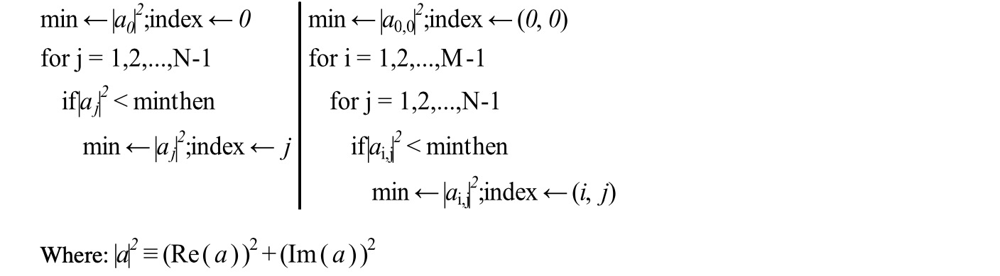

**接口定义**

C interface：

```c
vsip_scalar_f vsip_vcminmgsqval_f(const vsip_cvview_f *a, vsip_scalar_vi *index);
vsip_scalar_f vsip_mcminmgsqval_f(const vsip_cmview_f *a, vsip_scalar_mi *index);
```

**参数**

<table style="width: 100%; table-layout: fixed; word-break: break-word;">
  <colgroup>
    <col style="width: 18.00%;">
    <col style="width: 46.00%;">
    <col style="width: 20.00%;">
    <col style="width: 16.00%;">
  </colgroup>
  <thead>
    <tr><th>参数名</th><th>描述</th><th>取值范围</th><th>输入输出</th></tr>
  </thead>
  <tbody>
    <tr><td>a</td><td>输入向量/矩阵视图</td><td>非空</td><td>输入</td></tr>
    <tr><td>index</td><td>返回索引的指针，如果为null，则不返回索引。</td><td>可空</td><td>输出</td></tr>
  </tbody>
</table>

##### 7.6.3.6.14 vsip\_\[s\]minmgval\_\[p\]

返回向量/矩阵元素的最小绝对值的索引和值。索引作为参数之一通过引用返回。

**函数功能**

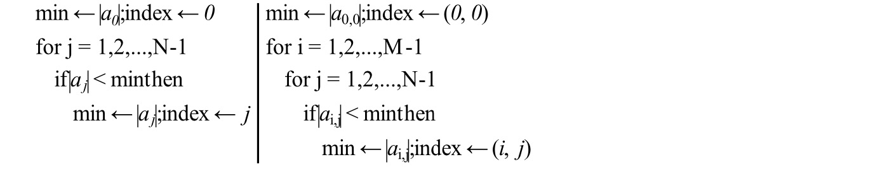

**接口定义**

C interface：

```c
vsip_scalar_f vsip_vminmgval_f(const vsip_vview_f *a, vsip_scalar_vi *index);
vsip_scalar_f vsip_mminmgval_f(const vsip_mview_f *a, vsip_scalar_mi *index);
```

**参数**

<table style="width: 100%; table-layout: fixed; word-break: break-word;">
  <colgroup>
    <col style="width: 18.00%;">
    <col style="width: 46.00%;">
    <col style="width: 20.00%;">
    <col style="width: 16.00%;">
  </colgroup>
  <thead>
    <tr><th>参数名</th><th>描述</th><th>取值范围</th><th>输入输出</th></tr>
  </thead>
  <tbody>
    <tr><td>a</td><td>输入向量/矩阵视图</td><td>非空</td><td>输入</td></tr>
    <tr><td>index</td><td>返回索引的指针，如果为null，则不返回索引。</td><td>可空</td><td>输出</td></tr>
  </tbody>
</table>

##### 7.6.3.6.15 vsip\_\[s\]minval\_\[p\]

返回向量/矩阵元素的最小值的索引和值。索引作为参数之一通过引用返回。

**函数功能**

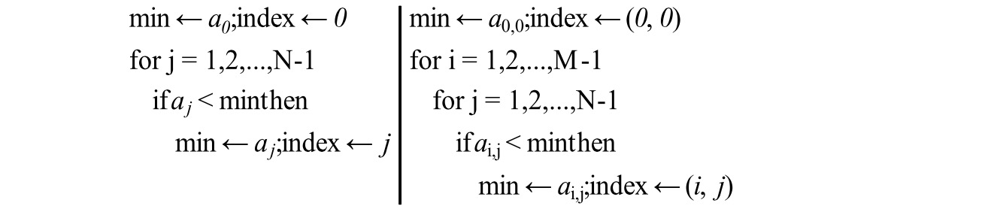

**接口定义**

C interface：

```c
vsip_scalar_f vsip_vminval_f(const vsip_vview_f *a, vsip_scalar_vi *index);
vsip_scalar_f vsip_mminval_f(const vsip_mview_f *a, vsip_scalar_mi *index);
```

**参数**

<table style="width: 100%; table-layout: fixed; word-break: break-word;">
  <colgroup>
    <col style="width: 18.00%;">
    <col style="width: 46.00%;">
    <col style="width: 20.00%;">
    <col style="width: 16.00%;">
  </colgroup>
  <thead>
    <tr><th>参数名</th><th>描述</th><th>取值范围</th><th>输入输出</th></tr>
  </thead>
  <tbody>
    <tr><td>a</td><td>输入向量/矩阵视图</td><td>非空</td><td>输入</td></tr>
    <tr><td>index</td><td>返回索引的指针，如果为null，则不返回索引。</td><td>可空</td><td>输出</td></tr>
  </tbody>
</table>

**示例**

见`vsip_[s]minval_[p]`

#### 7.6.3.7 元素生成和复制

##### 7.6.3.7.1 vsip\_\[d\] \[s\]copy\_\[p\]\_\[p\]

将源向量/矩阵/张量复制到目标向量/矩阵/张量，执行任何必要的标准ANSI C标量类型的类型转换。

**函数功能**

将源向量/矩阵/张量视图对象的源数据复制到目标向量/矩阵/张量视图对象的目标数据，执行任何必要的标准ANSI C标量类型的类型转换。

**接口定义**

C interface：

```c
void vsip_vcopy_[s]_[t](const vsip_vview_s* x, const vsip_vview_t* y);
void vsip_vcopy_vi_vi(const vsip_vview_vi* x, const vsip_vview_vi* y);
void vsip_vcopy_vi_i(const vsip_vview_vi* x, const vsip_vview_i* y);
void vsip_vcopy_i_vi(const vsip_vview_i* x, const vsip_vview_vi* y);
void vsip_vcopy_mi_mi(const vsip_vview_mi* x, const vsip_vview_mi* y);
void vsip_vcopy_ti_ti(const vsip_vview_ti* x, const vsip_vview_ti* y);
void vsip_vcopy_bl_t(const vsip_vview_bl* x, const vsip_vview_t* y);
void vsip_vcopy_[s]_bl(const vsip_vview_s* x, const vsip_vview_bl* y);
void vsip_cvcopy_[s]_[t](const vsip_cvview_s* x, const vsip_cvview_t* y);
void vsip_mcopy_[s]_[t](const vsip_mview_s* X, const vsip_mview_t* Y);
void vsip_mcopy_bl_[t](const vsip_mview_bl* X, const vsip_mview_t* Y);
void vsip_mcopy_[s]_bl(const vsip_mview_s* X, const vsip_mview_bl* Y);
void vsip_cmcopy_[s]_t(const vsip_cmview_s* X, const vsip_cmview_t* Y);
```

其中`\_[s]`和`_[t]`可以是以下任意的组合。

<table style="width: 100%; table-layout: fixed; word-break: break-word;">
  <colgroup>
    <col style="width: 33.33%;">
    <col style="width: 33.33%;">
    <col style="width: 33.33%;">
  </colgroup>
  <thead>
    <tr><th>—</th><th>_s,_t</th><th>ANSI C Type</th></tr>
  </thead>
  <tbody>
    <tr><td>_i</td><td>_c</td><td>signed char</td></tr>
    <tr><td>_i</td><td>_si</td><td>short int</td></tr>
    <tr><td>_i</td><td>_i</td><td>int</td></tr>
    <tr><td>_i</td><td>_li</td><td>long int</td></tr>
    <tr><td>_i</td><td>_ll</td><td>long long int(non-ANSI)</td></tr>
    <tr><td>_i</td><td>_uc</td><td>unsigned char</td></tr>
    <tr><td>_i</td><td>_us</td><td>unsigned short int</td></tr>
    <tr><td>_i</td><td>_ui</td><td>unsigned int</td></tr>
    <tr><td>_i</td><td>_ul</td><td>unsigned long int</td></tr>
    <tr><td>_i</td><td>_ull</td><td>unsigned long long int(non-ANSI)</td></tr>
    <tr><td>_f</td><td>_f</td><td>float</td></tr>
    <tr><td>_f</td><td>_d</td><td>double</td></tr>
    <tr><td>_f</td><td>_ld</td><td>long double</td></tr>
  </tbody>
</table>

<table style="width: 100%; table-layout: fixed; word-break: break-word;">
  <colgroup>
    <col style="width: 33.33%;">
    <col style="width: 33.33%;">
    <col style="width: 33.33%;">
  </colgroup>
  <thead>
    <tr><th>—</th><th>—</th><th>VSIPL Type</th></tr>
  </thead>
  <tbody>
    <tr><td>—</td><td>_vi</td><td>vsip_scalar_vi or vsip_index</td></tr>
    <tr><td>—</td><td>_mi</td><td>vsip_scalar_mi</td></tr>
    <tr><td>—</td><td>_ti</td><td>vsip_scalar_ti</td></tr>
    <tr><td>—</td><td>_bl</td><td>vsip_scalar_bl or vsip_bool</td></tr>
  </tbody>
</table>

**参数**

<table style="width: 100%; table-layout: fixed; word-break: break-word;">
  <colgroup>
    <col style="width: 18.00%;">
    <col style="width: 46.00%;">
    <col style="width: 20.00%;">
    <col style="width: 16.00%;">
  </colgroup>
  <thead>
    <tr><th>参数名</th><th>描述</th><th>取值范围</th><th>输入输出</th></tr>
  </thead>
  <tbody>
    <tr><td>x</td><td>源向量/矩阵/张量视图对象。</td><td>非空</td><td>输入</td></tr>
    <tr><td>y</td><td>目标向量/矩阵/张量视图对象。</td><td>非空</td><td>输出</td></tr>
  </tbody>
</table>

##### 7.6.3.7.2 vsip\_\[d\] \[s\]fill\_\[p\]

用一个常数值填充一个向量/矩阵。

**函数功能**

$$
r\_j = \\alpha \\quad\\text{for}\\quad j=0,1,...,N-1
$$
$$
r\_{i,j} = \\alpha \\quad\\text{for}\\quad i=0,1,...,M-1;\\quad\\text{for}\\quad j=0,1,...,N-1
$$

**接口定义**

C interface：

```c
void vsip_vfill_i(vsip_scalar_i alpha, const vsip_vview_i *r);
void vsip_vfill_f(vsip_scalar_f alpha, const vsip_vview_f *r);
void vsip_cvfill_f(vsip_cscalar_f alpha, const vsip_cvview_f *r);
void vsip_mfill_i(vsip_scalar_i alpha, const vsip_mview_i *r);
void vsip_mfill_f(vsip_scalar_f alpha, const vsip_mview_f *r);
void vsip_cmfill_f(vsip_cscalar_f alpha, const vsip_cmview_f *r);
```

**参数**

<table style="width: 100%; table-layout: fixed; word-break: break-word;">
  <colgroup>
    <col style="width: 18.00%;">
    <col style="width: 46.00%;">
    <col style="width: 20.00%;">
    <col style="width: 16.00%;">
  </colgroup>
  <thead>
    <tr><th>参数名</th><th>描述</th><th>取值范围</th><th>输入输出</th></tr>
  </thead>
  <tbody>
    <tr><td>alpha</td><td>标量填充值</td><td>任意</td><td>输入</td></tr>
    <tr><td>r</td><td>目标向量/矩阵/视图对象。</td><td>非空</td><td>输出</td></tr>
  </tbody>
</table>

##### 7.6.3.7.3 vsip\_vramp\_\[p\]

计算一个向量的斜坡，从一个初始值开始，每个连续的元素增加斜坡步长。

**函数功能**

$$
r\_j = \\alpha + k \\cdot \\beta \\quad\\text{for}\\quad j=0,1,...,N-1
$$

**接口定义**

C interface：

```c
void vsip_vramp_i(vsip_scalar_i alpha, vsip_scalar_i beta, const vsip_vview_i *r);
void vsip_vramp_f(vsip_scalar_f alpha vsip_scalar_f beta, const vsip_vview_f *r);
```

**参数**

<table style="width: 100%; table-layout: fixed; word-break: break-word;">
  <colgroup>
    <col style="width: 18.00%;">
    <col style="width: 46.00%;">
    <col style="width: 20.00%;">
    <col style="width: 16.00%;">
  </colgroup>
  <thead>
    <tr><th>参数名</th><th>描述</th><th>取值范围</th><th>输入输出</th></tr>
  </thead>
  <tbody>
    <tr><td>alpha</td><td>向量斜坡的初始值</td><td>任意</td><td>输入</td></tr>
    <tr><td>beta</td><td>斜坡的增量（如果为负则为减量）</td><td>人意</td><td>输入</td></tr>
    <tr><td>r</td><td>目标向量视图对象。</td><td>非空</td><td>输出</td></tr>
  </tbody>
</table>

#### 7.6.3.8 变换操作

##### 7.6.3.8.1 vsip\_\[s\]cmplx\_\[p\]

从两个实向量/矩阵形成一个复数向量/矩阵。

**函数功能**

$$
Re(r\_j) \\leftarrow a\_j;Im(r\_j) \\leftarrow b\_j \\quad\\text{for}\\quad j=0,1,...,N-1;
$$
$$
Re(r\_{i,j}) \\leftarrow a\_{i,j};Im(r\_{i,j}) \\leftarrow b\_{i,j} \\quad\\text{for}\\quad i=0,1,...,M-1; \\quad\\text{for}\\quad j=0,1,...,N-1;
$$

**接口定义**

C interface：

```c
void vsip_vcmplx_f(const vsip_vview_f *a, 
                   const vsip_vview_f *b,
                   const vsip_cvview_f *r);
void vsip_mcmplx_f(const vsip_mview_f *a, 
                   const vsip_mview_f *b,
                   const vsip_cmview_f *r);
```

**参数**

<table style="width: 100%; table-layout: fixed; word-break: break-word;">
  <colgroup>
    <col style="width: 18.00%;">
    <col style="width: 46.00%;">
    <col style="width: 20.00%;">
    <col style="width: 16.00%;">
  </colgroup>
  <thead>
    <tr><th>参数名</th><th>描述</th><th>取值范围</th><th>输入输出</th></tr>
  </thead>
  <tbody>
    <tr><td>a</td><td>包含实部的输入向量/矩阵的视图</td><td>非空</td><td>输入</td></tr>
    <tr><td>b</td><td>包含虚部的输入向量/矩阵的视图</td><td>人意</td><td>输入</td></tr>
    <tr><td>r</td><td>目标向量视图对象。</td><td>非空</td><td>输出</td></tr>
  </tbody>
</table>

##### 7.6.3.8.2 vsip\_\[d\] \[s\]gather\_\[p\]

汇集操作使用索引向量中提供的索引从源向量/矩阵中选择元素。选中的元素按顺序放置在输出向量中，以确保输出向量和索引向量具有相同的索引。

**函数功能**

$$
\\begin{align} y\_j \&\\leftarrow x\_{index\_j} \\end{align}
$$

for j = 0,1,...,N-1
其中N时索引向量的长度。

请注意，向量的索引向量包含适合于索引向量的标量元素。矩阵的索引向量包含由标量对（行索引和列索引）组成的元素，适合于索引矩阵。汇集操作的输出始终是一个向量。

**接口定义**

C interface：

```c
void vsip_vgather_i(const vsip_vview_i* x,
                    const vsip_vview_vi* index,
                    vsip_vview_i* y);
void vsip_mgather_i(const vsip_mview_i* x,
                    const vsip_vview_mi* index,
                    vsip_vview_i* y);
void vsip_vgather_mi(const vsip_vview_mi* x,
                     const vsip_vview_vi* index,
                     vsip_vview_mi* y);
void vsip_vgather_f(const vsip_vview_f* x,
                    const vsip_vview_vi* index,
                    vsip_vview_f* y);
void vsip_mgather_f(const vsip_mview_f* x,
                    const vsip_vview_mi* index,
                    vsip_vview_f* y);
void vsip_cvgather_f(const vsip_cvview_f* x,
                     const vsip_vview_vi* index,
                     vsip_cvview_f* y);
void vsip_cmgather_f(const vsip_cmview_f* x,
                     const vsip_vview_mi* index,
                     vsip_cvview_f* y);
```

**参数**

<table style="width: 100%; table-layout: fixed; word-break: break-word;">
  <colgroup>
    <col style="width: 18.00%;">
    <col style="width: 46.00%;">
    <col style="width: 20.00%;">
    <col style="width: 16.00%;">
  </colgroup>
  <thead>
    <tr><th>参数名</th><th>描述</th><th>取值范围</th><th>输入输出</th></tr>
  </thead>
  <tbody>
    <tr><td>x</td><td>输入源向量/矩阵视图</td><td>非空</td><td>输入</td></tr>
    <tr><td>index</td><td>输入源向量/矩阵索引视图</td><td>非空</td><td>输入</td></tr>
    <tr><td>y</td><td>输出源向量/矩阵视图</td><td>非空</td><td>输出</td></tr>
  </tbody>
</table>

**示例**

C interface：

```c
#include <stdio.h>

#include "vsip.h"
#define L  10 /* A length */
#define PI 3.141592653589793
int main() {
    vsip_vview_f* dataA;
    vsip_vview_f* dataB;
    vsip_vview_vi* Index;
    vsip_vview_bl* dataBl;
    int i;
    vsip_length N;
    vsip_init((void*)0);
    dataA = vsip_vcreate_f(L, VSIP_MEM_NONE);
    dataB = vsip_vcreate_f(L, VSIP_MEM_NONE);
    Index = vsip_vcreate_vi(L, VSIP_MEM_NONE);
    dataBl = vsip_vcreate_bl(L, VSIP_MEM_NONE);
    /* Make up some data */
    vsip_vramp_f(0, 2 * PI / (L - 1), dataA);
    vsip_vcos_f(dataA, dataB);
    /* Find out where dataB is greater than zero */
    vsip_vfill_f(0, dataA);
    vsip_vlge_f(dataB, dataA, dataBl);
    /* Find the index where dataB is greater than zero */
    if ((N = vsip_vindexbool(dataBl, Index))) {
        /* make a vector of those points where dataB is greater than zero*/
        vsip_vgather_f(dataB, Index, vsip_vputlength_f(dataA, N));
        /*print out the results */
        printf("Index Value\n");
        for (i = 0; i < N; i++)
            printf("%li %6.3f\n",
                   vsip_vget_vi(Index, i),
                   vsip_vget_f(dataA, i));
    } else {
        printf("Zero Length Index");
    }
    vsip_blockdestroy_f(vsip_vdestroy_f(dataA));
    vsip_blockdestroy_f(vsip_vdestroy_f(dataB));
    vsip_blockdestroy_vi(vsip_vdestroy_vi(Index));
    vsip_blockdestroy_bl(vsip_vdestroy_bl(dataBl));
    vsip_finalize((void*)0);
    return 0;
}
```

输出结果

```text
Index Value
0  1.000
1  0.766
2  0.174
7  0.174
8  0.766
9  1.000
```

##### 7.6.3.8.3 vsip\_\[s\]imag\_\[p\]

提取复数向量/矩阵的虚部。

**函数功能**

$$
r\_j \\leftarrow Im(a\_j) \\quad\\text{for}\\quad j=0,1,...,N-1
$$
$$
r\_{i,j} \\leftarrow Im(a\_{i,j}) \\quad\\text{for}\\quad i=0,1,...,M-1; \\quad\\text{for}\\quad j=0,1,...,N-1
$$

**接口定义**

C interface：

```c
void vsip_vimag_f(const vsip_cvview_f *a, const vsip_vview_f *r);
void vsip_mimag_f(const vsip_cmview_f *a, const vsip_mview_f *r);
```

**参数**

<table style="width: 100%; table-layout: fixed; word-break: break-word;">
  <colgroup>
    <col style="width: 18.00%;">
    <col style="width: 46.00%;">
    <col style="width: 20.00%;">
    <col style="width: 16.00%;">
  </colgroup>
  <thead>
    <tr><th>参数名</th><th>描述</th><th>取值范围</th><th>输入输出</th></tr>
  </thead>
  <tbody>
    <tr><td>a</td><td>复数输入向量/矩阵的视图</td><td>非空</td><td>输入</td></tr>
    <tr><td>r</td><td>实数输出向量/矩阵视图对象。</td><td>非空</td><td>输出</td></tr>
  </tbody>
</table>

**示例**

C interface：

```c
#include <stdio.h>

#include "hml_vsip.h"
#include "vsip.h"

#define PI 3.1415926535
#define L  7 /* length */
int main() {
    int i;
    vsip_cvview_f* data;
    vsip_vview_f *real, *imag;
    vsip_init((void*)0);
    data = vsip_cvcreate_f(L, VSIP_MEM_NONE);
    real = vsip_vcreate_f(L, VSIP_MEM_NONE);
    imag = vsip_vcreate_f(L, VSIP_MEM_NONE);
    /* Make up some data */
    for (int i = 0; i < L; i++) {
        vsip_cscalar_f val = {i, i * PI};
        vsip_cvput_f(data, i, val);
    }
    /* find the real and imaginary parts */
    vsip_vreal_f(data, real);
    vsip_vimag_f(data, imag);
    /* print the results */
    printf("Complex Vector\n");
    hml_vsip_cvprintm_f("6.5", data);
    printf("Complex Real Vector\n");
    hml_vsip_vprintm_f("6.5", real);
    printf("Complex Imag Vector\n");
    hml_vsip_vprintm_f("6.5", imag);

    /*destroy the vector views and any associated blocks */
    vsip_cblockdestroy_f(vsip_cvdestroy_f(data));
    vsip_blockdestroy_f(vsip_vdestroy_f(real));
    vsip_blockdestroy_f(vsip_vdestroy_f(imag));
    vsip_finalize((void*)0);
    return 0;
}
```

输出结果

```text
Complex Vector
[
(0.00000 +0.00000i) (1.00000 +3.14159i) (2.00000 +6.28319i) (3.00000 +9.42478i) (4.00000 +12.56637i) 
(5.00000 +15.70796i) (6.00000 +18.84956i)];
Complex Real Vector
[
0.00000  1.00000  2.00000  3.00000  4.00000  5.00000  6.00000 ];
Complex Imag Vector
[
0.00000  3.14159  6.28319  9.42478  12.56637  15.70796  18.84956 ];
```

##### 7.6.3.8.4 vsip\_\[s\]polar\_\[p\]

将复数向量/矩阵从矩形形式转换为极坐标形式。极坐标数据包括一个实数向量/矩阵，表示半径，以及一个对应的实数向量/矩阵，表示复数输入数据的角度（相位）。

**函数功能**

$$
\\begin{align} r\_j \&\\leftarrow |a\_j|; \\phi\_j \\leftarrow \\arg(a\_j) \\end{align}
$$

for j=0,1,...,N-1
$$
\\begin{align} r\_{i,j} \&\\leftarrow |a\_{i,j}|; \\phi\_{i,j} \\leftarrow \\arg(a\_{i,j}) \\end{align}
$$

for i=0,1,...,M-1; for j=0,1,...,N-1

**接口定义**

C interface：

```c
void vsip_vpolar_f(const vsip_cvview_f* a,
                   const vsip_vview_f* r,
                   const vsip_vview_f* phi);
void vsip_mpolar_f(const vsip_cmview_f* a,
                   const vsip_mview_f* r,
                   const vsip_mview_f* phi);
```

**参数**

<table style="width: 100%; table-layout: fixed; word-break: break-word;">
  <colgroup>
    <col style="width: 18.00%;">
    <col style="width: 46.00%;">
    <col style="width: 20.00%;">
    <col style="width: 16.00%;">
  </colgroup>
  <thead>
    <tr><th>参数名</th><th>描述</th><th>取值范围</th><th>输入输出</th></tr>
  </thead>
  <tbody>
    <tr><td>a</td><td>复数输入向量/矩阵的视图</td><td>非空</td><td>输入</td></tr>
    <tr><td>r</td><td>实数输出向量/矩阵视图对象。</td><td>非空</td><td>输出</td></tr>
    <tr><td>phi</td><td>输出角度（相位φ向量/矩阵的视图</td><td>非空</td><td>输出</td></tr>
  </tbody>
</table>

**示例**

C interface：

```c
#include <stdio.h>

#include "vsip.h"
#define PI 3.1415926535
#define L  7 /* length */
int main() {
    int i;
    vsip_cvview_f* dataEuler;
    vsip_vview_f *data, *radius, *arg;
    vsip_init((void*)0);
    dataEuler = vsip_cvcreate_f(L, VSIP_MEM_NONE);
    data = vsip_vcreate_f(L, VSIP_MEM_NONE);
    radius = vsip_vcreate_f(L, VSIP_MEM_NONE);
    arg = vsip_vcreate_f(L, VSIP_MEM_NONE);
    /* Make up some data */
    /* compute a ramp from zero to 2pi */
    vsip_vramp_f(0.0, (2.0 * PI / (double)(L - 1)), data);
    vsip_veuler_f(data, dataEuler);
    /* find the radius and argument */
    vsip_vpolar_f(dataEuler, radius, arg);
    /* print the results */
    printf("rect radius argument\n");
    for (i = 0; i < L; i++) {
        printf("(%7.4f, %7.4f) => %7.4f;
%7.4f\n",
               vsip_real_f(vsip_cvget_f(dataEuler, i)),
               vsip_imag_f(vsip_cvget_f(dataEuler, i)),
               vsip_vget_f(radius, i),
               vsip_vget_f(arg, i));
    }
    /*destroy the vector views and any associated blocks */
    vsip_blockdestroy_f(vsip_vdestroy_f(data));
    vsip_blockdestroy_f(vsip_vdestroy_f(radius));
    vsip_blockdestroy_f(vsip_vdestroy_f(arg));
    vsip_cblockdestroy_f(vsip_cvdestroy_f(dataEuler));
    vsip_finalize((void*)0);
    return 0;
}
```

输出结果

```text
rect radius argument
( 1.0000,  0.0000) =>  1.0000;  0.0000
( 0.5000,  0.8660) =>  1.0000;  1.0472
(-0.5000,  0.8660) =>  1.0000;  2.0944
(-1.0000, -0.0000) =>  1.0000; -3.1416
(-0.5000, -0.8660) =>  1.0000; -2.0944
( 0.5000, -0.8660) =>  1.0000; -1.0472
( 1.0000,  0.0000) =>  1.0000;  0.0000
```

##### 7.6.3.8.5 vsip\_\[s\]real\_\[p\]

提取复数向量/矩阵的实部。

**函数功能**

$$
r\_j \\leftarrow Re(a\_j) \\quad\\text{for}\\quad j=0,1,...,N-1
$$
$$
r\_{i,j} \\leftarrow Re(a\_{i,j}) \\quad\\text{for}\\quad i=0,1,...,M-1; \\quad\\text{for}\\quad j=0,1,...,N-1
$$

**接口定义**

C interface：

```c
void vsip_vreal_f(const vsip_cvview_f *a, const vsip_vview_f *r);
void vsip_mreal_f(const vsip_cmview_f *a, const vsip_mview_f *r);
```

**参数**

<table style="width: 100%; table-layout: fixed; word-break: break-word;">
  <colgroup>
    <col style="width: 18.00%;">
    <col style="width: 46.00%;">
    <col style="width: 20.00%;">
    <col style="width: 16.00%;">
  </colgroup>
  <thead>
    <tr><th>参数名</th><th>描述</th><th>取值范围</th><th>输入输出</th></tr>
  </thead>
  <tbody>
    <tr><td>a</td><td>复数输入向量/矩阵的视图</td><td>非空</td><td>输入</td></tr>
    <tr><td>r</td><td>实数输出向量/矩阵视图对象。</td><td>非空</td><td>输出</td></tr>
  </tbody>
</table>

**示例**

见`vsip\_[s]imag_[p]`

##### 7.6.3.8.6 vsip\_\[s\]rect\_\[p\]

将一对实数向量/矩阵从复数极坐标形式转换为复数矩形形式。

**函数功能**

$$
\\begin{align} y\_j \&\\leftarrow r\_k(\\cos(\\phi\_k) + j\\sin(\\phi\_k)) \\end{align}
$$

for k=0,1,...,N-1
$$
\\begin{align} y\_{k,l} \&\\leftarrow r\_{k,l}(\\cos(\\phi\_{k,l}) + j\\sin(\\phi\_{k,l})) \\end{align}
$$

for k=0,1,...,M-1; for l=0,1,...,N-1

**接口定义**

C interface：

```c
void vsip_vrect_f(const vsip_vview_f* r,
                  const vsip_vview_f* phi,
                  const vsip_cvview_f* y);
void vsip_mrect_f(const vsip_mview_f* r,
                  const vsip_mview_f* phi,
                  const vsip_cmview_f* y);
```

**参数**

<table style="width: 100%; table-layout: fixed; word-break: break-word;">
  <colgroup>
    <col style="width: 18.00%;">
    <col style="width: 46.00%;">
    <col style="width: 20.00%;">
    <col style="width: 16.00%;">
  </colgroup>
  <thead>
    <tr><th>参数名</th><th>描述</th><th>取值范围</th><th>输入输出</th></tr>
  </thead>
  <tbody>
    <tr><td>r</td><td>输入半径（幅度）向量/矩阵的视图</td><td>非空</td><td>输入</td></tr>
    <tr><td>phi</td><td>输入半径（幅度）向量/矩阵的视图</td><td>非空</td><td>输入</td></tr>
    <tr><td>y</td><td>输出矩形形式向量/矩阵的视图</td><td>非空</td><td>输出</td></tr>
  </tbody>
</table>

**示例**

C interface：

```c
#include <stdio.h>

#include "vsip.h"
#define PI 3.1415926535
#define L  7 /* length */
int main() {
    int i;
    vsip_cvview_f *dataEuler, *dataRect;
    vsip_vview_f *data, *radius, *arg;
    vsip_init((void*)0);
    dataEuler = vsip_cvcreate_f(L, VSIP_MEM_NONE);
    dataRect = vsip_cvcreate_f(L, VSIP_MEM_NONE);
    data = vsip_vcreate_f(L, VSIP_MEM_NONE);
    radius = vsip_vrealview_f(dataEuler);
    arg = vsip_vimagview_f(dataEuler);
    /* Make up some data */
    /* compute a ramp from zero to 2pi */
    vsip_vramp_f(0.0, (2.0 * PI / (double)(L - 1)), data);
    vsip_veuler_f(data, dataEuler);
    /* find the complex assuming real view of Euler is Radius
       and the imaginary view is the Argument */
    vsip_vrect_f(radius, arg, dataRect);
    /* print the results */
    printf("rect radius argument\n");
    for (i = 0; i < L; i++) {
        printf("(%7.4f, %7.4f) <= %7.4f;
%7.4f\n",
               vsip_real_f(vsip_cvget_f(dataRect, i)),
               vsip_imag_f(vsip_cvget_f(dataRect, i)),
               vsip_vget_f(radius, i),
               vsip_vget_f(arg, i));
    }
    /*destroy the vector views and any associated blocks */
    vsip_blockdestroy_f(vsip_vdestroy_f(data));
    vsip_blockdestroy_f(vsip_vdestroy_f(radius));
    vsip_blockdestroy_f(vsip_vdestroy_f(arg));
    vsip_cblockdestroy_f(vsip_cvdestroy_f(dataEuler));
    vsip_cblockdestroy_f(vsip_cvdestroy_f(dataRect));
    vsip_finalize((void*)0);
    return 0;
}
```

输出结果

```text
rect radius argument
( 1.0000,  0.0000) <=  1.0000;  0.0000
( 0.3239,  0.3809) <=  0.5000;  0.8660
(-0.3239, -0.3809) <= -0.5000;  0.8660
(-1.0000,  0.0000) <= -1.0000; -0.0000
(-0.3239,  0.3809) <= -0.5000; -0.8660
( 0.3239, -0.3809) <=  0.5000; -0.8660
( 1.0000,  0.0000) <=  1.0000;  0.0000
```

##### 7.6.3.8.7 vsip\_\[d\] \[s\]scatter\_\[p\]

分散操作依次使用源向量和索引向量的元素。向量索引（矩阵索引）的元素用于选择输出向量/矩阵中的存储位置，以存储来自源向量的元素。

**函数功能**

$$
\\begin{align} y\_{index\_j} \&\\leftarrow x\_j \\end{align}
$$

for j=0,1,...,N-1
其中N是索引向量的长度。

请注意，向量的索引向量包含适合于索引向量的标量元素。矩阵的索引向量包含由标量对（行索引和列索引）组成的元素，适合于索引矩阵。分散操作的输入始终是一个向量。

**接口定义**

C interface：

```c
void vsip_vscatter_i(const vsip_vview_i* x,
                     const vsip_vview_i* y,
                     const vsip_vview_vi* index);
void vsip_mscatter_i(const vsip_vview_i* x,
                     const vsip_mview_i* y,
                     const vsip_vview_mi* index);
void vsip_vscatter_mi(const vsip_vview_mi* x,
                      const vsip_vview_mi* y,
                      const vsip_vview_vi* index);
void vsip_vscatter_f(const vsip_vview_f* x,
                     const vsip_vview_f* y,
                     const vsip_vview_vi* index);
void vsip_mscatter_f(const vsip_vview_f* x,
                     const vsip_mview_f* y,
                     const vsip_vview_mi* index);
void vsip_cvscatter_f(const vsip_vview_f* x,
                      const vsip_vview_f* y,
                      const vsip_vview_vi* index);
void vsip_cmscatter_f(const vsip_cvview_f* x,
                      const vsip_cmview_f* y,
                      const vsip_vview_mi* index);
```

**参数**

<table style="width: 100%; table-layout: fixed; word-break: break-word;">
  <colgroup>
    <col style="width: 18.00%;">
    <col style="width: 46.00%;">
    <col style="width: 20.00%;">
    <col style="width: 16.00%;">
  </colgroup>
  <thead>
    <tr><th>参数名</th><th>描述</th><th>取值范围</th><th>输入输出</th></tr>
  </thead>
  <tbody>
    <tr><td>x</td><td>输入源向量/矩阵视图</td><td>非空</td><td>输入</td></tr>
    <tr><td>y</td><td>输出目标向量/矩阵视图</td><td>非空</td><td>输出</td></tr>
    <tr><td>index</td><td>输入向量/矩阵索引视图</td><td>非空</td><td>输入</td></tr>
  </tbody>
</table>

**示例**

C interface：

```c
#include <stdio.h>

#include "vsip.h"
#define L  10 /* A length */
#define PI 3.141592653589793
int main() {
    vsip_vview_f* dataA;
    vsip_vview_f* dataB;
    vsip_vview_vi* Index;
    vsip_vview_bl* dataBl;
    int i;
    vsip_length N;
    vsip_init((void*)0);
    dataA = vsip_vcreate_f(L, VSIP_MEM_NONE);
    dataB = vsip_vcreate_f(L, VSIP_MEM_NONE);
    Index = vsip_vcreate_vi(L, VSIP_MEM_NONE);
    dataBl = vsip_vcreate_bl(L, VSIP_MEM_NONE);
    /* make up some data */
    vsip_vramp_f(0, 2 * PI / (L - 1), dataA);
    vsip_vcos_f(dataA, dataB);
    /* find out where dataB is greater than zero */
    vsip_vfill_f(0, dataA);
    vsip_vlgt_f(dataB, dataA, dataBl);
    /* find the index where dataB is greater than zero */
    if ((N = vsip_vindexbool(dataBl, Index))) {
        /* make a vector of those points where dataB is greater than zero*/
        vsip_vgather_f(dataB, Index, vsip_vputlength_f(dataA, N));
        /*print out the results */
        printf("Index Value\n");
        for (i = 0; i < N; i++)
            printf("%li %6.3f\n",
                   vsip_vget_vi(Index, i),
                   vsip_vget_f(dataA, i));
    } else {
        printf("Zero Length Index");
        exit(0);
    }
    vsip_vfill_f(0, dataB);
    vsip_vscatter_f(dataA, dataB, Index);
    for (i = 0; i < L; i++)
        printf("%6.3f\n", vsip_vget_f(dataB, i));
    /*recover the data space*/
    vsip_blockdestroy_f(vsip_vdestroy_f(dataA));
    vsip_blockdestroy_f(vsip_vdestroy_f(dataB));
    vsip_blockdestroy_vi(vsip_vdestroy_vi(Index));
    vsip_blockdestroy_bl(vsip_vdestroy_bl(dataBl));
    vsip_finalize((void*)0);
    return 0;
}
```

输出结果

```text
Index Value
0  1.000
1  0.766
2  0.174
7  0.174
8  0.766
9  1.000
 1.000
 0.766
 0.174
 0.000
 0.000
 0.000
 0.000
 0.174
 0.766
 1.000
```

##### 7.6.3.8.8 vsip\_\[d\] \[s\]swap\_\[p\]

交换两个向量/矩阵之间的元素。

**函数功能**

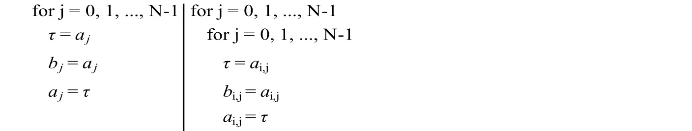

**接口定义**

C interface：

```c
void vsip_vswap_i(const vsip_vview_i* a, const vsip_vview_i* b);
void vsip_vswap_f(const vsip_vview_f* a, const vsip_vview_f* b);
void vsip_cvswap_f(const vsip_cvview_f* a, const vsip_cvview_f* b);
void vsip_mswap_i(const vsip_mview_i* a, const vsip_mview_i* b);
void vsip_mswap_f(const vsip_mview_f* a, const vsip_mview_f* b);
void vsip_cmswap_f(const vsip_cmview_f* a, const vsip_cmview_f* b);
```

**参数**

<table style="width: 100%; table-layout: fixed; word-break: break-word;">
  <colgroup>
    <col style="width: 18.00%;">
    <col style="width: 46.00%;">
    <col style="width: 20.00%;">
    <col style="width: 16.00%;">
  </colgroup>
  <thead>
    <tr><th>参数名</th><th>描述</th><th>取值范围</th><th>输入输出</th></tr>
  </thead>
  <tbody>
    <tr><td>a</td><td>输入源向量/矩阵视图</td><td>非空</td><td>输入</td></tr>
    <tr><td>b</td><td>输出目标向量/矩阵视图</td><td>非空</td><td>输出</td></tr>
  </tbody>
</table>

**示例**

C interface：

```c
#include <stdio.h>

#include "vsip.h"
#define L  7 /* A length */
#define PI 3.141592653589793
int main() {
    vsip_vview_f* dataA;
    vsip_vview_f* dataB;
    int i;
    vsip_init((void*)0);
    dataA = vsip_vcreate_f(L, VSIP_MEM_NONE);
    dataB = vsip_vcreate_f(L, VSIP_MEM_NONE);
    vsip_vramp_f(0, 2 * PI / (L - 1), dataA);
    vsip_vcos_f(dataA, dataB);
    printf(" A B \n");
    for (i = 0; i < L; i++)
        printf("%6.3f %6.3f\n", vsip_vget_f(dataA, i), vsip_vget_f(dataB, i));
    printf(" Swap\n A B \n");
    vsip_vswap_f(dataA, dataB);
    for (i = 0; i < L; i++)
        printf("%6.3f %6.3f\n", vsip_vget_f(dataA, i), vsip_vget_f(dataB, i));
    vsip_blockdestroy_f(vsip_vdestroy_f(dataA));
    vsip_blockdestroy_f(vsip_vdestroy_f(dataB));
    vsip_finalize((void*)0);
    return 0;
}
```

输出结果

```text
A B 
 0.000  1.000
 1.047  0.500
 2.094 -0.500
 3.142 -1.000
 4.189 -0.500
 5.236  0.500
 6.283  1.000
 Swap
 A B 
 1.000  0.000
 0.500  1.047
-0.500  2.094
-1.000  3.142
-0.500  4.189
 0.500  5.236
 1.000  6.283
```

### 7.6.4 信号量处理

#### 7.6.4.1 FFT函数

**当前版本已实现函数**

<table style="width: 100%; table-layout: fixed; word-break: break-word;">
  <colgroup>
    <col style="width: 33.33%;">
    <col style="width: 33.33%;">
    <col style="width: 33.33%;">
  </colgroup>
  <tbody>
    <tr><td>vsip_ccfftop_f</td><td>vsip_ccfftop_create_f</td><td>vsip_ccfftip_f</td></tr>
    <tr><td>vsip_ccfftip_create_f</td><td>vsip_rcfftop_f</td><td>vsip_rcfftop_create_f</td></tr>
    <tr><td>vsip_fft_getattr_f</td><td>vsip_crfftop_f</td><td>vsip_crfftop_create_f</td></tr>
    <tr><td>vsip_fft_destroy_f</td><td>vsip_ccfftmop_f</td><td>vsip_ccfftmop_create_f</td></tr>
    <tr><td>vsip_ccfftmip_f</td><td>vsip_ccfftmip_create_f</td><td>vsip_rcfftmop_f</td></tr>
    <tr><td>vsip_rcfftmop_create_f</td><td>vsip_fftm_getattr_f</td><td>vsip_crfftmop_f</td></tr>
    <tr><td colspan="2">vsip_crfftmop_create_f</td><td>vsip_fftm_destroy_f</td></tr>
  </tbody>
</table>

##### 7.6.4.1.2 vsip\_ccfft\[x\]\_f

应用复数到复数的快速傅里叶变换（FFT）。

**函数功能**

计算复向量x=x^n的复数到复数的快速傅里叶变换（FFT），并将结果存储在复向量中y=y^k。
$$
y\_k \\leftarrow scale\\sum\_{n=0}^{N-1}x\_{n}W\_{N}^{kn} \\quad\\text{for}\\quad k=0,1,...,N-1
$$
其中：
$$
W\_N \\equiv e^{signj2\\pi/n}
$$
$$
j \\equiv \\sqrt(-1)
$$
sign=-1时为正转换，sign=+1时为逆变换

**接口定义**

C interface：

非原地

```c
void vsip_ccfftop_f(const vsip_fft_f *fft, const vsip_cvview_f *x, const vsip_cvview_f *y);
```

原地

```c
void vsip_ccfftip_f(const vsip_fft_f *fft, const vsip_cvview_f *xy);
```

**参数**

<table style="width: 100%; table-layout: fixed; word-break: break-word;">
  <colgroup>
    <col style="width: 18.00%;">
    <col style="width: 46.00%;">
    <col style="width: 20.00%;">
    <col style="width: 16.00%;">
  </colgroup>
  <thead>
    <tr><th>参数名</th><th>描述</th><th>取值范围</th><th>输入输出</th></tr>
  </thead>
  <tbody>
    <tr><td>fft</td><td>vsip_ccfftx_create_f创建的指向一维FFT对象的指针</td><td>非空</td><td>输入</td></tr>
    <tr><td>x</td><td>长度为N的输入复向量的视图</td><td>非空</td><td>输入</td></tr>
    <tr><td>y</td><td>长度为N的输出复向量的视图</td><td>非空</td><td>输出</td></tr>
    <tr><td>xy</td><td>长度为N的输入输出复向量的视图</td><td>非空</td><td>输出</td></tr>
  </tbody>
</table>

**示例**

C interface：

```c
#include <stdio.h>

#include "hml_vsip.h"
#include "vsip.h"

#define BUFFER_SIZE_T 10

int main() {
    float src[BUFFER_SIZE_T] = {1.64f,
                                1.63f,
                                -1.09f,
                                0.71f,
                                -3.20f,
                                -0.43f,
                                0.41f,
                                -4.83f,
                                5.36f,
                                -4.40f};
    float dst[BUFFER_SIZE_T];
    int64_t stride = 1;
    int64_t cvLen = BUFFER_SIZE_T / 2;
    uint64_t offset = 0;
    vsip_cblock_f* block_a = vsip_cblockbind_f(src, NULL, cvLen, VSIP_MEM_NONE);
    vsip_cblock_f* block_r = vsip_cblockbind_f(dst, NULL, cvLen, VSIP_MEM_NONE);
    vsip_cvview_f* a = vsip_cvbind_f(block_a, offset, stride, cvLen);
    vsip_cblockadmit_f(block_a, VSIP_TRUE);
    vsip_cvview_f* r = vsip_cvbind_f(block_r, offset, stride, cvLen);
    vsip_cblockadmit_f(block_r, VSIP_TRUE);
    vsip_fft_f* Offt =
        vsip_ccfftop_create_f(cvLen, 1.0f, VSIP_FFT_FWD, 0, VSIP_ALG_SPACE);
    vsip_ccfftop_f(Offt, a, r);
    (void)vsip_fft_destroy_f(Offt);
    printf("Input\n");
    hml_vsip_cvprintm_f("6.5", a);
    printf("Output\n");
    hml_vsip_cvprintm_f("6.5", r);

    vsip_cvalldestroy_f(a);
    vsip_cvalldestroy_f(r);
    return 0;
}
```

输出结果

```text
Input
[
(1.64000 +1.63000i) (-1.09000 +0.71000i) (-3.20000 -0.43000i) (0.41000 -4.83000i) (5.36000 -4.40000i)];
Output
[
(3.12000 -7.32000i) (12.66281 +13.00138i) (-3.85773 +3.34774i) (-1.49559 +2.63194i) (-2.22949 -3.51106i)];
```

##### 7.6.4.1.3 vsip\_crfftop\_f

应用复数到实数的快速傅里叶变换（FFT）。

**函数功能**

计算复向量x=x^n的复数到实数的快速傅里叶变换（FFT），并将结果存储在复向量中y=y^k。
$$
y\_k \\leftarrow scale\\sum\_{n=0}^{N-1}x\_{n}W\_{N}^{kn} \\quad\\text{for}\\quad k=0,1,...,N-1
$$
其中：
$$
W\_N \\equiv e^{+j2\\pi/n}
$$
$$
j \\equiv \\sqrt(-1)
$$

**接口定义**

C interface：

```c
void vsip_crfftop_f(const vsip_fft_f *fft, const vsip_cvview_f *x, const vsip_vview_f *y);
```

**参数**

<table style="width: 100%; table-layout: fixed; word-break: break-word;">
  <colgroup>
    <col style="width: 18.00%;">
    <col style="width: 46.00%;">
    <col style="width: 20.00%;">
    <col style="width: 16.00%;">
  </colgroup>
  <thead>
    <tr><th>参数名</th><th>描述</th><th>取值范围</th><th>输入输出</th></tr>
  </thead>
  <tbody>
    <tr><td>fft</td><td>vsip_ccfftx_create_f创建的指向一维FFT对象的指针</td><td>非空</td><td>输入</td></tr>
    <tr><td>x</td><td>长度为N/2+1的输入复向量的视图，其中索引为0的值包含直流（0频率）值，索引为N/2的值包含折叠频率（采样率的一半）的值。</td><td>非空</td><td>输入</td></tr>
    <tr><td>y</td><td>长度为N的输出复向量的视图</td><td>非空</td><td>输出</td></tr>
  </tbody>
</table>

**示例**

C interface：

```c
#include <stdlib.h>

#include "hml_vsip.h"
#include "vsip.h"

#define L 8
int main() {
    vsip_length npm, n2;
    int i;
    vsip_scalar_f enp, t;
    vsip_cvview_f* x = vsip_cvcreate_f(L, VSIP_MEM_NONE);
    vsip_vview_f* y = vsip_vcreate_f(L, VSIP_MEM_NONE);
    vsip_vview_f* ramp = vsip_vcreate_f(L, VSIP_MEM_NONE);
    vsip_vramp_f(0, 1, ramp);

    enp = L;
    npm = L / 2 - 1;
    t = M_PI / enp;
    vsip_cvputlength_f(x, L);
    vsip_vputlength_f(y, L);
    vsip_cvput_f(x, 0, vsip_cmplx_f((enp - 1.0) / 2.0, 0));
    n2 = L / 2;
    vsip_cvput_f(x, n2, vsip_cmplx_f(-0.5, 0));
    vsip_cvputlength_f(x, L / 2 + 1);
    vsip_vputlength_f(ramp, L);
    { /* do fft */
        {
            vsip_fft_f* fft = vsip_crfftop_create_f(L, 1.0, 0, VSIP_ALG_SPACE);
            printf("x = ");
            hml_vsip_cvprintm_f("8.6", x);
            vsip_crfftop_f(fft, x, y);
            printf("y = ");
            hml_vsip_vprintm_f("8.6", y);
            vsip_fft_destroy_f(fft);
        }
    }
    vsip_valldestroy_f(ramp);
    vsip_cvalldestroy_f(x);
    vsip_valldestroy_f(y);
    return 0;
}
```

输出结果

```text
x = [
(3.500000 +0.000000i) (0.000000 +0.000000i) (0.000000 +0.000000i) (0.000000 +0.000000i) (-0.500000 +0.000000i)];
y = [
3.000000  4.000000  3.000000  4.000000  3.000000  4.000000  3.000000  4.000000 ];
```

##### 7.6.4.1.4 vsip\_rcfftop\_f

应用实数到复数的快速傅里叶变换（FFT）。

**函数功能**

计算复向量x=x^n的实数到复数的快速傅里叶变换（FFT），并将结果存储在复向量中y=y^k。
$$
y\_k \\leftarrow scale\\sum\_{n=0}^{N-1}x\_{n}W\_{N}^{kn} \\quad\\text{for}\\quad k=0,1,...,N-1
$$
其中：
$$
W\_N \\equiv e^{+j2\\pi/n}
$$
$$
j \\equiv \\sqrt(-1)
$$

**接口定义**

C interface：

```c
void vsip_rcfftop_f(const vsip_fft_f *fft, const vsip_vview_f *x, const vsip_cvview_f *y);
```

**参数**

<table style="width: 100%; table-layout: fixed; word-break: break-word;">
  <colgroup>
    <col style="width: 18.00%;">
    <col style="width: 46.00%;">
    <col style="width: 20.00%;">
    <col style="width: 16.00%;">
  </colgroup>
  <thead>
    <tr><th>参数名</th><th>描述</th><th>取值范围</th><th>输入输出</th></tr>
  </thead>
  <tbody>
    <tr><td>fft</td><td>vsip_ccfftx_create_f创建的指向一维FFT对象的指针</td><td>非空</td><td>输入</td></tr>
    <tr><td>x</td><td>长度为N的输入实向量的视图</td><td>非空</td><td>输入</td></tr>
    <tr><td>y</td><td>长度为N/2+1的输出复向量的视图。放置在输出向量中的第一个值是直流频率值，最后一个值是等于输入向量采样率一半的折叠频率值。</td><td>非空</td><td>输出</td></tr>
  </tbody>
</table>

**示例**

C interface：

```c
#include <hml_vsip.h>
#include <stdio.h>
#include <vsip.h>

#define N 8
int main() {
    int i;
    vsip_cscalar_f z;
    vsip_scalar_f data[N];
/* a public data space for I/O */
    vsip_fft_f* rcfftNop;
    vsip_block_f* block;
    vsip_vview_f* xin;
    vsip_cvview_f* yout;
    vsip_init((void*)0);
    rcfftNop = /* Create an out-of-place Real->Cmplx N-pt FFT */
        vsip_rcfftop_create_f(N, 1.0 / N, 0, VSIP_ALG_SPACE);
    /* Create a block object and bind it to the array data */
    block = vsip_blockbind_f(data, N, VSIP_MEM_NONE);
    xin = vsip_vbind_f(block, 0, 1, N);
    /* Create another block and complex vector view for the
       symmetric output */
    yout = vsip_cvcreate_f((N / 2) + 1, VSIP_MEM_NONE);
    /* Admit block to VSIPL for processing and initialize with a
       linear ramp */
    vsip_blockadmit_f(block, VSIP_FALSE);
    vsip_vramp_f(0.0, 1.0, xin);
    /* Compute an out-of-place Real->Cmplx N-pt FFT using the
       rcfftNop object */
    vsip_rcfftop_f(rcfftNop, xin, yout);
    /* print it */
    printf("Real Input Vector\n");
    hml_vsip_vprintm_f("8.5", xin);
    printf("\nComplex Output Vector\n");
    hml_vsip_cvprintm_f("8.5", yout);
    /* Destroy the rcfftNop, blocks, and view objects */
    vsip_fft_destroy_f(rcfftNop);
    vsip_valldestroy_f(xin);
    vsip_cvalldestroy_f(yout);
    vsip_finalize((void*)0);
    return (0);
}
```

输出结果

```text
Real Input Vector
[
 0.00000   1.00000   2.00000   3.00000   4.00000   5.00000   6.00000   7.00000 ];

Complex Output Vector
[
( 3.50000 +0.00000i) (-0.50000 +1.20711i) (-0.50000 +0.50000i) (-0.50000 +0.20711i) (-0.50000 +0.00000i)];
```

##### 7.6.4.1.5 vsip\_\[d\]fft\[x\]\_create\_f

创建一个一维FFT对象。

**函数功能**

创建一个一维FFT对象。FFT对象封装了要计算的FFT的类型信息，并可以根据此信息在实现者的自由裁量下先计算或优化FFT。

**接口定义**

C interface：

```c
vsip_fft_f* vsip_ccfftip_create_f(vsip_length N,
                                  vsip_scalar_f scale,
                                  vsip_fft_dir dir,
                                  vsip_length ntimes,
                                  vsip_alg_hint hint);
vsip_fft_f* vsip_ccfftop_create_f(vsip_length N,
                                  vsip_scalar_f scale,
                                  vsip_fft_dir dir,
                                  vsip_length ntimes,
                                  vsip_alg_hint hint);
vsip_fft_f* vsip_rcfftop_create_f(vsip_length N,
                                  vsip_scalar_f scale,
                                  vsip_length ntimes,
                                  vsip_alg_hint hint);
vsip_fft_f* vsip_crfftop_create_f(vsip_length N,
                                  vsip_scalar_f scale,
                                  vsip_length ntimes,
                                  vsip_alg_hint hint);
```

**参数**

<table style="width: 100%; table-layout: fixed; word-break: break-word;">
  <colgroup>
    <col style="width: 18.00%;">
    <col style="width: 46.00%;">
    <col style="width: 20.00%;">
    <col style="width: 16.00%;">
  </colgroup>
  <thead>
    <tr><th>参数名</th><th>描述</th><th>取值范围</th><th>输入输出</th></tr>
  </thead>
  <tbody>
    <tr><td>N</td><td>FFT长度</td><td>>0</td><td>输入</td></tr>
    <tr><td>scale</td><td>实数比例因子，典型的比例值为1,1/N,1/√(N)</td><td>>0</td><td>输入</td></tr>
    <tr><td>dir</td><td>正向或反向FFT（注意参数仅适用于复数到复数）。</td><td>枚举类型vsip_fft_dir</td><td>输入</td></tr>
    <tr><td>ntimes</td><td>估计FFT对象将被调用的次数。零值被视为半无限。</td><td>>=0</td><td>输入</td></tr>
    <tr><td>hint</td><td>提示以帮助确定滤波方法。</td><td>枚举类型vsip_alg_hint</td><td>输入</td></tr>
  </tbody>
</table>

返回值
返回值是指向一维FFT对象的指针，如果失败则返回null。

##### 7.6.4.1.6 vsip\_ccfftm\[x\]\_f

应用多重复数到复数的快速傅里叶变换（FFT）。

**函数功能**

计算复数矩阵X=(x\_{m,n})的复数到复数的快速傅立叶变换，并存储结果到复数矩阵Y=(y\_{k,l})
按行：
$$
y\_{l,k} \\leftarrow scale \\sum^{N-1}_{n=0}x_{l,n}W^{pk}_{P} \\quad\\text{for}\\quad k=0,1,...,N-1 \\text{ 并且 } l=0,1,...,M-1
$$
按列：
$$
y_{k,l} \\leftarrow scale \\sum^{N-1}_{n=0}x_{n,l}W^{kn}\_{N} \\quad\\text{for}\\quad k=0,1,...,N-1 \\text{ 并且 } l=0,1,...,M-1
$$
其中：
$$
W\_p \\equiv e^{sign{j2\\pi/p}} \\quad\\text{for}\\quad P \\in {M, N }
$$
$$
j \\equiv \\sqrt{-1}
$$
"sign=-1"表示正变换，"sign=+1"表示逆变换。

**接口定义**

C interface：

非原地

```c
void vsip_ccfftmop_f(const vsip_fftm_f *fft,
                     const vsip_cmview_f *X, const vsip_cmview_f *Y);
```

原地

```c
void vsip_ccfftmip_f(const vsip_fftm_f *fft, const vsip_cmview_f *XY);
```

**参数**

<table style="width: 100%; table-layout: fixed; word-break: break-word;">
  <colgroup>
    <col style="width: 18.00%;">
    <col style="width: 46.00%;">
    <col style="width: 20.00%;">
    <col style="width: 16.00%;">
  </colgroup>
  <thead>
    <tr><th>参数名</th><th>描述</th><th>取值范围</th><th>输入输出</th></tr>
  </thead>
  <tbody>
    <tr><td>fft</td><td>指向由vsip_ccfftmx_create_f函数创建的1维FFT对象的指针。</td><td>非空</td><td>输入</td></tr>
    <tr><td>X</td><td>大小为M×N的输入复数矩阵视图。</td><td>非空</td><td>输入</td></tr>
    <tr><td>Y</td><td>大小为M×N的输出复数矩阵视图。</td><td>非空</td><td>输入</td></tr>
    <tr><td>XY</td><td>大小为M×N的输入输出复数矩阵视图。</td><td>非空</td><td>输入</td></tr>
  </tbody>
</table>

**返回值**

空

**示例**

C interface：

```c
#include <hml_vsip.h>
#include <stdio.h>
#include <vsip.h>
#define ROWS 64
#define N    16
#define ACMPLX(x) \
    vsip_real_f(x), (vsip_imag_f(x) < 0.0 ? "-i" : "+i"), fabs(vsip_imag_f(x))
#define SCMPLX "%g%s%g"

int main() {
    int i;
    vsip_randstate* state;
    vsip_cmview_f* xy;
    vsip_cvview_f* xy_row;
    vsip_length stride;
    vsip_cvview_f* sum;
    vsip_fftm_f* ccfftmip;
    vsip_length seed = 0, num_procs = 1, id = 1;
    vsip_init((void*)0);
    /* Initialize Random Number Generator */
    state = vsip_randcreate(seed, num_procs, id, VSIP_PRNG);
    /* Row major, 64 (ROWS) of 16 point data vectors */
    xy = vsip_cmcreate_f(ROWS, 16, VSIP_ROW, VSIP_MEM_NONE);
    /* Bind xy_row view initially to row 0 of xy */
    xy_row = vsip_cmrowview_f(xy, 0);
    /* Stride between column elements of xy */
    stride = vsip_cmgetcolstride_f(xy);
    sum = vsip_cvcreate_f(N, VSIP_MEM_NONE);
    /* Create an in-place Cmplx->Cmplx Multiple N-pt FFT */
    ccfftmip = vsip_ccfftmip_create_f(ROWS,
                                      N,
                                      1.0,
                                      VSIP_FFT_FWD,
                                      VSIP_ROW,
                                      1,
                                      VSIP_ALG_TIME);
    /* Initialize xy by rows with complex Gaussian noise N(0,1) */
    for (i = 0; i < ROWS; i++) {
        vsip_cvputoffset_f(xy_row, i * stride);
/* view of row i of xy */
        vsip_cvrandn_f(state, xy_row);
/* Initialize row i of xy */
    }
    /* Compute an in-place Cmplx->Cmplx Multiple N-pt FFT using the
       ccfftmip object*/
    vsip_ccfftmip_f(ccfftmip, xy);
    /* Coherently sum the rows together (in the Freq domain) */
    vsip_cvputoffset_f(xy_row, 0);
    vsip_cvcopy_f_f(xy_row, sum);
/* sum = row 0 of xy */
    for (i = 1; i < ROWS; i++) {
        vsip_cvputoffset_f(xy_row, i * stride);
/* view of row i of xy */
        vsip_cvadd_f(xy_row, sum, sum);
/* sum += row i of xy */
    }
    /* Print it */
    printf("\nComplex Output Vector (Real, Imag)\n");
    for (i = 0; i < N; i++)
        printf("%d:\t" SCMPLX "\n", i, ACMPLX(vsip_cvget_f(sum, i)));
    printf("\n");
    /* Destroy all the objects */
    vsip_fftm_destroy_f(ccfftmip);
    vsip_cvdestroy_f(xy_row);
    vsip_cvdestroy_f(sum);
    vsip_cmalldestroy_f(xy);
    vsip_randdestroy(state);
    vsip_finalize((void*)0);
    return (0);
}

```

输出结果

```text
Complex Output Vector (Real, Imag)
0:      20.0083+i6.08206
1:      -26.4844+i7.67323
2:      -4.07152-i25.2523
3:      -6.97208+i4.66444
4:      3.3-i26.5079
5:      1.38358+i24.7104
6:      -26.9195-i6.50514
7:      -55.5968-i14.5449
8:      17.5836+i11.988
9:      47.3935+i6.97178
10:     -15.1936+i0.623942
11:     -5.02811+i19.7588
12:     16.4394+i2.74181
13:     29.8801+i16.1271
14:     30.5698-i13.7185
15:     -26.3054+i14.0307
```

##### 7.6.4.1.7 vsip\_crfftmop\_f

应用多重复数到实数的快速傅里叶变换（FFT）。

**函数功能**

计算复数矩阵X=(x\_{m,n})的复数到实数的快速傅立叶变换，并存储结果到复数矩阵Y=(y\_{k,l})的实数部分。
按行：
$$
y\_{l,k} \\leftarrow scale \\sum^{P-1}_{p=0}x_{l,n}W^{pk}_{P} \\quad\\text{for}\\quad k=0,1,...,N-1 \\text{ 并且 } l=0,1,...,M-1
$$
按列：
$$
y_{k,l} \\leftarrow scale \\sum^{N-1}_{n=0}x_{n,l}W^{kn}\_{N} \\quad\\text{for}\\quad k=0,1,...,N-1 \\text{ 并且 } l=0,1,...,M-1
$$
其中：
$$
W\_P \\equiv e^{+j2\\pi/P} \\quad\\text{for}\\quad P \\in {M, N }
$$
$$
j \\equiv \\sqrt{-1}
$$

**接口定义**

C interface：

```c
void vsip_crfftmop_f(const vsip_fftm_f *fft, const vsip_cvview_f *X, const vsip_vview_f *Y);
```

**参数**

<table style="width: 100%; table-layout: fixed; word-break: break-word;">
  <colgroup>
    <col style="width: 18.00%;">
    <col style="width: 46.00%;">
    <col style="width: 20.00%;">
    <col style="width: 16.00%;">
  </colgroup>
  <thead>
    <tr><th>参数名</th><th>描述</th><th>取值范围</th><th>输入输出</th></tr>
  </thead>
  <tbody>
    <tr><td>fft</td><td>指向由vsip_ccfftmx_create_f函数创建的1维FFT对象的指针。</td><td>非空</td><td>输入</td></tr>
    <tr><td>X</td><td>大小为(M/2+1)×N或者Mx(N/2+1)的输入复数矩阵视图。</td><td>非空</td><td>输入</td></tr>
    <tr><td>Y</td><td>大小为M×N的输出复数矩阵视图。</td><td>非空</td><td>输入</td></tr>
  </tbody>
</table>

**返回值**

空

##### 7.6.4.1.8 vsip\_rcfftmop\_f

应用多重实数到复数的快速傅里叶变换（FFT）。

**函数功能**

计算复数矩阵X=(x\_{m,n})的实数到复数的快速傅立叶变换，并存储结果到复数矩阵Y=(y\_{k,l})的复数部分。
按行：
$$
y\_{l,k} \\leftarrow scale \\sum^{P-1}_{p=0}x_{l,n}W^{pk}_{P} \\quad\\text{for}\\quad k=0,1,...,N-1 \\text{ 并且 } l=0,1,...,M-1
$$
按列：
$$
y_{k} \\leftarrow scale \\sum^{N-1}_{n=0}x_{n}W^{kn}\_{N} \\quad\\text{for}\\quad k=0,1,...,N-1 \\text{ 并且 } l=0,1,...,M-1
$$
其中：
$$
W\_N \\equiv e^{+j2\\pi/N}
$$
$$
j \\equiv \\sqrt{-1}
$$

**接口定义**

C interface：

```c
void vsip_rcfftmop_f(const vsip_fftm_f *fft, const vsip_vview_f *x, const vsip_cvview_f *y);
```

**参数**

<table style="width: 100%; table-layout: fixed; word-break: break-word;">
  <colgroup>
    <col style="width: 18.00%;">
    <col style="width: 46.00%;">
    <col style="width: 20.00%;">
    <col style="width: 16.00%;">
  </colgroup>
  <thead>
    <tr><th>参数名</th><th>描述</th><th>取值范围</th><th>输入输出</th></tr>
  </thead>
  <tbody>
    <tr><td>fft</td><td>指向由vsip_ccfftmx_create_f函数创建的1维FFT对象的指针。</td><td>非空</td><td>输入</td></tr>
    <tr><td>X</td><td>大小为MxN的输入复数矩阵视图。</td><td>非空</td><td>输入</td></tr>
    <tr><td>Y</td><td>大小为(M/2+1)×N或者Mx(N/2+1)的输出复数矩阵视图。</td><td>非空</td><td>输入</td></tr>
  </tbody>
</table>

**返回值**

空

##### 7.6.4.1.9 vsip\_\[d\]fftm\[x\]\_create\_f

创建1维多重快速傅立叶变换对象。

**函数功能**

创建一个一维多重FFT对象。该FFT对象封装了关于要计算的FFT类型的信息。

**接口定义**

C interface：

```c
vsip_fftm_f* vsip_ccfftmop_create_f(vsip_length M,
                                    vsip_length N,
                                    vsip_scalar_f scale,
                                    vsip_fft_dir dir,
                                    vsip_major major,
                                    vsip_length ntimes,
                                    vsip_alg_hint hint);
vsip_fftm_f* vsip_ccfftmip_create_f(vsip_length M,
                                    vsip_length N,
                                    vsip_scalar_f scale,
                                    vsip_fft_dir dir,
                                    vsip_major major,
                                    vsip_length ntimes,
                                    vsip_alg_hint hint);
vsip_fftm_f* vsip_rcfftmop_create_f(vsip_length M,
                                    vsip_length N,
                                    vsip_scalar_f scale,
                                    vsip_major major,
                                    vsip_length ntimes,
                                    vsip_alg_hint hint);
vsip_fftm_f* vsip_crfftmop_create_f(vsip_length M,
                                    vsip_length N,
                                    vsip_scalar_f scale,
                                    vsip_major major,
                                    vsip_length ntimes,
                                    vsip_alg_hint hint);
```

**参数**

<table style="width: 100%; table-layout: fixed; word-break: break-word;">
  <colgroup>
    <col style="width: 18.00%;">
    <col style="width: 46.00%;">
    <col style="width: 20.00%;">
    <col style="width: 16.00%;">
  </colgroup>
  <thead>
    <tr><th>参数名</th><th>描述</th><th>取值范围</th><th>输入输出</th></tr>
  </thead>
  <tbody>
    <tr><td>M</td><td>列FFT的长度或行FFT的数量。</td><td>>0</td><td>输入</td></tr>
    <tr><td>N</td><td>行FFT的长度或列FFT的数量。</td><td>>0</td><td>输入</td></tr>
    <tr><td>scale</td><td>实数标量缩放因子，典型的值为1, 1/N, 1/√(M), 和1/√(N)</td><td>任意</td><td>输入</td></tr>
    <tr><td>dir</td><td>正或逆FFT（仅对复数到复数FFT生效）</td><td>枚举类型vsip_fft_dir</td><td>输入</td></tr>
    <tr><td>major</td><td>多重FFT的方向（行或列）</td><td>枚举类型vsip_major</td><td>输入</td></tr>
    <tr><td>ntimes</td><td>估计 FFT 对象将被调用的次数。值为零表示半无限。</td><td>>=0</td><td>输入</td></tr>
    <tr><td>hint</td><td>帮助确定滤波方法的提示。</td><td>枚举类型vsip_alg_hint</td><td>输入</td></tr>
  </tbody>
</table>

**返回值**

##### 7.6.4.1.10 vsip\_\[d\]fft\[n\]\_destroy\_f

销毁一个FFT对象。

**函数功能**

销毁（释放内存）一个FFT对象，在成功时返回null，在失败时返回非null。

**接口定义**

C interface：

```c
int vsip_fft_destroy_f(vsip_fft_f *fft);
int vsip_fftm_destroy_f(vsip_fftm_f *fft);
int vsip_fft2d_destroy_f(vsip_fft2d_f *fft);
int vsip_fft3d_destroy_f(vsip_fft3d_f *fft);
```

**参数**

<table style="width: 100%; table-layout: fixed; word-break: break-word;">
  <colgroup>
    <col style="width: 18.00%;">
    <col style="width: 46.00%;">
    <col style="width: 20.00%;">
    <col style="width: 16.00%;">
  </colgroup>
  <thead>
    <tr><th>参数名</th><th>描述</th><th>取值范围</th><th>输入输出</th></tr>
  </thead>
  <tbody>
    <tr><td>fft</td><td>vsip_dfftx_create_f、vsip_dfftmx_create_f、vsip_dfft2dx_create_f或vsip_dfft3dx_create_f创建的FFT对象的指针</td><td>非空</td><td>输入</td></tr>
  </tbody>
</table>

**返回值**

成功返回零，失败返回非零值。

##### 7.6.4.1.11 vsip\_fft\[n\]\_getattr\_f

返回FFT对象的属性。

**函数功能**

在通过引用传递的结构中返回 FFT 对象的属性值。

属性包括：

- 输入数据大小（以输入类型的元素计）（N、M×N或P×M×N）
- 输出数据大小（以输出类型的元素计）（N、M×N或P×M×N）
- FFT 符号
- 原地/非原地
- 缩放因子

**接口定义**

C interface：

```c
typedef enum { VSIP_FFT_FWD = -1, VSIP_FFT_INV = 1 } vsip_fft_dir;
typedef enum { VSIP_FFT_IP = 0, VSIP_FFT_OP = 1 } vsip_fft_place;
typedef enum { VSIP_ROW = 0, VSIP_COL = 1 } vsip_major;
typedef struct {
    vsip_scalar_t input;
    vsip_scalar_t output;
    vsip_fft_place place;
    vsip_scalar_f scale;
    vsip_fft_dir dir;
} vsip_fftn_attr_f;
typedef struct {
    vsip_scalar_mi input;
    vsip_scalar_mi output;
    vsip_fft_place place;
    vsip_scalar_f scale;
    vsip_fft_dir dir;
    vsip_major major;
} vsip_fftm_attr_f;
void vsip_fft_getattr_f(const vsip_fft_f *fft, vsip_fft_attr_f *attr);
void vsip_fftm_getattr_f(const vsip_fftm_f *fft, vsip_fftm_attr_f *attr);
void vsip_fft2d_getattr_f(const vsip_fft2d_f *fft, vsip_fft2d_attr_f *attr);
void vsip_fft3d_getattr_f(const vsip_fft3d_f *fft, vsip_fft3d_attr_f *attr);
```

**参数**

<table style="width: 100%; table-layout: fixed; word-break: break-word;">
  <colgroup>
    <col style="width: 18.00%;">
    <col style="width: 46.00%;">
    <col style="width: 20.00%;">
    <col style="width: 16.00%;">
  </colgroup>
  <thead>
    <tr><th>参数名</th><th>描述</th><th>取值范围</th><th>输入输出</th></tr>
  </thead>
  <tbody>
    <tr><td>fft</td><td>vsip_[d]fft[n] [x]_create_f创建的FFT对象的指针</td><td>非空</td><td>输入</td></tr>
  </tbody>
</table>

#### 7.6.4.2 卷积\&相关性计算函数

**当前版本已实现函数**

<table style="width: 100%; table-layout: fixed; word-break: break-word;">
  <colgroup>
    <col style="width: 50.00%;">
    <col style="width: 50.00%;">
  </colgroup>
  <tbody>
    <tr><td>vsip_conv1d_create_f</td><td>vsip_convolve1d_f</td></tr>
    <tr><td>vsip_conv1d_destroy_f</td><td>vsip_conv1d_getattr_f</td></tr>
    <tr><td>vsip_corr1d_create_f</td><td>vsip_ccorr1d_create_f</td></tr>
    <tr><td>vsip_correlate1d_f</td><td>vsip_ccorrelate1d_f</td></tr>
    <tr><td>vsip_corr1d_destroy_f</td><td>vsip_ccorr1d_destroy_f</td></tr>
    <tr><td>vsip_corr1d_getattr_f</td><td>vsip_ccorr1d_getattr_f</td></tr>
  </tbody>
</table>

##### 7.6.4.2.2 vsip\_dconv1d\_create\_f

创建一个降采样的一维卷积滤波器对象。

**函数功能**

创建一个降采样的卷积滤波器对象，并返回指向该对象的指针。用户指定核（滤波器阶数、对称性和滤波器系数）、支持区域以及积分输出的降采样因子。

一个一维卷积对象用于计算长度为M的滤波器（核）向量h与长度为N的数据向量x的卷积，输出采样率为D，生成输出向量y。

FULL: Length=⌊ (N+M-2)/D ⌋ + 1
$$
y\_n \\leftarrow \\sum^{M-1}_{k=0}h\_k \\cdot x_{nD-k}, \\quad\\text{for}\\quad n=0,...,\\lfloor \\frac{M+N-2}{D} \\rfloor
$$
SAME: Length=⌊ (N-1)/D ⌋ + 1
$$
y\_n \\leftarrow \\sum^{M-1}_{k=0}h\_k \\cdot x_{nD+\\lfloor M/2 \\rfloor -k}, \\quad\\text{for}\\quad n=0,...,\\lfloor \\frac{N-1}{D} \\rfloor
$$
Minimum: Length=⌊ (N-1)/D ⌋ - ⌊ (M-1)/D ⌋ + 1
$$
y\_n \\leftarrow \\sum^{M-1}_{k=0}h\_k \\cdot x_{nD+(M-1)-k}, \\quad\\text{for}\\quad n=0,...,\\lfloor \\frac{N-1}{D} \\rfloor- \\lfloor \\frac{M-1}{D} \\rfloor
$$

其中：
$$
x\_j \\equiv \\begin{cases} x\_j \& \\text{if } 0 \\leq j \< N \\ 0 \& \\text{otherwise} \\end{cases}
$$

滤波器核可以是偶对称（共轭对称）或非对称的。如果它是（共轭）对称的，那么只需要指定非冗余的值。

**接口定义**

C interface：

```c
vsip_conv1d_f* vsip_conv1d_create_f(const vsip_vview_f* h,
                                    vsip_symmetry symm,
                                    vsip_length N,
                                    vsip_length D,
                                    vsip_support_region support,
                                    vsip_length ntimes,
                                    vsip_alg_hint hint);
vsip_rcconv1d_f* vsip_rcconv1d_create_f(const vsip_vview_f* h,
                                        vsip_symmetry symm,
                                        vsip_length N,
                                        vsip_length D,
                                        vsip_support_region support,
                                        vsip_length ntimes,
                                        vsip_alg_hint hint);
vsip_cconv1d_f* vsip_cconv1d_create_f(const vsip_cvview_f* h,
                                      vsip_symmetry symm,
                                      vsip_length N,
                                      vsip_length D,
                                      vsip_support_region support,
                                      vsip_length ntimes,
                                      vsip_alg_hint hint);
```

**参数**

<table style="width: 100%; table-layout: fixed; word-break: break-word;">
  <colgroup>
    <col style="width: 18.00%;">
    <col style="width: 46.00%;">
    <col style="width: 20.00%;">
    <col style="width: 16.00%;">
  </colgroup>
  <thead>
    <tr><th>参数名</th><th>描述</th><th>取值范围</th><th>输入输出</th></tr>
  </thead>
  <tbody>
    <tr><td>h</td><td>指向滤波器系数向量视图对象的指针，<br>非对称：length M<br>对称：lenght lceil M/2 rceil</td><td>非空</td><td>输入</td></tr>
    <tr><td>symm</td><td>滤波器对称性，包括长度对称性 {偶对称，奇对称}</td><td>枚举类型vsip_symmetry</td><td>输入</td></tr>
    <tr><td>N</td><td>输入向量的长度</td><td>>0</td><td>输入</td></tr>
    <tr><td>D</td><td>降采样因子</td><td>>=1</td><td>输入</td></tr>
    <tr><td>support</td><td>输出支持区域（指示计算哪些输出点）。</td><td>枚举类型vsip_support_region</td><td>输入</td></tr>
    <tr><td>ntimes</td><td>估计将应用多少次卷积。值为零被视为半无限（很多次）。</td><td>>=0</td><td>输入</td></tr>
    <tr><td>hint</td><td>帮助确定算法方法的提示。</td><td>枚举类型vsip_alg_hint</td><td>输入</td></tr>
  </tbody>
</table>

##### 7.6.4.2.3 vsip\_\[d\]conv1d\_destroy\_f

销毁一个一维卷积对象，并释放任何相关的内存。

**函数功能**

销毁一个一维卷积对象。

**接口定义**

C interface：

```c
vsip_length vsip_conv1d_destroy_f(vsip_conv1d_f *conv1d);
vsip_length vsip_rcconv1d_destroy_f(vsip_rcconv1d_f *conv1d);
vsip_length vsip_cconv1d_destroy_f(vsip_cconv1d_f *conv1d);
```

**参数**

<table style="width: 100%; table-layout: fixed; word-break: break-word;">
  <colgroup>
    <col style="width: 18.00%;">
    <col style="width: 46.00%;">
    <col style="width: 20.00%;">
    <col style="width: 16.00%;">
  </colgroup>
  <thead>
    <tr><th>参数名</th><th>描述</th><th>取值范围</th><th>输入输出</th></tr>
  </thead>
  <tbody>
    <tr><td>conv1d</td><td>指向一个一维卷积对象的指针</td><td>非空</td><td>输入</td></tr>
  </tbody>
</table>

**返回值**

成功返回零，失败返回非零值。

##### 7.6.4.2.4 vsip\_\[d\]conv1d\_getattr\_f

返回一个一维卷积对象的属性。

**函数功能**

返回一个一维卷积对象的属性。
属性包括：

- 滤波器核长度
- 滤波器核对称性
- 输入数据所需长度（向量视图）
- 输出数据所需长度（向量视图）
- 输出的支持区域
- 输出的降采样因子

**接口定义**

C interface：

```c
typedef enum {
    VSIP_NONSYM = 0,
    VSIP_SYM_EVEN_LEN_ODD = 1,
    VSIP_SYM_EVEN_LEN_EVEN = 2
} vsip_symmetry;
typedef enum {
    VSIP_SUPPORT_FULL = 0,
    VSIP_SUPPORT_SAME = 1,
    VSIP_SUPORT_MIN = 2
} vsip_support_region;
typedef struct {
    vsip_scalar_vi kernel_len;
    vsip_symmetry symm;
    vsip_scalar_vi data_len;
    vsip_support_region support, vsip_scalar_vi out_len;
    vsip_length decimation;
} vsip_conv1d_attr_f;
void vsip_conv1d_getattr_f(const vsip_conv1d_f* conv1d,
                           vsip_conv1d_attr_f* attr);
void vsip_rcconv1d_getattr_f(const vsip_rcconv1d_f* conv1d,
                             vsip_conv1d_attr_f* attr);
void vsip_cconv1d_getattr_f(const vsip_cconv1d_f* conv1d,
                            vsip_conv1d_attr_f* attr);
```

**参数**

<table style="width: 100%; table-layout: fixed; word-break: break-word;">
  <colgroup>
    <col style="width: 18.00%;">
    <col style="width: 46.00%;">
    <col style="width: 20.00%;">
    <col style="width: 16.00%;">
  </colgroup>
  <thead>
    <tr><th>参数名</th><th>描述</th><th>取值范围</th><th>输入输出</th></tr>
  </thead>
  <tbody>
    <tr><td>conv1d</td><td>指向一个一维卷积对象的指针</td><td>非空</td><td>输入</td></tr>
    <tr><td>attr</td><td>指向vsip_conv1d_attr_f结构体的指针。</td><td>非空</td><td>输入</td></tr>
  </tbody>
</table>

##### 7.6.4.2.5 vsip\_\[d\]convolve1d\_f

计算两个向量的降采样实数一维 (1D) 卷积。

**函数功能**

使用一维卷积对象来计算长度为M的滤波器（核）向量h与长度为N的数据向量x的卷积，输出降采样因子为D，生成输出向量y。

FULL: Length=⌊ (N+M-2)/D ⌋ + 1
$$
y\_n \\leftarrow \\sum^{M-1}_{k=0}h\_k \\cdot x_{nD-k}, \\quad\\text{for}\\quad n=0,...,\\lfloor \\frac{M+N-2}{D} \\rfloor
$$
SAME: Length=⌊ (N-1)/D ⌋ + 1
$$
y\_n \\leftarrow \\sum^{M-1}_{k=0}h\_k \\cdot x_{nD+\\lfloor M/2 \\rfloor -k}, \\quad\\text{for}\\quad n=0,...,\\lfloor \\frac{N-1}{D} \\rfloor
$$
Minimum: Length=⌊ (N-1)/D ⌋ - ⌊ (M-1)/D ⌋ + 1
$$
y\_n \\leftarrow \\sum^{M-1}_{k=0}h\_k \\cdot x_{nD+(M-1)-k}, \\quad\\text{for}\\quad n=0,...,\\lfloor \\frac{N-1}{D} \\rfloor- \\lfloor \\frac{M-1}{D} \\rfloor
$$

其中：
$$
x\_j \\equiv \\begin{cases} x\_j \& \\text{if } 0 \\leq j \< N \\ 0 \& \\text{otherwise} \\end{cases}
$$

**接口定义**

C interface：

```c
void vsip_convolve1d_f(const vsip_conv1d_f* conv1d,
                       const vsip_vview_f* x,
                       const vsip_vview_f* y);
void vsip_rcconvolve1d_f(const vsip_rcconv1d_f* conv1d,
                         const vsip_cvview_f* x,
                         const vsip_cvview_f* y);
void vsip_cconvolve1d_f(const vsip_cconv1d_f* conv1d,
                        const vsip_cvview_f* x,
                        const vsip_cvview_f* y);
```

**参数**

<table style="width: 100%; table-layout: fixed; word-break: break-word;">
  <colgroup>
    <col style="width: 18.00%;">
    <col style="width: 46.00%;">
    <col style="width: 20.00%;">
    <col style="width: 16.00%;">
  </colgroup>
  <thead>
    <tr><th>参数名</th><th>描述</th><th>取值范围</th><th>输入输出</th></tr>
  </thead>
  <tbody>
    <tr><td>conv1d</td><td>指向一个一维卷积对象的指针</td><td>非空</td><td>输入</td></tr>
    <tr><td>x</td><td>长度为 N 的实数输入数据向量视图。</td><td>非空</td><td>输入</td></tr>
    <tr><td>y</td><td>长度为M的实数目标向量视图。<br>Full: ⌊ (N+M-2)/D ⌋ + 1<br>Same: ⌊ (N-1)/D ⌋ + 1<br>Minimum: ⌊ (N-1)/D ⌋ - ⌊ (M-1)/D ⌋ + 1</td><td>非空</td><td>输入</td></tr>
  </tbody>
</table>

##### 7.6.4.2.6 vsip\_\[d\]corr1d\_create\_f

创建1维相关性对象。

**函数功能**

创建一个（交叉）相关对象，并返回指向该对象的指针。用户指定参考向量r和数据向量x的长度。

一个相关对象用于计算长度为M的参考向量r与长度为N的数据向量x的相关性，生成输出向量y。

Full: Length N+M-1
$$
\\begin{align} ŷ\_n \&\\leftarrow \\sum\_{k=0}^{M-1} r\_k \\cdot x^\\ast \_{n+k-(M-1)}, \\end{align}
$$

for n=0,...,N+M-2
$$
y\_n \\leftarrow \\hat{y}_n \* \\begin{cases} 1/(n+1) \& \\text{for } 0 \\leq n \< M-1 \\ 1/M \& \\text{for } M-1 \\leq n \< N \\ 1/(N+M-1-n) \& \\text{for } N \\leq n \<N+M-1 \\end{cases}
$$
Same size: Length N
$$
\\begin{align} ŷ\_n \&\\leftarrow \\sum_{k=0}^{M-1} r\_k \\cdot x^\\ast \_{n+k- ⌊ M/2 ⌋}, \\end{align}
$$

for n=0,...,N-1
$$
y\_n \\leftarrow \\hat{y}\_n \* \\begin{cases} 1/(n+1) \& \\text{for } 0 \\leq n \< \\lfloor M/2 \\rfloor \\ 1/M \& \\text{for } \\lfloor M/2 \\rfloor \\leq n \< N - \\lfloor M/2 \\rfloor \\ 1/(N+M-1-n) \& \\text{for } N - \\lfloor M/2 \\rfloor \\leq n \<N \\end{cases}
$$

Minimum: Length N-M+1
$$
\\begin{align} ŷ\_n \&\\leftarrow \\sum\_{k=0}^{M-1} r\_k \\cdot x^\\ast \_{n+k}, \\end{align}
$$

for n=0,...,N-M
$$
y\_n \\leftarrow \\hat{h}\_n / M
$$
其中：
$$
x\_j \\equiv \\begin{cases} x\_j \& \\text{if } 0 \\leq j \< N \\ 0 \& \\text{otherwise} \\end{cases}
$$
在这种情况下，ŷ\_j是有偏相关估计值，而y\_j是无偏估计值。（无偏估计值会根据每个滞后的求和项数进行缩放，其中y\_j未定义的情况下被定义为零。）

**接口定义**

C interface：

```c
vsip_corr1d_f* vsip_corr1d_create_f(vsip_length M,
                                    vsip_length N,
                                    vsip_support_region support,
                                    vsip_length ntimes,
                                    vsip_alg_hint hint);
vsip_ccorr1d_f* vsip_ccorr1d_create_f(vsip_length M,
                                      vsip_length N,
                                      vsip_support_region support,
                                      vsip_length ntimes,
                                      vsip_alg_hint hint);
```

**参数**

<table style="width: 100%; table-layout: fixed; word-break: break-word;">
  <colgroup>
    <col style="width: 18.00%;">
    <col style="width: 46.00%;">
    <col style="width: 20.00%;">
    <col style="width: 16.00%;">
  </colgroup>
  <thead>
    <tr><th>参数名</th><th>描述</th><th>取值范围</th><th>输入输出</th></tr>
  </thead>
  <tbody>
    <tr><td>M</td><td>输入参考向量视图r的长度</td><td>非空</td><td>输入</td></tr>
    <tr><td>N</td><td>输入数据向量视图x的长度</td><td>非空</td><td>输入</td></tr>
    <tr><td>support</td><td>输出支持区域（指示计算哪些输出点）。</td><td>枚举类型vsip_support_region</td><td>输入</td></tr>
    <tr><td>ntimes</td><td>估计将应用多少次卷积。如果值为零，则视为半无限（非常多次）。</td><td>>0</td><td>输入</td></tr>
    <tr><td>hint</td><td>提示以帮助确定算法方法。</td><td>枚举类型vsip_alg_hint</td><td>输入</td></tr>
  </tbody>
</table>

##### 7.6.4.2.7 vsip\_\[d\]corr1d\_destroy\_f

销毁一个1维相关性对象。

**函数功能**

销毁一个一维相关对象。失败时返回零。

**接口定义**

C interface：

```c
int vsip_corr1d_destroy_f(vsip_corr1d_f *corr1d);
int vsip_ccorr1d_destroy_f(vsip_ccorr1d_f *corr1d);
```

**参数**

<table style="width: 100%; table-layout: fixed; word-break: break-word;">
  <colgroup>
    <col style="width: 18.00%;">
    <col style="width: 46.00%;">
    <col style="width: 20.00%;">
    <col style="width: 16.00%;">
  </colgroup>
  <thead>
    <tr><th>参数名</th><th>描述</th><th>取值范围</th><th>输入输出</th></tr>
  </thead>
  <tbody>
    <tr><td>corr1d</td><td>指向一个一维相关性对象的指针</td><td>非空</td><td>输入</td></tr>
  </tbody>
</table>

##### 7.6.4.2.8 vsip\_\[d\]corr1d\_getattr\_f

返回一个一维相关对象的属性。

**函数功能**

返回一个一维（交叉）相关对象的属性。
属性包括：

- 参考数据的所需长度（向量视图）
- 输入数据的所需长度（向量视图）
- 输出支持区域
- 输出数据的所需长度（向量视图）

**接口定义**

C interface：

```c
typedef struct {
    vsip_scalar_vi ref_len;
    vsip_scalar_vi data_len;
    vsip_support_region support;
    vsip_scalar_vi lag_len;
} vsip_corr1d_attr_f;
typedef struct {
    vsip_scalar_vi ref_len;
    vsip_scalar_vi data_len;
    vsip_support_region support;
    vsip_scalar_vi lag_len;
} vsip_ccorr1d_attr_f;
void vsip_corr1d_getattr_f(const vsip_corr1d_f* corr1d,
                           vsip_corr1d_attr_f* attr);
void vsip_ccorr1d_getattr_f(const vsip_ccorr1d_f* corr1d,
                            vsip_ccorr1d_attr_f* attr);
```

**参数**

<table style="width: 100%; table-layout: fixed; word-break: break-word;">
  <colgroup>
    <col style="width: 18.00%;">
    <col style="width: 46.00%;">
    <col style="width: 20.00%;">
    <col style="width: 16.00%;">
  </colgroup>
  <thead>
    <tr><th>参数名</th><th>描述</th><th>取值范围</th><th>输入输出</th></tr>
  </thead>
  <tbody>
    <tr><td>corr1d</td><td>指向一个一维相关性对象的指针</td><td>非空</td><td>输入</td></tr>
    <tr><td>attr</td><td>指向vsip_dcorr1d_attr_f结构体的指针</td><td>非空</td><td>输出</td></tr>
  </tbody>
</table>

##### 7.6.4.2.9 vsip\_\[d\]correlate\_f

计算两个向量的实数一维（1D）相关性。

**函数功能**

创建一个（交叉）相关对象，并返回指向该对象的指针。用户指定参考向量r和数据向量x的长度。

一个相关对象用于计算长度为M的参考向量r与长度为N的数据向量x的相关性，生成输出向量y。

Full: Length N+M-1
$$
\\begin{align} ŷ\_n \&\\leftarrow \\sum\_{k=0}^{M-1} r\_k \\cdot x^\\ast \_{n+k-(M-1)}, \\end{align}
$$

for n=0,...,N+M-2
$$
y\_n \\leftarrow \\hat{y}_n \* \\begin{cases} 1/(n+1) \& \\text{for } 0 \\leq n \< M-1 \\ 1/M \& \\text{for } M-1 \\leq n \< N \\ 1/(N+M-1-n) \& \\text{for } N \\leq n \<N+M-1 \\end{cases}
$$
Same size: Length N
$$
\\begin{align} ŷ\_n \&\\leftarrow \\sum_{k=0}^{M-1} r\_k \\cdot x^\\ast \_{n+k- ⌊ M/2 ⌋}, \\end{align}
$$

for n=0,...,N-1
$$
y\_n \\leftarrow \\hat{y}\_n \* \\begin{cases} 1/(n+1) \& \\text{for } 0 \\leq n \< \\lfloor M/2 \\rfloor \\ 1/M \& \\text{for } \\lfloor M/2 \\rfloor \\leq n \< N - \\lfloor M/2 \\rfloor \\ 1/(N+M-1-n) \& \\text{for } N - \\lfloor M/2 \\rfloor \\leq n \<N \\end{cases}
$$

Minimum: Length N-M+1
$$
\\begin{align} ŷ\_n \&\\leftarrow \\sum\_{k=0}^{M-1} r\_k \\cdot x^\\ast \_{n+k}, \\end{align}
$$

for n=0,...,N-M
$$
y\_n \\leftarrow \\hat{h}\_n / M
$$
其中：
$$
x\_j \\equiv \\begin{cases} x\_j \& \\text{if } 0 \\leq j \< N \\ 0 \& \\text{otherwise} \\end{cases}
$$
在这种情况下，ŷ\_j是有偏相关估计值，而y\_j是无偏估计值。（无偏估计值会根据每个滞后的求和项数进行缩放，其中y\_j未定义的情况下被定义为零。）

**接口定义**

C interface：

```c
void vsip_correlate1d_f(const vsip_corr1d_f* corr1d,
                        vsip_bias bias,
                        const vsip_vview_f* ref,
                        const vsip_vview_f* x,
                        const vsip_vview_f* y);
void vsip_ccorrelate1d_f(const vsip_corr1d_f* corr1d,
                         vsip_bias bias,
                         const vsip_cvview_f* ref,
                         const vsip_cvview_f* x,
                         const vsip_cvview_f* y);
```

**参数**

<table style="width: 100%; table-layout: fixed; word-break: break-word;">
  <colgroup>
    <col style="width: 18.00%;">
    <col style="width: 46.00%;">
    <col style="width: 20.00%;">
    <col style="width: 16.00%;">
  </colgroup>
  <thead>
    <tr><th>参数名</th><th>描述</th><th>取值范围</th><th>输入输出</th></tr>
  </thead>
  <tbody>
    <tr><td>corr1d</td><td>指向一个一维相关性对象的指针</td><td>非空</td><td>输入</td></tr>
    <tr><td>bias</td><td>选择有偏或无偏的相关性估计。</td><td>枚举类型vsip_bias</td><td>输入</td></tr>
    <tr><td>ref</td><td>长度为M的实数（或复数）参考数据向量视图</td><td>非空</td><td>输入</td></tr>
    <tr><td>x</td><td>长度为N的实数（或复数）参考数据向量视图</td><td>非空</td><td>输入</td></tr>
    <tr><td>y</td><td>长度为(N + M - 1)、N或(N - M + 1)的实数（或复数）滞后向量视图（完整、相同或最小）。</td><td>非空</td><td>输入</td></tr>
  </tbody>
</table>

#### 7.6.4.3 窗口函数

**当前版本已实现函数**

<table style="width: 100%; table-layout: fixed; word-break: break-word;">
  <colgroup>
    <col style="width: 100.00%;">
  </colgroup>
  <tbody>
    <tr><td>vsip_vcreate_hanning_f</td></tr>
    <tr><td>vsip_vcreate_blackman_f</td></tr>
    <tr><td>vsip_vcreate_kaiser_f</td></tr>
    <tr><td>vsip_vcreate_cheby_f</td></tr>
  </tbody>
</table>

##### 7.6.4.3.1 vsip\_vcreate\_blackman\_f

创建一个带有Blackman窗口权重的向量。

**函数功能**

创建一个长度为 N 的向量，其中元素初始化为 Blackman 窗口函数的值,
$$
\\begin{align} wind\_k \&\\leftarrow 0.42 \\cdot 0.5 \\cdot \\cos(2 \\pi k/N-1) + 0.08 \\cdot \\cos(4 \\pi k/N-1), \\end{align}
$$

for k= 0,...,N-1
并返回一个指向实数向量视图对象的指针，如果创建失败则返回空指针。

**接口定义**

C interface：

```c
vsip_vview_f *vsip_vcreate_blackman_f(vsip_length N, vsip_memory_hint hint);
```

**参数**

<table style="width: 100%; table-layout: fixed; word-break: break-word;">
  <colgroup>
    <col style="width: 18.00%;">
    <col style="width: 46.00%;">
    <col style="width: 20.00%;">
    <col style="width: 16.00%;">
  </colgroup>
  <thead>
    <tr><th>参数名</th><th>描述</th><th>取值范围</th><th>输入输出</th></tr>
  </thead>
  <tbody>
    <tr><td>N</td><td>窗口向量的长度</td><td>>1</td><td>输入</td></tr>
    <tr><td>hint</td><td>内存类型指示</td><td>枚举类型vsip_memory_hint</td><td>输入</td></tr>
  </tbody>
</table>

##### 7.6.4.3.2 vsip\_vcreate\_cheby\_f

用Dolph-Chebyshev窗函数权重创建一个向量。

**函数功能**

创建一个长度为 的实向量，并用Dolph-Chebyshev窗函数进行初始化，

$$
\\delta\_P = 10^{-ripple/20}
$$
$$
\\tau\_P = (1+\\delta\_P) / \\delta\_P
$$
$$
\\delta\_f = \\frac{1}{\\pi}cos^{-1}(cosh(cosh^{-1}\\tau\_P / (N-1)) ^{-1})
$$
$$
src\_0 = (3-cos(2\\pi \\delta\_f)) / (1+cos(2\\pi \\delta\_f))
$$
$$
x\_k=\\frac{x\_0+1}{2} \\cdot cos(2\\pi k / N) + \\frac{x\_0-1}{2}
$$
N为奇数时：
$$
w\_k = \\begin{cases} \\delta\_P cosh(\\frac{N-1}{2} cosh^{-1} x\_k) \& \\text{if } |x\_k| \>1, 0 \\leq k \<N \\ \\delta\_P cos(\\frac{N-1}{2} cos^{-1}x\_k) \& \\text{if } |x\_k| \\leq 1, 0 \\leq k \<N \\end{cases}
$$
N为偶数时：
$$
w\_k = \\begin{cases} \\delta\_P cosh(\\frac{N-1}{2} cosh^{-1} x\_k)e^{-j\\pi k/N} \& \\text{if } |x\_k| \>1, 0 \\leq k \<N \\ -\\delta\_P cosh(\\frac{N-1}{2} cosh^{-1} x\_k)e^{j\\pi k/N} \& \\text{if } |x\_k| \>1, \\lfloor N/2 \\rfloor \< k \\leq N-1 \\ \\delta\_P cos(\\frac{N-1}{2} cos^{-1}x\_k)e^{-j\\pi k/N} \& \\text{if } |x\_k| \\leq 1, 0 \\leq k \\leq \\lfloor N/2 \\rfloor \\ -\\delta\_P cos(\\frac{N-1}{2} cos^{-1}x\_k)e^{j\\pi k/N} \& \\text{if } |x\_k| \\leq 1, \\lfloor N/2 \\rfloor \< k \\leq N-1 \\end{cases}
$$
$$
w\_n = \\sum^{N-1}\_{k=0} W\_K e^{\\frac{j2\\pi kn}{N}}(FFT \\quad of \\quad W\_K)
$$

$$
wind\_k \\leftarrow \\begin{cases} Re(\\hat{w}\_k + \\lfloor \\frac{N}{2} \\rfloor / \\hat{w}\_0) \& \\text{if } 0 \\leq k \< \\lfloor \\frac{N}{2} \\rfloor \\ Re(\\hat{w}\_k - \\lfloor \\frac{N}{2} \\rfloor / \\hat{w}\_0) \& \\text{if } \\lfloor \\frac{N}{2} \\rfloor \\leq k \< N \\end{cases}
$$
该函数返回一个指向实向量视图对象的指针，如果创建失败则返回空指针。

**接口定义**

C interface：

```c
vsip_vview_f* vsip_vcreate_cheby_f(vsip_length N,
                                   vsip_scalar_f ripple,
                                   vsip_memory_hint hint);
```

**参数**

<table style="width: 100%; table-layout: fixed; word-break: break-word;">
  <colgroup>
    <col style="width: 18.00%;">
    <col style="width: 46.00%;">
    <col style="width: 20.00%;">
    <col style="width: 16.00%;">
  </colgroup>
  <thead>
    <tr><th>参数名</th><th>描述</th><th>取值范围</th><th>输入输出</th></tr>
  </thead>
  <tbody>
    <tr><td>N</td><td>窗口向量的长度</td><td>>1</td><td>输入</td></tr>
    <tr><td>ripple</td><td>窗口波纹（单位为分贝，旁瓣波纹在主瓣以下）。</td><td>>0</td><td>输入</td></tr>
    <tr><td>hint</td><td>内存类型指示</td><td>枚举类型vsip_memory_hint</td><td>输入</td></tr>
  </tbody>
</table>

##### 7.6.4.3.3 vsip\_vcreate\_hanning\_f

用 Hanning 窗口权重创建一个向量。

**函数功能**

创建一个长度为 N 的、用 Hanning 窗口初始化的向量。
$$
\\begin{align} wind\_k \&\\leftarrow 1/2 (1-\\cos(2\\pi (k+1)/N+1)), \\end{align}
$$

for k=0,...,N-1
并返回指向实向量视图对象的指针，如果创建失败则返回空指针。

**接口定义**

C interface：

```c
vsip_vview_f *vsip_vcreate_hanning_f(vsip_length N, vsip_memory_hint hint);
```

**参数**

<table style="width: 100%; table-layout: fixed; word-break: break-word;">
  <colgroup>
    <col style="width: 18.00%;">
    <col style="width: 46.00%;">
    <col style="width: 20.00%;">
    <col style="width: 16.00%;">
  </colgroup>
  <thead>
    <tr><th>参数名</th><th>描述</th><th>取值范围</th><th>输入输出</th></tr>
  </thead>
  <tbody>
    <tr><td>N</td><td>窗口向量的长度</td><td>>1</td><td>输入</td></tr>
    <tr><td>hint</td><td>内存类型指示</td><td>枚举类型vsip_memory_hint</td><td>输入</td></tr>
  </tbody>
</table>

##### 7.6.4.3.4 vsip\_vcreate\_kaiser\_f

用 Kaiser 窗口权重创建一个向量。

**函数功能**

创建一个长度为N的、用Kaiser窗口初始化的向量，
$$
\\begin{align} wind\_k \&\\leftarrow I\_0(\\beta \\sqrt{1-(2k-(N-1)/N-1) ^ 2)} / I\_0{ \\beta}, \\end{align}
$$

for k=0,...,N-1
其中：
$$
I\_0{x} = \\sum^{\\infty}\_{p=0}(\\frac{x^p}{2^pp!})^2
$$
这个函数返回一个指向实向量视图对象的指针，如果创建失败则返回空指针。增加参数 # 可以扩展主瓣（过渡宽度）并减少旁瓣。

**接口定义**

C interface：

```c
vsip_vview_f* vsip_vcreate_kaiser_f(vsip_length N,
                                    vsip_scalar_f beta,
                                    vsip_memory_hint hint);
```

**参数**

<table style="width: 100%; table-layout: fixed; word-break: break-word;">
  <colgroup>
    <col style="width: 18.00%;">
    <col style="width: 46.00%;">
    <col style="width: 20.00%;">
    <col style="width: 16.00%;">
  </colgroup>
  <thead>
    <tr><th>参数名</th><th>描述</th><th>取值范围</th><th>输入输出</th></tr>
  </thead>
  <tbody>
    <tr><td>N</td><td>窗口向量的长度</td><td>>1</td><td>输入</td></tr>
    <tr><td>beta</td><td>实数标量，过渡宽度参数</td><td>>0</td><td>输入</td></tr>
    <tr><td>hint</td><td>内存类型指示</td><td>枚举类型vsip_memory_hint</td><td>输入</td></tr>
  </tbody>
</table>

#### 7.6.4.4 Filter函数

**当前版本已实现函数**

<table style="width: 100%; table-layout: fixed; word-break: break-word;">
  <colgroup>
    <col style="width: 50.00%;">
    <col style="width: 50.00%;">
  </colgroup>
  <tbody>
    <tr><td>vsip_fir_create_f</td><td>vsip_cfir_create_f</td></tr>
    <tr><td>vsip_firflt_f</td><td>vsip_cfirflt_f</td></tr>
    <tr><td>vsip_fir_destroy_f</td><td>vsip_cfir_destroy_f</td></tr>
    <tr><td>vsip_fir_getattr_f</td><td>vsip_cfir_getattr_f</td></tr>
  </tbody>
</table>

##### 7.6.4.4.2 vsip\_\[d\]fir\_create\_f

创建一个抽取的FIR滤波器对象。

**函数功能**

创建一个抽取的FIR滤波器对象，并返回指向该对象的指针。用户指定了核心（滤波器系数和滤波器阶数）、积分输出抽取因子D，以及将被滤波的输入段（向量）的长度。用户还提供了关于如何优化滤波器的可移植信息：

1. 要被滤波的段数（例如，1、16等），
2. 提示要优化什么,
3. 滤波器是否保存状态信息以进行连续滤波。

如果创建失败，则返回null。

如果请求，FIR滤波器对象还将封装滤波器的状态信息。状态被初始化为零。滤波器状态允许通过连续调用`vsip_[d]firflt_f`来处理长（半无限）数据流的段。

给定阶数为M、系数为h的滤波器核心，段长度为N，抽取因子为D。抽取的输出y的长度为N/D。以下是如何执行FIR的示例。所使用的实际方法取决于供应商，并且必须只提供相同的功能。使用FIR滤波器对象来计算：

$$
y\_k \\leftarrow \\sum\_{i=0}^{M-1}h\_i \\hat{x}\_{p+kD-i} \\quad\\text{for}\\quad k=0,...,\[(N-p)/D\]-1
$$

其中：
$$
\\hat{x}\_j = \\left{ \\begin{array}{ll} x\_j, \& \\text{if } j \\geq 0 \\ s\_j, \& \\text{if } j \< 0 \\end{array} \\right.
$$

最终条件s和p是私有的内部状态信息。
$$
s\_j \\leftarrow x\_{N+j} \\quad for j=-1,-2,...,-M
$$
$$
p \\leftarrow D-1-\[(N-1-p) \\quad mod \\quad D\]
$$
当创建FIR滤波器对象时，s和p被初始化为零。如果未选择保存状态选项，则s和p将保持初始化为零。

**接口定义**

C interface：

```c
vsip_fir_f* vsip_fir_create_f(const vsip_vview_f* kernel,
                              vsip_symmetry symm,
                              vsip_length N,
                              vsip_length D,
                              vsip_obj_state state,
                              vsip_length ntimes,
                              vsip_alg_hint hint);
vsip_rcfir_f* vsip_rcfir_create_f(const vsip_vview_f* kernel,
                                  vsip_symmetry symm,
                                  vsip_length N,
                                  vsip_length D,
                                  vsip_obj_state state,
                                  vsip_length ntimes,
                                  vsip_alg_hint hint);
vsip_cfir_f* vsip_cfir_create_f(const vsip_cvview_f* kernel,
                                vsip_symmetry symm,
                                vsip_length N,
                                vsip_length D,
                                vsip_obj_state state,
                                vsip_length ntimes,
                                vsip_alg_hint hint);
```

**参数**

<table style="width: 100%; table-layout: fixed; word-break: break-word;">
  <colgroup>
    <col style="width: 18.00%;">
    <col style="width: 46.00%;">
    <col style="width: 20.00%;">
    <col style="width: 16.00%;">
  </colgroup>
  <thead>
    <tr><th>参数名</th><th>描述</th><th>取值范围</th><th>输入输出</th></tr>
  </thead>
  <tbody>
    <tr><td>kernel</td><td>指向非冗余FIR滤波器系数的向量视图对象：<br>1. 非对称：长度为M+1<br>2. （共轭）对称：长度为[(M+1)/2]</td><td>非空</td><td>输入</td></tr>
    <tr><td>symm</td><td>核对称性，包括长度对称性 {偶数，奇数}</td><td>枚举类型vsip_symmetry</td><td>输入</td></tr>
    <tr><td>N</td><td>输入数据段长度</td><td>>0</td><td>输入</td></tr>
    <tr><td>D</td><td>抽取因子</td><td>>0</td><td>输入</td></tr>
    <tr><td>state</td><td>对象状态历史记录要求。如果对象将用于过滤多个向量集，则设置为VSIP_STATE_SAVE。如果对象将用于单次调用过滤，则将状态设置为VSIP_STATE_NO_SAVE。</td><td>vsip_obj_statel类型</td><td>输入</td></tr>
    <tr><td>ntimes</td><td>估计将被过滤的段数。零值被视为半无限（很多次）。</td><td>>=0</td><td>输入</td></tr>
    <tr><td>hint</td><td>提示以帮助确定算法方法</td><td>枚举类型vsip_alg_hint</td><td>输入</td></tr>
  </tbody>
</table>

**返回值**

如果创建成功，返回指向FIR滤波器对象的指针；如果创建失败，则返回null。

##### 7.6.4.4.3 vsip\_\[d\]fir\_destroy\_f

销毁一个FIR滤波器对象。

**函数功能**

销毁一个FIR滤波器对象，释放相关内存。失败时返回非零值。

**接口定义**

C interface：

```c
int vsip_fir_destroy_f(vsip_fir_f *filt);
int vsip_rcfir_destroy_f(vsip_rcfir_f *filt);
int vsip_cfir_destroy_f(vsip_cfir_f *filt);
```

**参数**

<table style="width: 100%; table-layout: fixed; word-break: break-word;">
  <colgroup>
    <col style="width: 18.00%;">
    <col style="width: 46.00%;">
    <col style="width: 20.00%;">
    <col style="width: 16.00%;">
  </colgroup>
  <thead>
    <tr><th>参数名</th><th>描述</th><th>取值范围</th><th>输入输出</th></tr>
  </thead>
  <tbody>
    <tr><td>filt</td><td>指向一个FIR滤波器对象的指针</td><td>非空</td><td>输入</td></tr>
  </tbody>
</table>

**返回值**

成功时返回零，失败时返回非零值。

##### 7.6.4.4.4 vsip\_\[d\]firflt\_f

对输入序列进行FIR滤波，并对输出进行抽取。

**函数功能**

将由FIR滤波器对象指定的FIR滤波器应用于输入段x，并计算抽取的输出段y。初始和最终的滤波器状态被封装在FIR滤波器对象中。长数据流可以通过对`vsip_dfirflt_f`的连续调用来分段处理。

<table style="width: 100%; table-layout: fixed; word-break: break-word;">
  <colgroup>
    <col style="width: 33.33%;">
    <col style="width: 33.33%;">
    <col style="width: 33.33%;">
  </colgroup>
  <thead>
    <tr><th>Case</th><th>输出数量</th><th>y的长度</th></tr>
  </thead>
  <tbody>
    <tr><td>N mod D = 0</td><td>N/D</td><td>N/D</td></tr>
    <tr><td>N mod D = 0</td><td>⌊ N/D ⌋ or lceil N/D rceil</td><td>lceil N/D rceil</td></tr>
  </tbody>
</table>

返回值是计算的输出样本数。当⌊ N/D ⌋ neq lceil N/D rceil时，输出向量y在每次调用时将不会完全填充。

N和D由FIR滤波器对象的创建确定。

**接口定义**

C interface：

```c
int vsip_firflt_f(vsip_fir_f* filt,
                  const vsip_vview_f* x,
                  const vsip_vview_f* y);
int vsip_rcfirflt_f(vsip_rcfir_f* filt,
                    const vsip_cvview_f* x,
                    const vsip_cvview_f* y);
int vsip_cfirflt_f(vsip_cfir_f* filt,
                   const vsip_cvview_f* x,
                   const vsip_cvview_f* y);
```

**参数**

<table style="width: 100%; table-layout: fixed; word-break: break-word;">
  <colgroup>
    <col style="width: 18.00%;">
    <col style="width: 46.00%;">
    <col style="width: 20.00%;">
    <col style="width: 16.00%;">
  </colgroup>
  <thead>
    <tr><th>参数名</th><th>描述</th><th>取值范围</th><th>输入输出</th></tr>
  </thead>
  <tbody>
    <tr><td>filt</td><td>指向一个FIR滤波器对象的指针</td><td>非空</td><td>输入</td></tr>
    <tr><td>x</td><td>输入序列的指针（向量视图对象）</td><td>非空</td><td>输入</td></tr>
    <tr><td>y</td><td>输出序列的指针（向量视图对象）</td><td>非空</td><td>输出</td></tr>
  </tbody>
</table>

**返回值**

返回值是计算的输出样本数。

**示例**

C interface：

```c
#include <stdio.h>

#include "hml_vsip.h"
#include "vsip.h"

int main() {
    vsip_length N = 201;
    vsip_length D = 2;
    vsip_length n = 0;
    vsip_length L = 0;
    vsip_scalar_f k_data[] = {1.0, 1.0, 1.0, 1.0, 1.0, 1.0, 1.0, 1.0, 1.0, 1.0};
    vsip_scalar_f in_data[] = {
        0.0, 0.1, 0.1, 0.1, 0.1, 0.1, 0.1, 0.1, 0.1, 0.1, 0.1, 0.0, 0.0, 0.0,
        0.0, 0.0, 0.0, 0.0, 0.0, 0.0, 0.0, 0.1, 0.1, 0.1, 0.1, 0.1, 0.1, 0.1,
        0.1, 0.1, 0.1, 0.0, 0.0, 0.0, 0.0, 0.0, 0.0, 0.0, 0.0, 0.0, 0.0, 0.1,
        0.1, 0.1, 0.1, 0.1, 0.1, 0.1, 0.1, 0.1, 0.1, 0.0, 0.0, 0.0, 0.0, 0.0,
        0.0, 0.0, 0.0, 0.0, 0.0, 0.1, 0.1, 0.1, 0.1, 0.1, 0.1, 0.1, 0.1, 0.1,
        0.1, 0.0, 0.0, 0.0, 0.0, 0.0, 0.0, 0.0, 0.0, 0.0, 0.0, 0.1, 0.1, 0.1,
        0.1, 0.1, 0.1, 0.1, 0.1, 0.1, 0.1, 0.0, 0.0, 0.0, 0.0, 0.0, 0.0, 0.0,
        0.0, 0.0, 0.0, 0.1, 0.1, 0.1, 0.1, 0.1, 0.1, 0.1, 0.1, 0.1, 0.1, 0.0,
        0.0, 0.0, 0.0, 0.0, 0.0, 0.0, 0.0, 0.0, 0.0, 0.1, 0.1, 0.1, 0.1, 0.1,
        0.1, 0.1, 0.1, 0.1, 0.1, 0.0, 0.0, 0.0, 0.0, 0.0, 0.0, 0.0, 0.0, 0.0,
        0.0, 0.1, 0.1, 0.1, 0.1, 0.1, 0.1, 0.1, 0.1, 0.1, 0.1, 0.0, 0.0, 0.0,
        0.0, 0.0, 0.0, 0.0, 0.0, 0.0, 0.0, 0.1, 0.1, 0.1, 0.1, 0.1, 0.1, 0.1,
        0.1, 0.1, 0.1, 0.0, 0.0, 0.0, 0.0, 0.0, 0.0, 0.0, 0.0, 0.0, 0.0, 0.1,
        0.1, 0.1, 0.1, 0.1, 0.1, 0.1, 0.1, 0.1, 0.1, 0.0, 0.0, 0.0, 0.0, 0.0,
        0.0, 0.0, 0.0, 0.0, 0.0};
    vsip_block_f* k_block = vsip_blockbind_f(k_data, 10, VSIP_MEM_NONE);
    vsip_block_f* in_block = vsip_blockbind_f(in_data, 201, VSIP_MEM_NONE);
    vsip_block_f* out_block = vsip_blockcreate_f(201, VSIP_MEM_NONE);
    vsip_vview_f* k = vsip_vbind_f(k_block, 0, 1, 10);
    vsip_vview_f* in = vsip_vbind_f(in_block, 0, 1, 201);
    vsip_vview_f* out = vsip_vbind_f(out_block, 0, 1, 201);
    vsip_fir_f* fir;
    vsip_blockadmit_f(k_block, VSIP_TRUE);
    vsip_blockadmit_f(in_block, VSIP_TRUE);
    {
        L = N / D;
        if (N % D)
            L += 1;
        vsip_vputlength_f(out, L);
        vsip_vputstride_f(out, D);
    }
    fir = vsip_fir_create_f(k,               /* kernel */
                            VSIP_NONSYM,     /* lets use the whole thing */
                            N,               /* length input */
                            D,               /* decimation */
                            VSIP_STATE_SAVE, /* save state */
                            0,
                            0);
    n = vsip_firflt_f(fir, in, out);
    printf("N = %d\nD = %d\n", N, D);
    printf("n = %d\n", n);

    printf("kernel\n");
    hml_vsip_vprintm_f("3.2", k);
    printf("input\n");
    hml_vsip_vprintm_f("3.2", in);
    printf("output\n");
    hml_vsip_vprintm_f("3.2", out);

    vsip_fir_destroy_f(fir);
    vsip_valldestroy_f(k);
    vsip_valldestroy_f(in);
    vsip_valldestroy_f(out);
    return 0;
}
```

输出结果

```text
N = 201
D = 2
n = 101
kernel
[
1.00  1.00  1.00  1.00  1.00  1.00  1.00  1.00  1.00  1.00 ];
input
[
0.00  0.10  0.10  0.10  0.10  0.10  0.10  0.10  0.10  0.10  
0.10  0.00  0.00  0.00  0.00  0.00  0.00  0.00  0.00  0.00  
0.00  0.10  0.10  0.10  0.10  0.10  0.10  0.10  0.10  0.10  
0.10  0.00  0.00  0.00  0.00  0.00  0.00  0.00  0.00  0.00  
0.00  0.10  0.10  0.10  0.10  0.10  0.10  0.10  0.10  0.10  
0.10  0.00  0.00  0.00  0.00  0.00  0.00  0.00  0.00  0.00  
0.00  0.10  0.10  0.10  0.10  0.10  0.10  0.10  0.10  0.10  
0.10  0.00  0.00  0.00  0.00  0.00  0.00  0.00  0.00  0.00  
0.00  0.10  0.10  0.10  0.10  0.10  0.10  0.10  0.10  0.10  
0.10  0.00  0.00  0.00  0.00  0.00  0.00  0.00  0.00  0.00  
0.00  0.10  0.10  0.10  0.10  0.10  0.10  0.10  0.10  0.10  
0.10  0.00  0.00  0.00  0.00  0.00  0.00  0.00  0.00  0.00  
0.00  0.10  0.10  0.10  0.10  0.10  0.10  0.10  0.10  0.10  
0.10  0.00  0.00  0.00  0.00  0.00  0.00  0.00  0.00  0.00  
0.00  0.10  0.10  0.10  0.10  0.10  0.10  0.10  0.10  0.10  
0.10  0.00  0.00  0.00  0.00  0.00  0.00  0.00  0.00  0.00  
0.00  0.10  0.10  0.10  0.10  0.10  0.10  0.10  0.10  0.10  
0.10  0.00  0.00  0.00  0.00  0.00  0.00  0.00  0.00  0.00  
0.00  0.10  0.10  0.10  0.10  0.10  0.10  0.10  0.10  0.10  
0.10  0.00  0.00  0.00  0.00  0.00  0.00  0.00  0.00  0.00  
0.00 ];
output
[
0.00  0.20  0.40  0.60  0.80  1.00  0.80  0.60  0.40  0.20  
0.00  0.20  0.40  0.60  0.80  1.00  0.80  0.60  0.40  0.20  
0.00  0.20  0.40  0.60  0.80  1.00  0.80  0.60  0.40  0.20  
0.00  0.20  0.40  0.60  0.80  1.00  0.80  0.60  0.40  0.20  
0.00  0.20  0.40  0.60  0.80  1.00  0.80  0.60  0.40  0.20  
0.00  0.20  0.40  0.60  0.80  1.00  0.80  0.60  0.40  0.20  
0.00  0.20  0.40  0.60  0.80  1.00  0.80  0.60  0.40  0.20  
0.00  0.20  0.40  0.60  0.80  1.00  0.80  0.60  0.40  0.20  
0.00  0.20  0.40  0.60  0.80  1.00  0.80  0.60  0.40  0.20  
0.00  0.20  0.40  0.60  0.80  1.00  0.80  0.60  0.40  0.20  
0.00 ];
```

##### 7.6.4.4.5 vsip\_\[d\]fir\_getattr\_f

返回FIR滤波器对象的属性。

**函数功能**

返回FIR滤波器对象的属性值，属性值存储在通过引用传递的结构体中。属性包括：

- 滤波器核长度，M + 1
- 核对称性
- 输入段（向量视图）所需的长度
- 输出段（向量视图）所需的长度
- 输出抽取因子
- 保存状态对象

**接口定义**

C interface：

```c
typedef struct {
    vsip_scalar_vi kernel_len;
    vsip_symmetry symm;
    vsip_scalar_vi in_len;
    vsip_scalar_vi out_len;
    vsip_length decimation;
    vsip_obj_state state;
} vsip_fir_attr_f;
typedef struct {
    vsip_scalar_vi kernel_len;
    vsip_symmetry symm;
    vsip_scalar_vi in_len;
    vsip_scalar_vi out_len;
    vsip_length decimation;
    vsip_obj_state state;
} vsip_rcfir_attr_f;
typedef struct {
    vsip_scalar_vi kernel_len;
    vsip_symmetry symm;
    vsip_scalar_vi in_len;
    vsip_scalar_vi out_len;
    vsip_length decimation;
    vsip_obj_state state;
} vsip_cfir_attr_f;
void vsip_fir_getattr_f(const vsip_fir_f* filt, vsip_fir_attr_f* attr);
void vsip_rcfir_getattr_f(const vsip_rcfir_f* filt, vsip_rcfir_attr_f* attr);
void vsip_cfir_getattr_f(const vsip_cfir_f* filt, vsip_cfir_attr_f* attr);
```

**参数**

<table style="width: 100%; table-layout: fixed; word-break: break-word;">
  <colgroup>
    <col style="width: 18.00%;">
    <col style="width: 46.00%;">
    <col style="width: 20.00%;">
    <col style="width: 16.00%;">
  </colgroup>
  <thead>
    <tr><th>参数名</th><th>描述</th><th>取值范围</th><th>输入输出</th></tr>
  </thead>
  <tbody>
    <tr><td>filt</td><td>指向一个FIR滤波器对象的指针</td><td>非空</td><td>输入</td></tr>
    <tr><td>attr</td><td>指向vsip_dfir_attr_f结构体的指针</td><td>非空</td><td>输入</td></tr>
  </tbody>
</table>

#### 7.6.4.5 其他信号处理函数

##### 7.6.4.5.1 vsip\_\[s\]histo\_\[p\]

计算向量（矩阵）的直方图。

**函数功能**

为了形成一个向量（矩阵）的直方图。

输出向量的长度为P。输出向量的第一个元素（索引0）和最后一个元素（索引P-1）用于累积超出感兴趣范围的输入向量的值。因此，通过（P-2）（收集小于src\_max且大于或等于src\_min的值的bin数）确定bin大小。如果选择了VSIP\_HIST\_RESET选项，则输出向量被初始化为零，如果选择了VSIP\_HIST\_ACCUM选项，则直方图被累积在输出向量中当前数据的顶部：
$$
c\_{j\_k} \\leftarrow c\_{j\_k} + 1 \\quad\\text{for}\\quad k=0,1,...,N-1
$$
$$
c\_{j\_{k,l}} \\leftarrow c\_{j\_{k,l}} + 1 \\quad for k=0,1,...,M-1,\\quad\\text{for}\\quad l=0,1,...,N-1
$$
其中：
$$
j\_k = \\left{ \\begin{array}{ll} 0, \& \\text{if } src\_k \< src\_min \\ P-1, \& \\text{if } src\_k \\geq src\_max \\ \\lfloor (P-2)\\frac{src\_k - src\_min}{src\_max-src\_min} + 1 \\rfloor \& \\text{if } src\_min \\leq src\_k \< src\_max \\end{array} \\right.
$$

或者：
$$
j\_{k,l} = \\left{ \\begin{array}{ll} 0, \& \\text{if } src\_k \< src\_min \\ P-1, \& \\text{if } src\_k \\geq src\_max \\ \\lfloor (P-2)\\frac{src\_k - src\_min}{src\_max-src\_min} + 1 \\rfloor \& \\text{if } src\_min \\leq src\_k \< src\_max \\end{array} \\right.
$$

**接口定义**

C interface：

```c
typedef enum { VSIP_HIST_RESET = 1, VSIP_HIST_ACCUM = 2 } vsip_hist_opt;
void vsip_vhisto_f(const vsip_vview_f* src,
                   vsip_scalar_f min_bin,
                   vsip_scalar_f max_bin,
                   vsip_hist_opt opt,
                   const vsip_vview_f* hist);
void vsip_vhisto_i(const vsip_vview_i* src,
                   vsip_scalar_i min_bin,
                   vsip_scalar_i max_bin,
                   vsip_hist_opt opt,
                   const vsip_vview_i* hist);
void vsip_mhisto_f(const vsip_mview_f* src,
                   vsip_scalar_f min_bin,
                   vsip_scalar_f max_bin,
                   vsip_hist_opt opt,
                   const vsip_vview_f* hist);
void vsip_mhisto_i(const vsip_mview_i* src,
                   vsip_scalar_i min_bin,
                   vsip_scalar_i max_bin,
                   vsip_hist_opt opt,
                   const vsip_vview_i* hist);
```

**参数**

<table style="width: 100%; table-layout: fixed; word-break: break-word;">
  <colgroup>
    <col style="width: 18.00%;">
    <col style="width: 46.00%;">
    <col style="width: 20.00%;">
    <col style="width: 16.00%;">
  </colgroup>
  <thead>
    <tr><th>参数名</th><th>描述</th><th>取值范围</th><th>输入输出</th></tr>
  </thead>
  <tbody>
    <tr><td>src</td><td>源向量（矩阵）的视图</td><td>非空</td><td>输入</td></tr>
    <tr><td>min_bin</td><td>最小bin的阈值</td><td>任意</td><td>输入</td></tr>
    <tr><td>max_bin</td><td>最大bin的阈值</td><td>>min_bin</td><td>输入</td></tr>
    <tr><td>opt</td><td>枚举类型，用于确定输出直方图是首先初始化为零，还是在之前的数据上累积。</td><td>枚举类型vsip_hist_opt</td><td>输入</td></tr>
    <tr><td>hist</td><td>直方图向量的视图，长度为P</td><td>>0</td><td>输入</td></tr>
  </tbody>
</table>

### 7.6.5 随机数生成

本部分涵盖了HygonVSIP随机数生成功能。定义了两个伪随机数生成器。第一个生成在开区间零到一之间的均匀随机数。第二个近似生成均值为零、方差为1的高斯随机数。

#### 7.6.5.1 随机数函数

**当前版本已实现函数**

<table style="width: 100%; table-layout: fixed; word-break: break-word;">
  <colgroup>
    <col style="width: 50.00%;">
    <col style="width: 50.00%;">
  </colgroup>
  <tbody>
    <tr><td>vsip_vrandu_f</td><td>vsip_crandu_f</td></tr>
    <tr><td>vsip_randn_f</td><td>vsip_crandn_f</td></tr>
    <tr><td>vsip_randcreate</td><td>vsip_randdestroy</td></tr>
  </tbody>
</table>

##### 7.6.5.1.1 vsip\_randcreate

创建一个随机数生成器状态对象。

**函数功能**

创建一个用于VSIPL随机数生成函数的状态对象。

随机数生成器的特征是通过指定应用程序预期创建的随机数生成器的数量和该生成器的索引来确定的。如果指定了可移植序列，则随机数生成器的数量指定了主序列被分成多少个子序列。如果指定了不可移植序列，则随机数生成器的特性取决于实现。
该函数返回一个随机状态对象，该对象保存了随机数序列生成器的状态信息，如果创建失败则返回null。

**接口定义**

C interface：

```c
vsip_randstate *vsip_randcreate(vsip_index seed, 
                                vsip_index numprocs,
                                vsip_index id, 
                                vsip_rng portable);
```

**参数**

<table style="width: 100%; table-layout: fixed; word-break: break-word;">
  <colgroup>
    <col style="width: 18.00%;">
    <col style="width: 46.00%;">
    <col style="width: 20.00%;">
    <col style="width: 16.00%;">
  </colgroup>
  <thead>
    <tr><th>参数名</th><th>描述</th><th>取值范围</th><th>输入输出</th></tr>
  </thead>
  <tbody>
    <tr><td>seed</td><td>用于初始化生成器的种子。</td><td>任意</td><td>输入</td></tr>
    <tr><td>numprocs</td><td>处理器数量（主序列要分成的子序列数量）。</td><td>0< numprocs <= 2^{32}-1</td><td>输入</td></tr>
    <tr><td>id</td><td>处理器ID（从numprocs个子序列组中选择特定子序列的索引）。</td><td>0< id <= numprocs</td><td>输入</td></tr>
    <tr><td>portable</td><td>选择可移植和不可移植的随机数序列。</td><td>枚举类型vsip_rng</td><td>输入</td></tr>
  </tbody>
</table>

**返回值**

返回指向`vsip_randstate`类型的随机数状态对象的指针，如果创建失败，则返回null。

##### 7.6.5.1.2 vsip\_randdestroy

销毁一个随机数生成器状态对象。

**函数功能**

销毁由`vsip_randcreate`创建的随机数状态对象。

**接口定义**

C interface：

```c
int vsip_randdestroy(vsip_randstate *state);
```

**参数**

<table style="width: 100%; table-layout: fixed; word-break: break-word;">
  <colgroup>
    <col style="width: 18.00%;">
    <col style="width: 46.00%;">
    <col style="width: 20.00%;">
    <col style="width: 16.00%;">
  </colgroup>
  <thead>
    <tr><th>参数名</th><th>描述</th><th>取值范围</th><th>输入输出</th></tr>
  </thead>
  <tbody>
    <tr><td>state</td><td>指向随机数状态对象的指针。</td><td>非空</td><td>输入</td></tr>
  </tbody>
</table>

**返回值**

成功返回零，失败返回非零值。

##### 7.6.5.1.3 vsip\_\[d\] \[s\]randu\_\[p\]

生成一个均匀分布的（伪）随机数。浮点值在开区间（0,1）上均匀分布，整数值在开区间（0, 2^31-1）上均匀分布。

**函数功能**

实数
$$
r \\leftarrow Uniform(0,1)
$$
$$
r\_{n} \\leftarrow Uniform(0,1) \\quad\\text{for}\\quad n=0,1,...,N-1
$$
$$
r\_{n,m} \\leftarrow Uniform(0,1) \\quad\\text{for}\\quad n=0,1,...,N-1; for \\quad m=0,1,...,M-1
$$

复数
$$
r \\leftarrow Uniform(0,1) + j Uniform(0,1)
$$
$$
r\_{n} \\leftarrow Uniform(0,1) + j Uniform(0,1) \\quad\\text{for}\\quad n=0,1,...,N-1
$$
$$
r\_{n,m} \\leftarrow Uniform(0,1) + j Uniform(0,1) \\quad\\text{for}\\quad n=0,1,...,N-1; for \\quad m=0,1,...,M-1
$$

**接口定义**

C interface：

标量

```c
vsip_scalar_f vsip_randu_f(vsip_randstate *state);
vsip_cscalar_f vsip_crandu_f(vsip_randstate *state);
```

向量或矩阵

```c
void vsip_vrandu_f(vsip_randstate *state, const vsip_vview_f *r);
void vsip_cvrandu_f(vsip_randstate *state, const vsip_cvview_f *r);
void vsip_mrandu_f(vsip_randstate *state, const vsip_mview_f *r);
void vsip_cmrandu_f(vsip_randstate *state, const vsip_cmview_f *r);
```

**参数**

<table style="width: 100%; table-layout: fixed; word-break: break-word;">
  <colgroup>
    <col style="width: 18.00%;">
    <col style="width: 46.00%;">
    <col style="width: 20.00%;">
    <col style="width: 16.00%;">
  </colgroup>
  <thead>
    <tr><th>参数名</th><th>描述</th><th>取值范围</th><th>输入输出</th></tr>
  </thead>
  <tbody>
    <tr><td>state</td><td>随机数状态对象的指针。</td><td>非空</td><td>输入</td></tr>
    <tr><td>r</td><td>输出向量或矩阵对象</td><td>非空</td><td>输出</td></tr>
  </tbody>
</table>

**返回值**

参数必须符合以下规定：

1. 随机数状态对象必须有效。
2. 输出视图对象必须有效。

**示例**

C interface：

```c
#include <stdint.h>
#include <stdio.h>
#include <stdlib.h>

#include "hml_vsip.h"
#include "vsip.h"

void VranduExample() {
    int i;
    int seed = 0, num_procs = 1, id = 1;
    vsip_length length = 10;
    vsip_randstate* state;
    vsip_init((void*)0);
    state = vsip_randcreate(seed, num_procs, id, VSIP_PRNG);
    vsip_vview_f* v = vsip_vcreate_f(length, VSIP_MEM_NONE);
    printf("Uniform\n");
    vsip_vrandu_f(state, v);
    hml_vsip_vprintm_f("6.4", v);
    printf("\n");
    vsip_randdestroy(state);
    vsip_finalize((void*)0);
}

int main() {
    VranduExample();
    return 0;
}
```

输出结果：
C interface：

```c
Uniform
[
0.2361  0.1678  0.8350  0.9617  0.1212  0.9262  0.1770  0.3901  0.6737  0.6316 ];
```

##### 7.6.5.1.4 vsip\_\[d\] \[s\]randn\_\[p\]

生成均值为零、方差为1的近似正态分布（伪）随机数；N(0,1)。

**函数功能**

实数
$$
r \\leftarrow 6-\\sum\_{k=0}^{11}x\_{k}
$$
$$
r\_{n} \\leftarrow 6-\\sum\_{k=0}^{11}x\_{k+12n} \\quad\\text{for}\\quad n=0,1,...,N-1
$$
$$
r\_{n,m} \\leftarrow 6-\\sum\_{k=0}^{11}x\_{k+12(n+mN)} \\quad\\text{for}\\quad n=0,1,...,N-1;\\quad\\text{for}\\quad m=0,1,...,M-1\\quad\\text{（行主序）}
$$
$$
r\_{n,m} \\leftarrow 6-\\sum\_{k=0}^{11}x\_{k+12(m+nM)} \\quad\\text{for}\\quad n=0,1,...,N-1;\\quad\\text{for}\\quad m=0,1,...,M-1\\quad\\text{（列主序）}
$$

复数
$$
t\_{1} \\leftarrow \\sum\_{k=0}^{2}x\_k, \\quad t\_2 \\leftarrow \\sum\_{k=0}^{2}x\_k
$$
$$
r \\leftarrow 3-(t\_1+t\_2) + j(t\_1-t\_2)
$$
$$
t\_1 \\leftarrow \\sum\_{k=0}^{2}x\_{k+6n}, \\quad t\_2 \\leftarrow \\sum\_{k=0}^{2}x\_{k+6n+3} \\quad\\text{for}\\quad n=0,1,...,N-1
$$
$$
r\_n \\leftarrow 3-(t\_1+t\_2) + j(t\_1-t\_2)
$$
$$
t\_1 \\leftarrow \\sum\_{k=0}^{2}x\_{k+6(n+mN)}, \\quad t\_2 \\leftarrow \\sum\_{k=0}^{2}x\_{k+6(n+mN)+3} \\quad\\text{for}\\quad n=0,1,...,N-1;\\quad\\text{for}\\quad m=0,1,...,M-1
$$
$$
r\_{n,m} \\leftarrow 3-(t\_1+t\_2)+j(t\_1-t\_2) \\quad\\text{（行主序）}
$$
$$
t\_1 \\leftarrow \\sum\_{k=0}^{2}x\_{k+6(m+nM)}, \\quad t\_2 \\leftarrow \\sum\_{k=0}^{2}x\_{k+6(m+nM)+3} \\quad\\text{for}\\quad n=0,1,...,N-1;\\quad\\text{for}\\quad m=0,1,...,M-1
$$
$$
r\_{n,m} \\leftarrow 3-(t\_1+t\_2)+j(t\_1-t\_2) \\quad\\text{（列主序）}
$$
其中：X\_{k}是在开区间(0,1)上均匀分布的随机数。使用与均匀标量函数`vsip_randu_f`相同的方法按顺序生成。对于矩阵，最小步幅的维度先填充。

**接口定义**

C interface：

标量

```c
vsip_scalar_f vsip_randn_f(vsip_randstate *state);
vsip_cscalar_f vsip_crandn_f(vsip_randstate *state);
```

向量或矩阵

```c
void vsip_vrandn_f(vsip_randstate *state, const vsip_vview_f *r);
void vsip_cvrandn_f(vsip_randstate *state, const vsip_cvview_f *r);
void vsip_mrandn_f(vsip_randstate *state, const vsip_mview_f *r);
void vsip_cmrandn_f(vsip_randstate *state, const vsip_cmview_f *r);
```

**参数**

<table style="width: 100%; table-layout: fixed; word-break: break-word;">
  <colgroup>
    <col style="width: 18.00%;">
    <col style="width: 46.00%;">
    <col style="width: 20.00%;">
    <col style="width: 16.00%;">
  </colgroup>
  <thead>
    <tr><th>参数名</th><th>描述</th><th>取值范围</th><th>输入输出</th></tr>
  </thead>
  <tbody>
    <tr><td>state</td><td>随机数状态对象的指针。</td><td>非空</td><td>输入</td></tr>
    <tr><td>r</td><td>输出向量或矩阵对象</td><td>非空</td><td>输出</td></tr>
  </tbody>
</table>

**返回值**

返回一个高斯随机数。

### 7.6.6 线性代数计算函数

以下函数对矩阵进行操作或产生矩阵结果。它们目前仅针对浮点类型定义。

在VSIPL中，块中的值可以视为向量（`vsip_dvview_p`）或矩阵（`vsip_dmview_p`）。为了书写方便，矩阵函数将向量视图对象视为列向量。

矩阵对象可以由应用程序员通过选择矩阵视图步长来在内存中按行优先或列优先顺序存储（C 顺序或 FORTRAN 顺序）。

注意：许多构成一个系列的矩阵函数，例如矩阵乘法，已经在其他库中实现，例如 BLAS，以一个具有多个参数的函数形式实现。历史上，由于七个字母（或短）子程序名称的限制，BLAS 和其他库选择了这种方法。在这里，这些函数被处理为具有不同名称的单独函数。

这通过将某些运行时检查移到编译时来消除，并可能简化某些优化。（这种命名空间方法也更接近未来面向对象绑定的潜力。）两种方法具有相似的代码开发规模。然而，单独命名的函数方法通过不包含不必要的功能来减少链接程序的大小。

#### 7.6.6.1 矩阵和向量计算函数

**当前版本已实现函数**

**矩阵乘**

<table style="width: 100%; table-layout: fixed; word-break: break-word;">
  <colgroup>
    <col style="width: 33.33%;">
    <col style="width: 33.33%;">
    <col style="width: 33.33%;">
  </colgroup>
  <tbody>
    <tr><td>vsip_vmprod_f</td><td>vsip_mprodt_f</td><td>vsip_cmprodt_f</td></tr>
    <tr><td>vsip_cvmprod_f</td><td>vsip_mvprod_f</td><td>vsip_mprod_f</td></tr>
    <tr><td>vsip_cmprod_f</td><td>vsip_cmvprod_f</td><td>vsip_cmprodj_f</td></tr>
  </tbody>
</table>

**矩阵转置**

<table style="width: 100%; table-layout: fixed; word-break: break-word;">
  <colgroup>
    <col style="width: 50.00%;">
    <col style="width: 50.00%;">
  </colgroup>
  <thead>
    <tr><th>vsip_mtrans_f</th><th>vsip_cmtrans_f</th></tr>
  </thead>
  <tbody>
    <tr><td>—</td><td>vsip_cmherm_f</td></tr>
  </tbody>
</table>

**通用矩阵乘加、特殊矩阵乘**

<table style="width: 100%; table-layout: fixed; word-break: break-word;">
  <colgroup>
    <col style="width: 50.00%;">
    <col style="width: 50.00%;">
  </colgroup>
  <thead>
    <tr><th>vsip_gemp_f</th><th>vsip_cgemp_f</th></tr>
  </thead>
  <tbody>
    <tr><td>vsip_gems_f</td><td>vsip_cgems_f</td></tr>
    <tr><td>vsip_vouter_f</td><td>vsip_cvouter_f</td></tr>
  </tbody>
</table>

##### 7.6.6.1.1 vsip\_cmherm\_\[p\]

矩阵的复数厄米共轭（共轭转置）。

**函数功能**

返回N×M矩阵C它是M×N矩阵A的厄米共轭（共轭转置）。

$$
C \\leftarrow A^H
$$

**接口定义**

C interface：

```c
void vsip_cmherm_f(const vsip_cmview_f *A, const vsip_cmview_f *C);
```

**参数**

<table style="width: 100%; table-layout: fixed; word-break: break-word;">
  <colgroup>
    <col style="width: 18.00%;">
    <col style="width: 46.00%;">
    <col style="width: 20.00%;">
    <col style="width: 16.00%;">
  </colgroup>
  <thead>
    <tr><th>参数名</th><th>描述</th><th>取值范围</th><th>输入输出</th></tr>
  </thead>
  <tbody>
    <tr><td>A</td><td>输入MxN的矩阵视图</td><td>非空</td><td>输入</td></tr>
    <tr><td>C</td><td>输入NxM的矩阵视图</td><td>非空</td><td>输出</td></tr>
  </tbody>
</table>

##### 7.6.6.1.2 vsip\_cvjdot\_\[p\]

计算两个复数向量的共轭内积（点积）。

**函数功能**

计算共轭点积

$$
r \\leftarrow a^T b^\* = \\sum\_{j=0}^{N-1} a\_j b\_j^\*
$$

其中 `*` 代表复数共轭计算。

**接口定义**

C interface：

```c
vsip_cscalar_f vsip_cvjdot_f(const vsip_cvview_f *a, const vsip_cvview_f *b);
```

**参数**

<table style="width: 100%; table-layout: fixed; word-break: break-word;">
  <colgroup>
    <col style="width: 18.00%;">
    <col style="width: 46.00%;">
    <col style="width: 20.00%;">
    <col style="width: 16.00%;">
  </colgroup>
  <thead>
    <tr><th>参数名</th><th>描述</th><th>取值范围</th><th>输入输出</th></tr>
  </thead>
  <tbody>
    <tr><td>a</td><td>输入向量视图</td><td>非空</td><td>输入</td></tr>
    <tr><td>b</td><td>输入向量视图</td><td>非空</td><td>输入</td></tr>
  </tbody>
</table>

**返回值**

此函数返回一个与输入向量具有相同精度的复数标量。

**示例**

C interface：

```c
#include <stdint.h>
#include <stdio.h>
#include <stdlib.h>

#include "hml_vsip.h"
#include "vsip.h"

#define L 10

int main() {
    int i;
    vsip_vview_f* dataRe;
    vsip_vview_f* dataIm;
    vsip_cvview_f* cvectorLeft;
    vsip_cvview_f* cvectorRight;
    vsip_cscalar_f cjdotpr, cLeft, cRight;
    vsip_init((void*)0);
    dataRe = vsip_vcreate_f(L, VSIP_MEM_NONE);
    dataIm = vsip_vcreate_f(L, VSIP_MEM_NONE);
    cvectorLeft = vsip_cvcreate_f(L, VSIP_MEM_NONE);
    cvectorRight = vsip_cvcreate_f(L, VSIP_MEM_NONE);
    /* Make up some data to use for a dot product*/
    vsip_vramp_f(1.0, 1.0, dataRe);
    vsip_vramp_f(1.0, -2.0 / (double)(L - 1), dataIm);
    vsip_vcmplx_f(dataRe, dataIm, cvectorLeft);
    vsip_vcmplx_f(dataIm, dataRe, cvectorRight);
    cjdotpr = vsip_cvjdot_f(cvectorLeft, cvectorRight);
    for (i = 0; i < L - 1; i++) {
        cLeft = vsip_cvget_f(cvectorLeft, i);
        cRight = vsip_cvget_f(cvectorRight, i);
        printf("(%7.4f + %7.4fi) * conj(%7.4f + %7.4fi) +\n",
               vsip_real_f(cLeft),
               vsip_imag_f(cLeft),
               vsip_real_f(cRight),
               vsip_imag_f(cRight));
    }
    cLeft = vsip_cvget_f(cvectorLeft, L - 1);
    cRight = vsip_cvget_f(cvectorRight, L - 1);
    printf("(%7.4f + %7.4fi) * conj(%7.4f + %7.4fi) = "
           "(%7.4f + %7.4fi)\n",
           vsip_real_f(cLeft),
           vsip_real_f(cLeft),
           vsip_real_f(cRight),
           vsip_imag_f(cRight),
           vsip_real_f(cjdotpr),
           vsip_imag_f(cjdotpr));
    printf("\n");
    /* Do the same conjugate dot product with inputs reversed */
    cjdotpr = vsip_cvjdot_f(cvectorRight, cvectorLeft);
    /* now print out the data and the Result */
    for (i = 0; i < L - 1; i++) {
        cLeft = vsip_cvget_f(cvectorLeft, i);
        cRight = vsip_cvget_f(cvectorRight, i);
        printf("(%7.4f + %7.4fi) * conj(%7.4f + %7.4fi) +\n",
               vsip_real_f(cRight),
               cRight.i,
               vsip_real_f(cLeft),
               cLeft.i);
    }
    cLeft = vsip_cvget_f(cvectorLeft, L - 1);
    cRight = vsip_cvget_f(cvectorRight, L - 1);
    printf("(%7.4f + %7.4fi) * conj(%7.4f + %7.4fi) = "
           "(%7.4f + %7.4fi)\n",
           vsip_real_f(cRight),
           vsip_imag_f(cRight),
           vsip_real_f(cLeft),
           vsip_imag_f(cLeft),
           vsip_real_f(cjdotpr),
           vsip_imag_f(cjdotpr));
    /* destroy the vector views and any associated blocks */
    vsip_blockdestroy_f(vsip_vdestroy_f(dataRe));
    vsip_blockdestroy_f(vsip_vdestroy_f(dataIm));
    vsip_cblockdestroy_f(vsip_cvdestroy_f(cvectorLeft));
    vsip_cblockdestroy_f(vsip_cvdestroy_f(cvectorRight));
    vsip_finalize((void*)0);
    return 0;

    return 0;
}
```

输出结果

```text
( 1.0000 +  1.0000i) * conj( 1.0000 +  1.0000i) +
( 2.0000 +  0.7778i) * conj( 0.7778 +  2.0000i) +
( 3.0000 +  0.5556i) * conj( 0.5556 +  3.0000i) +
( 4.0000 +  0.3333i) * conj( 0.3333 +  4.0000i) +
( 5.0000 +  0.1111i) * conj( 0.1111 +  5.0000i) +
( 6.0000 + -0.1111i) * conj(-0.1111 +  6.0000i) +
( 7.0000 + -0.3333i) * conj(-0.3333 +  7.0000i) +
( 8.0000 + -0.5556i) * conj(-0.5556 +  8.0000i) +
( 9.0000 + -0.7778i) * conj(-0.7778 +  9.0000i) +
(10.0000 + 10.0000i) * conj(-1.0000 + 10.0000i) = (-36.6667 + -380.9259i)

( 1.0000 +  1.0000i) * conj( 1.0000 +  1.0000i) +
( 0.7778 +  2.0000i) * conj( 2.0000 +  0.7778i) +
( 0.5556 +  3.0000i) * conj( 3.0000 +  0.5556i) +
( 0.3333 +  4.0000i) * conj( 4.0000 +  0.3333i) +
( 0.1111 +  5.0000i) * conj( 5.0000 +  0.1111i) +
(-0.1111 +  6.0000i) * conj( 6.0000 + -0.1111i) +
(-0.3333 +  7.0000i) * conj( 7.0000 + -0.3333i) +
(-0.5556 +  8.0000i) * conj( 8.0000 + -0.5556i) +
(-0.7778 +  9.0000i) * conj( 9.0000 + -0.7778i) +
(-1.0000 + 10.0000i) * conj(10.0000 + -1.0000i) = (-36.6667 + 380.9259i)
```

##### 7.6.6.1.3 vsip\_\[d\]gemp\_\[p\]

计算两个矩阵的一般乘积并累加。

**函数功能**

计算下列矩阵乘
$$
C \\leftarrow \\alpha \\operatorname{op}(A) \\operatorname{op}(B) + \\beta C
$$
其中op(X)是下面之一
$$
\\operatorname{op}(X) = X, \\operatorname{op}(X) = X^T, \\operatorname{op}(X) = X^H, \\operatorname{op}(X) = X^\*
$$
alpha和beta是标量，A,B,C时矩阵，op(A)是MxP的矩阵，op(B)是PxN的矩阵，C是MxN的矩阵。

**接口定义**

C interface：

```c
typedef enum {
    VSIP_MAT_NTRANS = 0,  // op(A) = A
    VSIP_MAT_TRANS = 1,   // op(A) = A^T
    VSIP_MAT_HERM = 2,    // op(A) = A^H (complex only)
    VSIP_MAT_CONJ = 3     // op(X) = A^* (complex only)
} vsip_mat_op;
void vsip_gemp_f(vsip_scalar_f alpha,
                 const vsip_mview_f* A,
                 vsip_mat_op OpA,
                 const vsip_mview_f* B,
                 vsip_mat_op OpB,
                 vsip_scalar_f beta,
                 const vsip_mview_f* C);
void vsip_cgemp_f(vsip_cscalar_f alpha,
                  const vsip_cmview_f* A,
                  vsip_mat_op OpA,
                  const vsip_cmview_f* B,
                  vsip_mat_op OpB,
                  vsip_cscalar_f beta,
                  const vsip_cmview_f* C);
```

**参数**

<table style="width: 100%; table-layout: fixed; word-break: break-word;">
  <colgroup>
    <col style="width: 18.00%;">
    <col style="width: 46.00%;">
    <col style="width: 20.00%;">
    <col style="width: 16.00%;">
  </colgroup>
  <thead>
    <tr><th>参数名</th><th>描述</th><th>取值范围</th><th>输入输出</th></tr>
  </thead>
  <tbody>
    <tr><td>alpha</td><td>(实数/复数)标量</td><td>标量</td><td>输入</td></tr>
    <tr><td>A</td><td>输入矩阵A视图</td><td>非空</td><td>输入</td></tr>
    <tr><td>OpA</td><td>指定op(A)的操作类型</td><td>枚举类型</td><td>输入</td></tr>
    <tr><td>B</td><td>输入矩阵B视图</td><td>非空</td><td>输入</td></tr>
    <tr><td>OpB</td><td>指定op(B)的操作类型</td><td>枚举类型</td><td>输入</td></tr>
    <tr><td>beta</td><td>(实数/复数)标量</td><td>标量</td><td>输入</td></tr>
    <tr><td>C</td><td>输出矩阵C视图</td><td>非空</td><td>输出</td></tr>
  </tbody>
</table>

##### 7.6.6.1.4 vsip\_\[d\]gems\_\[p\]

计算一般矩阵和。

**函数功能**

计算下面的矩阵操作
$$
\\begin{align} C \&\\leftarrow \\alpha \\operatorname{op}(A) + \\beta C \\end{align}
$$

，其中op(X)是下面操作之一
$$
\\operatorname{op}(X) = X, \\operatorname{op}(X) = X^T, \\operatorname{op}(X) = X^H, \\operatorname{op}(X) = X^\*
$$
alpha和beta是标量，A,B,C时矩阵，op(A)是MxP的矩阵，op(B)是PxN的矩阵，C是MxN的矩阵。

**接口定义**

C interface：

```c
typedef enum {
    VSIP_MAT_NTRANS = 0,  // op(A) = A
    VSIP_MAT_TRANS = 1,   // op(A) = A^T
    VSIP_MAT_HERM = 2,    // op(A) = A^H (complex only)
    VSIP_MAT_CONJ = 3     // op(X) = A^* (complex only)
} vsip_mat_op;
void vsip_gems_f(vsip_scalar_f alpha,
                 const vsip_mview_f* A,
                 vsip_mat_op OpA,
                 vsip_scalar_f beta,
                 const vsip_mview_f* C);
void vsip_cgems_f(vsip_cscalar_f alpha,
                  const vsip_cmview_f* A,
                  vsip_mat_op OpA,
                  vsip_cscalar_f beta,
                  const vsip_cmview_f* C);
```

**参数**

<table style="width: 100%; table-layout: fixed; word-break: break-word;">
  <colgroup>
    <col style="width: 18.00%;">
    <col style="width: 46.00%;">
    <col style="width: 20.00%;">
    <col style="width: 16.00%;">
  </colgroup>
  <thead>
    <tr><th>参数名</th><th>描述</th><th>取值范围</th><th>输入输出</th></tr>
  </thead>
  <tbody>
    <tr><td>alpha</td><td>(实数/复数)标量</td><td>标量</td><td>输入</td></tr>
    <tr><td>A</td><td>输入矩阵A视图</td><td>非空</td><td>输入</td></tr>
    <tr><td>OpA</td><td>指定op(A)的操作类型</td><td>枚举类型</td><td>输入</td></tr>
    <tr><td>beta</td><td>(实数/复数)标量</td><td>标量</td><td>输入</td></tr>
    <tr><td>C</td><td>输出矩阵C视图</td><td>非空</td><td>输出</td></tr>
  </tbody>
</table>

##### 7.6.6.1.5 vsip\_\[d\]mprod\_\[p\]

计算两个矩阵的乘积。

**函数功能**

计算一个M×P矩阵A和一个P×N矩阵B的乘积。该操作的结果是一个M×N矩阵。

$$
\\begin{align} c\_{i,j} \&\\leftarrow \\sum\_{k=0}^{P-1} a\_{i,k} b\_{k,l} \\end{align}
$$

for i=0,1,...,M-1; for j=0,1,...,N-1

**接口定义**

C interface：

```c
void vsip_mprod_f(const vsip_mview_f* A,
                  const vsip_mview_f* B,
                  const vsip_mview_f* C);
void vsip_cmprod_f(const vsip_cmview_f* A,
                   const vsip_cmview_f* B,
                   const vsip_cmview_f* C);
```

**参数**

<table style="width: 100%; table-layout: fixed; word-break: break-word;">
  <colgroup>
    <col style="width: 18.00%;">
    <col style="width: 46.00%;">
    <col style="width: 20.00%;">
    <col style="width: 16.00%;">
  </colgroup>
  <thead>
    <tr><th>参数名</th><th>描述</th><th>取值范围</th><th>输入输出</th></tr>
  </thead>
  <tbody>
    <tr><td>A</td><td>输入矩阵A视图</td><td>非空</td><td>输入</td></tr>
    <tr><td>B</td><td>输入矩阵A视图</td><td>非空</td><td>输入</td></tr>
    <tr><td>C</td><td>输出矩阵C视图</td><td>非空</td><td>输出</td></tr>
  </tbody>
</table>

##### 7.6.6.1.6 vsip\_\[d\]mprodh\_\[p\]

计算一个复数矩阵与另一个复数矩阵的厄米共轭的乘积。

**函数功能**

计算一个M×P复数矩阵A和一个N×P复数矩阵B的厄米共轭的乘积。该操作的结果是一个M×N复数矩阵。

$$
\\begin{align} c\_{i,j} \&\\leftarrow \\sum\_{k=0}^{P-1} a\_{i,k} b\_{k,l}^\\ast \\end{align}
$$

for i=0,1,...,M-1; for j=0,1,...,N-1

**接口定义**

C interface：

```c
void vsip_cmprodh_f(const vsip_cmview_f* A,
                    const vsip_cmview_f* B,
                    const vsip_cmview_f* C);
```

**参数**

<table style="width: 100%; table-layout: fixed; word-break: break-word;">
  <colgroup>
    <col style="width: 18.00%;">
    <col style="width: 46.00%;">
    <col style="width: 20.00%;">
    <col style="width: 16.00%;">
  </colgroup>
  <thead>
    <tr><th>参数名</th><th>描述</th><th>取值范围</th><th>输入输出</th></tr>
  </thead>
  <tbody>
    <tr><td>A</td><td>输入矩阵A视图</td><td>非空</td><td>输入</td></tr>
    <tr><td>B</td><td>输入矩阵A视图</td><td>非空</td><td>输入</td></tr>
    <tr><td>C</td><td>输出矩阵C视图</td><td>非空</td><td>输出</td></tr>
  </tbody>
</table>

##### 7.6.6.1.7 vsip\_\[d\]mprodj\_\[p\]

计算一个矩阵与另一个矩阵的共轭的乘积。

**函数功能**

计算一个M×P复数矩阵A和一个P×N复数矩阵B的厄米共轭的乘积。该操作的结果是一个M×N复数矩阵。

$$
\\begin{align} c\_{i,j} \&\\leftarrow \\sum\_{k=0}^{P-1} a\_{i,k} b\_{k,l}^\\ast \\end{align}
$$

for i=0,1,...,M-1; for j=0,1,...,N-1

**接口定义**

C interface：

```c
void vsip_cmprodj_f(const vsip_cmview_f* A,
                    const vsip_cmview_f* B,
                    const vsip_cmview_f* C);
```

**参数**

<table style="width: 100%; table-layout: fixed; word-break: break-word;">
  <colgroup>
    <col style="width: 18.00%;">
    <col style="width: 46.00%;">
    <col style="width: 20.00%;">
    <col style="width: 16.00%;">
  </colgroup>
  <thead>
    <tr><th>参数名</th><th>描述</th><th>取值范围</th><th>输入输出</th></tr>
  </thead>
  <tbody>
    <tr><td>A</td><td>输入矩阵A视图</td><td>非空</td><td>输入</td></tr>
    <tr><td>B</td><td>输入矩阵A视图</td><td>非空</td><td>输入</td></tr>
    <tr><td>C</td><td>输出矩阵C视图</td><td>非空</td><td>输出</td></tr>
  </tbody>
</table>

##### 7.6.6.1.8 vsip\_\[d\]mprodt\_\[p\]

计算一个矩阵与另一个矩阵的转置的乘积。

**函数功能**

计算一个M×P复数矩阵A和一个N×P矩阵B的转置的乘积。该操作的结果是一个M×N矩阵。

$$
\\begin{align} c\_{i,j} \&\\leftarrow \\sum\_{k=0}^{P-1} a\_{i,k} b\_{j,k}^\\ast \\end{align}
$$

for i=0,1,...,M-1; for j=0,1,...,N-1

**接口定义**

C interface：

```c
void vsip_mprodt_f(const vsip_mview_f* A,
                   const vsip_mview_f* B,
                   const vsip_mview_f* C);
void vsip_cmprodt_f(const vsip_cmview_f* A,
                    const vsip_cmview_f* B,
                    const vsip_cmview_f* C);
```

**参数**

<table style="width: 100%; table-layout: fixed; word-break: break-word;">
  <colgroup>
    <col style="width: 18.00%;">
    <col style="width: 46.00%;">
    <col style="width: 20.00%;">
    <col style="width: 16.00%;">
  </colgroup>
  <thead>
    <tr><th>参数名</th><th>描述</th><th>取值范围</th><th>输入输出</th></tr>
  </thead>
  <tbody>
    <tr><td>A</td><td>输入矩阵A视图</td><td>非空</td><td>输入</td></tr>
    <tr><td>B</td><td>输入矩阵A视图</td><td>非空</td><td>输入</td></tr>
    <tr><td>C</td><td>输出矩阵C视图</td><td>非空</td><td>输出</td></tr>
  </tbody>
</table>

##### 7.6.6.1.9 vsip\_\[d\]mvprod\_\[p\]

计算矩阵向量乘法。

**函数功能**

计算MxN的矩阵和一个向量的乘积。
$$
y = Ax
$$
$$
\\begin{align} y\_j \&\\leftarrow \\sum\_{j=0}^{N-1} a\_{i,j}x\_j \\end{align}
$$

for i=0,1,...,M-1

**接口定义**

C interface：

```c
void vsip_mvprod_f(const vsip_mview_f* A,
                   const vsip_vview_f* x,
                   const vsip_vview_f* y);
void vsip_cmvprod_f(const vsip_cmview_f* A,
                    const vsip_cvview_f* x,
                    const vsip_cvview_f* y);
```

**参数**

<table style="width: 100%; table-layout: fixed; word-break: break-word;">
  <colgroup>
    <col style="width: 18.00%;">
    <col style="width: 46.00%;">
    <col style="width: 20.00%;">
    <col style="width: 16.00%;">
  </colgroup>
  <thead>
    <tr><th>参数名</th><th>描述</th><th>取值范围</th><th>输入输出</th></tr>
  </thead>
  <tbody>
    <tr><td>A</td><td>输入矩阵视图</td><td>非空</td><td>输入</td></tr>
    <tr><td>x</td><td>输入向量视图</td><td>非空</td><td>输入</td></tr>
    <tr><td>y</td><td>输出向量视图</td><td>非空</td><td>输出</td></tr>
  </tbody>
</table>

##### 7.6.6.1.10 vsip\_\[d\]mtrans\_\[p\]

矩阵转置操作。

**函数功能**

返回一个NxM的矩阵C，该矩阵是MxN的矩阵A的转置。
$$
C = A^T
$$

**接口定义**

C interface：

```c
void vsip_mtrans_f(const vsip_mview_f* A, const vsip_mview_f* C);
void vsip_cmtrans_f(const vsip_cmview_f* A, const vsip_cmview_f* C);
```

**参数**

<table style="width: 100%; table-layout: fixed; word-break: break-word;">
  <colgroup>
    <col style="width: 18.00%;">
    <col style="width: 46.00%;">
    <col style="width: 20.00%;">
    <col style="width: 16.00%;">
  </colgroup>
  <thead>
    <tr><th>参数名</th><th>描述</th><th>取值范围</th><th>输入输出</th></tr>
  </thead>
  <tbody>
    <tr><td>A</td><td>输入矩阵视图</td><td>非空</td><td>输入</td></tr>
    <tr><td>C</td><td>输出矩阵视图</td><td>非空</td><td>输出</td></tr>
  </tbody>
</table>

##### 7.6.6.1.11 vsip\_\[d\]vdot\_\[p\]

计算两个向量的点积。

**函数功能**

计算点积
$$
r \\leftarrow a^Tb = \\sum\_{j=0}^{N-1}a\_jb\_j
$$

**接口定义**

C interface：

```c
vsip_scalar_f vsip_vdot_f(const vsip_vview_f *a, const vsip_vview_f *b);
vsip_cscalar_f vsip_cvdot_f(const vsip_cvview_f *a, const vsip_cvview_f *b);
```

**参数**

<table style="width: 100%; table-layout: fixed; word-break: break-word;">
  <colgroup>
    <col style="width: 18.00%;">
    <col style="width: 46.00%;">
    <col style="width: 20.00%;">
    <col style="width: 16.00%;">
  </colgroup>
  <thead>
    <tr><th>参数名</th><th>描述</th><th>取值范围</th><th>输入输出</th></tr>
  </thead>
  <tbody>
    <tr><td>a</td><td>输入向量视图</td><td>非空</td><td>输入</td></tr>
    <tr><td>b</td><td>输入向量视图</td><td>非空</td><td>输入</td></tr>
  </tbody>
</table>

**返回值**

对于实数输入向量，此函数返回一个与输入向量具有相同精度的实数标量。
对于复数输入向量，此函数返回一个与输入向量具有相同精度的复数标量。

**示例**

C interface：

```c
#include <stdio.h>

#include "hml_vsip.h"
#include "vsip.h"

#define L 7 /* length */
int main() {
    int i;
    vsip_vview_f* dataRe;
    vsip_vview_f* dataIm;
    vsip_cvview_f* cvectorLeft;
    vsip_cvview_f* cvectorRight;
    vsip_cscalar_f cdotpr, cLeft, cRight;
    vsip_init((void*)0);
    dataRe = vsip_vcreate_f(L, VSIP_MEM_NONE);
    dataIm = vsip_vcreate_f(L, VSIP_MEM_NONE);
    cvectorLeft = vsip_cvcreate_f(L, VSIP_MEM_NONE);
    cvectorRight = vsip_cvcreate_f(L, VSIP_MEM_NONE);
    vsip_vramp_f(1.0, 1.0, dataRe);
    vsip_vramp_f(1.0, -2.0 / (double)(L - 1), dataIm);
    vsip_vcmplx_f(dataRe, dataIm, cvectorLeft);
    vsip_vcmplx_f(dataIm, dataRe, cvectorRight);
    /* do a real vector dot product and print the data and results*/
    for (i = 0; i < L - 1; i++)
        printf("%7.4f * %7.4fi +\n",
               vsip_vget_f(dataRe, i),
               vsip_vget_f(dataIm, i));
    printf("%7.4f * %7.4fi = %7.4f\n\n",
           vsip_vget_f(dataRe, i),
           vsip_vget_f(dataIm, i),
           vsip_vdot_f(dataRe, dataIm));
    /* do a complex vector dot product and print the data and results*/
    cdotpr = vsip_cvdot_f(cvectorLeft, cvectorRight);
    for (i = 0; i < L - 1; i++) {
        cLeft = vsip_cvget_f(cvectorLeft, i);
        cRight = vsip_cvget_f(cvectorRight, i);
        printf("(%7.4f + %7.4fi) * (%7.4f + %7.4fi) +\n",
               vsip_real_f(cRight),
               vsip_imag_f(cRight),
               vsip_real_f(cLeft),
               vsip_imag_f(cLeft));
    }
    cLeft = vsip_cvget_f(cvectorLeft, L - 1);
    cRight = vsip_cvget_f(cvectorRight, L - 1);
    printf("(%7.4f + %7.4fi) * (%7.4f + %7.4fi) = "
           "(%7.4f + %7.4fi)\n",
           vsip_real_f(cRight),
           vsip_imag_f(cRight),
           vsip_real_f(cLeft),
           vsip_imag_f(cLeft),
           vsip_real_f(cdotpr),
           vsip_imag_f(cdotpr));
    /* destroy the vector views and any associated blocks */
    vsip_blockdestroy_f(vsip_vdestroy_f(dataRe));
    vsip_blockdestroy_f(vsip_vdestroy_f(dataIm));
    vsip_cblockdestroy_f(vsip_cvdestroy_f(cvectorLeft));
    vsip_cblockdestroy_f(vsip_cvdestroy_f(cvectorRight));
    vsip_finalize((void*)0);
    return 0;
}
```

输出结果

```text
1.0000 *  1.0000i +
 2.0000 *  0.6667i +
 3.0000 *  0.3333i +
 4.0000 * -0.0000i +
 5.0000 * -0.3333i +
 6.0000 * -0.6667i +
 7.0000 * -1.0000i = -9.3333

( 1.0000 +  1.0000i) * ( 1.0000 +  1.0000i) +
( 0.6667 +  2.0000i) * ( 2.0000 +  0.6667i) +
( 0.3333 +  3.0000i) * ( 3.0000 +  0.3333i) +
(-0.0000 +  4.0000i) * ( 4.0000 + -0.0000i) +
(-0.3333 +  5.0000i) * ( 5.0000 + -0.3333i) +
(-0.6667 +  6.0000i) * ( 6.0000 + -0.6667i) +
(-1.0000 +  7.0000i) * ( 7.0000 + -1.0000i) = ( 0.0000 + 143.1111i)
```

##### 7.6.6.1.12 vsip\_\[d\]vmprod\_\[p\]

计算向量矩阵乘积。

**函数功能**

计算一个向量和一个MxN的矩阵的乘积。
$$
y=x^TA
$$
$$
\\begin{align} y\_j \&\\leftarrow \\sum\_{k=0}^{M-1}a\_{i,j}x\_j \\end{align}
$$

for i=0,1,...,N-1

**接口定义**

C interface：

```c
void vsip_vmprod_f(const vsip_vview_f* x,
                   const vsip_mview_f* A,
                   const vsip_vview_f* y);
void vsip_cvmprod_f(const vsip_cvview_f* x,
                    const vsip_cmview_f* A,
                    const vsip_cvview_f* y);
```

**参数**

<table style="width: 100%; table-layout: fixed; word-break: break-word;">
  <colgroup>
    <col style="width: 18.00%;">
    <col style="width: 46.00%;">
    <col style="width: 20.00%;">
    <col style="width: 16.00%;">
  </colgroup>
  <thead>
    <tr><th>参数名</th><th>描述</th><th>取值范围</th><th>输入输出</th></tr>
  </thead>
  <tbody>
    <tr><td>x</td><td>输入向量视图</td><td>非空</td><td>输入</td></tr>
    <tr><td>A</td><td>输入矩阵视图</td><td>非空</td><td>输入</td></tr>
    <tr><td>y</td><td>输出向量视图</td><td>非空</td><td>输出</td></tr>
  </tbody>
</table>

##### 7.6.6.1.13 vsip\_\[d\]vouter\_\[p\]

计算两个向量的外积。

**函数功能**

如果x和y是长度分别为M和N的向量，则此函数计算x和y外积的标量倍数。即，

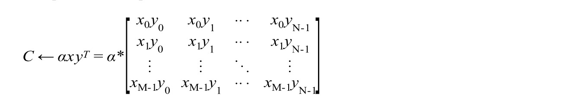

如果x和y是复数向量，那么这个函数计算

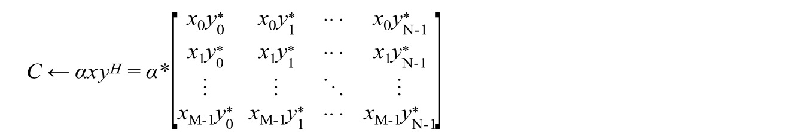

**接口定义**

C interface：

```c
void vsip_vouter_f(vsip_scalar_f alpha,
                   const vsip_vview_f* x,
                   const vsip_vview_f* y,
                   const vsip_mview_f* C);
void vsip_cvouter_f(vsip_cscalar_f alpha,
                    const vsip_cvview_f* x,
                    const vsip_cvview_f* y,
                    const vsip_cmview_f* C);
```

**参数**

<table style="width: 100%; table-layout: fixed; word-break: break-word;">
  <colgroup>
    <col style="width: 18.00%;">
    <col style="width: 46.00%;">
    <col style="width: 20.00%;">
    <col style="width: 16.00%;">
  </colgroup>
  <thead>
    <tr><th>参数名</th><th>描述</th><th>取值范围</th><th>输入输出</th></tr>
  </thead>
  <tbody>
    <tr><td>x</td><td>输入向量视图</td><td>非空</td><td>输入</td></tr>
    <tr><td>y</td><td>输入向量视图</td><td>非空</td><td>输入</td></tr>
    <tr><td>C</td><td>输出矩阵视图</td><td>非空</td><td>输出</td></tr>
  </tbody>
</table>

#### 7.6.6.2 特殊线性方程求解

**当前版本已实现函数**

<table style="width: 100%; table-layout: fixed; word-break: break-word;">
  <colgroup>
    <col style="width: 50.00%;">
    <col style="width: 50.00%;">
  </colgroup>
  <tbody>
    <tr><td>vsip_toepsol_f</td><td>vsip_ctoepsol_f</td></tr>
    <tr><td>vsip_covsol_f</td><td>vsip_ccovsol_f</td></tr>
    <tr><td>vsip_llsqsol_f</td><td>vsip_cllsqsol_f</td></tr>
  </tbody>
</table>

##### 7.6.6.2.1 vsip\_\[d\]covsol\_\[p\]

解协方差线性方程组。

**函数功能**

$$
A^TAX = B
$$
或者
$$
A^HAX = B
$$

其中A是MxN(M\>=N)且秩为N的矩阵，B是NxK的矩阵。

**接口定义**

C interface：

```c
int vsip_covsol_f(const vsip_mview_f *A, const vsip_mview_f *XB);
int vsip_ccovsol_f(const vsip_cmview_f *A, const vsip_cmview_f *XB);
```

**参数**

<table style="width: 100%; table-layout: fixed; word-break: break-word;">
  <colgroup>
    <col style="width: 18.00%;">
    <col style="width: 46.00%;">
    <col style="width: 20.00%;">
    <col style="width: 16.00%;">
  </colgroup>
  <thead>
    <tr><th>参数名</th><th>描述</th><th>取值范围</th><th>输入输出</th></tr>
  </thead>
  <tbody>
    <tr><td>A</td><td>输入矩阵A的视图，大小为M×N, M>=N</td><td>非空</td><td>输入</td></tr>
    <tr><td>XB</td><td>输出NxK矩阵视图</td><td>非空</td><td>输出</td></tr>
  </tbody>
</table>

**返回值**

- 成功返回0
- 内存占用错误返回-1
- 如果A不是列满秩返回正数

##### 7.6.6.2.2 vsip\_\[d\]llsqsol\_\[p\]

解最小二乘问题。

**函数功能**

解最小二乘问题
$$
min\_x||AX-B||\_2
$$
其中A是一个MxN(M\>=N)且秩为N的矩阵，B是一个MxK的矩阵

**接口定义**

C interface：

```c
int vsip_llsqsol_f(const vsip_mview_f *A, const vsip_mview_f *XB);
int vsip_cllsqsol_f(const vsip_cmview_f *A, const vsip_cmview_f *XB);
```

**参数**

<table style="width: 100%; table-layout: fixed; word-break: break-word;">
  <colgroup>
    <col style="width: 18.00%;">
    <col style="width: 46.00%;">
    <col style="width: 20.00%;">
    <col style="width: 16.00%;">
  </colgroup>
  <thead>
    <tr><th>参数名</th><th>描述</th><th>取值范围</th><th>输入输出</th></tr>
  </thead>
  <tbody>
    <tr><td>A</td><td>输入矩阵A的视图，大小为M×N, M>=N</td><td>非空</td><td>输入</td></tr>
    <tr><td>XB</td><td>输出NxK矩阵视图</td><td>非空</td><td>输出</td></tr>
  </tbody>
</table>

**返回值**

- 成功返回0
- 内存占用错误返回-1
- 如果A不是列满秩返回正数

##### 7.6.6.2.3 vsip\_\[d\]toepsol\_\[p\]

解实对称或复数厄米正定的Toeplitz线性方程组。

**函数功能**

解实对称正定NxN的Toeplitz线性方程组，Tx=b, 其中

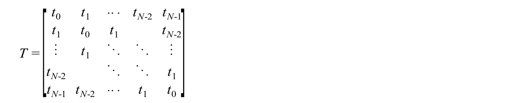

解复数厄米正定的Toeplitz线性方程组， Tx=b, 其中

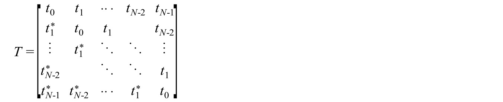

我们只需要一组向量t-矩阵T的第一行即可确定矩阵。

**接口定义**

C interface：

```c
int vsip_toepsol_f(const vsip_vview_f* t,
                   const vsip_vview_f* b,
                   const vsip_vview_f* w,
                   const vsip_vview_f* x);
int vsip_ctoepsol_f(const vsip_cvview_f* t,
                    const vsip_cvview_f* b,
                    const vsip_cvview_f* w,
                    const vsip_cvview_f* x);
```

**参数**

<table style="width: 100%; table-layout: fixed; word-break: break-word;">
  <colgroup>
    <col style="width: 18.00%;">
    <col style="width: 46.00%;">
    <col style="width: 20.00%;">
    <col style="width: 16.00%;">
  </colgroup>
  <thead>
    <tr><th>参数名</th><th>描述</th><th>取值范围</th><th>输入输出</th></tr>
  </thead>
  <tbody>
    <tr><td>t</td><td>输入向量t的视图，长度为 N，它是Toeplitz矩阵T的第一行。</td><td>非空</td><td>输入</td></tr>
    <tr><td>b</td><td>输入向量b的视图，长度为N</td><td>非空</td><td>输入</td></tr>
    <tr><td>w</td><td>向量w的视图，长度为N，用于临时工作空间。</td><td>非空</td><td>输入</td></tr>
    <tr><td>x</td><td>输出向量视图，长度为N</td><td>非空</td><td>输出</td></tr>
  </tbody>
</table>

**返回值**

- 成功返回0
- 内存占用错误返回-1
- 如果T不是正定矩阵返回正数

#### 7.6.6.3 通用方阵线性系统求解器

**当前版本已实现函数**

<table style="width: 100%; table-layout: fixed; word-break: break-word;">
  <colgroup>
    <col style="width: 50.00%;">
    <col style="width: 50.00%;">
  </colgroup>
  <tbody>
    <tr><td>vsip_lud_create_f</td><td>vsip_clud_create_f</td></tr>
    <tr><td>vsip_lud_f</td><td>vsip_clud_f</td></tr>
    <tr><td>vsip_lud_getattr_f</td><td>vsip_clud_getattr_f</td></tr>
    <tr><td>vsip_lusol_f</td><td>vsip_clusol_f</td></tr>
    <tr><td>vsip_lud_destroy_f</td><td>vsip_clud_destroy_f</td></tr>
  </tbody>
</table>

##### 7.6.6.3.1 vsip\_\[d\]lud\_p

计算方阵A的LU分解，使用部分主元法。

**函数功能**

计算一般N×N矩阵A的LU分解，使用部分主元法，支持行交换或列交换。LU分解的一种示例是，使用行交换的因式分解具有以下形式，
$$
A=PLU
$$
或使用列交换具有以下形式
$$
A=LUP
$$
其中P是置换矩阵，L是下三角矩阵，U是上三角矩阵。特定的因式分解选择以及行交换或列交换的使用依赖于实现。

**接口定义**

C interface：

```c
int vsip_lud_f(vsip_lu_f *lud, const vsip_mview_f *A);
int vsip_clud_f(vsip_clu_f *lud, const vsip_cmview_f *A);
```

**参数**

<table style="width: 100%; table-layout: fixed; word-break: break-word;">
  <colgroup>
    <col style="width: 18.00%;">
    <col style="width: 46.00%;">
    <col style="width: 20.00%;">
    <col style="width: 16.00%;">
  </colgroup>
  <thead>
    <tr><th>参数名</th><th>描述</th><th>取值范围</th><th>输入输出</th></tr>
  </thead>
  <tbody>
    <tr><td>lud</td><td>指向由vsip_[d]lud_create_f创建的对象。</td><td>非空</td><td>输入</td></tr>
    <tr><td>A</td><td>输入矩阵A的视图，大小为NxN</td><td>非空</td><td>输入</td></tr>
  </tbody>
</table>

**返回值**

如果成功，则返回零。如果A不具有满秩，则此例程将失败并返回非零值。

##### 7.6.6.3.2 vsip\_\[d\]lud\_create\_\[p\]

创建一个LU分解对象。

**函数功能**

计算一般N×N矩阵A的LU分解，使用部分主元法，支持行交换或列交换。LU分解的一种示例是，使用行交换的因式分解具有以下形式，
$$
A=PLU
$$
或使用列交换具有以下形式
$$
A=LUP
$$
其中P是置换矩阵，L是下三角矩阵，U是上三角矩阵。特定的因式分解选择以及行交换或列交换的使用依赖于实现。

**接口定义**

C interface：

```c
vsip_lu_f *vsip_lud_create_f(vsip_length N);
vsip_clu_f *vsip_clud_create_f(vsip_length N);
```

**参数**

<table style="width: 100%; table-layout: fixed; word-break: break-word;">
  <colgroup>
    <col style="width: 18.00%;">
    <col style="width: 46.00%;">
    <col style="width: 20.00%;">
    <col style="width: 16.00%;">
  </colgroup>
  <thead>
    <tr><th>参数名</th><th>描述</th><th>取值范围</th><th>输入输出</th></tr>
  </thead>
  <tbody>
    <tr><td>N</td><td>矩阵A的行数</td><td>>0</td><td>输入</td></tr>
  </tbody>
</table>

**返回值**

返回值是指向LU分解对象的指针，如果失败则为null。

##### 7.6.6.3.3 vsip\_\[d\]lud\_destroy\_\[p\]

销毁一个LU分解对象。

**函数功能**

销毁（释放内存）一个 LU 分解对象，成功时返回零，失败时返回非零值。

**接口定义**

C interface：

```c
int vsip_lud_destroy_f(vsip_lu_f *lud);
int vsip_clud_destroy_f(vsip_clu_f *lud);
```

**参数**

<table style="width: 100%; table-layout: fixed; word-break: break-word;">
  <colgroup>
    <col style="width: 18.00%;">
    <col style="width: 46.00%;">
    <col style="width: 20.00%;">
    <col style="width: 16.00%;">
  </colgroup>
  <thead>
    <tr><th>参数名</th><th>描述</th><th>取值范围</th><th>输入输出</th></tr>
  </thead>
  <tbody>
    <tr><td>lud</td><td>指向由vsip_[d]lud_create_f创建的对象。</td><td>非空</td><td>输入</td></tr>
  </tbody>
</table>

**返回值**

返回值是指向LU分解对象的指针，如果失败则为null。

##### 7.6.6.3.4 vsip\_\[d\]lud\_getattr\_\[p\]

返回 LU 分解对象的属性。

**函数功能**

将LU分解对象的属性返回到通过引用传递的LU属性结构中。

**接口定义**

C interface：

```c
typedef struct {
    vsip_length n;
// number of rows and columns in the matrix
} vsip_dlu_attr_f;
void vsip_lud_getattr_f(const vsip_lu_f* lud, vsip_lu_attr_f* attr);
void vsip_clud_getattr_f(const vsip_clu_f* lud, vsip_clu_attr_f* attr);
```

**参数**

<table style="width: 100%; table-layout: fixed; word-break: break-word;">
  <colgroup>
    <col style="width: 18.00%;">
    <col style="width: 46.00%;">
    <col style="width: 20.00%;">
    <col style="width: 16.00%;">
  </colgroup>
  <thead>
    <tr><th>参数名</th><th>描述</th><th>取值范围</th><th>输入输出</th></tr>
  </thead>
  <tbody>
    <tr><td>lud</td><td>指向由vsip_[d]lud_create_f创建的对象。</td><td>非空</td><td>输入</td></tr>
    <tr><td>attr</td><td>指向LU属性结构</td><td>非空</td><td>输出</td></tr>
  </tbody>
</table>

##### 7.6.6.3.5 vsip\_\[d\]ludsol\_\[p\]

解方阵线性方程组。

**函数功能**

解下面的线性方程组
op(A)X=B 其中，op(A)是下面之一
$$
\\operatorname{op}(A) = A, \\operatorname{op}(A)=A^T, \\operatorname{op}(A) = A^H
$$

对于一般矩阵A，使用由例程`vsip_dlud_f`计算的分解。A是一个N×N的矩阵，秩为 N，而B是一个N×K的矩阵。

**接口定义**

C interface：

```c
int vsip_lusol_f(const vsip_lu_f *lud, vsip_mat_op OpA, const vsip_mview_f *XB);
int vsip_clusol_f(const vsip_clu_f *lud, vsip_mat_op OpA, const vsip_cmview_f *XB);
```

**参数**

<table style="width: 100%; table-layout: fixed; word-break: break-word;">
  <colgroup>
    <col style="width: 18.00%;">
    <col style="width: 46.00%;">
    <col style="width: 20.00%;">
    <col style="width: 16.00%;">
  </colgroup>
  <thead>
    <tr><th>参数名</th><th>描述</th><th>取值范围</th><th>输入输出</th></tr>
  </thead>
  <tbody>
    <tr><td>lud</td><td>指向由vsip_[d]lud_create_f创建的对象。</td><td>非空</td><td>输入</td></tr>
    <tr><td>OpA</td><td>执行op(A)的形式</td><td>枚举类型</td><td>输入</td></tr>
    <tr><td>XB</td><td>输出矩阵X/输入矩阵B，大小为NxK</td><td>非空</td><td>输入输出</td></tr>
  </tbody>
</table>

#### 7.6.6.4 对称正定线性系统求解器

**当前版本已实现函数**

<table style="width: 100%; table-layout: fixed; word-break: break-word;">
  <colgroup>
    <col style="width: 50.00%;">
    <col style="width: 50.00%;">
  </colgroup>
  <tbody>
    <tr><td>vsip_chold_f</td><td>vsip_cchold_f</td></tr>
    <tr><td>vsip_chold_create_f</td><td>vsip_cchold_create_f</td></tr>
    <tr><td>vsip_cholsol_f</td><td>vsip_ccholsol_f</td></tr>
    <tr><td>vsip_chold_getattr_f</td><td>vsip_cchold_getattr_f</td></tr>
    <tr><td>vsip_chold_destroy_f</td><td>vsip_cchold_destroy_f</td></tr>
  </tbody>
</table>

##### 7.6.6.4.1 vsip\_\[d\]chold\_\[p\]

计算对称（厄米）正定矩阵A的Cholesky分解。

**函数功能**

NxN的对称（厄米）正定矩阵A的Cholesky分解的形式如下所示
A=LL^T(A=LL^H)，其中L是下三角矩阵。
或者
A=R^TR(A=R^HR)，其中R是上三角矩阵。

特定类型的因式分解取决于实现方式。没有用于访问分解因子的实用函数。

**接口定义**

C interface：

```c
int vsip_chold_f(vsip_chol_f *chold, const vsip_mview_f *A);
int vsip_cchold_f(vsip_cchol_f *chold, const vsip_cmview_f *A);
```

**参数**

<table style="width: 100%; table-layout: fixed; word-break: break-word;">
  <colgroup>
    <col style="width: 18.00%;">
    <col style="width: 46.00%;">
    <col style="width: 20.00%;">
    <col style="width: 16.00%;">
  </colgroup>
  <thead>
    <tr><th>参数名</th><th>描述</th><th>取值范围</th><th>输入输出</th></tr>
  </thead>
  <tbody>
    <tr><td>chold</td><td>指向由vsip_[d]chold_create_f创建的Cholesky分解的对象。</td><td>非空</td><td>输入</td></tr>
    <tr><td>A</td><td>输入矩阵A的视图，大小为NxN</td><td>非空</td><td>输入输出</td></tr>
  </tbody>
</table>

**返回值**

如果成功，则返回零。如果矩阵A的主子矩阵不是对称（厄米）正定的，并且算法无法完成，则此例程将失败。

##### 7.6.6.4.2 vsip\_\[d\]chold\_create\_\[p\]

创建一个 Cholesky 分解对象。

**函数功能**

创建一个Cholesky分解（CHOLD）对象。Cholesky分解对象封装了与分解属性和所需工作空间相关的信息。

Cholesky分解对象用于计算对称正定N×N矩阵A的Cholesky分解。

对称（厄米）正定N×N矩阵A的Cholesky分解表示为
A=LL^T(A=LL^H), 其中L是一个下三角矩阵。
或者
A=R^TR(A=R^HR), 其中R是一个上三角矩阵。
特定类型的因式分解取决于实现方式。没有用于访问分解因子的实用函数。

**接口定义**

C interface：

```c
typedef enum { VSIP_TR_LOW = 0, VSIP_TR_UPP = 1 } vsip_mat_uplo;
vsip_chol_f* vsip_chold_create_f(vsip_mat_uplo uplo, vsip_length N);
vsip_cchol_f* vsip_cchold_create_f(vsip_mat_uplo uplo, vsip_length N);
```

**参数**

<table style="width: 100%; table-layout: fixed; word-break: break-word;">
  <colgroup>
    <col style="width: 18.00%;">
    <col style="width: 46.00%;">
    <col style="width: 20.00%;">
    <col style="width: 16.00%;">
  </colgroup>
  <thead>
    <tr><th>参数名</th><th>描述</th><th>取值范围</th><th>输入输出</th></tr>
  </thead>
  <tbody>
    <tr><td>N</td><td>输入矩阵的行数或列数</td><td>>0</td><td>输入</td></tr>
    <tr><td>uplo</td><td>指定矩阵是上三角部分或下三角部分存储的。</td><td>枚举类型</td><td>输入</td></tr>
  </tbody>
</table>

**返回值**

返回值是指向Cholesky分解对象的指针，如果失败则返回 null。

##### 7.6.6.4.3 vsip\_\[d\]chold\_destroy\_\[p\]

销毁一个 Cholesky 分解对象。

**函数功能**

销毁（释放内存）一个Cholesky分解对象，成功时返回零，失败时返回非零值。

**接口定义**

C interface：

```c
int vsip_chold_destroy_f(vsip_chol_f *chold);
int vsip_cchold_destroy_f(vsip_cchol_f *chold);
```

**参数**

<table style="width: 100%; table-layout: fixed; word-break: break-word;">
  <colgroup>
    <col style="width: 18.00%;">
    <col style="width: 46.00%;">
    <col style="width: 20.00%;">
    <col style="width: 16.00%;">
  </colgroup>
  <thead>
    <tr><th>参数名</th><th>描述</th><th>取值范围</th><th>输入输出</th></tr>
  </thead>
  <tbody>
    <tr><td>chold</td><td>指向通过vsip_[d]chold_create_f 创建的Cholesky分解对象的指针。</td><td>非空</td><td>输入</td></tr>
  </tbody>
</table>

**返回值**

成功时返回零，失败时返回非零值。

##### 7.6.6.4.4 vsip\_\[d\]chold\_getattr\_\[p\]

返回 Cholesky 分解对象的属性。

**函数功能**

将Cholesky分解对象的属性返回到通过引用传递的结构中。

**接口定义**

C interface：

```c
typedef struct {
    vsip_mat_uplo uplo;
// Upper or lower triangular matrix
    vsip_length n;
// Number of rows and columns in the matrix
} vsip_dchol_attr_f;
void vsip_chold_getattr_f(const vsip_chol_f* chold, vsip_chol_attr_f* attr);
void vsip_cchold_getattr_f(const vsip_cchol_f* chold, vsip_cchol_attr_f* attr);
```

**参数**

<table style="width: 100%; table-layout: fixed; word-break: break-word;">
  <colgroup>
    <col style="width: 18.00%;">
    <col style="width: 46.00%;">
    <col style="width: 20.00%;">
    <col style="width: 16.00%;">
  </colgroup>
  <thead>
    <tr><th>参数名</th><th>描述</th><th>取值范围</th><th>输入输出</th></tr>
  </thead>
  <tbody>
    <tr><td>chold</td><td>指向通过vsip_[d]chold_create_f 创建的Cholesky分解对象的指针。</td><td>非空</td><td>输入</td></tr>
    <tr><td>attr</td><td>指向输出属性结构体。</td><td>非空</td><td>输入</td></tr>
  </tbody>
</table>

##### 7.6.6.4.5 vsip\_\[d\]cholsol\_\[p\]

求解对称（厄米）正定线性系统。

**函数功能**

解下面的线性方程
$$
AX=B
$$

对于使用例程`vsip_[d]chold_f`计算的对称（厄米）正定矩阵A，其中A是一个N×N的矩阵，B是一个N×K的矩阵。

**接口定义**

C interface：

```c
int vsip_cholsol_f(const vsip_chol_f *chold, const vsip_mview_f *XB);
int vsip_ccholsol_f(const vsip_cchol_f *chold, const vsip_cmview_f *XB);
```

**参数**

<table style="width: 100%; table-layout: fixed; word-break: break-word;">
  <colgroup>
    <col style="width: 18.00%;">
    <col style="width: 46.00%;">
    <col style="width: 20.00%;">
    <col style="width: 16.00%;">
  </colgroup>
  <thead>
    <tr><th>参数名</th><th>描述</th><th>取值范围</th><th>输入输出</th></tr>
  </thead>
  <tbody>
    <tr><td>chold</td><td>指向通过vsip_[d]chold_create_f 创建的Cholesky分解对象的指针。</td><td>非空</td><td>输入</td></tr>
    <tr><td>XB</td><td>指向输出属性结构体。</td><td>非空</td><td>输入</td></tr>
  </tbody>
</table>

**返回值**

成功返回0

#### 7.6.6.5 过定线性系统求解器

**当前版本已实现函数**

<table style="width: 100%; table-layout: fixed; word-break: break-word;">
  <colgroup>
    <col style="width: 50.00%;">
    <col style="width: 50.00%;">
  </colgroup>
  <tbody>
    <tr><td>vsip_qrd_f</td><td>vsip_cqrd_f</td></tr>
    <tr><td>vsip_qrd_create_f</td><td>vsip_cqrd_create_f</td></tr>
    <tr><td>vsip_qrsol_f</td><td>vsip_cqrsol_f</td></tr>
    <tr><td>vsip_qrdprodq_f</td><td>vsip_cqrdprodq_f</td></tr>
    <tr><td>vsip_qrdsolr_f</td><td>vsip_cqrdsolr_f</td></tr>
    <tr><td>vsip_qrd_getattr_f</td><td>vsip_cqrd_getattr_f</td></tr>
    <tr><td>vsip_qrd_destroy_f</td><td>vsip_cqrd_destroy_f</td></tr>
  </tbody>
</table>

##### 7.6.6.5.1 vsip\_\[d\]qrd\_\[p\]

计算矩阵的QR分解。

**函数功能**

计算矩阵的QR分解，要求M≥N。M×N矩阵A的QR分解表示为
$$
A=QR
$$
其中Q是一个M×N的正交矩阵（当A是实数矩阵时）或单位矩阵（当A是复数矩阵时），而R是一个上三角矩阵。如果A具有满秩，则R是一个非奇异矩阵。此例程不执行任何列交换。

**接口定义**

C interface：

```c
int vsip_qrd_f(vsip_qr_f *qrd, const vsip_mview_f *A);
int vsip_cqrd_f(vsip_cqr_f *qrd, const vsip_cmview_f *A);
```

**参数**

<table style="width: 100%; table-layout: fixed; word-break: break-word;">
  <colgroup>
    <col style="width: 18.00%;">
    <col style="width: 46.00%;">
    <col style="width: 20.00%;">
    <col style="width: 16.00%;">
  </colgroup>
  <thead>
    <tr><th>参数名</th><th>描述</th><th>取值范围</th><th>输入输出</th></tr>
  </thead>
  <tbody>
    <tr><td>qrd</td><td>指向通过vsip_[d]qrd_create_f 创建的QR分解对象的指针。</td><td>非空</td><td>输入</td></tr>
    <tr><td>A</td><td>输入矩阵A的视图，大小为MxN</td><td>非空</td><td>输入</td></tr>
  </tbody>
</table>

**返回值**

成功时返回零。如果矩阵A不具有满列秩（即rank(A)≠N，则此例程将失败并返回非零值。

##### 7.6.6.5.2 vsip\_\[d\]qrd\_create\_\[p\]

计算矩阵的QR分解。

**函数功能**

计算矩阵的QR分解，要求M≥N。M×N矩阵A的QR分解表示为
$$
A=QR
$$
其中Q是一个M×N的正交矩阵（当A是实数矩阵时）或单位矩阵（当A是复数矩阵时），而R是一个上三角矩阵。如果A具有满秩，则R是一个非奇异矩阵。此例程不执行任何列交换。

矩阵R将被生成并保留以供后续使用。然而，有一个标志指示是否保留矩阵Q。可以选择保留“瘦型” Q或完整的Q，其中Q是一个M×M的正交（单位）矩阵。

**接口定义**

C interface：

```c
typedef enum {
    VSIP_QRD_NOSAVEQ = 0,  // Do not save Q
    VSIP_QRD_SAVEQ = 1,    // Save full Q
    VSIP_QRD_SAVEQ1 = 2    // Save skinny Q
} vsip_qrd_qopt;
vsip_qr_f* vsip_qrd_create_f(vsip_length M, vsip_length N, vsip_qrd_qopt qopt);
vsip_cqr_f* vsip_cqrd_create_f(vsip_length M,
                               vsip_length N,
                               vsip_qrd_qopt qopt);
```

**参数**

<table style="width: 100%; table-layout: fixed; word-break: break-word;">
  <colgroup>
    <col style="width: 18.00%;">
    <col style="width: 46.00%;">
    <col style="width: 20.00%;">
    <col style="width: 16.00%;">
  </colgroup>
  <thead>
    <tr><th>参数名</th><th>描述</th><th>取值范围</th><th>输入输出</th></tr>
  </thead>
  <tbody>
    <tr><td>M</td><td>输入矩阵A的行数</td><td>>0 M>=N</td><td>输入</td></tr>
    <tr><td>N</td><td>输入矩阵A的列数</td><td>>0 M>=N</td><td>输入</td></tr>
    <tr><td>qopt</td><td>指示是否保留矩阵Q</td><td>枚举类型</td><td>输入</td></tr>
  </tbody>
</table>

**返回值**

返回值是指向QR分解对象的指针，如果失败则为null。

##### 7.6.6.5.3 vsip\_\[d\]qrd\_destroy\_\[p\]

销毁一个QR分解对象。

**函数功能**

销毁（释放内存）一个QR分解对象，成功时返回零，失败时返回非零值。

**接口定义**

C interface：

```c
int vsip_qrd_destroy_f(vsip_qr_f *qrd);
int vsip_cqrd_destroy_f(vsip_cqr_f *qrd);
```

**参数**

<table style="width: 100%; table-layout: fixed; word-break: break-word;">
  <colgroup>
    <col style="width: 18.00%;">
    <col style="width: 46.00%;">
    <col style="width: 20.00%;">
    <col style="width: 16.00%;">
  </colgroup>
  <thead>
    <tr><th>参数名</th><th>描述</th><th>取值范围</th><th>输入输出</th></tr>
  </thead>
  <tbody>
    <tr><td>qrd</td><td>指向通过vsip_[d]qrd_create_f 创建的QR分解对象的指针。</td><td>非空</td><td>输入</td></tr>
  </tbody>
</table>

**返回值**

成功返回0，失败返回非0。

##### 7.6.6.5.4 vsip\_\[d\]qrd\_getattr\_\[p\]

返回QR分解对象的属性。

**函数功能**

将QR分解对象的属性返回到通过引用传递的结构中。

**接口定义**

C interface：

```c
typedef struct {
    vsip_length m;
// The number of rows for the input matrix A
    vsip_length n;
// The number of columns for the input matrix A
    vsip_qrd_opt Qopt;
// Indicates if the matrix Q is retained or not
} vsip_dqr_attr_f;
typedef enum {
    VSIP_QRD_NOSAVEQ = 0,  // Do not save Q
    VSIP_QRD_SAVEQ = 1,    // Save Q
    VSIP_QRD_SAVEQ1 = 2    // Save Skinny Q
} vsip_qrd_qopt;
void vsip_qrd_getattr_f(const vsip_qr_f* qrd, vsip_qr_attr_f* attr);
void vsip_cqrd_getattr_f(const vsip_cqr_f* qrd, vsip_cqr_attr_f* attr);
```

**参数**

<table style="width: 100%; table-layout: fixed; word-break: break-word;">
  <colgroup>
    <col style="width: 18.00%;">
    <col style="width: 46.00%;">
    <col style="width: 20.00%;">
    <col style="width: 16.00%;">
  </colgroup>
  <thead>
    <tr><th>参数名</th><th>描述</th><th>取值范围</th><th>输入输出</th></tr>
  </thead>
  <tbody>
    <tr><td>qrd</td><td>指向通过vsip_[d]qrd_create_f 创建的QR分解对象的指针。</td><td>非空</td><td>输入</td></tr>
    <tr><td>attr</td><td>指向输出属性的结构体。</td><td>非空</td><td>输入输出</td></tr>
  </tbody>
</table>

##### 7.6.6.5.5 vsip\_\[d\]qrdprodq\_\[p\]

将矩阵与QR分解中的矩阵Q相乘。

**函数功能**

这个函数重写一个RxS的矩阵C，使用下面的方式，

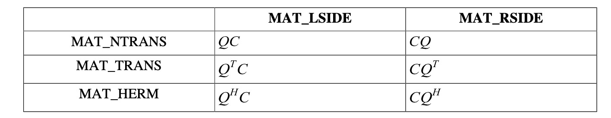

其中矩阵Q是由例程`vsip_dqrd_f`生成的。如果M×N矩阵是`vsip_dqrd_f`函数的输入矩阵，则Q可以是M×M矩阵或M×N矩阵，这取决于生成Q时使用的选项。

如果Q是使用QRD\_SAVEQ1选项计算的，则下表列出了矩阵C在此操作前后的可能维度：

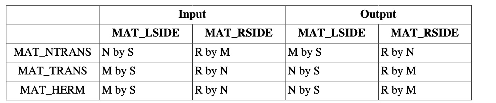

考虑到M≥N，对于某些选项，此操作的结果矩阵可能比输入矩阵大。用于输入输出数据的矩阵视图对象是常量的。输入和输出的第一个元素存储在输入输出矩阵的（0,0）位置。其他元素根据输入输出视图的行跨度和列跨度存储在块的自然位置。

如果Q是使用QRD\_SAVEQ选项计算的，则下表列出了矩阵C在此操作前后的可能维度：

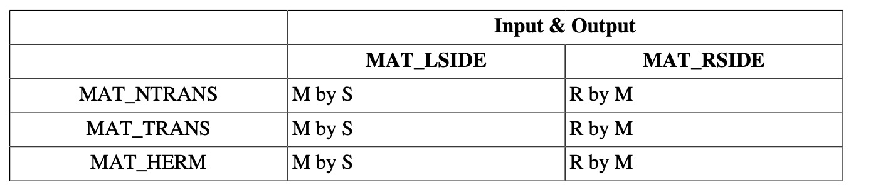

**接口定义**

C interface：

```c
typedef enum {
    VSIP_MAT_NTRANS = 0,
    VSIP_MAT_TRANS = 1,
    VSIP_MAT_HERM = 2
} vsip_mat_op;
typedef enum { VSIP_MAT_LSIDE = 0, VSIP_MAT_RSIDE = 1 } vsip_mat_side;
int vsip_qrdprodq_f(const vsip_qr_f* qrd,
                    vsip_mat_op opQ,
                    vsip_mat_side apQ,
                    const vsip_mview_f* C);
int vsip_cqrdprodq_f(const vsip_cqr_f* qrd,
                     vsip_mat_op opQ,
                     vsip_mat_side apQ,
                     const vsip_cmview_f* C);
```

**参数**

<table style="width: 100%; table-layout: fixed; word-break: break-word;">
  <colgroup>
    <col style="width: 18.00%;">
    <col style="width: 46.00%;">
    <col style="width: 20.00%;">
    <col style="width: 16.00%;">
  </colgroup>
  <thead>
    <tr><th>参数名</th><th>描述</th><th>取值范围</th><th>输入输出</th></tr>
  </thead>
  <tbody>
    <tr><td>qrd</td><td>指向通过vsip_[d]qrd_create_f 创建的QR分解对象的指针。</td><td>非空</td><td>输入</td></tr>
    <tr><td>opQ</td><td>指定op(Q)的形式</td><td>枚举类型</td><td>输入</td></tr>
    <tr><td>apQ</td><td>指示op(C)是应用在C的左边还是右边。</td><td>枚举类型</td><td>输入</td></tr>
    <tr><td>C</td><td>输入时，矩阵C的视图，大小为R×S。输出时，数据按自然顺序存储在由输入矩阵视图的偏移量、行跨度和列跨度确定的块中。请参见下面的限制。</td><td>非空</td><td>输入</td></tr>
  </tbody>
</table>

**返回值**

成功返回0

##### 7.6.6.5.6 vsip\_\[d\]qrdsolr\_\[p\]

根据矩阵A的QR分解中的矩阵R求解线性系统。

**函数功能**

求解以下形式的三角线性系统
op(R)X=alpha B, 其中op(R)是下列形式之一，
$$
\\operatorname{op}(R)=R, \\operatorname{op}(R)=R^T, \\operatorname{op}(R)=R^H
$$
R是一个上三角NxN矩阵，X和B是NxK矩阵。

**接口定义**

C interface：

```c
typedef enum {
    VSIP_MAT_NTRANS = 0,
    VSIP_MAT_TRANS = 1,
    VSIP_MAT_HERM = 2
} vsip_mat_op;
int vsip_qrdsolr_f(const vsip_qr_f* qrd,
                   vsip_mat_op OpR,
                   vsip_scalar_f alpha,
                   const vsip_mview_f* XB);
int vsip_cqrdsolr_f(const vsip_cqr_f* qrd,
                    vsip_mat_op OpR,
                    vsip_cscalar_f alpha,
                    const vsip_cmview_f* XB);
```

**参数**

<table style="width: 100%; table-layout: fixed; word-break: break-word;">
  <colgroup>
    <col style="width: 18.00%;">
    <col style="width: 46.00%;">
    <col style="width: 20.00%;">
    <col style="width: 16.00%;">
  </colgroup>
  <thead>
    <tr><th>参数名</th><th>描述</th><th>取值范围</th><th>输入输出</th></tr>
  </thead>
  <tbody>
    <tr><td>qrd</td><td>指向通过vsip_[d]qrd_create_f 创建的QR分解对象的指针。</td><td>非空</td><td>输入</td></tr>
    <tr><td>opR</td><td>指定op(R)的形式</td><td>枚举类型</td><td>输入</td></tr>
    <tr><td>alpha</td><td>实数/复数标量</td><td>标量</td><td>输入</td></tr>
    <tr><td>XB</td><td>NxK的输入输出矩阵</td><td>非空</td><td>输入输出</td></tr>
  </tbody>
</table>

**返回值**

成功返回0

##### 7.6.6.5.7 vsip\_\[d\]qrsol\_\[p\]

求解线性协方差问题或线性最小二乘问题。

**函数功能**

假设A是一个M×N的矩阵，秩为N，而B是一个N×K的矩阵（用于协方差问题）或M×K的矩阵（用于最小二乘问题）。此例程使用由例程 `vsip_[d]qrd_f` 计算的分解来解决以下问题之一：协方差线性系统问题，
$$
A^TAX=B
$$
或者
$$
A^HAX=B
$$
或者最小二乘问题
$$
min\_x|| AX-B ||\_2
$$

**接口定义**

C interface：

```c
typedef enum {
    VSIP_COV = 0,  // Solve a covariance linear system problem
    VSIP_LLS = 1   // Solve a linear least squares problem
} vsip_qrd_prob;
int vsip_qrsol_f(const vsip_qr_f* qrd,
                 vsip_qrd_prob prob,
                 const vsip_mview_f* XB);
int vsip_cqrsol_f(const vsip_qr_f* qrd,
                  vsip_qrd_prob prob,
                  const vsip_cmview_f* XB);
```

**参数**

<table style="width: 100%; table-layout: fixed; word-break: break-word;">
  <colgroup>
    <col style="width: 18.00%;">
    <col style="width: 46.00%;">
    <col style="width: 20.00%;">
    <col style="width: 16.00%;">
  </colgroup>
  <thead>
    <tr><th>参数名</th><th>描述</th><th>取值范围</th><th>输入输出</th></tr>
  </thead>
  <tbody>
    <tr><td>qrd</td><td>指向通过vsip_[d]qrd_create_f 创建的QR分解对象的指针。</td><td>非空</td><td>输入</td></tr>
    <tr><td>prob</td><td>选择解协方差线性系统还是最小二乘问题。</td><td>枚举类型</td><td>输入</td></tr>
    <tr><td>XB</td><td>输入时，矩阵B的视图，大小为N×K（用于协方差问题）或M×K（用于最小二乘问题）。视图是常量的。输出数据从索引零开始覆盖输入数据。对于最小二乘问题，输出时从索引N开始的输入输出视图元素在输出上依赖于供应商。</td><td>非空</td><td>输出</td></tr>
  </tbody>
</table>

**返回值**

成功返回0。
