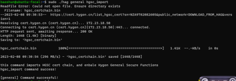
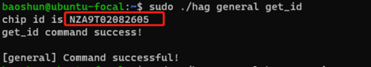
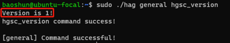
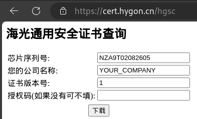
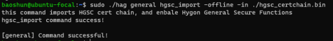
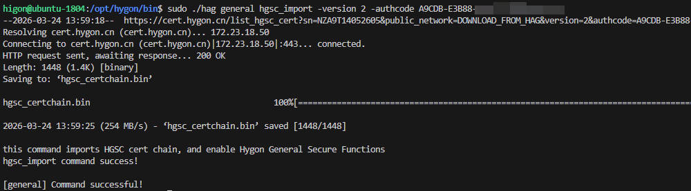
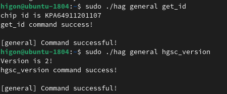
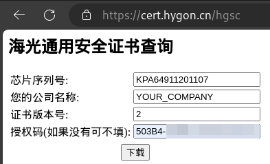
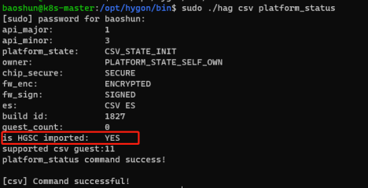

<span style="color:red">**使用海光安全功能必须导入通用安全证书，否则安全功能不工作。**</span>

通用安全证书导入后，会写入安全flash，不重新烧录bios的情况下，无需重新导入。以下操作都无需重新导入证书：重启机器、升级安全固件。

## 安装依赖

说明: 从https网站下载文件，需要依赖ssl证书，可以使用以下方法安装：

Ubuntu：

```
$ sudo apt-get install -y ca-certificates
```

Centos：

```
$ sudo yum install -y ca-certificates
```

### 下载hag

https://download.sourcefind.cn:65024/8/main/c86-devkit/latest/tools

下载后建议放入`/opt/hygon/bin`目录

## 导入通用安全证书

> 说明：通用安全证书支持在线导入和离线导入两种方式。
> 
> 注意：
> 
> 在C86-4G上使用`TKM`功能的客户，请参见`导入升级版通用安全证书`；
> 
> 使用TPCM（开放接口）功能的客户，也需要`导入升级版通用安全证书`；

### 在线导入

```
$ cd /opt/hygon/bin/
$ sudo ./hag general hgsc_import
```

图 1 在线导入通用安全证书



### 离线导入

(1)	获取芯片的chip ID和证书版本号

```
$ cd /opt/hygon/bin
$ sudo ./hag general get_id
$ sudo ./hag general hgsc_version
```

图 2 获取芯片chip ID



图 3 获取证书版本号



(2)	网站下载证书
说明：在可以连接互联网的机器上，访问 https://cert.hygon.cn/hgsc, 如下图所示，输入您的服务器的Chip ID、证书版本号，以及您的公司信息。

注意：授权码请不要填写

图 4 网站下载证书



(3)	导入证书

```
$ cd /opt/hygon/bin
$ sudo ./hag general hgsc_import -offline -in /realpath/to/hgsc_certchain
```

说明：将下载的证书拷贝到对应的服务器，证书名称类似为hygon-hgsc-certchain-v1.0-NZA9T02082605.bin。如下图，使用hag离线导入该证书。

图 5 离线导入证书



## 导入升级版通用安全证书

### 获取 `授权码`

使用TKM、TPCM（开放接口）功能，需要导入对应升级版通用安全证书，该证书需要使用授权码下载和导入。

#### TKM证书

请联系securitytech@hygon.cn获取授权码，邮件中需提供以下信息：

```
1.您的公司名称
2.您的公司邮箱地址
3.您购买的CPU型号
4.您购买的CPU数量
```

获取授权码后，即可使用`在线导入`或`离线导入`方式导入证书。

#### TPCM证书

海光指定北京同创安全可信科技有限公司为TPCM授权业务唯一代理，提供免费试用和收费商用两种授权，请联系tpcm-license@cotrusted.com.cn获取授权码，邮件中请提供如下信息：

```
1、您的公司名称：
2、您的公司邮箱地址：
3、您购买的CPU型号：   该型号的购买数量：
4、您购买的CPU型号：   该型号的购买数量：    （可列多项）
5、贵公司联系人电话：
```

获取授权码后，即可使用下述在线导入或离线导入方式导入证书。

开源可信计算支撑模块openTCSM网址: https://gitee.com/anolis/opentcsm, 技术支持可以添加“同创可信”公众号（或搜索公众号TONGCHUANGKEXIN-427）进行留言，留下邮箱地址技术人员会进行回复。

### 在线导入

```
$ cd /opt/hygon/bin/
# -authcode后面跟获取到的授权码
$ sudo ./hag general hgsc_import -version 2 -authcode xxxxx-xxxxx-xxxxx
```

图 6 在线导入升级版通用安全证书



### 离线导入

(1)	获取芯片的chip ID和证书版本号

```
$ cd /opt/hygon/bin
$ sudo ./hag general get_id
$ sudo ./hag general hgsc_version
```

> 注意：使用TPCM（开放接口）功能时，证书版本号必须选择为2，和hgsc\_version获取的版本有差异时，请以此为准。

图 7 获取芯片chip ID和证书版本号



(2)	网站下载证书
说明：在可以连接互联网的机器上，访问 https://cert.hygon.cn/hgsc, 如下图所示，输入您的服务器的Chip ID、证书版本号，您的公司信息，以及获取的授权码。

图 4 网站下载证书



(3)	导入证书

```
$ cd /opt/hygon/bin
$ sudo ./hag general hgsc_import -offline -in /realpath/to/hgsc_certchain
```

说明：将下载的证书拷贝到对应的服务器，证书名称类似为hygon-hgsc-certchain-v2.0-KPA64911201107.bin。如下图，使用hag离线导入该证书。

图 5 离线导入证书


## 确认证书导入成功

```
$ cd /opt/hygon/bin
$ sudo ./hag csv platform_status
```

图 6 确认证书导入成功


