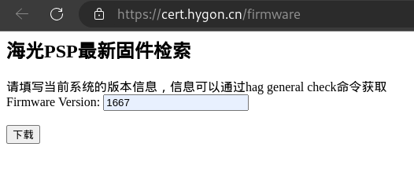

# 安全固件动态升级功能

## 功能描述

使用海光安全工具(hag)，可以把当前BIOS中的PSP固件升级到与BIOS兼容的最新版本。

注： 使用该功能升级的固件，推荐仅用于功能测试，产品线推荐使用官方发布的更新的BIOS。

## 下载hag

https://download.sourcefind.cn:65024/8/main/c86-devkit/latest/tools

下载后建议放入`/opt/hygon/bin`目录

## 升级固件

固件升级支持两种升级模式：

- 在线模式（推荐）：适用于被升级设备可以访问互联网的场景
- 离线模式：适用于被升级设备无法访问互联网的场景

### 在线模式

```
cd /opt/hygon/bin
sudo ./hag general download_firmware
```

期望结果：

```
Readfile Error: Could not open file. Ensure directory exists
  Filename: csv.fw
--2023-09-19 09:17:08--  https://cert.hygon.cn/get_firmware?bl_version=0&fw_version=1921
Connecting to 10.61.40.183:7890... connected.
Proxy request sent, awaiting response... 200 OK
Length: 524288 (512K) [binary]
Saving to: ‘csv.fw’

csv.fw                             100%[===============================================================>] 512.00K  1.28MB/s    in 0.4s

2023-09-19 09:17:09 (1.28 MB/s) - ‘csv.fw’ saved [524288/524288]

download_firmware command success!

[general] Command successful!
```

### 离线模式

#### 1. 获取当前固件版本

```
cd /opt/hygon/bin
sudo ./hag general check
```

期望结果如下：

```
firewalld:                  inactive
Jump selinux check, getenforce not found!
kernel version:             5.15.0-83-generic
model name:                 Hygon C86 5280 16-core Processor
is Hygon CPU:               YES
SME:                        enabled
/dev/sev:                   nonexist
CSV:                        disabled
csv api version:            1.3
firmware version:           1667
is HGSC imported:           YES
chip id:                    NZA9T14052605
/dev/tdm:                   nonexist
TDM:                        disabled
/dev/tpm0:                  nonexist
tpm_acpi:                   HYGT0101
/dev/tcm0:                  nonexist
tcm_acpi:                   nonexist
check command success!

[general] Command successful!
```

其中firmware version对应的1667即为当前固件版本。

#### 2. 下载固件

使用可以访问互联网的设备访问[下载服务器](https://cert.hygon.cn/firmware)下载固件，将上一步获取的固件版本填写进去，如下图所示：



点击下载，将下载的psp\_fw\_\*.bin拷贝到待升级设备

#### 3. 升级固件

```
cd /opt/hygon/bin
sudo ./hag general download_firmware -offline -in /PATH/TO/psp_fw_*.bin
```

期望结果：

```
download_firmware command success!

[general] Command successful!
```
