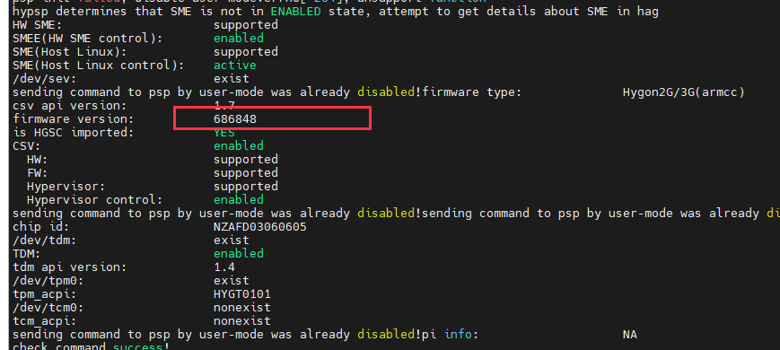

# 旧固件版本号异常（乱码）处理方法

## 1. 问题描述

部分较新版本的固件升级后，使用**旧版本 hag** 查询版本号时会显示一个异常大的数字，例如：



```
firmware version:           686848        <-- 异常显示
```

这不是固件异常，而是固件版本号的**存储编码格式发生了变更**，旧版 hag 不认识新编码导致显示错误。功能本身不受影响。

## 2. 版本号格式变更说明

固件版本号从 **2675** 版本开始采用新的编码格式：

| 项目 | 说明 |
|------|------|
| 旧格式（固件 \<= 2674） | 版本号就是单个数字，如 `2674` |
| 新格式（固件 \>= 2675） | 版本号由"主版本号 + 补丁号"组成，如 `2676`、`2676.1` |

新格式在固件内部按 `主版本号 × 256 + 补丁号` 编码存储。因此同一个固件版本：

```
真实版本 2676  ->  固件内部编码 = 2676 × 256 + 0 = 685056
```

旧版 hag 不认识新编码，直接把内部编码值当版本号显示出来，这就是"乱码"（685056）的来源。新版 hag 会自动识别新旧编码并显示为正常版本号。

## 3. 如何获得正常显示：升级 hag 到 2675 及以上版本

用以下命令查看当前 hag 版本：

```
# hag version
Version: 2674 (release)
```

| hag 版本 | 查询新固件（\>= 2675）版本号的显示结果 |
|----------|--------------------------------------|
| **\>= 2675** | 正常，如 `firmware version: 2676`；带补丁号时显示 `2676.1` |
| **\<= 2674** | 异常大数字，如 `firmware version: 685056` |

请向支持人员获取 2675 及以上版本的 hag 安装包并升级。升级后无需任何配置，`check`、`platform_status`、`tpcm_get_info` 等命令会自动正常显示。

**验证方法**：升级后执行 `hag check`，版本号显示为 `2676` 这样的正常数字即为生效。

## 4. 临时方法：旧版 hag 手工换算版本号

如暂时无法升级 hag，可按以下方法手工换算：

```
主版本号 = 显示的数字 ÷ 256（取整数部分）
补丁号   = 显示的数字 mod 256（除以 256 的余数）
```

换算示例：

| 旧 hag 显示 | 换算过程 | 真实固件版本 |
|------------|----------|-------------|
| 684800 | 684800 ÷ 256 = 2675，余 0 | 2675 |
| 685056 | 685056 ÷ 256 = 2676，余 0 | 2676 |
| 685057 | 685057 ÷ 256 = 2676，余 1 | 2676.1 |

Linux 环境可直接用一行命令换算：

```bash
echo $((685056 / 256)).$((685056 % 256))    # 输出 2676.0
```

如果显示的是**负数**或大于等于 2147483648 的超大数字，属于定制版本固件：先将该数字加上 2147483648（去掉最高标志位），再按上述方法换算。

## 5. 注意事项

1. **版本号显示异常不影响其他功能**：hag 的功能判断内部已兼容新编码，HGSC 证书、CSV 状态查询、TPCM 状态查询等功能均正常工作，仅版本号显示需要按第 4 节换算。
