# HPT Profiler GUI

## 用户手册

> 以HPT工具为基础的可视化性能分析工具，提供从项目管理、性能采集到结果分析的一站式操作

## 阅读指南

如果你是第一次使用，建议按以下路径完成一次完整分析：

**创建或打开项目 → 选择采集位置 → 选择采集对象 → 配置参数→ 开始采集 → 结果可视化**

| 你想完成的任务 | 建议阅读 |
| --- | --- |
| 尽快完成第一次采集 | [1. 快速上手](#1-快速上手) |
| 连接远端 Linux 主机 | [4. 配置采集位置](#4-配置采集位置) |
| 了解指标与采集参数 | [6. 配置 Collect 分析](#6-配置-collect-分析) |
| 分析折线图、矩阵、Topdown 与拓扑 | [10. Collect 分析页](#10-collect-分析页) |
| 修改主题、语言或快捷键 | [11. 选项与快捷键](#11-选项与快捷键) |
| 快速理解各项性能指标 | [12. 指标速查](#12-指标速查) |

## 1. 快速上手

### 1.1 启动与运行环境

HPT Profiler GUI 提供以下桌面安装产物：

- Windows：NSIS 安装包（x64）。
- Linux：AppImage、DEB、RPM（x64）。
- macOS：Apple Silicon arm64。

Linux 安装后可从应用菜单启动，也可在终端执行 `hpt-profiler`。远端图形桌面环境需要可用的显示服务。

性能采集依赖 HPT 命令行工具。开始采集时，应用会检测本地或远端 HPT 环境；版本缺失或过低时会尝试部署匹配的安装包，期间可能请求 `sudo` 密码。远端采集目标为可通过 SSH 访问的 Linux 主机。

### 1.2 欢迎页

启动后进入 **欢迎** 页。这里提供：

- **快速启动**：新建项目、打开项目、开始采集。
- **帮助文档**：在应用内打开本离线手册。
- **在线帮助**：在默认浏览器中打开 C86 DevKit 文档。
- **最近项目**：显示最近使用的项目，点击即可重新打开。

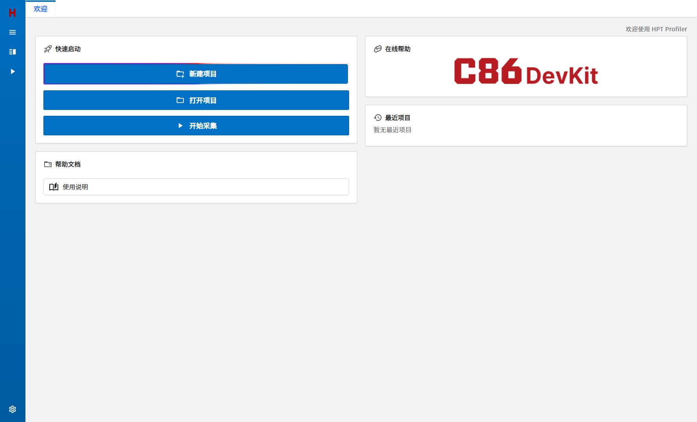

### 1.3 第一次采集

1. 点击 **新建项目**，填写项目名称和保存位置。
2. 点击左侧播放按钮或欢迎页的 **开始采集**。
3. 在 **采集位置** 选择本地或远端；远端必须先测试连接。
4. 在 **采集对象** 选择系统分析或程序分析。
5. 在 **分析方法** 选择 `collect`，配置指标、时间与层级。
6. 进入 **采集\&分析**，核对命令后点击播放按钮开始。
7. 采集完成后，从项目导航器打开结果，依次查看 **摘要** 和 **Collect**。

---

## 2. 认识工作区

应用采用三栏布局：左侧功能栏（Rail）、项目导航器（Navigator）和主工作区（Workspace）。

| 区域 | 用途 |
| --- | --- |
| 左侧功能栏 | 返回欢迎页、打开主菜单、显示/隐藏导航器、开始采集、打开选项。 |
| 项目导航器 | 展示所有已打开项目及其结果；底部显示并可复制当前项目路径。 |
| 顶部页签 | 管理欢迎、帮助、采集配置和每个已打开的结果。 |
| 结果子页签 | 在摘要和 Collect 等结果视图之间切换。 |

### 2.1 左侧功能栏

- **H 图标**：返回欢迎页。
- **菜单**：项目操作、最近项目、选项和退出。
- **项目导航器**：显示或隐藏项目树。
- **播放按钮**：打开开始采集页；没有项目时先引导创建项目。
- **齿轮按钮**：打开选项。

### 2.2 页签与导航器

- 点击结果会打开对应的顶级页签。
- 右键导航器中的结果并选择 **删除**，会删除该结果；此操作不可撤销。
- 导航器收起后，可从功能栏边缘重新展开。

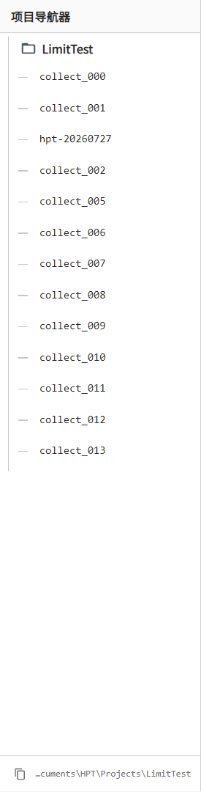

---

## 3. 项目管理

### 3.1 新建项目

1. 在欢迎页点击 **新建项目**，或从主菜单选择 **新建项目**。
2. 输入项目名称。
3. 输入保存位置，或点击文件夹按钮在应用内选择目录。
4. 点击 **创建**。创建成功后，项目会自动成为活动项目并展开导航器。

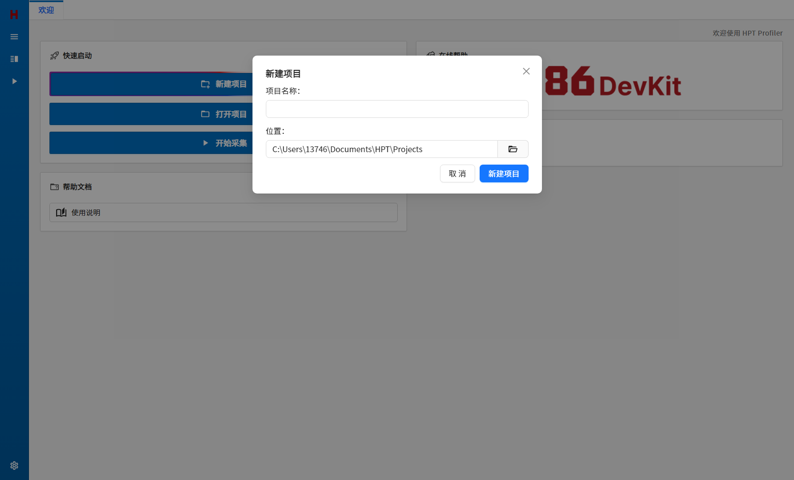

项目文件使用 `.hptproj` 扩展名，结果保存在项目目录内。请勿只移动 `.hptproj` 文件而遗漏同项目的结果目录。

### 3.2 打开与切换项目

- 选择 **打开项目**，定位到 `.hptproj` 文件。
- 欢迎页与主菜单中的 **最近项目** 可快速重新打开项目。
- 应用可同时保留多个已打开项目：
  - 单击非活动项目名称：展开或收起其结果。
  - 双击非活动项目名称：切换为活动项目。
  - 点击非活动项目中的某个结果：应用会先切换项目，再打开该结果。

### 3.3 导入独立数据库结果

1. 先打开目标项目。
2. 从主菜单选择 **导入采集结果**。
3. 在文件浏览器中选择一个 `.db` 文件（通常为 `hpt.db`）。
4. 应用会将数据库复制到当前项目的新结果目录，并自动打开结果页签。

> **注意**：当前界面的导入入口只接受 `.db` 文件。没有打开项目时，该菜单项不可用。

### 3.4 关闭项目与删除结果

- **关闭项目**：关闭当前活动项目并返回欢迎页，不删除项目文件。
- **删除结果**：在项目导航器中右键结果并确认删除。删除会移除对应结果目录，无法通过关闭页签恢复。

## 4. 配置采集位置

打开 **开始采集** 后，左侧为四步采集向导，右侧显示当前步骤的设置。

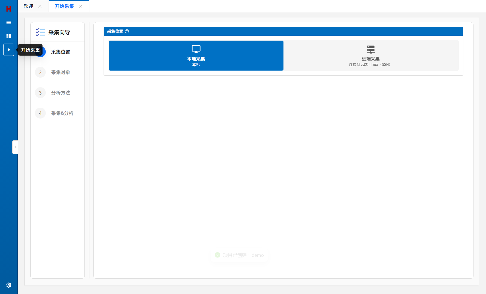

### 4.1 本地采集

选择 **本地采集** 后，命令直接在当前主机运行。开始时应用会检查 HPT 是否已安装以及版本是否满足要求；需要安装或升级时，可能请求 `sudo` 权限。

### 4.2 远端直连

1. 选择 **远端采集**。
2. 选择 **直接连接**。
3. 填写目标主机 IP 或主机名、SSH 端口与用户名。
4. 点击 **测试连接**。
5. 指示灯变绿并显示连接可用后，再继续后续步骤。

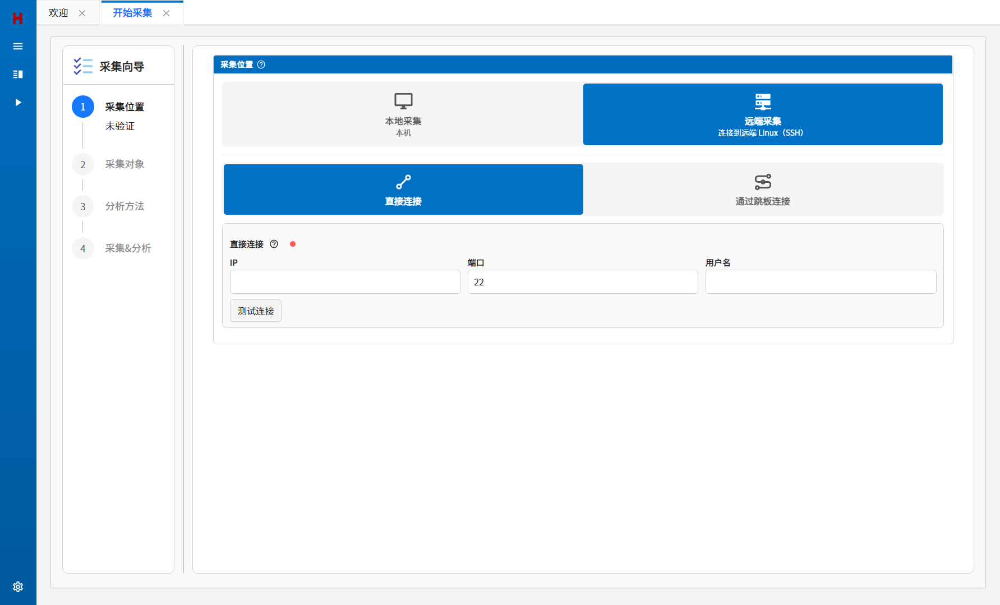

密钥认证失败时，应用会弹出密码输入框。

### 4.3 通过跳板机连接

1. 选择 **通过跳板连接**。
2. 完整填写跳板机和目标机的 IP、端口、用户名。
3. 点击 **测试跳转连接**。
4. 根据提示依次输入跳板机或目标机密码。

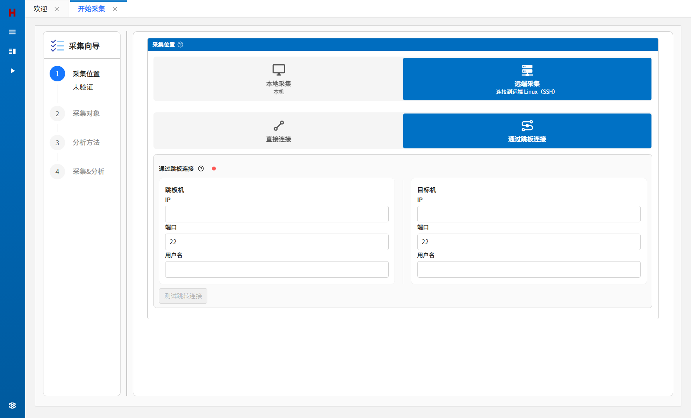

> **门禁规则**：远端连接测试未通过时，应用不会开始采集。修改任何连接信息后，请重新测试链接状态。

---

## 5. 选择采集对象

当前版本提供两种采集对象：

| 对象 | 适用场景 | 必填项 |
| --- | --- | --- |
| 系统分析 | 观察整机或指定 Core / CCX / DIE / Socket 的性能 | 无 |
| 程序分析 | 启动指定程序，并在程序运行期间采集 | 执行文件及其参数 |

### 5.1 系统分析

选择 **系统分析** 后，可在 Collect 的层级配置中选择统计所有核或指定对象，并设置结果粒度。

### 5.2 程序分析

选择 **程序分析** 后，在输入框中填写完整的执行文件及参数。路径或参数包含空格时，请按目标 Shell 的规则正确引用。

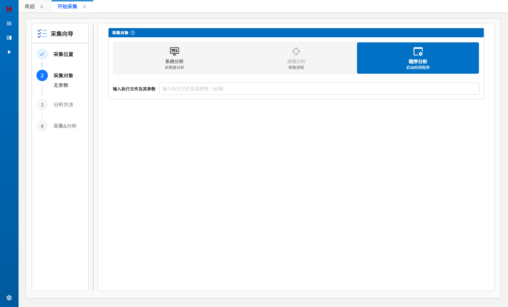

> **当前限制**：界面暂不提供“附加到正在运行进程 / PID”的进程分析入口。

---

## 6. 配置 Collect 分析

当前可用的分析方法为 `collect`，用于采集 CPU Core、L3、Data Fabric 与软件事件指标。

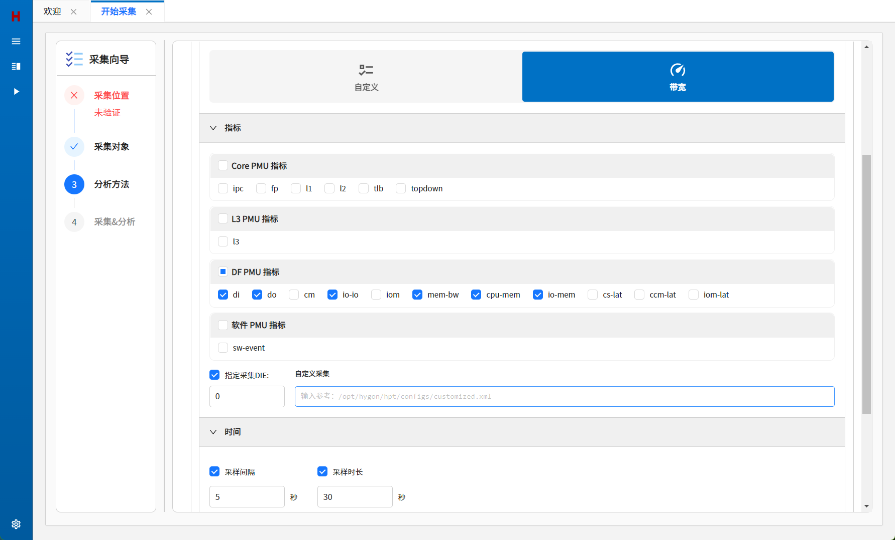

### 6.1 方案

- **自定义**：按需要选择指标。
- **带宽**：自动选中 `di`、`do`、`io-io`、`cpu-mem`、`io-mem`、`mem-bw`。
- 再次点击已选的带宽方案可取消；手动修改指标后，配置按自定义方式处理。

### 6.2 指标

| 分组 | 可选指标 |
| --- | --- |
| Core PMU | `ipc`、`fp`、`l1`、`l2`、`tlb`、`topdown` |
| L3 PMU | `l3` |
| DF PMU | `di`、`do`、`cm`、`io-io`、`iom`、`mem-bw`、`cpu-mem`、`io-mem`、`cs-lat`、`ccm-lat`、`iom-lat` |
| 软件 PMU | `sw-event` |

每组支持全选与逐项选择。也可在 **自定义采集** 中填写 XML 配置路径；填写自定义配置后，预设指标会被清空并禁用。

如只希望采集某个 DIE，可启用 **指定采集 DIE** 并填写DIE的编号。

### 6.3 时间

- **采样间隔**：命令参数 `-I`，最小 0.1 秒。
- **采样时长**：命令参数 `-d`，最小 1 秒。
- 两者可同时启用，也可按需求分别关闭。

### 6.4 层级

- **统计所有核**：生成 `-a`。
- **统计指定对象**：选择 Core / CCX / DIE / Socket，并填写一个或多个非负编号，例如 `0,1,2,4`。
- **颗粒度**：System / Core / CCX / DIE / Socket，对应输出聚合层级。
- 程序分析模式下，“统计所有核”不可用，应指定对象范围。

> **实践建议**：采样间隔越短，时间分辨率越高，但数据量和采集开销也越大。先使用默认值观察趋势，再针对短时抖动逐步缩短间隔。

## 7. 运行与监控采集

进入第四步 **采集\&分析** 后，底部会显示根据配置自动生成的 HPT 命令。

### 7.1 核对与编辑命令

- 点击复制按钮可复制命令。
- 点击编辑按钮可进入手动编辑模式；启动时将执行编辑后的命令。
- 退出编辑模式会恢复由界面配置自动生成的命令。

### 7.2 开始与停止

- 点击播放按钮开始采集。
- 运行期间配置控件被禁用，播放按钮变为停止按钮。
- 点击停止会终止当前命令；跳板机场景也会关闭关联的隧道连接。
- 连续 5 分钟没有任何输出时，应用会自动停止，避免任务永久挂起。

### 7.3 密码与安装包提示

- SSH 密码只用于当前连接，不会保存。
- 检测到 `sudo` 密码提示时，应用会打开专用密码框。
- 如果无法根据远端系统自动判断 DEB 或 RPM，应用会请求选择要上传的安装包类型。
- 取消密码输入会停止本次采集。

### 7.4 日志与状态

终端区域实时显示 HPT 与 SSH 输出，并对错误、权限和警告信息使用不同颜色。右键终端可选择 **全选** 或 **复制**。

| 状态 | 含义 |
| --- | --- |
| 正在运行 | 命令正在执行。 |
| 正在停止 | 已请求停止，等待进程结束。 |
| 正在下载数据 | 远端命令完成，正在校验并下载数据库。 |
| 采集完成 | 结果已保存并加入项目。 |
| 已停止 | 用户停止、取消密码或超时停止。 |
| 执行失败 | 命令退出码非零、检测到错误输出，或数据库校验失败。 |

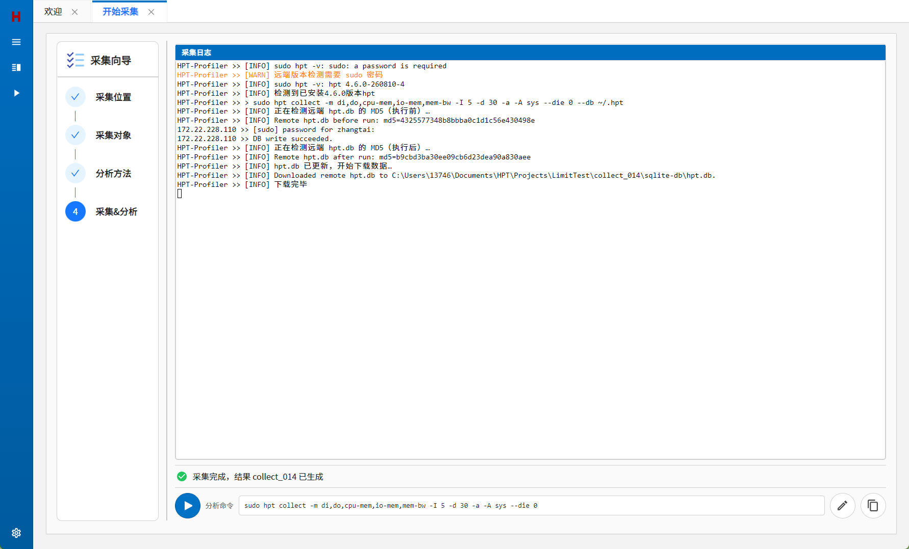

远端采集会在执行前后比较 `hpt.db` 的 MD5。若数据库未发生变化，应用会判定采集失败，不会把旧数据库误导入为新结果。

---

## 8. 打开与理解结果

采集成功后，新结果会出现在活动项目下并自动打开。本手册聚焦两个面向用户分析的页面：

1. **摘要**：采集上下文、性能预警、日志与配置快照。
2. **Collect**：指标图表、矩阵、Topdown 与内存访问拓扑。

如果结果目录缺少有效的 `sqlite-db/hpt.db`，应用只显示摘要页，以便查看仍可用的日志和元数据。

---

## 9. 摘要页

摘要页用于快速判断采集是否正确，并定位最值得继续分析的时间段。

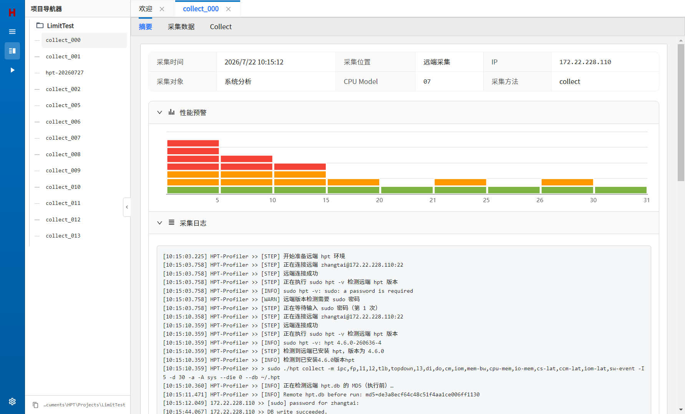

### 9.1 基本信息

顶部显示采集时间、采集位置、目标主机、采集对象、CPU Model 和分析方法。程序分析还会显示执行文件与参数。

### 9.2 性能预警

性能预警时间线汇总多个指标在各采样时刻的告警等级：

- 绿色：正常或低风险。
- 橙色：接近阈值，需要关注。
- 红色：达到较高告警水平，建议结合 Collect 视图继续定位。

告警用于缩小排查范围，不应单独作为性能结论。请结合业务负载、持续时间和相邻指标共同判断。

### 9.3 日志与配置快照

- **采集日志**：查看采集期间的完整输出。
- **Collect 配置快照**：回顾当次采集的位置、对象、指标、时间和层级配置。
- **解析警告**：数据解析存在异常时，摘要底部会列出部分告警信息。

---

## 10. Collect 分析页

Collect 页会根据数据库中实际存在的表启用指标。首次进入时默认展示 **硬件内存访问拓扑**。

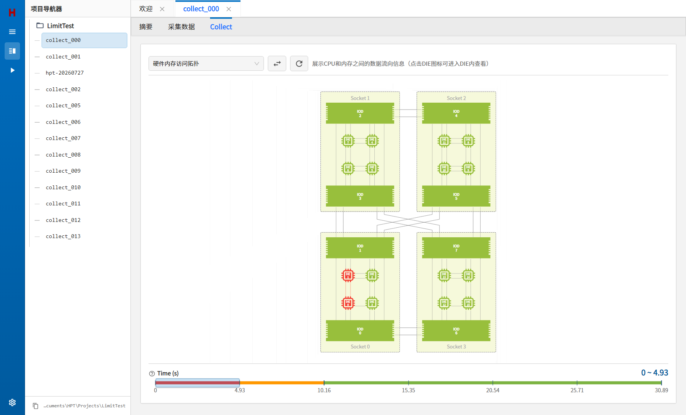

### 10.1 指标导航

通过左上方级联选择器在以下分组间切换：

- Core PMU：IPC、FP、L1、L2、TLB、Topdown。
- L3 PMU：L3。
- DF PMU：拓扑、DI/DO、CM、IOM、内存带宽、CPU/IO 访存和延迟指标。
- 软件 PMU：Software Event。

数据库中不存在对应表的指标会被禁用。指标名称旁的说明可帮助理解高值或低值的常见含义。

### 10.2 折线图与表格

- 点击右上方切换按钮，在图表与表格之间切换。
- 使用 **筛选 Level** 选择展示对象：单击单选，`Ctrl+单击` 多选，`Alt+拖动` 框选。
- 右键某个 Level 标签可只显示该系列。
- L1 / L2 / L3 使用 ACCESS、MISS RATIO、BW、MPKI 分组切换。
- `cs-lat`、`ccm-lat`、`iom-lat` 可在 LATENCY 与 REQUESTS 之间切换，再选择细分项。
- 图表支持悬停查看精确值、图例显隐和缩放。

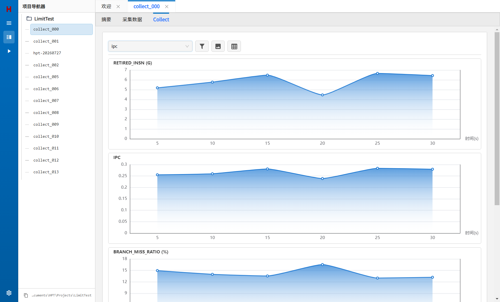

### 10.3 Topdown

Topdown 以层级图展示 Retiring、Frontend Bound、Backend Bound、Bad Speculation 等类别：

- Retiring 较高通常表示有效工作占比较高。
- Frontend Bound 较高常见于取指或解码受限。
- Backend Bound 较高可能与执行单元或内存等待有关。
- Bad Speculation 较高通常需要关注分支预测与错误推测。

可选择一个 Level，并通过时间轴查看不同采样时刻。颜色越接近告警色，异常程度通常越高。

### 10.4 矩阵热力图

`di`、`do`、`cpu-mem`、`io-mem`、`io-io` 等指标按“发出节点 × 接收节点”展示数据流向。

- 行表示发出节点，列表示接收节点。
- `cpu-mem` 可在 Cacheable 与 Non-Cacheable 间切换。
- `cpu-mem`、`io-mem`、`io-io` 支持 **阈值占比** 与 **实际带宽** 两种视图。
- 拖动时间轴或滚动滚轮可切换采样时刻。

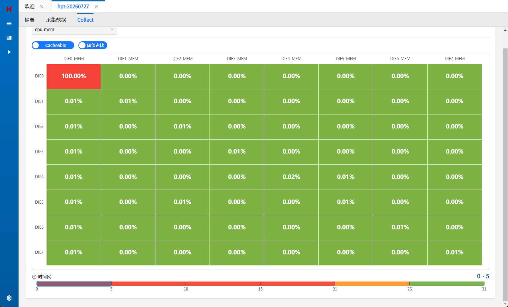

### 10.5 硬件内存访问拓扑

硬件拓扑展示 Socket、IOD、DIE、内存等物理关系，并将动态带宽或中断数据叠加到连线上。

- 点击 DIE 节点进入 DIE 内拓扑。
- 在任意位置右键，或点击返回按钮，回到上一级。
- 点击重置视口，使拓扑重新适配窗口。
- `Ctrl + 滚轮` 缩放；普通滚轮前后切换时间。
- 橙色表示达到约 85% 的告警阈值，红色表示达到约 95% 或更高。

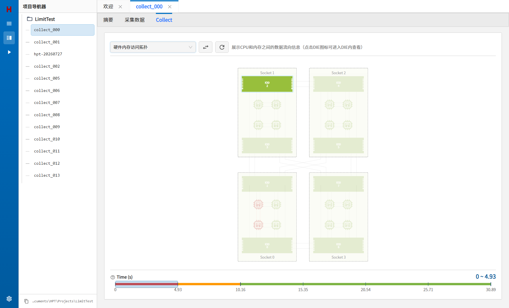

### 10.6 软件内存访问拓扑

软件拓扑不受物理连线限制，只在当前时间点存在数据时显示逻辑数据流。

- **带宽阈值预警**：按每条链路相对阈值着色。
- **DIE 间带宽对比**：汇总每个 DIE 的相连链路带宽，以右下角书签标注排名；数字 1 表示带宽最高。
- 节点右上角的阈值告警与右下角的排名标记可以同时出现。

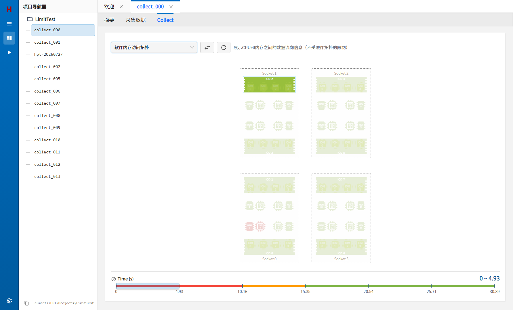

### 10.7 DIE 内拓扑

DIE 内视图继续展示 CCM、Layer、CS、UMC 等节点以及读写方向数据。返回上级后，原有硬件拓扑视图会恢复。

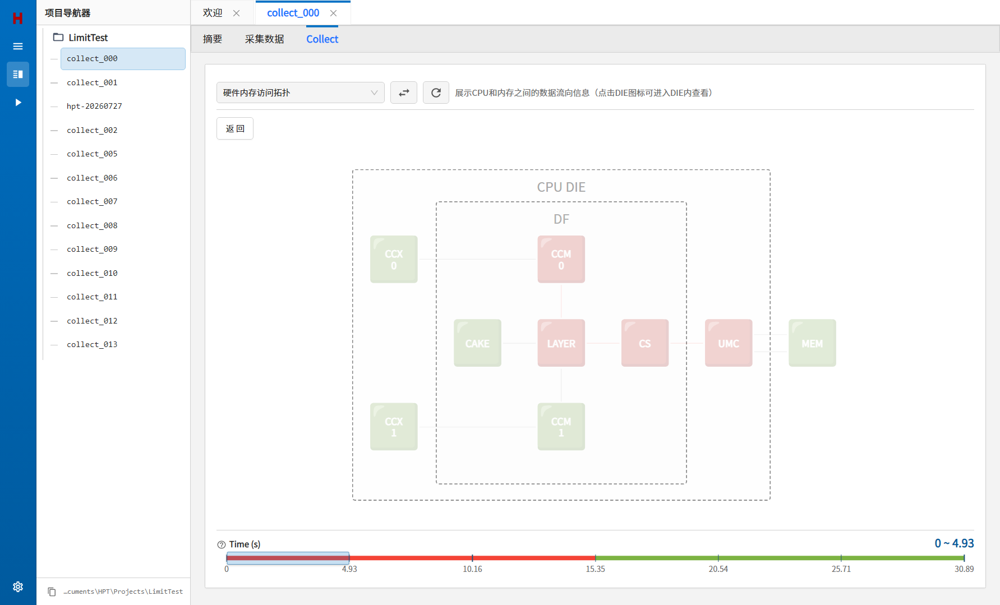

---

## 11. 选项与快捷键

点击左下角齿轮，或从主菜单选择 **选项**。

### 11.1 主题与语言

- 主题：浅色模式 / 深色模式（暂不可用） 。
- 语言：简体中文 / English。
- 保存后立即生效，并在下次启动时恢复。

### 11.2 快捷键

快捷键按拓扑图、矩阵图和 Topdown 分组。点击现有按键进入录制状态，然后按新的键盘组合或滚动滚轮；按 `Esc` 取消。

| 视图 | 动作 | 默认快捷键 |
| --- | --- | --- |
| 拓扑图 | 放大 / 缩小 | `Ctrl + Wheel↑` / `Ctrl + Wheel↓` |
| 拓扑图 | 时间轴前移 / 后移 | `Wheel↑` / `Wheel↓` |
| 矩阵图 | 时间轴前移 / 后移 | `Wheel↑` / `Wheel↓` |
| Topdown | 时间轴前移 / 后移 | `Wheel↑` / `Wheel↓` |

如果两个动作使用相同组合，设置页会显示冲突提示。点击 **全部恢复默认** 可还原所有绑定。

## 12. 指标速查

| 指标 | 主要用途 | 常见解读方向 |
| --- | --- | --- |
| IPC | 每周期执行指令数 | 低值可能对应流水线停顿或内存等待。 |
| FP | 浮点运算活动 | 高值常见于浮点计算密集负载。 |
| L1 / L2 / L3 | 缓存访问、缺失与带宽 | Miss 增加通常会把压力传递到更低层缓存或内存。 |
| TLB | 地址转换缓存 | Miss 较高可能触发更多页表遍历。 |
| Topdown | 微架构瓶颈分类 | 联合观察 Retiring、Frontend、Backend 与 Bad Speculation。 |
| DI / DO | DIE 间输入与输出 | 用于发现跨 DIE 通信与 Fabric 压力。 |
| CM | 一致性内存 / 缓存缺失流量 | 高值可能表示一致性通信频繁。 |
| IOM | IO 与内存流量 | 用于观察 DMA / IO 活跃度。 |
| mem-bw | 内存带宽 | 接近平台上限时，负载可能受 DRAM 吞吐限制。 |
| cpu-mem | CPU 到内存请求 | 高值常见于 memory-bound 负载。 |
| io-mem / io-io | IO 到内存 / IO 间流量 | 用于识别 IO 子系统与内存控制器压力。 |
| cs-lat / ccm-lat / iom-lat | 一致性或 IO 访问延迟 | 结合请求数量判断是延迟升高还是负载增加。 |
| sw-event | 调度、缺页等软件事件 | 上下文切换、缺页或迁移过多可能影响局部性与吞吐。 |

> **分析原则**：任何单一指标都只能提供线索。优先从摘要页定位异常时间段，再在 Collect 中联合观察计算、缓存、内存、互连和软件事件。

---
