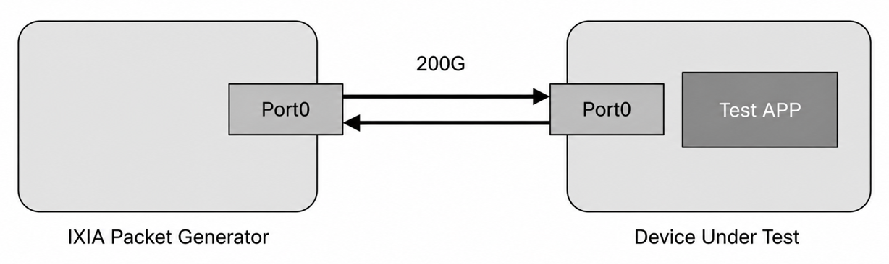

# 海光平台DPDK 部署与性能优化指南

## 1. 简介

DPDK（Data Plane Development Kit）广泛应用于网络转发、虚拟交换机、网络安全及云计算等高性能网络场景。为了充分发挥 DPDK 的性能，不仅需要正确构建和部署运行环境，还需要结合处理器架构、NUMA 拓扑、BIOS 配置、Linux 系统参数以及网卡配置等进行合理优化。

本文档面向海光（Hygon）平台，介绍 DPDK 应用的环境搭建及性能优化方法，内容涵盖环境准备、依赖软件安装、DPDK 编译、平台配置以及性能测试，帮助用户在海光平台上完成 DPDK 环境部署，并获得更优的网络数据包处理性能。

## 2. DPDK 概述

DPDK是一套面向高性能数据包处理的用户态开发框架，提供了高效的内存管理、网络设备驱动及数据包处理库，广泛应用于高吞吐、低时延网络应用开发。

与传统网络应用不同，DPDK 将网络数据包直接收发至用户态应用程序，减少了内核协议栈处理、上下文切换以及数据拷贝等额外开销。同时，DPDK 采用 Poll Mode Driver（PMD）持续轮询网卡接收队列，而非依赖中断方式处理数据包，从而降低中断处理开销，提高网络吞吐能力，并获得更加稳定的处理时延。

DPDK 的性能不仅取决于应用程序本身，还与硬件平台和系统配置密切相关。合理配置处理器、内存、NUMA、Linux 系统及网卡参数，是充分发挥 DPDK 性能的重要前提。

## 3. 环境准备

本章介绍本文档使用的软硬件环境，并说明 DPDK 编译所需的软件依赖。

### 3.1 测试环境

本文档使用如下软硬件环境进行验证。

| **项目** | **配置** |
|----|:--:|
| **CPU** | Hygon C86 7447V |
| **RAM** | 24 × 32 GB DIMMs @ 6000 MHz |
| **BIOS** | CSQH051011 |
| **Operating System** | Ubuntu 22.04.4 LTS (Jammy Jellyfish) |
| **Kernel version** | 5.15.0-94-generic |
| **NIC** | MCX755106AS-HEAT NVIDIA ConnectX-7 HHHL Adapter Card, 200GbE / NDR200 IB, Dual-port QSFP112 |
| **NIC Firmware version** | 28.40.1000 |
| **DOCA version** | 2.9.3-0.2.2 |
| **DPDK version** | 23.11.6 |
| **GCC version** | GCC 12.3.0 (Ubuntu 12.3.0-1ubuntu1~22.04.3) |

### 3.2 安装软件依赖

DPDK 使用 Meson 和 Ninja 构建系统进行编译。在 Ubuntu 22.04 上，可通过以下命令安装 DPDK 编译所需的软件依赖：

```bash
sudo apt update
sudo apt install python3-pyelftools libnuma-dev meson pkg-config libpcap-dev
```

## 4. DPDK 编译

本章介绍 DPDK 的获取及编译过程。

### 4.1 获取 DPDK 源码

从 DPDK 官方网站下载对应版本源码，并解压。

```bash
wget https://fast.dpdk.org/rel/dpdk-23.11.6.tar.xz
tar -xf dpdk-23.11.6.tar.xz
cd dpdk-stable-23.11.6
```

### 4.2 编译 DPDK

本文档使用 GCC 12 编译 DPDK。

```bash
CC=gcc-12 meson build -Dmax_numa_nodes=12 -Dmax_lcores=384 -Dexamples=all
ninja -C build
```

## 5. 系统配置

本章介绍海光平台运行 DPDK 前推荐的系统配置，包括 BIOS 配置、Linux OS 配置和 ConnectX-7 网卡配置。

### 5.1 BIOS 配置

为了获得更好的 DPDK 性能，建议根据实际平台配置 BIOS 相关选项。

本文档推荐配置如下：

- Chipset -\> Core Common Options -\> Core Performance Boost \[Enabled\]
- Chipset -\> Core Common Options -\> CPU C-state Control \[Enabled CC6\]
- Chipset -\> Core Common Options -\> SMT Control \[Disabled\]
- Chipset -\> NBIO Common Options -\> IOHC DPM Cntl \[Disabled\]

完成 BIOS 配置后，保存配置并重新启动系统。

### 5.2 Linux OS 配置

为了获得更好的 DPDK 性能，建议通过 Linux Kernel 启动参数完成系统配置。

编辑 /etc/default/grub 文件，修改 GRUB\_CMDLINE\_LINUX\_DEFAULT，增加如下启动参数：

```
default_hugepagesz=1G hugepagesz=1G hugepages=48 isolcpus=176-191 nohz_full=176-191 rcu_nocbs=176-191 \
    transparent_hugepage=never numa_balancing=disable amd_iommu=on iommu=pt
```

修改完成后，执行以下命令更新 GRUB 配置并重新启动系统：

```bash
sudo update-grub
sudo reboot
```

系统启动后，停止 `irqbalance` 服务，避免系统自动调整中断亲和性：

```bash
sudo systemctl stop irqbalance
```

关闭 Linux realtime throttling：

```bash
echo -1 > /proc/sys/kernel/sched_rt_runtime_us
```

### 5.3 ConnectX-7 网卡配置

NVIDIA ConnectX-7 网卡使用 DPDK `mlx5` Poll Mode Driver（PMD），无需绑定至 `vfio-pci` 或其他用户态驱动。

关闭网卡流量控制：

```bash
ethtool -A <interface> rx off tx off
```

设置网卡CQE Compression 为 **AGGRESSIVE** 模式：

```bash
mlxconfig -d <PCIe Address> set CQE_COMPRESSION=1
```

设置网卡PCIe MaxReadReq 为 4096 Bytes：

```bash
setpci -s <PCIe Address> 68.w=5957
```

## 6. 性能测试

本章介绍 L3fwd 和Testpmd 两种典型 DPDK 应用的性能测试方法及测试结果。

### 6.1 测试环境



上图展示了本文档性能测试所采用的网络拓扑。测试系统由 IXIA Packet Generator 和 Device Under Test（DUT） 两部分组成。DUT 采用海光平台服务器，并配置 NVIDIA ConnectX-7 Dual-Port 200GbE 网卡，测试过程中仅使用其中一个端口，通过一条 200GbE 链路与 IXIA Packet Generator 直接互连。IXIA Packet Generator 负责生成和接收测试流量，并统计报文发送率、接收率、吞吐率及丢包率等性能指标。DUT 运行待测 DPDK 应用程序（如 L3fwd 或 testpmd），接收来自网卡的数据包，经 DPDK处理后再通过同一网卡端口转发回IXIA。本文档中每种报文长度测试时长60秒，测试过程中使用包含 240 个 IP 流的测试流量，最终由IXIA统计测试期间的平均Million Packets Per Second（Mpps）及%Line Rate。

### 6.2 L3fwd 性能测试

#### 6.2.1 测试配置

修改 `examples/l3fwd/l3fwd.h` 中的如下宏定义，并重新编译：

```c
#define RX_DESC_DEFAULT      2048
#define TX_DESC_DEFAULT      1024
#define MAX_PKT_BURST         256
#define MEMPOOL_CACHE_SIZE    512
#define NB_SOCKETS RTE_MAX_NUMA_NODES
```

使用网卡亲和NUMA节点上的16个物理核，每个核处理一个队列。

```bash
sudo chrt -r 99 ./dpdk-l3fwd -a 95:00.0,txq_inline_mpw=128,mprq_en=1,rxqs_min_mprq=1,mprq_log_stride_num=9,rxq_pkt_pad_en=1 \
    -l 176-191 -- -p 0x1 \
    --config="(0,0,176),(0,1,177),(0,2,178),(0,3,179),(0,4,180),(0,5,181),(0,6,182),(0,7,183),(0,8,184),(0,9,185),(0,10,186),(0,11,187),(0,12,188),(0,13,189),(0,14,190),(0,15,191)" –P
```

#### 6.2.2 性能测试结果

**表1：L3fwd 性能测试结果**

| **Frame Size (Bytes)** | **Frame Rate (Mpps)** | **% Line Rate** |
|------------------------|:---------------------:|:---------------:|
| **64**                 |        265.94         |      89.35      |
| **128**                |        168.92         |     100.00      |
| **256**                |         90.58         |     100.00      |
| **512**                |         46.99         |     100.00      |
| **1024**               |         23.94         |     100.00      |
| **1280**               |         19.23         |     100.00      |
| **1518**               |         16.25         |     100.00      |

### 6.3 testpmd 性能测试

#### 6.3.1 测试配置

使用网卡所在 NUMA 节点上的单个物理核处理3个队列。

```bash
sudo ./dpdk-testpmd -l 176-177 -a 95:00.0 -- --burst=256 --txd=1024 --rxd=1024 --mbcache=512 --rxq=3 --txq=3 --nb-cores=1 -a -i
```

#### 6.3.2 性能测试结果

**表2：testpmd 性能测试结果**

| **Frame Size (Bytes)** | **Frame Rate (Mpps)** | **% Line Rate** |
|------------------------|:---------------------:|:---------------:|
| **64**                 |         86.96         |      29.22      |
| **128**                |         84.63         |      50.10      |
| **256**                |         81.59         |      90.08      |
| **512**                |         46.99         |     100.00      |
| **1024**               |         23.94         |     100.00      |
| **1280**               |         19.23         |     100.00      |
| **1518**               |         16.25         |     100.00      |
