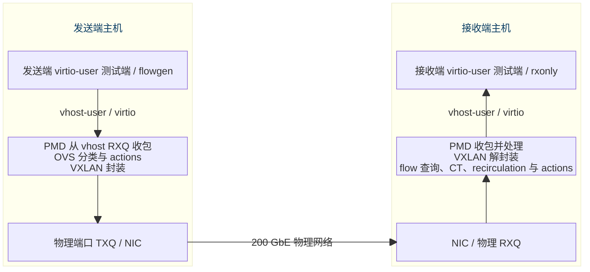
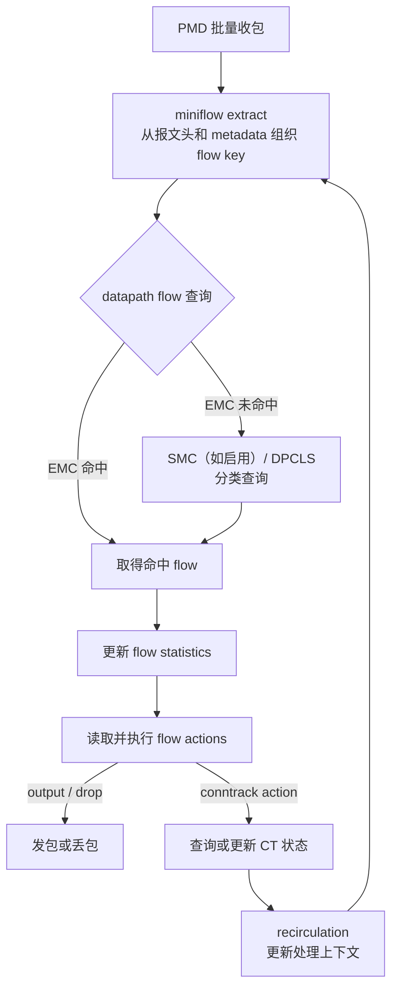
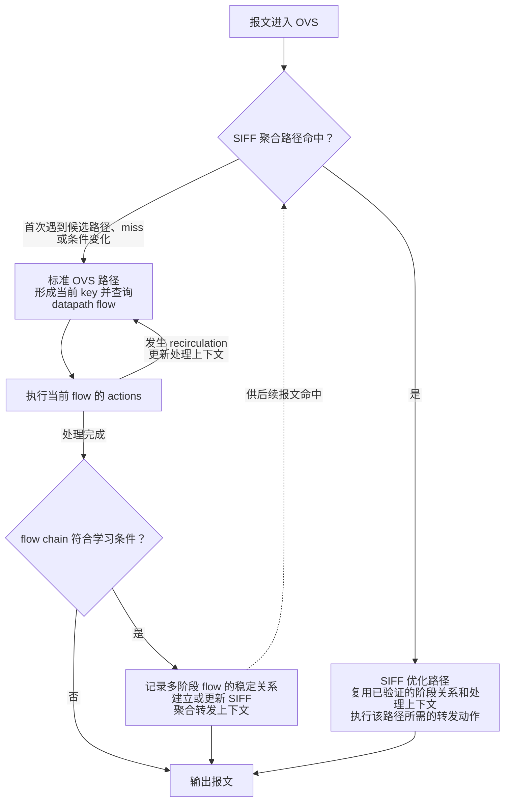

# 海光平台 OVS-DPDK 部署与性能优化指南

## 1. VXLAN 场景概述

Open vSwitch（OVS）是一款面向虚拟化环境的开源虚拟交换机，可连接虚拟机、容器、物理网口和隧道端口，并根据流表完成报文分类与转发。在云计算网络中，OVS 通常部署在计算节点或网络节点上，承担虚拟工作负载接入、虚拟网络互通以及物理网络连接等功能。

OVS-DPDK 使用 OVS 用户态 `netdev` datapath，由 OVS PMD 线程持续轮询分配给它的物理端口和 vhost-user 端口收包队列。结合用户态收发、批量处理、大页内存以及 vhost-user/virtio，数据面可以降低传统内核转发路径中的中断和调度开销，适用于吞吐和时延要求较高的虚拟网络场景。其性能同时受到处理器拓扑、内存位置、队列配置、缓存效率和软件处理路径的影响。

VXLAN 是云网络中常用的 overlay 隧道技术。它将租户侧二层报文封装在 UDP/IP 报文中，通过现有三层物理网络（underlay）在不同宿主机之间传输，并使用 VXLAN Network Identifier（VNI）区分逻辑网络。在典型部署中，OVS 可以作为软件 VXLAN Tunnel Endpoint（VTEP）：发送端将来自虚拟端口的报文封装后送入物理网络，接收端完成解封装，再将原始报文交付给目标虚拟端口。

实际云网络通常还需要安全组、状态防火墙等有状态处理能力。OVS conntrack（CT）用于记录和查询连接状态，使流表能够区分新建连接和已建立连接。报文执行 CT action 后可能携带更新后的状态通过 recirculation 再次进入分类路径，因此 VXLAN+CT 相比简单二层或三层转发包含更多状态访问、流表查询和 actions 执行过程。

本文面向海光 C86 7447V 平台上的 VXLAN+CT 场景，重点关注已经完成连接跟踪并进入稳态转发阶段的持续流量，典型匹配为 `ct_state=+trk+est`。本文介绍系统与队列配置、海光平台通用开放优化、SIFF 稳态流加速原理、部署方法及参考性能。

## 2. VXLAN+CT 数据路径

### 2.1 端到端报文路径

本次验证采用双机单向流量。发送端生成 TCP 多流，经本机 OVS 封装为 VXLAN 报文；接收端完成解封装、conntrack 和流表处理后，将报文通过 vhost/virtio 送入 host 上的 virtio-user 测试端。该测试端用 testpmd 模拟 VM 端口。



NIC、OVS 与 virtio-user/虚拟机端口之间的报文传递是这条数据路径的必要组成部分。PMD 负责轮询分配给自己的物理或 vhost RXQ；完成 OVS 分类和 actions 后，当前处理路径再将报文发送到物理端口 TXQ 或 vhost 队列。

### 2.2 报文进入 OVS 后的执行路径

报文被 PMD 收取后，OVS 需要从报文头和 metadata 中提取用于分类的信息，形成 flow key，随后查询 datapath flow 并执行对应 actions。包含 conntrack 的 actions 可能更新连接状态，并通过 recirculation 让报文携带新的上下文再次进入分类路径。



从这条执行路径看，主要的处理开销来自：

1. **miniflow extract 与 flow key 组织**：每次进入分类路径时，都需要读取报文头和 metadata，并准备后续查询使用的 key；
2. **流表查询与 actions 执行**：根据 key 查询 EMC，未命中时继续进入 SMC（如启用）或 DPCLS；取得命中 flow 后更新 statistics，并读取和执行对应 actions；
3. **conntrack 与 recirculation**：conntrack 本身会带来不小的处理开销；查询或更新连接状态后，recirculation 还可能使同一报文带着新的上下文再次执行 miniflow extract、flow 查询和 actions。

## 3. 优化方案

方案由共同的系统调优和软件调优组成：

- **共同基础**：NUMA 局部性、CPU 隔离、大页、网卡和队列配置，以及基于 DPDK 23.11.5 的 vhost 接口调优；
- **通用优化路线**：改善批处理效率和数据访问局部性，适用于海光平台的 OVS-DPDK 数据路径；
- **SIFF 路线**：SIFF（Streamlined Integrated Forwarding Framework）是海光自研的实验性流表软件加速方案，针对符合条件的稳态复杂流减少重复处理。

本次测试中的通用优化版本与 SIFF 版本是两条独立的项目构建路线。

### 3.1 保持 NUMA 局部性

NUMA 规划是部署 OVS-DPDK 的第一优先级。对于本次单端口高负载场景，可从以下布局开始验证；生产环境仍需根据端口数、队列负载和工作负载调整：

- 本次测试将物理网口 RXQ 与对应 PMD 一一绑定；
- 物理收包 PMD 和网卡尽量位于同一 NUMA 节点；
- 系统服务、中断和普通业务线程避开 PMD 专用核。

### 3.2 系统与内存配置

建议将 PMD 核从普通调度和 RCU 回调中隔离，并根据业务容量预留大页。下面仅展示参数形式，实际核号和大页数量必须按部署环境计算：

```text
isolcpus=<pmd_cores> nohz_full=<pmd_cores> rcu_nocbs=<pmd_cores>
default_hugepagesz=1G hugepagesz=1G hugepages=<capacity>
transparent_hugepage=never numa_balancing=disable
```

本次采用的 BIOS 参考配置为 Core Performance Boost `Enabled`、CPU C-state `Enabled CC6`、SMT `Disabled`、IOHC DPM `Disabled`。

### 3.3 NVIDIA ConnectX-7 网卡配置

NVIDIA ConnectX-7 网卡使用 DPDK `mlx5` Poll Mode Driver（PMD），无需绑定至 `vfio-pci` 或其他用户态驱动。

关闭网卡流量控制：

```bash
ethtool -A <interface> rx off tx off
```

设置网卡 CQE Compression 为 AGGRESSIVE 模式：

```bash
mlxconfig -d <PCIe Address> set CQE_COMPRESSION=1
```

本次测试的 PCIe MaxReadReq 为 4096 B。可用以下命令只读核对输出中的 `DevCtl` / `MaxReadReq`；如需调整，请使用网卡和整机厂商支持的方法，不要照搬其他设备的寄存器偏移或写入值。

```bash
UNDERLAY_PCI=REPLACE_WITH_LOCAL_NIC_BDF  # ethtool -i <测试网口> 输出中的 bus-info
lspci -vv -s "${UNDERLAY_PCI}"
```

### 3.4 海光平台通用开放优化

通用优化路线在报文解析、分类、动作执行和 vhost 数据搬运阶段改善批处理效率与数据访问局部性。

本次对比版本的关键差异如下。`MAX_BATCH_LEN=1518` 是 Baseline、通用优化和 SIFF 三个版本共同使用的海光平台 split ring 基础配置。

| 项目 | Baseline | 通用优化 | SIFF |
| --- | ---: | ---: | ---: |
| DPDK Memcpy Prefetch | 关闭 | 开启 | 开启 |
| OVS 报文、EMC、flow 和 actions 预取 | 默认路径 | 启用下述优化 | 默认路径 |
| DPDK `MAX_BATCH_LEN` | 1518 | 1518 | 1518 |
| OVS 编译器指令集目标 | `-O3` | `-O3 -mavx2` | `-O3 -mavx2` |

#### 3.4.1 split ring 的 batch-copy 路径

该阈值位于 DPDK 23.11.5 的 `lib/vhost/virtio_net.c`，参数名为 `MAX_BATCH_LEN`。DPDK 原始值为 256，本文 Baseline、通用优化和 SIFF 均改为 1518。`sync_fill_seg()` 使用该参数判断当前 `cpy_len` 是立即复制，还是先记录到 `batch_copy_elems` 并由 `do_data_copy_enqueue()` 集中复制：

```text
分段长度大于 MAX_BATCH_LEN，或 batch-copy 元素数组已满
  → 立即执行 memcpy

分段长度不大于 MAX_BATCH_LEN，且 batch-copy 元素数组仍有空间
  → 记录 batch-copy 元素
  → 随后集中执行 memcpy
```

这里比较的是每次复制分段的长度，而不是完整帧长。海光平台将 `MAX_BATCH_LEN` 设置为 1518。

#### 3.4.2 报文预取

报文进入 `miniflow` 提取前，需要访问报文数据和 metadata。默认的短距离预取可能来不及覆盖内存访问延迟，因此通用优化在处理当前报文时，提前准备批次中更靠后的报文，使处理器在执行中间报文的同时发起后续数据访问，从而降低报文解析阶段的等待。

#### 3.4.3 EMC 缓存项预取

当报文携带有效 RSS hash 时，通用优化复用该 hash，并结合 recirculation 上下文，提前计算后续报文可能访问的 EMC entry，RSS hash 无效时自然跳过，不额外执行完整软件 hash。

这一优化主要用于降低 EMC 正式查找时的缓存等待。

#### 3.4.4 AVX2 编译器指令集优化

通用优化版本将 OVS 编译参数更新为 `-O3 -mavx2`。这是编译器代码生成阶段的指令集目标，使编译器能够在适合的代码段使用 AVX2 指令，AVX2 的收益主要集中在 1024 B。

#### 3.4.5 多个活跃 datapath flow 场景下的 statistics 与 actions 预取

分类完成后，OVS 会按照命中的 flow 形成 per-flow batch，然后更新 statistics 并执行 actions。当一个报文批次分散命中多个不同的活跃 datapath flow 时，该批次会拆分为多个较小的 per-flow batch，后续 flow、statistics 和 actions 对象更容易发生缓存未命中。因此，收益取决于活跃 flow 工作集和单批报文的 flow 分散程度，而不只取决于 datapath flow 的总数。

`ovs-appctl upcall/disable-megaflows` 可用于构造大量精确 datapath flow 的调试或专项测试场景，仅用于构造模拟场景。

通用优化在处理当前 per-flow batch 时，提前准备后续 batch 的 flow statistics 和 actions。该优化主要面向多个活跃 datapath flow 形成小 per-flow batch 的场景，少量稳定流下的收益可能不明显。

#### 3.4.6 Memcpy Prefetch

Memcpy Prefetch 优化 DPDK vhost split-ring 批量复制时对目的地址的访问。复现本文测试，需要使用**包含该补丁**的 DPDK 23.11.5 源码。补丁提供编译期开关 `VHOST_BATCH_COPY_PREFETCH`，默认关闭；通用优化和 SIFF 测试使用同一份以 `-Dc_args=-DVHOST_BATCH_COPY_PREFETCH=1` 构建的 DPDK，Baseline 保持关闭。在未打补丁的原版 DPDK 上，仅添加这个宏不会启用预取。

上述 DPDK 参数和预取开关均在编译期生效。修改或切换后需要重新编译并安装对应 DPDK；若 OVS 静态链接 DPDK，还需要重新编译 OVS。

### 3.5 SIFF 稳态流加速

SIFF（Streamlined Integrated Forwarding Framework）是海光自研的流表软件加速方案。它面向包含 conntrack 和 recirculation 的稳态复杂流，通过聚合同一转发路径上的多个 datapath flow 处理阶段，减少报文重复执行完整分类和查询链路的开销。

#### 3.5.1 从多阶段查询到 flow chain 聚合

报文进入 OVS 后，数据路径根据报文头和 metadata 形成 flow key，并据此查询 datapath flow。取得命中 flow 后，OVS 执行对应的 actions。如果 actions 更新了连接状态或其他处理上下文，并触发 recirculation，报文会携带新的 `ct_state`、`recirc_id` 或其他 metadata 再次进入分类路径。

由于处理上下文已经变化，OVS 需要重新组织 flow key 并再次查表。同一个报文因此可能在不同阶段依次命中多个 datapath flow，形成一条多阶段 flow chain。标准 OVS 按阶段完成 key 提取、datapath flow 查询和 actions 执行；SIFF 则对符合条件、处理关系已经稳定的 flow chain 进行逻辑聚合，将其中可复用的信息组织为聚合转发上下文。

首次遇到该候选路径的报文、SIFF miss 或处理条件变化时，报文仍经过标准 OVS 路径。标准路径处理完成后，SIFF 可以学习多个处理阶段之间已经验证的稳定关系。下图以发生两次 recirculation、依次命中 Flow A、Flow B 和 Flow C 为例，并与后续稳态报文命中 SIFF 的路径进行对比：

```text
首次遇到候选路径的报文或 SIFF miss

报文 → Flow A → recirculation → Flow B → recirculation → Flow C → 输出
           └──────── 学习稳定的多阶段处理关系 ────────────────┘
                                    │
                                    ▼
                         SIFF 聚合转发上下文
                       [Flow A + Flow B + Flow C]

后续符合条件的稳态报文

报文 → SIFF 命中 → 复用聚合转发上下文 → 执行必要处理 → 输出
             │
             └─ 条件变化或 miss → 回到标准 OVS 路径
```

图的上半部分表示标准 OVS 逐阶段处理形成的 flow chain，下半部分表示后续稳态报文复用 SIFF 聚合转发上下文。Flow A、Flow B 和 Flow C 是数据路径在不同处理阶段命中的底层 datapath flow 项，不是三条不同的业务连接，也不一定分别对应三条人工配置的 OpenFlow 规则。实际经过的阶段数量由流表和 actions 决定；不触发 recirculation 的简单路径可能只需要一次查询。

可以把 recirculation 理解为：同一个报文带着上一阶段产生的新状态回到分类入口；由于携带的状态发生变化，下一阶段可能命中不同的 datapath flow。SIFF 在确认这条多阶段路径已经稳定后，复用已经验证的阶段关系和处理上下文，从而减少逐阶段重复分类和查询的开销。

#### 3.5.2 学习、命中与回退边界

SIFF 与标准 OVS 数据路径的关系如下：

1. 首次遇到候选路径的报文、SIFF miss、状态变化或不满足条件的报文仍进入标准 OVS 数据路径；
2. 标准路径处理完成后，对符合条件的多阶段 flow chain 学习并记录可复用的处理上下文；
3. 后续报文稳定命中时，复用已经验证的聚合转发上下文；
4. 未命中或处理条件发生变化时，回退到标准路径并根据需要重新学习。

对应的执行关系如下。该图在 3.5.1 概念对比的基础上，进一步展开 SIFF 命中、标准 OVS 处理循环、学习条件判断和回退路径：



\*\*TCP 序号检查的边界：\*\*启用 SIFF PMD offload 后，同一 datapath 的 conntrack 实例会跳过 TCP 序号/窗口检查。即使报文没有命中 SIFF、回到原生 OVS 路径，只要使用这个实例，也受该设置影响。如果业务依赖原生 TCP 序号/窗口检查，应保持 PMD offload 关闭。软件包接入和启用方法见附录 B。

## 4. 部署与验证

本节保留理解并使用方案所需的拓扑、关键参数、部署顺序和基本确认方法。可直接复制的构建、建桥、流表和 testpmd 完整命令集中在附录 C。

### 4.1 参考拓扑与主机角色

实验由两台通过单端口 200 GbE 链路直连的主机组成。发送端产生 4096 条 TCP 流，接收端执行 VXLAN 解封装、conntrack 和 vhost 转发。两端使用相同的三桥结构，CT 规则配置在接收端。下表和附录 C 使用示例地址，仅用于隔离实验网络。

| 参数 | 发送端主机 A | 接收端主机 B |
| --- | --- | --- |
| 角色 | testpmd `flowgen` | testpmd `rxonly` |
| 物理端口 PCI 地址 | `<发送端网卡 PCI 地址>` | `<接收端网卡 PCI 地址>` |
| underlay 地址 | `192.0.2.1/24` | `192.0.2.2/24` |
| VXLAN `remote_ip` | `192.0.2.2` | `192.0.2.1` |
| `br-int` 本地地址 | `198.51.100.1/24` | `198.51.100.2/24` |
| virtio 队列 | 15 | 15 |
| virtio ring / queue size | split ring / 1024 | split ring / 1024 |

每台主机的网桥和端口作用如下：

| 组件 | 端口 | 作用 |
| --- | --- | --- |
| `br-dpdk` | `dpdk0` | 连接 200 GbE 物理端口，承载 VXLAN underlay |
| `br-dpdk` | local/internal port | 配置本机 underlay 地址 |
| `br-int` | `vxlan0`、`ptap1` | 完成 VXLAN 与内部 patch port 之间的转发 |
| `br-int` | local/internal port | 配置本机内部参考地址 |
| `br-ply` | `ptap1-int`、`vhost0` | 连接内部 patch port 与 virtio/vhost 测试端 |
| patch pair | `ptap1` ↔ `ptap1-int` | 连接 `br-int` 和 `br-ply` |

发送方向的路径为：

```text
主机 A virtio/vhost
  → br-ply → patch port → br-int → vxlan0
  → br-dpdk/dpdk0 → 200 GbE 物理链路
  → 主机 B dpdk0/br-dpdk → vxlan0 → br-int
  → patch port → br-ply（conntrack）→ vhost/virtio
```

### 4.2 部署前检查与关键配置

部署前先识别处理器和 NIC 拓扑：

```bash
lscpu -e=CPU,NODE,SOCKET,CORE,ONLINE
numactl --hardware

NET_INTERFACE=your_interface_name
cat "/sys/class/net/${NET_INTERFACE}/device/numa_node"
```

根据输出规划物理 RXQ PMD、独立 vhost PMD、VM 或测试端 vCPU，以及 OVS 管理核，并按第 3.2 节配置 CPU 隔离和大页。各线程使用的 CPU 不应重叠；写入 `pmd-cpu-mask` 的 CPU 必须覆盖 RXQ affinity 中引用的全部 PMD 核。

部署时重点保持以下配置关系：

| 配置项 | 建议口径 |
| --- | --- |
| 软件版本 | 使用对应的 OVS、DPDK 优化源码并安装到独立前缀，避免混用系统自带 OVS |
| 物理端口 | RXQ 数量与物理 PMD 数量配套，并优先绑定到 NIC 本地 NUMA 节点 |
| vhost 端口 | 使用独立 PMD；virtio 与 vhost 的队列数保持一致 |
| RXQ descriptor | 可从 256 开始，并在保持其他条件不变时进行调优 |
| virtio | 15 队列、split ring、queue size 1024 |
| 测试流量 | 4096 条 TCP 流；本文公开 64 B 和 1024 B 两种典型包长 |

`n_rxq` 表示 RXQ 数量，`n_rxq_desc` 表示每个接收队列的 descriptor 深度。改变 RXQ 数量时，需要同步调整物理 PMD 列表、`pmd-cpu-mask` 和 affinity；比较不同源码版本时，这些运行参数必须保持一致。

### 4.3 部署流程

推荐按以下顺序部署：

1. 完成第 3.2～3.3 节的系统、大页和网卡配置，确认 CPU、NUMA 与 NIC 拓扑。
2. 选择一种构建：通用优化版本按附录 C.1 安装；SIFF 版本准备与发布包匹配的 DPDK，再按附录 B 构建 OVS。两种 OVS 安装到不同目录。
3. 初始化 OVSDB，写入 DPDK 和 PMD mask 配置后启动 `ovs-vswitchd`；完整命令见附录 C.2。
4. 在两端创建 `br-dpdk`、`br-int`、`br-ply` 及其端口，再添加 VXLAN+CT 流表；完整命令见附录 C.3～C.4。
5. 配置 RXQ、descriptor 和 PMD affinity。测试 SIFF 时，在被测数据面按附录 B.3 启用 PMD offload；再按附录 C.5 先启动接收端 rxonly，再启动发送端 flowgen。
6. 确认链路、vhost 连接和 PMD/RXQ 映射正常，预热流量并确认 datapath 已进入 `+trk+est`，再按统一条件采样吞吐。

OVS 的 `vhost0` 使用 vhost-user client，testpmd virtio-user 端使用 `server=1` 创建服务端 socket。推荐先启动 OVSDB 和 `ovs-vswitchd`、创建 `vhost0`，再启动 testpmd。

### 4.4 VXLAN+CT 流表逻辑

两端 `br-int` 负责 VXLAN port 与 patch port 之间的双向转发；发送端 `br-ply` 在 vhost 与 patch port 之间转发；接收端 `br-ply` 执行 conntrack。接收方向的代表性规则如下：

```bash
"${OFCTL}" add-flow br-ply \
  "priority=100,ip,in_port=ptap1-int,ct_state=-trk,actions=ct(table=0)"
"${OFCTL}" add-flow br-ply \
  "priority=90,ip,in_port=ptap1-int,ct_state=+trk+new,actions=ct(commit),output:vhost0"
"${OFCTL}" add-flow br-ply \
  "priority=90,ip,in_port=ptap1-int,ct_state=+trk+est,actions=output:vhost0"
```

报文第一次进入 `br-ply` 时处于 `-trk`，由 `ct(table=0)` 执行 conntrack 并回到 table 0。新连接命中 `+trk+new` 后通过 `ct(commit)` 建立状态并转发，后续报文命中 `+trk+est` 后执行对应的输出动作。反方向采用相同的状态处理过程，完整双向规则见附录 C.4。

### 4.5 运行与基本确认

拓扑和流表配置完成后，可先检查以下关键状态：

```bash
"${VSCTL}" --db="${DB}" show
"${VSCTL}" --db="${DB}" get Open_vSwitch . dpdk_initialized
"${VSCTL}" --db="${DB}" get Interface dpdk0 link_state
"${VSCTL}" --db="${DB}" get Interface vhost0 status
"${APPCTL}" -t "${CTL}" dpif-netdev/pmd-rxq-show
"${APPCTL}" -t "${CTL}" dpctl/dump-flows --names
```

两端 `dpdk0` 应为 up，testpmd 启动后 `vhost0` 应显示 connected，PMD/RXQ 映射应符合规划，并应确认 underlay 地址能够互通。启动 TCP 流量并完成预热后，`dpctl/dump-flows --names` 中应出现对应的 tracked/established flow。

OpenFlow 中存在 `+trk+est` 只说明规则已配置；在 datapath 中看到对应 flow 说明测试流量已走到 CT 稳态路径，不代表后续报文命中 SIFF。SIFF 开关和缓存的检查方法见附录 B.3，端到端连通性检查见附录 C.6。

## 5. 参考测试环境与结果口径

### 5.1 测试环境与流量

| 项目 | 配置 |
| --- | --- |
| 处理器 | Hygon C86 7447V |
| 内存（参考） | 24 × 32 GB DIMM，6000 MHz |
| 操作系统（参考） | Ubuntu 22.04.4 LTS |
| Linux 内核（参考） | 5.15.0-94-generic |
| OVS | 基于 OVS 3.3.3 的项目构建 |
| DPDK | 基于 DPDK 23.11.5 的项目构建 |
| 网卡（参考） | NVIDIA ConnectX-7 双端口 200 GbE（MCX755106AS-HEAT） |
| 网卡固件 / DOCA（参考） | 28.40.1000 / 2.9.3-0.2.2 |
| 构建工具链（参考） | GCC 12.3.0 |
| 物理链路 | 200 GbE |
| 网卡性能配置 | RX/TX 流控关闭；CQE Compression 为 AGGRESSIVE；PCIe Max Read Request 为 4096 B |
| 流量方向 | 发送端到接收端单向 |
| 流量模型 | TCP，4096 flows |
| 发送 / 接收 | 发送端 `flowgen`，接收端 `rxonly` |
| 测试端形态 | host 上的 virtio-user testpmd，模拟 VM 端口 |
| 业务路径 | VXLAN 封装 / 解封装、conntrack、recirculation、vhost/virtio |
| virtio | split ring，15 queues，queue size 1024 |
| 包长参数 | testpmd `--txpkts` 取 64 B 和 1024 B，分别作为小包和大包典型场景 |
| RXQ descriptor | 256、512、1024、2048 |
| 物理 PMD 数 | 1、2、4、8、16 |
| NUMA 布局 | 同 Socket、跨 Die |

### 5.2 对比版本

| 版本 | 说明 |
| --- | --- |
| Baseline | 项目参考配置：基于 OVS 3.3.3 与 DPDK 23.11.5；`MAX_BATCH_LEN=1518`；OVS 使用 `-O3` 构建 |
| 通用优化（Optimized） | 保留 packet、EMC、flow statistics/actions 预取和 DPDK Memcpy Prefetch；OVS 使用 `-O3 -mavx2` 构建 |
| SIFF | 海光自研的实验性流表软件加速扩展：使用与最终通用优化相同的 DPDK 基础配置和 `-O3 -mavx2`；不包含通用优化版本的 OVS netdev 路径改动 |

## 6. 性能结果

### 6.1 数据口径与总体结果

完整测试矩阵覆盖 64 B 和 1024 B 两种典型包长、4 种 RXQ descriptor、5 种物理 PMD 数和 1 种 NUMA 布局，共 40 个等权组合。

在这 40 个组合中，Optimized 相对 Baseline 的点估计平均提升 **14.61%**，中位数提升 **13.85%**。该差值是 OVS 预取、Memcpy Prefetch 和 AVX2 编译等最终版本差异的端到端整体结果。

SIFF 相对 Optimized 的点估计平均高出 **45.07%**，相对 Baseline 平均高出 **66.45%**。

### 6.2 典型包长性能数据

本节固定 RXQ descriptor 为 2048，展示 1、2、4、8 PMD 的小包和大包典型结果。单位为 Mpps；每个单元格依次为 `Baseline / Optimized / SIFF`。

#### 同 Socket、跨 Die

| 包长 | 1 PMD | 2 PMD | 4 PMD | 8 PMD |
| ---: | ---: | ---: | ---: | ---: |
| 64 B | 1.83 / 1.95 / 2.90 | 3.64 / 4.03 / 5.74 | 6.83 / 7.64 / 9.93 | 13.17 / 14.73 / 17.69 |
| 1024 B | 1.06 / 1.26 / 2.00 | 1.97 / 2.36 / 3.56 | 3.64 / 4.46 / 6.17 | 6.54 / 7.57 / 9.72 |

### 6.3 RXQ descriptor

RXQ descriptor 是每个接收队列的 descriptor 深度，而不是 RXQ 数量。在 16 PMD、同 Socket、跨 Die 场景下，将 RXQ descriptor 从 2048 调整为 256 的吞吐变化如下：

| 包长 | 同 Socket、跨 Die |
| ---: | ---: |
| 64 B | +15.6% |
| 1024 B | +26.1% |

调小每队列 descriptor 深度可以缩小多 PMD 场景下描述符、CQE 和相关元数据的工作集，从而改善缓存效率和扩展性。

## 7. 适用场景

本文性能结果反映 TCP 4096 flows、split ring 和固定 vhost 队列配置下的接收端稳态吞吐。各项优化的典型适用场景如下：

- flow statistics 与 actions 预取主要面向一次收包批次分散命中多个活跃 datapath flow、形成多个小 per-flow batch 的场景；
- SIFF 面向包含 conntrack 和 recirculation、能够持续命中稳定多阶段转发路径的复杂流。

## 附录 A：testpmd flowgen 的 TCP 改造

DPDK 23.11.5 的 testpmd `flowgen` 默认生成 IPv4/UDP 报文。本次实验修改：

```text
app/test-pmd/flowgen.c
```

核心变化如下：

| 修改项 | 默认实现 | 本次实现 |
| --- | --- | --- |
| L4 协议 | `IPPROTO_UDP` | `IPPROTO_TCP` |
| L4 header | `struct rte_udp_hdr` | `struct rte_tcp_hdr` |
| TCP flags | 不适用 | `RTE_TCP_ACK_FLAG` |
| TCP window | 不适用 | `0xffff` |
| L4 checksum | UDP checksum 置 0 | `rte_ipv4_udptcp_cksum()` 计算 TCP checksum |
| flow 变化方式 | 目的 IPv4 地址递增 | 保持原有机制 |

DPDK 23.11.5 已包含 `<rte_tcp.h>`。源码中的 header 指针由 UDP 改为 TCP：

```diff
-	struct rte_udp_hdr *udp_hdr;
+	struct rte_tcp_hdr *tcp_hdr;
```

IPv4 protocol 和 L4 header 初始化改为：

```diff
-	ip_hdr->next_proto_id = IPPROTO_UDP;
+	ip_hdr->next_proto_id = IPPROTO_TCP;

-	udp_hdr = (struct rte_udp_hdr *)(ip_hdr + 1);
-	udp_hdr->src_port = rte_cpu_to_be_16(cfg_udp_src);
-	udp_hdr->dst_port = rte_cpu_to_be_16(cfg_udp_dst);
-	udp_hdr->dgram_cksum = 0;
-	udp_hdr->dgram_len = RTE_CPU_TO_BE_16(pkt_size -
-			sizeof(*eth_hdr) - sizeof(*ip_hdr));
+	tcp_hdr = (struct rte_tcp_hdr *)(ip_hdr + 1);
+	memset(tcp_hdr, 0, sizeof(*tcp_hdr));
+	tcp_hdr->src_port = rte_cpu_to_be_16(cfg_udp_src);
+	tcp_hdr->dst_port = rte_cpu_to_be_16(cfg_udp_dst);
+	tcp_hdr->sent_seq = rte_cpu_to_be_32(0);
+	tcp_hdr->recv_ack = 0;
+	tcp_hdr->data_off = (sizeof(struct rte_tcp_hdr) / 4) << 4;
+	tcp_hdr->tcp_flags = RTE_TCP_ACK_FLAG;
+	tcp_hdr->rx_win = rte_cpu_to_be_16(0xffff);
+	tcp_hdr->cksum =
+		rte_ipv4_udptcp_cksum(ip_hdr, (const void *)tcp_hdr);
```

`flowgen` 原有逻辑通过以下方式生成多条流：

```c
ip_hdr->dst_addr = rte_cpu_to_be_32(cfg_ip_dst + next_flow);

if (++next_flow >= nb_flows_flowgen)
	next_flow = 0;
```

使用 `--flowgen-flows=4096` 时，源地址和端口固定，目的 IPv4 地址在 4096 个值之间循环。示例可将 `cfg_ip_src` 设为 `198.19.0.1`、`cfg_ip_dst` 起始值设为 `198.18.0.0`；目的地址范围为 `198.18.0.0`～`198.18.15.255`。这些是隧道内层的压测地址，与第 4.1 节的 underlay 地址独立，仅在隔离测试链路上使用。

修改完成后重新编译 testpmd，无需安装整个 DPDK：

```bash
DPDK_BUILD_DIR=/path/to/dpdk-build

ninja -C "${DPDK_BUILD_DIR}"
```

实验使用的关键启动参数为：

```text
--forward-mode=flowgen --flowgen-flows=4096 --txpkts=<packet-size>
```

该实现使用带 ACK 标志的单向 TCP 多流，首个五元组报文用于建立并提交 OVS conntrack entry，后续同五元组报文命中 `+trk+est` 路径，用于测量 VXLAN+CT 稳态转发吞吐。

## 附录 B：OVS-SIFF 软件包与编译安装

SIFF 发布包用于在指定 OVS 基线上构建可启用 SIFF 的 `ovs-vswitchd`，不需要 SIFF 实现源码。请完整解压软件包，保留隐藏目录和符号链接。以下用 `ovs-siff-release/` 代表解压后的目录：

```text
ovs-siff-release/
├── include/
│   └── siff/
│       ├── siff_component_arg.h
│       ├── siff_component.h
│       ├── siff_hook_arg.h
│       └── siff_hook.h
├── lib/
│   ├── libsiff.a
│   ├── libsiff.la
│   └── .libs/
│       └── libsiff.a -> ../libsiff.a
├── patch/
│   └── 0001-siff-ovs-3.3.3.patch
├── README.md
├── manifest.json
└── SHA256SUMS
```

接入补丁把 OVS 与包内的接口头文件和静态库连接起来。`libsiff.la` 是 libtool 的链接描述文件，不是额外的运行时动态库；它与 `.libs/` 下的相对链接必须一并保留。

### B.1 准备源码和依赖

从包内 `README.md` 确认 OVS 基线，准备该提交的干净源码树。选择为目标架构、编译器 ABI、libc 以及 DPDK 版本和配置匹配的发布包；构建配置见 `manifest.json`。本例使用支持 DPDK 静态链接的包。要复现第 6 节的结果，还需匹配第 5 节的实测构建，不能仅凭 OVS 版本号判断兼容性。

```bash
OVS_SOURCE_DIR=/path/to/openvswitch-3.3.3
OVS_BUILD_DIR=/path/to/ovs-siff-build
OVS_INSTALL_PREFIX=/opt/ovs-dpdk-siff
DPDK_INSTALL_PREFIX=/path/to/dpdk-install
SIFF_RELEASE_DIR=/path/to/ovs-siff-release  # 绝对路径，不含空白字符
SIFF_PATCH="${SIFF_RELEASE_DIR}/patch/0001-siff-ovs-3.3.3.patch"
BUILD_JOBS=8

export PKG_CONFIG_PATH="${DPDK_INSTALL_PREFIX}/lib/x86_64-linux-gnu/pkgconfig:${DPDK_INSTALL_PREFIX}/lib64/pkgconfig:${DPDK_INSTALL_PREFIX}/lib/pkgconfig${PKG_CONFIG_PATH:+:${PKG_CONFIG_PATH}}"
pkg-config --modversion libdpdk
pkg-config --variable=prefix libdpdk
git -C "${OVS_SOURCE_DIR}" status --short
```

确认 DPDK 版本符合发布包要求、查询到的 DPDK 安装前缀正确，且 `git status --short` 无输出后，校验包内容并应用补丁。任何一步失败都应停止：

```bash
(cd "${SIFF_RELEASE_DIR}" && sha256sum -c SHA256SUMS) &&
  cd "${OVS_SOURCE_DIR}" &&
  git apply --check "${SIFF_PATCH}" &&
  git apply "${SIFF_PATCH}"
```

### B.2 生成 configure 并编译安装

补丁会修改 OVS 构建配置和 SIFF 接入代码，因此应用补丁后先重新生成 `configure`：

```bash
cd "${OVS_SOURCE_DIR}"
./boot.sh
```

随后在独立构建目录中配置静态构建。`--enable-siff` 启用 SIFF，`--with-siff` 指向**整个发布包**。无需手工添加 SIFF 的头文件路径或 `-lsiff`。

```bash
mkdir -p "${OVS_BUILD_DIR}"
cd "${OVS_BUILD_DIR}"

"${OVS_SOURCE_DIR}/configure" \
  CFLAGS="-O3 -mavx2" \
  --prefix="${OVS_INSTALL_PREFIX}" \
  --localstatedir="${OVS_INSTALL_PREFIX}/var" \
  --sysconfdir="${OVS_INSTALL_PREFIX}/etc" \
  --disable-shared \
  --enable-siff \
  --with-siff="${SIFF_RELEASE_DIR}" \
  --with-dpdk=static

make -j"${BUILD_JOBS}"
make install
```

### B.3 启用 PMD 加速并检查缓存

SIFF 仅支持海光平台。按附录 C.2～C.4 从 **B.1 的安装目录**启动 OVS、创建 `netdev` datapath 和流表后，在被测主机执行以下命令。本例假定只有一个 datapath；如果有多个，先用 `dpctl/dump-dps` 查看名称，再将目标 datapath 名作为最后一个参数传给各条 SIFF 命令。

```bash
# APPCTL 和 CTL 沿用附录 C.2 中启动该实例时的设置
"${APPCTL}" -t "${CTL}" siff/siff-get-offload-state
"${APPCTL}" -t "${CTL}" siff/siff-enable-pmd-offload
"${APPCTL}" -t "${CTL}" siff/siff-get-offload-state
```

新建 datapath 的两个开关默认关闭。本文的 DPDK 数据面由 PMD 处理，不需要启用 main-thread offload。启用后的预期输出是：

```text
pmd offload state: enabled
main offload state: disabled
```

在接收端分别于发流前、流量预热后执行：

```bash
"${APPCTL}" -t "${CTL}" siff/siff-cache-show
```

在没有其他流量的实验 datapath 上，`admitted` 增长表示测试期间有新条目获准加入缓存，`total_entries` 表示当前缓存条目数。二者都不是报文命中数或命中率；接收端是否收到流量应在 `rxonly` testpmd 查看。结束 SIFF 测试时可执行 `"${APPCTL}" -t "${CTL}" siff/siff-disable-pmd-offload`。重启服务或重建 datapath 后，需要加速时应重新启用。

## 附录 C：完整实验部署命令

本附录集中给出基于本文参考拓扑的可复制命令。执行前应按实际环境替换源码目录、安装前缀、PCI 地址、CPU mask、RXQ affinity 和 testpmd lcore 等占位符，并仅在专用测试环境中使用。

### C.1 构建并独立安装测试版本

下面构建的是**通用优化版本**。DPDK 源码需包含第 3.4.6 节的预取补丁，并已按第 3.4.1 节设置 `MAX_BATCH_LEN`。若使用 SIFF 发布包，按附录 B 选择匹配的 DPDK 并构建 OVS，不要再执行本节的通用 OVS 构建步骤。

```bash
DPDK_SOURCE_DIR=/path/to/dpdk-source
DPDK_BUILD_DIR=/path/to/dpdk-build
OVS_INSTALL_PREFIX=/opt/ovs-dpdk-optimized

meson setup "${DPDK_BUILD_DIR}" "${DPDK_SOURCE_DIR}" \
  --prefix="${OVS_INSTALL_PREFIX}" \
  --buildtype=release \
  -Dc_args=-DVHOST_BATCH_COPY_PREFETCH=1

ninja -C "${DPDK_BUILD_DIR}"
ninja -C "${DPDK_BUILD_DIR}" install
```

OVS 使用独立的 out-of-tree 构建目录，并通过 `PKG_CONFIG_PATH` 绑定上一步安装的 DPDK：

```bash
OVS_SOURCE_DIR=/path/to/ovs-source
OVS_BUILD_DIR=/path/to/ovs-build
OVS_INSTALL_PREFIX=/opt/ovs-dpdk-optimized
OVS_LOCAL_STATE_DIR="${OVS_INSTALL_PREFIX}/var"
OVS_CONFIG_DIR="${OVS_INSTALL_PREFIX}/etc"
BUILD_JOBS=16

export PKG_CONFIG_PATH="${OVS_INSTALL_PREFIX}/lib/x86_64-linux-gnu/pkgconfig:${OVS_INSTALL_PREFIX}/lib/pkgconfig"
pkg-config --modversion libdpdk

mkdir -p "${OVS_BUILD_DIR}"
cd "${OVS_BUILD_DIR}"

"${OVS_SOURCE_DIR}/configure" \
  CFLAGS="-O3 -mavx2" \
  --prefix="${OVS_INSTALL_PREFIX}" \
  --localstatedir="${OVS_LOCAL_STATE_DIR}" \
  --sysconfdir="${OVS_CONFIG_DIR}" \
  --with-dpdk=static

make -j"${BUILD_JOBS}"
make install
```

本项目构建静态链接 DPDK，因此 DPDK 重新编译或安装后，需要重新链接 OVS。每个版本启动前应核对安装前缀中的 `ovs-vswitchd --version`。

### C.2 初始化并启动 OVS-DPDK

在每台主机上沿用该机实际安装时的 `OVS_INSTALL_PREFIX`。如已换终端，请先设置它：附录 B 的 SIFF 示例为 `/opt/ovs-dpdk-siff`，附录 C.1 的通用优化示例为 `/opt/ovs-dpdk-optimized`。后续命令都指向所选实例。

```bash
OVS_PREFIX="${OVS_INSTALL_PREFIX:?请先设置为本机待测 OVS 的安装前缀}"
OVS_SYSCONFDIR="${OVS_PREFIX}/etc/openvswitch"
OVS_RUNDIR="${OVS_PREFIX}/var/run/openvswitch"
OVS_LOGDIR="${OVS_PREFIX}/var/log/openvswitch"
OVS_DB_FILE="${OVS_SYSCONFDIR}/conf.db"
DB="unix:${OVS_RUNDIR}/db.sock"
CTL="${OVS_RUNDIR}/ovs-vswitchd.ctl"

VSCTL="${OVS_PREFIX}/bin/ovs-vsctl"
OFCTL="${OVS_PREFIX}/bin/ovs-ofctl"
APPCTL="${OVS_PREFIX}/bin/ovs-appctl"
```

创建 OVSDB，并先启动 `ovsdb-server`：

```bash
install -d "${OVS_SYSCONFDIR}" "${OVS_RUNDIR}" "${OVS_LOGDIR}"

if [ ! -f "${OVS_DB_FILE}" ]; then
  "${OVS_PREFIX}/bin/ovsdb-tool" create \
    "${OVS_DB_FILE}" \
    "${OVS_PREFIX}/share/openvswitch/vswitch.ovsschema"
fi

"${OVS_PREFIX}/sbin/ovsdb-server" "${OVS_DB_FILE}" \
  --remote="punix:${OVS_RUNDIR}/db.sock" \
  --remote=db:Open_vSwitch,Open_vSwitch,manager_options \
  --pidfile="${OVS_RUNDIR}/ovsdb-server.pid" \
  --detach \
  --log-file="${OVS_LOGDIR}/ovsdb-server.log"

"${VSCTL}" --db="${DB}" --no-wait init
```

根据本机 CPU 规划计算 PMD mask，配置 DPDK 后再启动 `ovs-vswitchd`。先把下面的 `REPLACE_WITH_HEX_MASK` 替换为本机 PMD CPU 集合对应的十六进制 mask：

```bash
PMD_CPU_MASK="REPLACE_WITH_HEX_MASK"

"${VSCTL}" --db="${DB}" --no-wait set Open_vSwitch . \
  other_config:dpdk-init=true \
  other_config:pmd-cpu-mask="${PMD_CPU_MASK}"

"${OVS_PREFIX}/sbin/ovs-vswitchd" "${DB}" \
  --pidfile="${OVS_RUNDIR}/ovs-vswitchd.pid" \
  --unixctl="${CTL}" \
  --detach \
  --log-file="${OVS_LOGDIR}/ovs-vswitchd.log"
```

如需为各 NUMA node 显式分配 DPDK 内存，可在启动 `ovs-vswitchd` 前补充 `other_config:dpdk-socket-mem`；具体容量应按已预留的大页和端口、队列规模设置。

### C.3 创建拓扑

在两台主机分别用 `ethtool -i <测试网口>` 查看 `bus-info`，将其填入本机的 `UNDERLAY_PCI`。以下 IP 与第 4.1 节对应：

```bash
# 主机 A：发送端
UNDERLAY_PCI=REPLACE_WITH_TX_NIC_BDF
UNDERLAY_LOCAL_IP=192.0.2.1/24
VXLAN_REMOTE_IP=192.0.2.2
INT_LOCAL_IP=198.51.100.1/24
```

```bash
# 主机 B：接收端
UNDERLAY_PCI=REPLACE_WITH_RX_NIC_BDF
UNDERLAY_LOCAL_IP=192.0.2.2/24
VXLAN_REMOTE_IP=192.0.2.1
INT_LOCAL_IP=198.51.100.2/24
```

以下命令用于新建的专用实验 OVS 实例。先用 `"${VSCTL}" --db="${DB}" list-br` 核对；若已存在同名网桥，请停止，不要删除或改写业务网桥。确认后，在两端创建相同的 bridge 和 port：

```bash
VHOST_SOCKET="${OVS_RUNDIR}/vhost-user-client-1"

"${VSCTL}" --db="${DB}" add-br br-dpdk \
  -- set Bridge br-dpdk datapath_type=netdev
"${VSCTL}" --db="${DB}" set-fail-mode br-dpdk standalone

"${VSCTL}" --db="${DB}" add-br br-int \
  -- set Bridge br-int datapath_type=netdev
"${VSCTL}" --db="${DB}" add-br br-ply \
  -- set Bridge br-ply datapath_type=netdev

"${VSCTL}" --db="${DB}" add-port br-dpdk dpdk0 \
  -- set Interface dpdk0 type=dpdk \
  options:dpdk-devargs="${UNDERLAY_PCI}"

ip addr replace "${UNDERLAY_LOCAL_IP}" dev br-dpdk
ip link set br-dpdk up

"${VSCTL}" --db="${DB}" add-port br-int vxlan0 \
  -- set Interface vxlan0 type=vxlan \
  options:remote_ip="${VXLAN_REMOTE_IP}"

ip addr replace "${INT_LOCAL_IP}" dev br-int
ip link set br-int up

"${VSCTL}" --db="${DB}" add-port br-ply vhost0 \
  -- set Interface vhost0 type=dpdkvhostuserclient \
  options:vhost-server-path="${VHOST_SOCKET}"

"${VSCTL}" --db="${DB}" add-port br-ply ptap1-int \
  -- set Interface ptap1-int type=patch options:peer=ptap1
"${VSCTL}" --db="${DB}" add-port br-int ptap1 \
  -- set Interface ptap1 type=patch options:peer=ptap1-int
```

这里 OVS 的 `vhost0` 是 vhost-user client；后续 testpmd virtio-user 端使用 `server=1` 创建服务端 socket。推荐顺序是先启动 OVSDB 和 `ovs-vswitchd`、创建 `vhost0`，再启动 testpmd。

### C.4 添加 VXLAN+CT 流表（用于 testpmd 发流）

以下 `del-flows` 会清空对应网桥上的全部 OpenFlow 规则，只能用于新建的专用实验网桥，禁止直接对承载业务的网桥执行。

两端的 `br-int` 均配置 VXLAN port 与 patch port 双向转发：

```bash
"${OFCTL}" del-flows br-int
"${OFCTL}" add-flow br-int \
  "priority=100,in_port=ptap1,actions=output:vxlan0"
"${OFCTL}" add-flow br-int \
  "priority=100,in_port=vxlan0,actions=output:ptap1"
```

发送端 `br-ply` 只在 vhost 与 patch port 之间转发：

```bash
"${OFCTL}" del-flows br-ply
"${OFCTL}" add-flow br-ply \
  "priority=100,in_port=vhost0,actions=output:ptap1-int"
"${OFCTL}" add-flow br-ply \
  "priority=100,in_port=ptap1-int,actions=output:vhost0"
```

接收端 `br-ply` 配置双向 conntrack 规则：

```bash
"${OFCTL}" del-flows br-ply

"${OFCTL}" add-flow br-ply \
  "priority=100,ip,in_port=ptap1-int,ct_state=-trk,actions=ct(table=0)"
"${OFCTL}" add-flow br-ply \
  "priority=100,ip,in_port=vhost0,ct_state=-trk,actions=ct(table=0)"

"${OFCTL}" add-flow br-ply \
  "priority=90,ip,in_port=ptap1-int,ct_state=+trk+new,actions=ct(commit),output:vhost0"
"${OFCTL}" add-flow br-ply \
  "priority=90,ip,in_port=ptap1-int,ct_state=+trk+est,actions=output:vhost0"

"${OFCTL}" add-flow br-ply \
  "priority=90,ip,in_port=vhost0,ct_state=+trk+new,actions=ct(commit),output:ptap1-int"
"${OFCTL}" add-flow br-ply \
  "priority=90,ip,in_port=vhost0,ct_state=+trk+est,actions=output:ptap1-int"

"${OFCTL}" add-flow br-ply "priority=0,actions=normal"
```

报文第一次进入 `br-ply` 时处于 `-trk`，由 `ct(table=0)` 执行 conntrack 并回到 table 0。新连接命中 `+trk+new` 后通过 `ct(commit)` 建立状态并转发，后续报文命中 `+trk+est` 后直接执行对应的输出动作。反方向使用同样的状态处理过程。

### C.5 配置 RXQ、PMD 与 virtio 测试端

下面使用变量表示 PMD/RXQ 配置，不固定测试机上的 CPU 编号。物理 RXQ PMD 应优先选择 NIC 本地 NUMA 节点中的核；vhost RXQ 使用独立 PMD，且不要与物理 PMD、testpmd 工作核和管理核重叠。根据最终选定的 PMD 集合计算附录 C.2 中的 `pmd-cpu-mask`。

```bash
PHYSICAL_RXQ_COUNT=4
RXQ_DESC_SIZE=256
PHYSICAL_RXQ_AFFINITY="REPLACE_WITH_QUEUE_TO_PMD_MAP"
VHOST_RXQ_COUNT=15
VHOST_RXQ_AFFINITY="REPLACE_WITH_VHOST_QUEUE_TO_PMD_MAP"

"${VSCTL}" --db="${DB}" set Interface dpdk0 \
  options:n_rxq="${PHYSICAL_RXQ_COUNT}" \
  options:n_rxq_desc="${RXQ_DESC_SIZE}" \
  other_config:pmd-rxq-affinity="${PHYSICAL_RXQ_AFFINITY}"

"${VSCTL}" --db="${DB}" set Interface vhost0 \
  options:n_rxq="${VHOST_RXQ_COUNT}" \
  options:n_rxq_desc="${RXQ_DESC_SIZE}" \
  other_config:pmd-rxq-affinity="${VHOST_RXQ_AFFINITY}"
```

`pmd-rxq-affinity` 的格式为 `队列号:CPU编号`，多个映射以逗号分隔。`n_rxq` 表示 RXQ 数量，可按 1、2、4、8、16 进行调优；`n_rxq_desc` 表示每个接收队列的 descriptor 深度，本次矩阵取 256、512、1024 和 2048。改变 RXQ 数量时，需要同步调整物理 PMD 列表、`pmd-cpu-mask` 和 affinity；改变 descriptor 深度则应重新启动数据路径并确认配置生效。比较不同源码版本时，这些运行参数必须保持一致。

本次实验使用 host 上的 virtio-user testpmd 模拟 VM 端口。以下 MAC 是本地管理的示例地址；若发流工具显式指定内层目的 MAC，应使用对应接收端的地址。先启动主机 B 的接收端，再启动主机 A 的发送端。

```bash
TESTPMD=/path/to/dpdk-build/app/dpdk-testpmd
VHOST_SOCKET="${OVS_RUNDIR}/vhost-user-client-1"
TESTPMD_LCORES="REPLACE_WITH_16_NON_OVERLAPPING_LCORES"
PACKET_SIZE=64

# 主机 A：以 64 B 小包为例发送 4096 条 TCP 流
"${TESTPMD}" -l "${TESTPMD_LCORES}" \
  --vdev "net_virtio_user0,mac=02:00:00:00:00:01,path=${VHOST_SOCKET},queues=15,server=1,packed_vq=0,queue_size=1024" \
  --file-prefix=vxlan-tx --no-pci -- \
  -i --txq=15 --rxq=15 --nb-cores=15 --auto-start \
  --forward-mode=flowgen --flowgen-flows=4096 \
  --txpkts="${PACKET_SIZE}"
```

```bash
TESTPMD=/path/to/dpdk-build/app/dpdk-testpmd
VHOST_SOCKET="${OVS_RUNDIR}/vhost-user-client-1"
TESTPMD_LCORES="REPLACE_WITH_16_NON_OVERLAPPING_LCORES"

# 主机 B：接收端
"${TESTPMD}" -l "${TESTPMD_LCORES}" \
  --vdev "net_virtio_user0,mac=02:00:00:00:00:02,path=${VHOST_SOCKET},queues=15,server=1,packed_vq=0,queue_size=1024" \
  --file-prefix=vxlan-rx --no-pci -- \
  -i --txq=15 --rxq=15 --nb-cores=15 --auto-start \
  --forward-mode=rxonly
```

发送端使用附录 A 所述的 TCP 多流 testpmd `flowgen`，生成 4096 条流，测量 `+trk+est` 路径上的稳态吞吐。本文结果采用 64 B 和 1024 B 两种典型包长。切换包长时，修改 `PACKET_SIZE` 并重启发送端 flowgen；使用其他 TCP 多流发生器时，保持 flow 数、包长和其余测试条件一致。

### C.6 完整执行与确认命令

推荐的实验顺序如下：

1. 两端确认大页、NIC 链路和第 3.2～3.3 节的系统/NIC 配置，核对实际运行的 OVS、DPDK 版本及安装前缀。
2. 启动 OVSDB，写入 DPDK 与 PMD mask 配置后启动 `ovs-vswitchd`。
3. 创建三桥五端口拓扑和流表，配置 RXQ descriptor 与 affinity。测试 SIFF 时按附录 B.3 仅启用 PMD offload，记录发流前的缓存统计；随后先启动接收端 rxonly，再启动发送端 flowgen。
4. 确认 underlay、DPDK 物理口和 vhost-user 连接正常，预热流量并确认接收端已进入 `+trk+est` 路径。测试 SIFF 时再次查看缓存，和发流前的读数对比。
5. 在参数保持不变的条件下采样吞吐，并按统一重复次数完成版本对比。

拓扑和流表配置完成后，可用以下命令检查关键状态：

```bash
"${VSCTL}" --db="${DB}" show
"${VSCTL}" --db="${DB}" get Open_vSwitch . dpdk_initialized
"${VSCTL}" --db="${DB}" get Interface dpdk0 link_state
"${VSCTL}" --db="${DB}" get Interface vhost0 status

"${OFCTL}" dump-flows br-int
"${OFCTL}" dump-flows br-ply

"${APPCTL}" -t "${CTL}" dpif-netdev/pmd-rxq-show
```

两端 `dpdk0` 链路为 up、testpmd 启动后 `vhost0` 显示 connected，并且 PMD/RXQ 映射符合规划后，先验证 underlay 连通性：

```bash
# 两端各执行一次，使用 C.3 中设置的对端 underlay 地址
ping -c 3 "${VXLAN_REMOTE_IP}"
```

启动 TCP 流量并完成预热后，在接收端确认实际 datapath flow 已进入 established 状态：

```bash
"${APPCTL}" -t "${CTL}" dpctl/dump-flows --names
```

该命令验证原生 CT 路径，不是 SIFF 命中统计。SIFF 开关、缓存是否建起，以及接收端是否实际收到报文，应分别按附录 B.3 检查。
